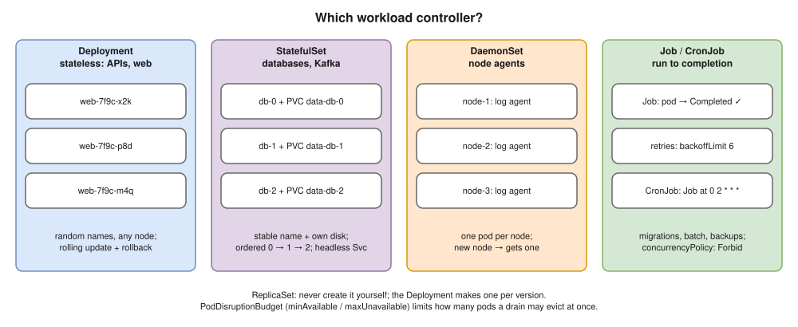
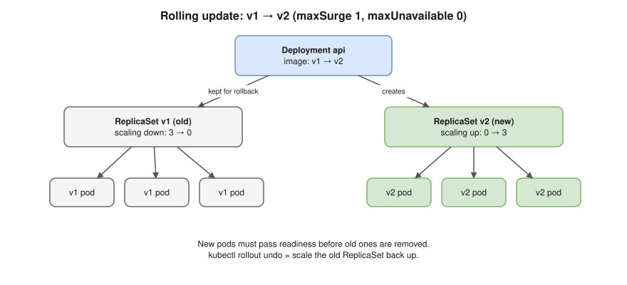

# 07 · Workloads: Deployments, StatefulSets, DaemonSets, Jobs ⭐



## Rolling updates ⭐



| Setting | Meaning |
|---|---|
| `maxSurge` (25%) | Extra pods allowed during the update |
| `maxUnavailable` (25%) | Pods allowed to be missing |
| **Zero downtime** | `maxUnavailable: 0`, `maxSurge: 1` + readiness probes |
| `type: Recreate` | Kill all old pods first (downtime); when 2 versions can't coexist |
| `revisionHistoryLimit` (10) | Old ReplicaSets kept for `rollout undo` |
| `minReadySeconds` | Must stay Ready this long to count as available |
| `progressDeadlineSeconds` (600) | Then marked failed; **no** automatic rollback |

```yaml
apiVersion: apps/v1
kind: Deployment
metadata:
  name: api
spec:
  replicas: 3
  revisionHistoryLimit: 10
  strategy:
    type: RollingUpdate
    rollingUpdate:
      maxSurge: 1
      maxUnavailable: 0
  selector:
    matchLabels:
      app: api
  template:
    metadata:
      labels:
        app: api
    spec:
      containers:
      - name: api
        image: myapi:1.4.2
        ports:
        - containerPort: 8080
        resources:
          requests:
            cpu: 250m
            memory: 256Mi
          limits:
            memory: 256Mi
        readinessProbe:
          httpGet:
            path: /readyz
            port: 8080
```

## StatefulSets

- Pods `db-0`, `db-1`… keep their name **and their own PVC** (`volumeClaimTemplates`) when rescheduled.
- Need a **headless Service** → `db-0.db.default.svc.cluster.local` ([08](08-services-and-dns.md)).
- Created 0 → 1 → 2, deleted in reverse (`Parallel` skips ordering). Updates go highest → lowest; `partition` = canary.
- **PVCs are kept** after delete or scale-down ([11](11-storage.md)).

## DaemonSets, Jobs, CronJobs

- DaemonSet: one pod per (matching) node; add a toleration to include control-plane nodes ([13](13-scheduling.md)).

| Job / CronJob field | Meaning |
|---|---|
| `completions` / `parallelism` | Successes needed / pods at once |
| `backoffLimit` (6) | Retries before failed |
| `activeDeadlineSeconds` | Time limit for the whole Job |
| `ttlSecondsAfterFinished` | Auto-delete when done |
| `schedule` | Cron, e.g. `"0 2 * * *"`; `timeZone` sets the zone |
| `concurrencyPolicy` | `Allow` / `Forbid` (skip if still running) / `Replace` |

## PodDisruptionBudget

- Limits **voluntary** disruptions (drain, upgrades, Karpenter consolidation): `minAvailable: 2` or `maxUnavailable: 1`.
- Does **not** help with a node crash.

```yaml
apiVersion: policy/v1
kind: PodDisruptionBudget
metadata:
  name: api-pdb
spec:
  minAvailable: 2
  selector:
    matchLabels:
      app: api
```

> **Docker link:** `--restart always` works on one host; a Deployment keeps the **count** right across the cluster ([Docker 11](../docker/11-production.md)).

## Interview angle

| Question | Answer |
|---|---|
| ⭐ Deployment vs StatefulSet? | Interchangeable pods vs stable name, own disk, ordering. |
| ⭐ Rolling update and rollback? | New ReplicaSet up, old down (`maxSurge` / `maxUnavailable`); `rollout undo`. |
| ⭐ Zero-downtime deploys? | Replicas, readiness, `maxUnavailable: 0`, `preStop` + SIGTERM ([05](05-pods.md)), PDB. |
| DaemonSet when? | Node agents: logs, metrics, networking. |
| PDB does what? | Caps how many pods a drain or upgrade can take down. |

## Practice 🖥️

```bash
kubectl create deployment web --image=nginx:1.26 --replicas=3
kubectl set image deployment/web nginx=nginx:1.27
kubectl rollout status deployment/web
kubectl rollout history deployment/web
kubectl get rs
kubectl rollout undo deployment/web
kubectl create job hello --image=busybox:1.36 -- echo hello
kubectl create cronjob tick --image=busybox:1.36 --schedule="*/1 * * * *" -- date
```
