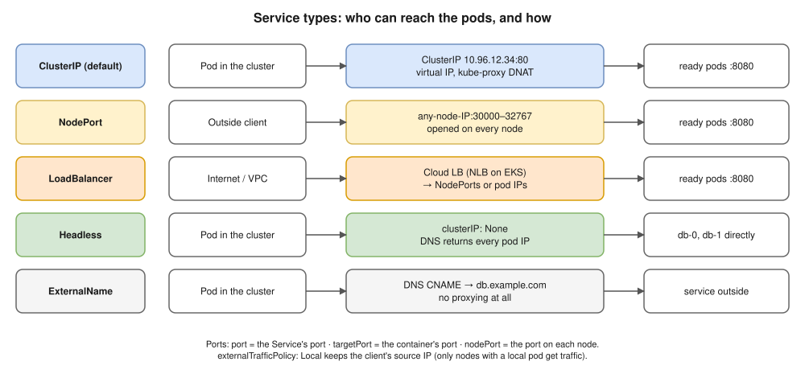
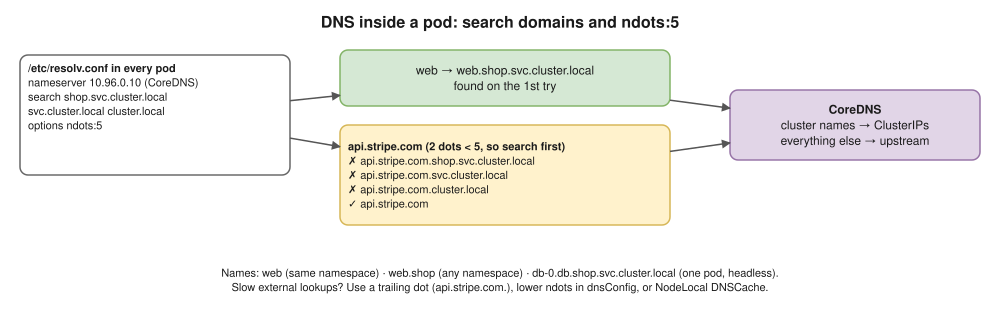

# 08 · Services and DNS ⭐

## Why Services exist

Pods come and go, and **every new pod gets a new IP**. A Service gives you:
- a **stable virtual IP** (the ClusterIP);
- a **stable DNS name**;
- **load balancing** across all the **ready** pods matching its **label selector**.


## Service types



| Type | Reachable from | How | Use |
|---|---|---|---|
| **ClusterIP** (default) | Inside the cluster only | A virtual IP | Service-to-service traffic |
| **NodePort** | Outside, via `<any-node-IP>:<30000–32767>` | Opens the port on **every** node | Testing; or behind your own load balancer |
| **LoadBalancer** | The internet or your VPC | The cloud creates a load balancer → NodePorts or pod IPs. On EKS, the AWS Load Balancer Controller makes an **NLB** ([20](20-eks.md)). | Exposing one service |
| **ExternalName** | Inside the cluster | A DNS **CNAME** to an outside name, no proxying | Giving an external database a cluster name |
| **Headless** (`clusterIP: None`) | Inside the cluster | **No virtual IP**; DNS returns **each pod's IP** | StatefulSets, client-side load balancing |

**The three ports:** `port` = the Service's port · `targetPort` = the container's port · `nodePort` = the port opened on each node.

## How a ClusterIP actually works ⭐ (deep fundamentals)

1. You create a Service with `selector: app=web`.
2. The **EndpointSlice controller** keeps a list of the **IPs of ready pods** with `app=web`.
3. **kube-proxy on every node** watches Services and EndpointSlices, and writes **iptables / nftables rules**: "traffic to `10.96.12.34:80` → rewrite (DNAT) to one of the pod IPs, port 8080".
4. A client pod connects to the ClusterIP. The **kernel on the client's own node** rewrites the destination and sends the packet straight to a pod.

⚠️ So the **ClusterIP isn't a real machine or process**. Nothing "listens" on it, and in the default iptables/nftables mode you **can't ping it**: rules exist only for the Service's TCP/UDP ports. (In the older IPVS mode, the IP sits on a dummy interface on each node, so ping can answer.) Cilium can replace kube-proxy and do the same job with eBPF.

## Useful Service settings

- `sessionAffinity: ClientIP`: send the same client to the same pod.
- `externalTrafficPolicy: Local` (NodePort and LoadBalancer): only nodes that have a local pod receive traffic, so the **client's source IP is kept** and there's no extra hop. `Cluster` (the default) spreads traffic more evenly but rewrites the source IP.
- **A Service without a selector**, plus your own EndpointSlice, can point at IPs outside the cluster.

```yaml
apiVersion: v1
kind: Service
metadata:
  name: web
spec:
  type: ClusterIP
  selector:
    app: web
  ports:
  - name: http
    port: 80
    targetPort: 8080
```

## DNS (CoreDNS) ⭐



| Name | Resolves to |
|---|---|
| `web` | Works only from the **same namespace**, thanks to the search domains |
| `web.shop` | Works from any namespace |
| `web.shop.svc.cluster.local` | The full name (FQDN) |
| `db-0.db.shop.svc.cluster.local` | One StatefulSet pod, through a **headless** Service |
| `_http._tcp.web.shop.svc.cluster.local` | An SRV record for a named port |

- A pod's `/etc/resolv.conf` points at the **CoreDNS Service IP**, with `search <ns>.svc.cluster.local svc.cluster.local cluster.local` and **`ndots:5`**.
- ⚠️ With `ndots:5`, an outside name like `api.stripe.com` first tries every search domain, which means several wasted lookups. Use a **trailing dot** (`api.stripe.com.`), lower `ndots` in `dnsConfig`, or run NodeLocal DNSCache. (Model answers Q3 and Q6 cover the details.)

> **Docker link:** in Docker, containers on a user-defined network find each other by **name** through Docker's DNS at `127.0.0.11` ([Docker 08](../docker/08-networking.md)). In Kubernetes, **Services and CoreDNS** do this across the whole cluster.

## Interview angle

- ⭐ "ClusterIP vs NodePort vs LoadBalancer vs headless?" → use the table above.
- ⭐ "How does a ClusterIP work if nothing listens on it?" → kube-proxy programs DNAT rules on every node; the client node's kernel rewrites the packet to a ready pod's IP.
- ⭐ "A Service has no endpoints. Why?" → the selector doesn't match the pod labels, the pods aren't Ready (readiness probe), or they're in a different namespace.
- "What's a headless Service for?" → giving each pod its own DNS record (StatefulSets) instead of one virtual IP.
- "How do you keep the client's real IP?" → `externalTrafficPolicy: Local`, or proxy-protocol / `X-Forwarded-For` headers at the load balancer.

## Practice 🖥️

```bash
kubectl create deployment web --image=nginx:1.27 --replicas=3
kubectl expose deployment web --port=80 --target-port=80
kubectl get svc web
kubectl get endpointslices -l kubernetes.io/service-name=web
kubectl run tmp --rm -it --image=busybox:1.36 --restart=Never -- sh
```

Inside the busybox shell, run `nslookup web`, `wget -qO- web` and `cat /etc/resolv.conf`.
