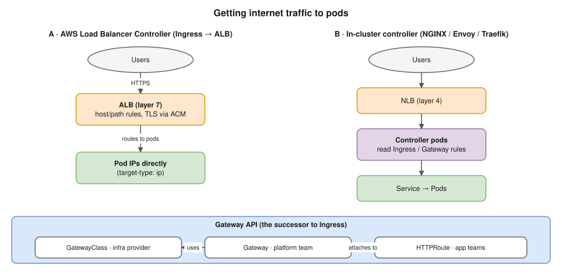
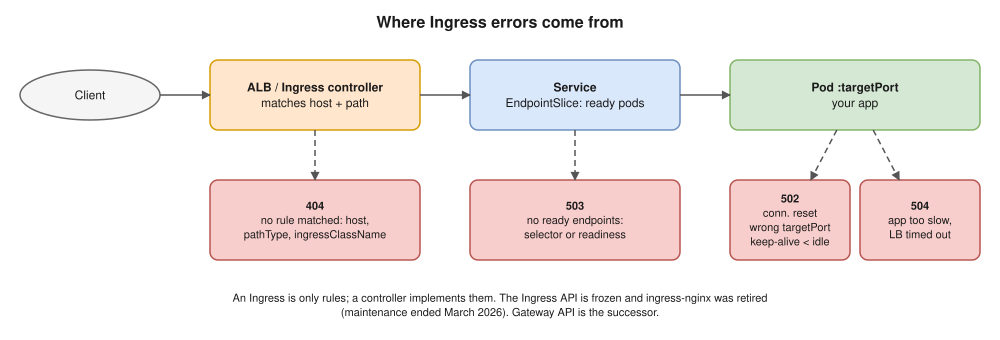

# 09 · Ingress and Gateway API

- One `LoadBalancer` Service per app = one cloud LB each: expensive, and only layer 4.
- You want **one entry point** with **layer 7** routing (host, path) and **TLS**.
- An **Ingress** is only rules. An **Ingress controller** implements them; without one, nothing happens.



| | AWS Load Balancer Controller | In-cluster controller (NGINX, Traefik, Envoy) |
|---|---|---|
| Ingress becomes | A real **ALB** | Config inside controller pods |
| Path | ALB → **pod IPs** (`target-type: ip`) or NodePort (`instance`) | NLB → controller pods → Service's pods |
| TLS | **ACM** on the ALB | cert-manager + Let's Encrypt, or a Secret |
| LBs | One ALB per Ingress, or shared via `group.name` | One NLB |

| Ingress field | Meaning |
|---|---|
| `ingressClassName` | Which controller (`alb`, `nginx`) |
| `rules[].host` | Hostname |
| `paths[].pathType` | `Prefix` (`/api` matches `/api/x`), `Exact`, `ImplementationSpecific` |
| `backend.service` | Service and port |
| `tls` | Hosts and certificate |

```yaml
apiVersion: networking.k8s.io/v1
kind: Ingress
metadata:
  name: shop
  annotations:
    alb.ingress.kubernetes.io/scheme: internet-facing
    alb.ingress.kubernetes.io/target-type: ip
spec:
  ingressClassName: alb
  tls:
  - hosts:
    - shop.example.com
  rules:
  - host: shop.example.com
    http:
      paths:
      - path: /api
        pathType: Prefix
        backend:
          service:
            name: api
            port:
              number: 80
      - path: /
        pathType: Prefix
        backend:
          service:
            name: web
            port:
              number: 80
```

## ⚠️ Status in 2026 (say this)

- Ingress API: stable but **feature-frozen**.
- **ingress-nginx retired:** announced Nov 2025, maintenance ended **March 2026**. Teams migrate with `ingress2gateway`.
- **Gateway API** (v1.0, Oct 2023) is the successor.

## Gateway API

| Resource | Owner | Purpose |
|---|---|---|
| **GatewayClass** | Infra provider | Which implementation |
| **Gateway** | Platform team | Listeners: ports, hostnames, TLS |
| **HTTPRoute** / GRPCRoute / TCPRoute | App teams | Rules → Services |

- Adds header/query matching, **weighted splits** (canary), mirroring, cross-namespace routes (`ReferenceGrant`). Installed as CRDs ([19](19-extending-kubernetes.md)).

```yaml
apiVersion: gateway.networking.k8s.io/v1
kind: HTTPRoute
metadata:
  name: shop-api
spec:
  parentRefs:
  - name: public-gateway
  hostnames:
  - shop.example.com
  rules:
  - matches:
    - path:
        type: PathPrefix
        value: /api
    backendRefs:
    - name: api-v1
      port: 80
      weight: 90
    - name: api-v2          # canary: 10% of traffic
      port: 80
      weight: 10
```

## 5xx at the Ingress (model answers Q28–Q29)



## Interview angle

| Question | Answer |
|---|---|
| ⭐ Ingress vs LoadBalancer Service? | L7 routing for many services behind one entry vs one L4 LB per service. |
| ⭐ Ingress controller? | The thing that implements the rules; without it an Ingress does nothing. |
| ⭐ Ingress vs Gateway API? | Gateway API is the role-based successor (splits, header matching); Ingress is frozen. |
| Traffic path with the AWS LB Controller? | ALB → pod IP directly (IP mode), via VPC CNI pod IPs ([20](20-eks.md)). |
| `/api` works, `/api/v2` is 404? | `pathType` (Exact vs Prefix), rewrite annotations, rule order. |

## Practice 🖥️ (read-only)

```bash
kubectl get ingressclass
kubectl get ingress -A
kubectl describe ingress shop
kubectl get endpointslices -l kubernetes.io/service-name=api
curl -v -H "Host: shop.example.com" http://<load-balancer-address>/api
```
