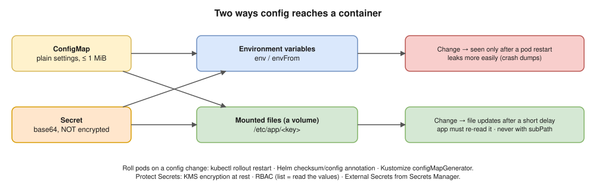
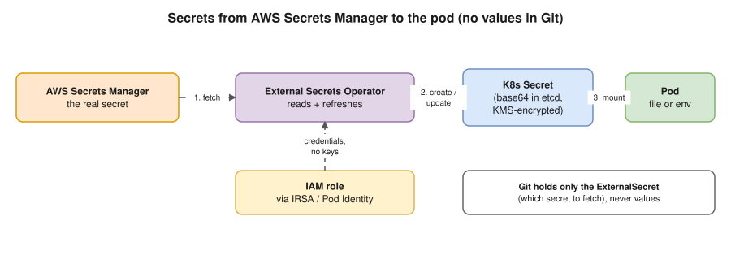

# 10 · ConfigMaps and Secrets

Keep config **out of the image**: one image runs in dev, QA and prod ("build once, promote everywhere", model answer Q38).



- **ConfigMap:** non-sensitive keys or files, max **1 MiB**. `immutable: true` blocks edits and cuts API load.
- **Secret** types: `Opaque` · `kubernetes.io/tls` · `kubernetes.io/dockerconfigjson` (for `imagePullSecrets`) · `basic-auth` · `ssh-auth`.
- ⚠️ **Secrets are base64-encoded, not encrypted**, and stored in etcd unencrypted unless **encryption at rest** (KMS) is on. The Instagram handbook gets this wrong.

```yaml
apiVersion: v1
kind: ConfigMap
metadata:
  name: app-config
data:
  LOG_LEVEL: info
  FEATURE_X: "true"
---
apiVersion: v1
kind: Secret
metadata:
  name: db-credentials
type: Opaque
stringData:                  # plain text here; the API server stores it base64-encoded
  DB_PASSWORD: change-me
---
apiVersion: v1
kind: Pod
metadata:
  name: app
spec:
  containers:
  - name: app
    image: busybox:1.36
    command: ["sh", "-c", "env; ls /etc/app; sleep 3600"]
    envFrom:
    - configMapRef:
        name: app-config            # every key becomes an env var
    env:
    - name: DB_PASSWORD
      valueFrom:
        secretKeyRef:
          name: db-credentials
          key: DB_PASSWORD
    volumeMounts:
    - name: config
      mountPath: /etc/app            # every key becomes a file
      readOnly: true
  volumes:
  - name: config
    configMap:
      name: app-config
```

## Secrets in production ⭐ 🔥



1. **No Secret YAML in Git**: base64 isn't protection.
2. Store in **Secrets Manager / SSM / Vault**, sync with **External Secrets Operator** (IRSA or Pod Identity, no keys) or mount with the **Secrets Store CSI Driver**. GitOps without a manager: **Sealed Secrets** or **SOPS**.
3. **KMS encryption at rest** for etcd (on EKS, envelope encryption).
4. **RBAC:** `get` *or* `list` on secrets reads the values. Grant rarely ([15](15-security.md)).
5. **Rotate**; prefer short-lived IAM credentials over static keys.

> **Docker link:** `-e`, `--env-file` and secret files from [Docker 10](../docker/10-security.md), managed for the whole cluster.

## Interview angle

| Question | Answer |
|---|---|
| ⭐ ConfigMap vs Secret? | Non-sensitive vs sensitive; Secrets are **only base64**. |
| ⭐ Are Secrets secure? | Not by default: KMS at rest, RBAC on get/list, External Secrets + Secrets Manager. |
| Changed a ConfigMap, app didn't change? | Env needs a restart; files update but the app must reload; `subPath` never updates. |
| Pull from a private registry? | `imagePullSecrets` with a `dockerconfigjson` Secret; on EKS the node's IAM role pulls from ECR. |

## Practice 🖥️

```bash
kubectl apply -f practice/config.yaml
kubectl logs config-demo                       # env vars + files from the ConfigMap
kubectl get secret db-credentials -o jsonpath='{.data.DB_PASSWORD}' | base64 -d   # base64 isn't security
kubectl create secret generic demo --from-literal=k=v --dry-run=client -o yaml
```
