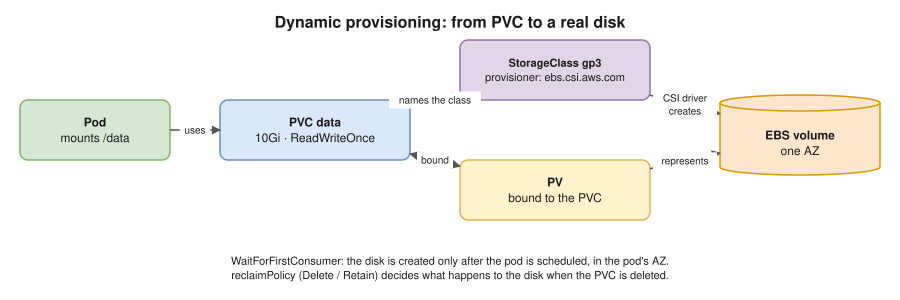

# 11 · Storage

A container's filesystem disappears when the container is recreated. **Volumes** give pods storage that lasts longer than one container, or longer than the pod itself.

## Volume types

| Type | Lives as long as | Use |
|---|---|---|
| `emptyDir` | **The pod** (survives container restarts) | Scratch space; sharing files between containers in a pod. `medium: Memory` = tmpfs (RAM). |
| `configMap` / `secret` / `projected` / `downwardAPI` | The pod | Config and credentials as files ([10](10-configmaps-and-secrets.md)) |
| `hostPath` | The node | ⚠️ Avoid: it ties the pod to one node and is a security risk. For system agents only. |
| `persistentVolumeClaim` | **Independent of the pod** | Databases and anything that must persist |
| Generic ephemeral volume | The pod (a PVC that's created and deleted with it) | Large scratch space backed by real disks |

## PV, PVC and StorageClass ⭐



| Object | Scope | What it is | Analogy |
|---|---|---|---|
| **PersistentVolume (PV)** | Cluster | A real piece of storage (an EBS volume, an NFS share) | A specific apartment |
| **PersistentVolumeClaim (PVC)** | Namespace | A **request** for storage: size + access mode + class | A rental application |
| **StorageClass** | Cluster | **How** to create storage on demand: provisioner and parameters | The housing agency's options |

- **Dynamic provisioning** (the normal way): create a PVC → the StorageClass's **CSI driver** creates a disk → a PV is made and **bound** to the PVC.
- **Static provisioning:** an admin creates PVs first, and PVCs bind to a matching one.
- **PVC status:** `Pending` (waiting for a match or the first pod) → `Bound`.
- **`reclaimPolicy`** (what happens to the disk when the PVC is deleted): `Delete` (the default for dynamic) or `Retain` (keep the disk and data, and clean up by hand).
- **`volumeBindingMode: WaitForFirstConsumer`:** create the disk only **after** the pod is scheduled, **in that pod's availability zone**. Essential for EBS, which lives in one AZ.
- **`allowVolumeExpansion: true`:** you can grow a PVC by editing its size.

## Access modes

| Mode | Meaning | Example |
|---|---|---|
| `ReadWriteOnce` (RWO) | Read-write by **one node** | **EBS** |
| `ReadOnlyMany` (ROX) | Read-only by many nodes | Shared reference data |
| `ReadWriteMany` (RWX) | Read-write by **many nodes** | **EFS**, NFS |
| `ReadWriteOncePod` (RWOP) | Read-write by **one pod** only | Strict single-writer databases |

```yaml
apiVersion: storage.k8s.io/v1
kind: StorageClass
metadata:
  name: gp3
provisioner: ebs.csi.aws.com
parameters:
  type: gp3
reclaimPolicy: Delete
volumeBindingMode: WaitForFirstConsumer
allowVolumeExpansion: true
---
apiVersion: v1
kind: PersistentVolumeClaim
metadata:
  name: data
spec:
  accessModes: ["ReadWriteOnce"]
  storageClassName: gp3
  resources:
    requests:
      storage: 10Gi
```

## CSI, snapshots and StatefulSets

- **CSI (Container Storage Interface):** storage drivers as plugins. On AWS: the **EBS CSI** and **EFS CSI** drivers (EKS add-ons, [20](20-eks.md)).
- **VolumeSnapshots:** point-in-time copies through CSI, for backups and cloning.
- **StatefulSet `volumeClaimTemplates`:** each pod gets **its own PVC** (`data-db-0`, `data-db-1`). The PVCs **stay** after scale-down or deletion unless you change the retention policy.

## Classic problems

- **Pod `Pending`: "volume node affinity conflict".** The EBS disk is in AZ-a, but the pod was scheduled in AZ-b. Fix: `WaitForFirstConsumer`, and spread nodes across AZs.
- **PVC stuck `Pending`.** No default StorageClass, the CSI driver isn't installed or lacks IAM permissions, or the access mode isn't supported (RWX on EBS).
- **Can't delete a PVC** (stuck `Terminating`). It's still mounted by a pod: the `pvc-protection` finalizer ([03](03-objects-and-api.md)).

> **Docker link:** Docker volume ≈ **PVC**, bind mount ≈ **hostPath**, tmpfs ≈ **emptyDir with `medium: Memory`** ([Docker 07](../docker/07-storage.md)).

## Interview angle

- ⭐ "PV vs PVC vs StorageClass?" → actual storage vs a request vs a recipe for creating storage on demand.
- ⭐ "Why can't two pods on different nodes write to the same EBS volume?" → EBS is ReadWriteOnce and tied to one AZ. Use EFS (RWX) or redesign.
- "What happens to the data when the pod is deleted? When the PVC is deleted?" → nothing happens to it when the pod goes; when the PVC goes, it depends on `reclaimPolicy` (Delete or Retain).
- "How does a StatefulSet handle storage?" → `volumeClaimTemplates`, one PVC per pod, which follows the pod when it's rescheduled.

## Practice 🖥️ (kind includes a default StorageClass called `standard`)

```bash
kubectl get storageclass
kubectl apply -f practice/pvc-and-pod.yaml
kubectl get pvc,pv
kubectl exec storage-demo -- sh -c 'echo hello > /data/test.txt'
kubectl delete pod storage-demo
kubectl apply -f practice/pvc-and-pod.yaml
kubectl exec storage-demo -- cat /data/test.txt
```

The file survives because it's on the PVC, not in the container.
