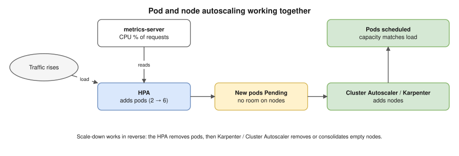

# 12 · Resources, QoS and Autoscaling ⭐

## Requests vs limits

| | **Request** | **Limit** |
|---|---|---|
| Used by | The **scheduler**: a node must have this much **unrequested** capacity | The **kernel (cgroups)** on the node |
| CPU | A guaranteed share of CPU time | A cap: going over gets the container **throttled** (slowed), never killed |
| Memory | Considered when the node runs low (eviction) | A cap: going over gets it **OOMKilled** (exit code 137) |

- **Units:**
  - CPU in cores or millicores: `250m` = a quarter of a core.
  - Memory in `Mi` / `Gi`. `M` and `Mi` are different units.
- ⭐ **The scheduler looks at requests, not real usage.** A node can look idle in `kubectl top` and still reject pods with `Insufficient cpu`, because its requests are already fully booked.
- **Common practice:**
  - always set requests;
  - set the memory limit equal to the memory request;
  - many teams **don't set CPU limits** for latency-sensitive apps, because throttling hurts response times.

  Know this debate.
- **In-place resize** (stable in **1.35**): CPU and memory can be changed on a running pod without recreating it.

## QoS classes (set automatically from requests and limits)

| Class | Rule | Under memory pressure on the node |
|---|---|---|
| **Guaranteed** | Every container has requests **equal to** limits, for both CPU and memory | Evicted **last** |
| **Burstable** | At least one request or limit is set, but it isn't Guaranteed | In the middle |
| **BestEffort** | No requests or limits at all | Evicted **first** |

## Limits per namespace

- **LimitRange:** default requests and limits, plus min and max, **per container** in a namespace. It catches pods that set nothing.
- **ResourceQuota:** a **total** cap for the whole namespace (`requests.cpu`, `limits.memory`, number of `pods`, number of PVCs…). Once a quota covers CPU or memory, every new pod **must** set those values.

```yaml
resources:
  requests:
    cpu: 250m
    memory: 256Mi
  limits:
    memory: 256Mi        # no CPU limit, to avoid throttling
---
apiVersion: v1
kind: ResourceQuota
metadata:
  name: team-a-quota
  namespace: team-a
spec:
  hard:
    requests.cpu: "8"
    requests.memory: 16Gi
    pods: "50"
```

## Autoscaling ⭐



| Autoscaler | Scales | Based on | Notes |
|---|---|---|---|
| **HPA** (Horizontal Pod Autoscaler) | The **number of pods** | CPU or memory **as a % of requests**, or custom/external metrics | Needs **metrics-server** and **requests set**. `autoscaling/v2`. |
| **VPA** (Vertical Pod Autoscaler) | **Requests** of each pod | Past usage | Recommends or applies new values. Don't combine it with an HPA on the same CPU metric. |
| **KEDA** | Pods, **including down to zero** | Events: queue length, Kafka lag, cron | Event-driven workloads |
| **Cluster Autoscaler** | **Nodes** (through ASGs / node groups) | Pods stuck `Pending` | Works with fixed node groups |
| **Karpenter** (AWS) | **Nodes**, created directly | Pending pods; picks the cheapest instance that fits; **consolidates** | Faster and more flexible; Spot-friendly ([20](20-eks.md)) |

**HPA formula:** `desiredReplicas = ceil(currentReplicas × currentValue / targetValue)`. For example, 4 pods at 90% CPU with a 60% target → ceil(4 × 90/60) = **6 pods**.

**The chain:** traffic rises → HPA adds pods → some are `Pending` (no room) → Cluster Autoscaler or Karpenter adds nodes → the pods get scheduled.

```yaml
apiVersion: autoscaling/v2
kind: HorizontalPodAutoscaler
metadata:
  name: api
spec:
  scaleTargetRef:
    apiVersion: apps/v1
    kind: Deployment
    name: api
  minReplicas: 2
  maxReplicas: 10
  metrics:
  - type: Resource
    resource:
      name: cpu
      target:
        type: Utilization
        averageUtilization: 60
```

> **Docker link:** `--memory` and `--cpus` set the same cgroup limits ([Docker 11](../docker/11-production.md)), and OOMKilled is the same exit code 137.

## Interview angle

- ⭐ "Requests vs limits?" → the scheduler's reservation vs the kernel's cap. CPU over its limit is throttled; memory over its limit is OOMKilled.
- ⭐ "Pods are Pending with `Insufficient cpu`, but the nodes look idle. Why?" → scheduling uses **requests**, not usage. Lower inflated requests, or add nodes.
- ⭐ "The HPA isn't scaling. Why?" → no metrics-server, no CPU requests on the pods (the percentage can't be calculated), already at `maxReplicas`, or the metric hasn't reached the target.
- "HPA vs VPA vs Cluster Autoscaler vs Karpenter?" → pods out vs pods bigger vs node groups vs on-demand right-sized nodes.
- "What are QoS classes for?" → the order of eviction under node pressure.

## Practice 🖥️

```bash
kubectl top nodes
kubectl top pods -A
kubectl autoscale deployment web --min=2 --max=10 --cpu=60%
kubectl get hpa -w
kubectl describe hpa web
kubectl get pod <pod> -o jsonpath='{.status.qosClass}'
```

`kubectl top` and the HPA need **metrics-server**. On kind, install it, then add `--kubelet-insecure-tls` to its arguments. Older kubectl versions used `--cpu-percent=60` instead of `--cpu=60%`.
