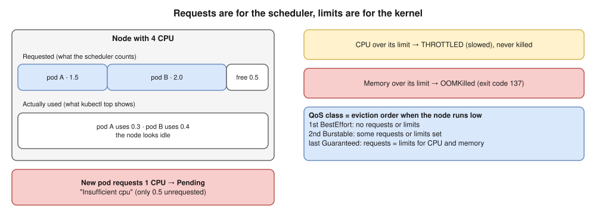

# 12 · Resources, QoS and Autoscaling ⭐



- ⭐ **The scheduler counts requests, not usage.** An idle-looking node can still reject pods with `Insufficient cpu`.
- Units: `250m` = ¼ core; memory in `Mi` / `Gi` (`M` ≠ `Mi`).
- Common practice: always set requests; memory limit = memory request; many teams **skip CPU limits** for latency-sensitive apps (throttling hurts). Know this debate.
- **In-place resize** (stable 1.35): change CPU / memory on a running pod.

## Per-namespace limits

- **LimitRange:** default + min/max **per container**; catches pods that set nothing.
- **ResourceQuota:** **total** cap per namespace (`requests.cpu`, `pods`, PVCs…). Once it covers CPU or memory, every pod must set them.

```yaml
resources:
  requests:
    cpu: 250m
    memory: 256Mi
  limits:
    memory: 256Mi        # no CPU limit, to avoid throttling
---
apiVersion: v1
kind: ResourceQuota
metadata:
  name: team-a-quota
  namespace: team-a
spec:
  hard:
    requests.cpu: "8"
    requests.memory: 16Gi
    pods: "50"
```

## Autoscaling ⭐


| Autoscaler | Scales | Based on | Note |
|---|---|---|---|
| **HPA** | Number of pods | CPU / memory **% of requests**, custom metrics | Needs metrics-server **and** requests |
| **VPA** | Requests per pod | Past usage | Don't mix with an HPA on the same CPU metric |
| **KEDA** | Pods, **down to zero** | Queue length, Kafka lag, cron | Event-driven |
| **Cluster Autoscaler** | Nodes (node groups) | Pending pods | Fixed node groups |
| **Karpenter** | Nodes, created directly | Pending pods; cheapest fit; **consolidates** | Faster, Spot-friendly ([20](20-eks.md)) |

- **HPA formula:** `ceil(current × currentValue / target)`: 4 pods at 90% with a 60% target → **6 pods**.

```yaml
apiVersion: autoscaling/v2
kind: HorizontalPodAutoscaler
metadata:
  name: api
spec:
  scaleTargetRef:
    apiVersion: apps/v1
    kind: Deployment
    name: api
  minReplicas: 2
  maxReplicas: 10
  metrics:
  - type: Resource
    resource:
      name: cpu
      target:
        type: Utilization
        averageUtilization: 60
```

> **Docker link:** `--memory` / `--cpus` set the same cgroup limits ([Docker 11](../docker/11-production.md)); OOMKilled is 137 there too.

## Interview angle

| Question | Answer |
|---|---|
| ⭐ Requests vs limits? | Scheduler's reservation vs kernel cap. CPU over → throttled; memory over → OOMKilled. |
| ⭐ Pending with `Insufficient cpu`, nodes idle? | Scheduling uses requests, not usage. Lower requests or add nodes. |
| ⭐ HPA not scaling? | No metrics-server, no CPU requests, at `maxReplicas`, or target not reached. |
| HPA vs VPA vs CA vs Karpenter? | More pods vs bigger pods vs node groups vs right-sized nodes on demand. |
| QoS classes for? | Eviction order under node pressure. |

## Practice 🖥️

```bash
kubectl top nodes
kubectl top pods -A
kubectl autoscale deployment web --min=2 --max=10 --cpu=60%   # older kubectl: --cpu-percent=60
kubectl get hpa -w
kubectl describe hpa web
kubectl get pod <pod> -o jsonpath='{.status.qosClass}'
```

`top` and the HPA need **metrics-server** (on kind add `--kubelet-insecure-tls`).
