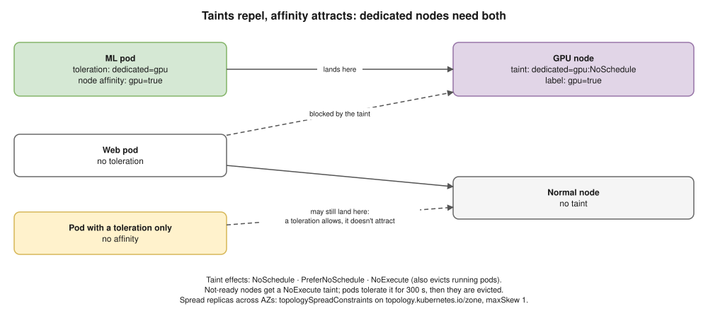

# 13 · Scheduling: Where Pods Run


## Attract: pick nodes

| Tool | Does |
|---|---|
| `nodeSelector` | Only nodes with these labels (`disktype: ssd`) |
| **Node affinity** | Rules (`In`, `NotIn`, `Exists`); **required** or **preferred** (weights) |
| **Pod affinity** | Near pods with label X (same node / zone) |
| **Pod anti-affinity** | Away from pods with label X (spread replicas) |
| **Topology spread** | Even spread across zones or nodes (`maxSkew`) |

- "…IgnoredDuringExecution" = checked only at scheduling; running pods aren't moved later.

## Repel: taints and tolerations



- Built-in taints: `node-role.kubernetes.io/control-plane:NoSchedule`, `node.kubernetes.io/not-ready:NoExecute`.
- ⭐ **Dedicated nodes** (GPU, a team) = taint the nodes **and** add affinity to the right pods.

```yaml
spec:
  tolerations:
  - key: dedicated
    operator: Equal
    value: gpu
    effect: NoSchedule
  affinity:
    nodeAffinity:
      requiredDuringSchedulingIgnoredDuringExecution:
        nodeSelectorTerms:
        - matchExpressions:
          - key: kubernetes.io/arch
            operator: In
            values: ["amd64"]
    podAntiAffinity:
      preferredDuringSchedulingIgnoredDuringExecution:
      - weight: 100
        podAffinityTerm:
          labelSelector:
            matchLabels:
              app: api
          topologyKey: kubernetes.io/hostname
  topologySpreadConstraints:
  - maxSkew: 1
    topologyKey: topology.kubernetes.io/zone
    whenUnsatisfiable: ScheduleAnyway
    labelSelector:
      matchLabels:
        app: api
```

## Priority and eviction

- **PriorityClass:** higher `value` scheduled first; may **preempt** lower pods. Built in: `system-cluster-critical`, `system-node-critical`.
- **Node-pressure eviction:** kubelet evicts BestEffort first, Guaranteed last ([12](12-resources-and-autoscaling.md)).
- **`kubectl drain`** evicts politely, **respecting PDBs** ([18](18-cluster-operations.md)). `cordon` = no new pods. Setting `spec.nodeName` by hand skips the scheduler.

## Why is it Pending?

| `describe` says | Fix |
|---|---|
| `Insufficient cpu` / `memory` | Lower requests, add nodes |
| `untolerated taint` | Add a toleration, or other nodes |
| `didn't match Pod's node affinity/selector` | Fix labels or affinity |
| `volume node affinity conflict` | Volume in another AZ → `WaitForFirstConsumer` ([11](11-storage.md)) |
| `unbound immediate PersistentVolumeClaims` | Fix the PVC or StorageClass |
| `didn't match pod anti-affinity rules` | Not enough nodes; use *preferred* |

## Interview angle

| Question | Answer |
|---|---|
| ⭐ Taints vs affinity? | Node repels vs pod attracts. Dedicated nodes need both. |
| ⭐ Spread replicas across AZs? | Topology spread on `topology.kubernetes.io/zone`, or anti-affinity. |
| ⭐ Why Pending? | `describe` events → table above. |
| Preemption? | Evicting lower-priority pods to fit higher-priority ones. |

## Practice 🖥️

```bash
kubectl get nodes --show-labels
kubectl label node kind-control-plane disktype=ssd
kubectl taint nodes kind-control-plane dedicated=gpu:NoSchedule
kubectl taint nodes kind-control-plane dedicated=gpu:NoSchedule-   # trailing - removes it
kubectl create priorityclass high --value=1000 --description="critical apps"
kubectl describe pod <pending-pod>
```
