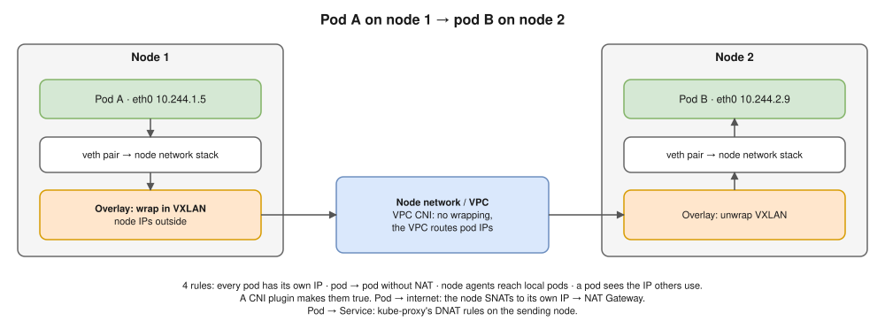
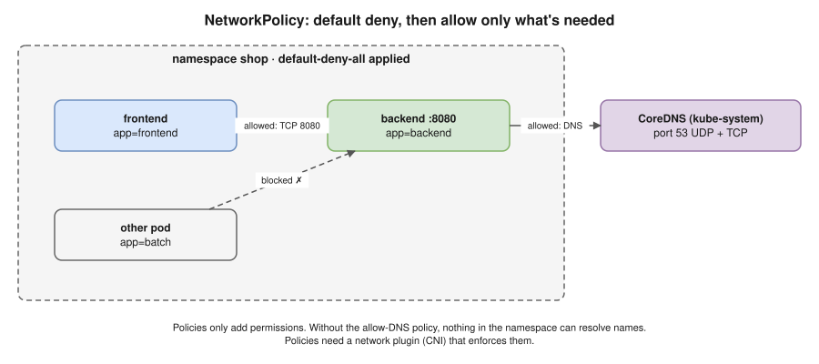

# 14 · Cluster Networking and NetworkPolicy ⭐



| CNI plugin | Pods on different nodes | Note |
|---|---|---|
| **AWS VPC CNI** (EKS) | Real **VPC IPs** from node ENIs; VPC routes them | No overlay; works with SGs, Flow Logs. ⚠️ Uses up subnet IPs ([20](20-eks.md)) |
| **Calico** | BGP or overlay (VXLAN / IP-in-IP) | Strong NetworkPolicy |
| **Cilium** | eBPF; overlay or native | Can **replace kube-proxy**; Hubble visibility |
| **Flannel** | Simple VXLAN | **No** NetworkPolicy |

## NetworkPolicy: the pod firewall ⭐



- **Default: all allowed.** Once a policy selects a pod for a direction, only permitted traffic gets through. Policies only **add**; no deny rules.
- Selectors: `podSelector`, `namespaceSelector`, `ipBlock`, ports.
- ⚠️ **AND vs OR:** `namespaceSelector` + `podSelector` in **one** `from` item = AND; in **separate** items = OR.
- ⚠️ Only enforced if the CNI supports it (Calico, Cilium, VPC CNI with policy on). Otherwise **silently ignored**.

```yaml
# 1. Default deny: no traffic in or out of any pod in the namespace
apiVersion: networking.k8s.io/v1
kind: NetworkPolicy
metadata:
  name: default-deny-all
  namespace: shop
spec:
  podSelector: {}
  policyTypes: ["Ingress", "Egress"]
---
# 2. ⚠️ Allow DNS, or after a default deny NOTHING can resolve names
apiVersion: networking.k8s.io/v1
kind: NetworkPolicy
metadata:
  name: allow-dns
  namespace: shop
spec:
  podSelector: {}
  policyTypes: ["Egress"]
  egress:
  - to:
    - namespaceSelector:
        matchLabels:
          kubernetes.io/metadata.name: kube-system
      podSelector:
        matchLabels:
          k8s-app: kube-dns
    ports:
    - protocol: UDP
      port: 53
    - protocol: TCP
      port: 53
---
# 3. Allow frontend → backend on 8080 (frontend also needs a matching egress rule)
apiVersion: networking.k8s.io/v1
kind: NetworkPolicy
metadata:
  name: backend-allow-frontend
  namespace: shop
spec:
  podSelector:
    matchLabels:
      app: backend
  policyTypes: ["Ingress"]
  ingress:
  - from:
    - podSelector:
        matchLabels:
          app: frontend
    ports:
    - protocol: TCP
      port: 8080
```

> **Docker link:** `docker0`, veth pairs and iptables NAT ([Docker 08](../docker/08-networking.md)) are the one-host version. In Kubernetes every pod has its own IP, so no port mapping.

## Interview angle

| Question | Answer |
|---|---|
| ⭐ Networking model? | The 4 rules (diagram caption), implemented by a CNI plugin. |
| ⭐ Pod on node A → pod on node B? | veth → node → overlay or VPC routing → node B → veth. Name your CNI. |
| ⭐ Default deny, now nothing resolves? | Egress to CoreDNS on 53 UDP **and** TCP is blocked. Add allow-DNS. |
| Namespaces isolate traffic? | No. NetworkPolicy does. |
| Added a policy, nothing changed? | The CNI doesn't enforce policies. |

## Practice 🖥️

```bash
kubectl create namespace shop
kubectl -n shop create deployment backend --image=nginx:1.27
kubectl -n shop expose deployment backend --port=80
kubectl -n shop run client --rm -it --image=busybox:1.36 --restart=Never -- wget -qO- -T 3 backend
kubectl apply -f practice/networkpolicies.yaml
kubectl -n shop run client --rm -it --image=busybox:1.36 --restart=Never -- wget -qO- -T 3 backend   # now fails
```

Still works? kind's default CNI may not enforce policies; install Calico to test.
