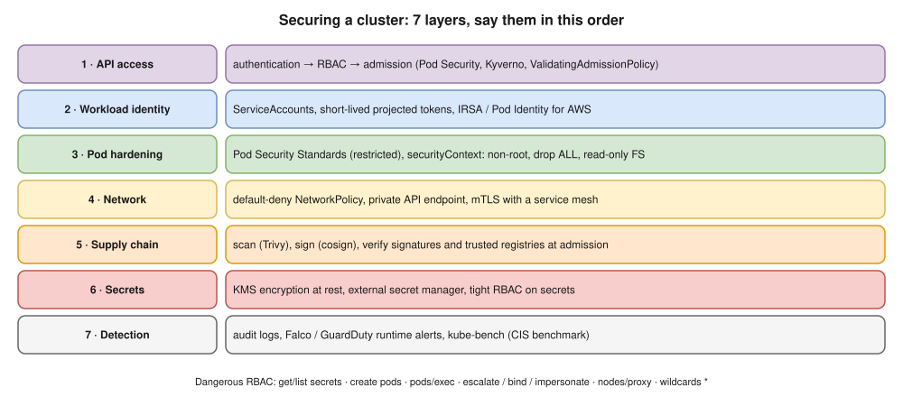
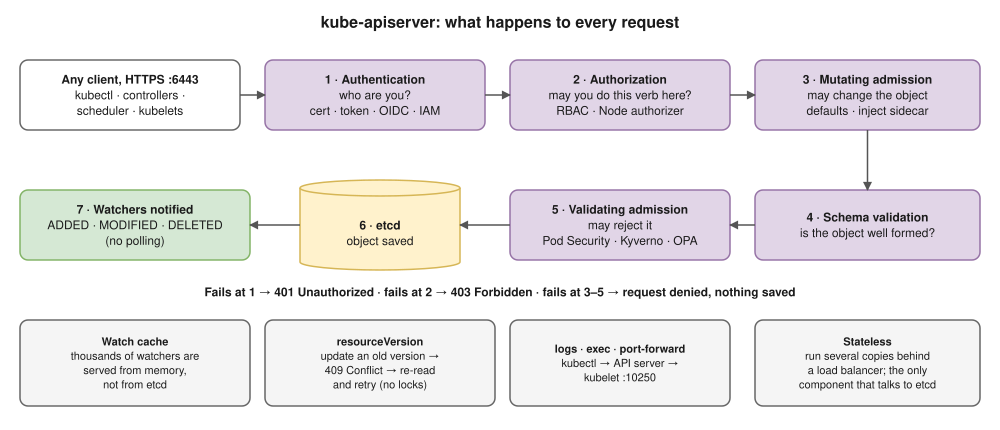
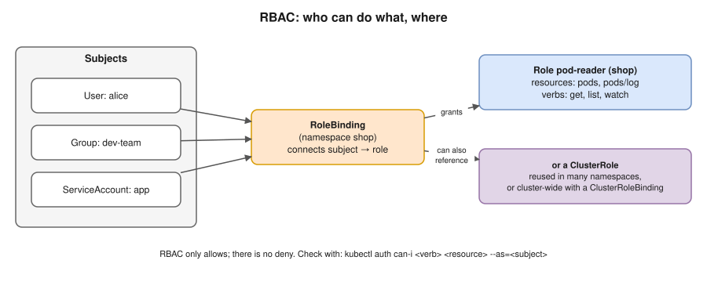

# 15 · Kubernetes Security ⭐🔥



Security comes in **layers**. Walk through them in this order in the interview:

| Layer | Controls |
|---|---|
| 1. **Access to the API** | Authentication → authorization (RBAC) → admission |
| 2. **Workload identity** | ServiceAccounts, short-lived tokens, IRSA / Pod Identity for AWS |
| 3. **Pod hardening** | Pod Security Standards, `securityContext` |
| 4. **Network** | NetworkPolicy default-deny ([14](14-cluster-networking.md)), private API endpoint, mTLS (service mesh) |
| 5. **Supply chain** | Trusted registries, image scanning, signing and verifying images at admission |
| 6. **Secrets** | Encryption at rest with KMS, external secret managers, careful RBAC ([10](10-configmaps-and-secrets.md)) |
| 7. **Detection** | Audit logs, runtime detection (Falco, GuardDuty), CIS benchmark (kube-bench) |

## 1. API access: every request passes 3 gates



1. **Authentication** (who?): X.509 client certificates, bearer tokens, OIDC (SSO). On **EKS**, an IAM user or role is mapped to Kubernetes through **access entries** (the older way is the `aws-auth` ConfigMap).
2. **Authorization** (allowed?): **RBAC**, plus the Node authorizer for kubelets.
3. **Admission** (acceptable?):
   - **mutating** admission (defaults, sidecar injection);
   - then **validating** admission: **Pod Security Admission**, ResourceQuota, **ValidatingAdmissionPolicy** (CEL rules inside the API server, stable since 1.30), or webhooks like **Kyverno** or **OPA Gatekeeper**.

## RBAC ⭐



| Object | Scope | Meaning |
|---|---|---|
| **Role** | One namespace | A set of rules: `apiGroups` + `resources` + `verbs` (get, list, watch, create, update, patch, delete) |
| **ClusterRole** | Whole cluster | The same, for cluster-wide resources (nodes) or for reuse |
| **RoleBinding** | One namespace | Grants a Role, **or a ClusterRole**, to subjects **in that namespace** |
| **ClusterRoleBinding** | Whole cluster | Grants a ClusterRole everywhere |

Subjects are **Users**, **Groups** and **ServiceAccounts**. RBAC only **allows**: there's no "deny" rule.

```yaml
apiVersion: v1
kind: ServiceAccount
metadata:
  name: app-reader
  namespace: shop
---
apiVersion: rbac.authorization.k8s.io/v1
kind: Role
metadata:
  name: pod-reader
  namespace: shop
rules:
- apiGroups: [""]
  resources: ["pods", "pods/log"]
  verbs: ["get", "list", "watch"]
---
apiVersion: rbac.authorization.k8s.io/v1
kind: RoleBinding
metadata:
  name: app-reader-pods
  namespace: shop
subjects:
- kind: ServiceAccount
  name: app-reader
  namespace: shop
roleRef:
  kind: Role
  name: pod-reader
  apiGroup: rbac.authorization.k8s.io
```

⚠️ **Dangerous permissions** (each one quietly gives someone far more power):
- `get` or `list` on **secrets** reads every secret value;
- **`create` pods** lets you run a pod as **any ServiceAccount** in the namespace;
- `pods/exec`;
- `escalate`, `bind` and `impersonate`;
- `nodes/proxy`;
- `*` wildcards.

## 2. ServiceAccounts

- The identity **pods** use to call the API server. Every namespace has a `default` ServiceAccount.
- Pods get a **projected token**: **short-lived, auto-refreshed, tied to one audience**. Since 1.24, long-lived token Secrets aren't created automatically.
- If the app never calls the API, set `automountServiceAccountToken: false`.
- **IRSA / Pod Identity** map a ServiceAccount to an **AWS IAM role**, so pods get AWS credentials with **no stored keys** ([20](20-eks.md)).

## 3. Pod Security Standards and securityContext ⭐

| Level | Allows |
|---|---|
| `privileged` | Everything (system components only) |
| `baseline` | Blocks known privilege escalations: no privileged containers, no hostNetwork/hostPID, no hostPath… |
| `restricted` | Baseline **plus**: must run as non-root, drop ALL capabilities, no privilege escalation, a seccomp profile |

- **Pod Security Admission** enforces these levels **per namespace**, using labels:
  ```bash
  kubectl label ns shop pod-security.kubernetes.io/enforce=restricted
  ```
  Modes: `enforce`, `audit`, `warn`.
- It replaced **PodSecurityPolicy**, which was **removed in 1.25**.

```yaml
spec:
  automountServiceAccountToken: false
  securityContext:
    runAsNonRoot: true
    runAsUser: 10001
    seccompProfile:
      type: RuntimeDefault
  containers:
  - name: app
    image: myapi:1.0
    securityContext:
      allowPrivilegeEscalation: false
      readOnlyRootFilesystem: true
      capabilities:
        drop: ["ALL"]
```

Avoid: `privileged: true`, `hostNetwork`, `hostPID`, `hostPath`, and running as root.

## 5. Supply chain (shift-left for Kubernetes, 🔥 model answer Q55)

- **In CI:**
  - scan images (Trivy);
  - scan manifests and Helm charts (Checkov, kube-linter, `trivy config`);
  - sign images (cosign).
- **At admission:**
  - allow only trusted registries;
  - **verify signatures** (Kyverno `verifyImages`);
  - block `:latest`, root containers and missing limits.

## 7. Detection and audit

- **API audit logs:** on EKS, turn on the `audit` control-plane logs (they go to CloudWatch).
- **Runtime detection:** Falco and GuardDuty EKS Runtime Monitoring alert on things like an unexpected shell in a container.
- **CIS Kubernetes Benchmark:** `kube-bench`.

> **Docker link:** `securityContext` is the Kubernetes version of `--user`, `--read-only`, `--cap-drop ALL` and `--security-opt no-new-privileges` ([Docker 10](../docker/10-security.md)).

## Interview angle

- ⭐🔥 "How do you secure a Kubernetes cluster?" → go through the 7 layers in order. Don't just list tools.
- ⭐ "Role vs ClusterRole? RoleBinding vs ClusterRoleBinding?" → namespace vs cluster scope. A RoleBinding can grant a ClusterRole inside one namespace.
- ⭐ "Which RBAC permissions are dangerous?" → secrets get/list, create pods, exec, escalate/bind/impersonate, wildcards.
- ⭐ "How does a pod get AWS access without keys?" → IRSA or EKS Pod Identity ([20](20-eks.md)).
- "What replaced PodSecurityPolicy?" → Pod Security Admission with the three Pod Security Standards; Kyverno or Gatekeeper for custom rules.
- 🔥 "Where do security checks go in the pipeline?" → scan and lint in CI, verify at admission, detect at runtime (model answers Q55–Q56).

## Practice 🖥️

```bash
kubectl auth can-i create deployments -n shop
kubectl auth can-i list secrets -n shop --as=system:serviceaccount:shop:app-reader
kubectl apply -f practice/rbac.yaml
kubectl auth can-i list pods -n shop --as=system:serviceaccount:shop:app-reader
kubectl label ns shop pod-security.kubernetes.io/enforce=restricted
kubectl -n shop run bad --image=nginx:1.27 --privileged
```

The last command is **rejected** by Pod Security Admission.
