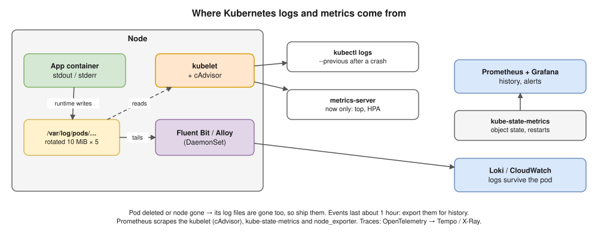

# 16 · Observability: Logs, Metrics, Events

The full stack design is in the model answers (Q45–Q49, [diagram](../diagrams/46-observability-stack.drawio.svg)). This file is the Kubernetes-specific part.



## Logs

- `kubectl logs <pod> --previous` = the **crashed** container's logs. The #1 CrashLoopBackOff command.
- **EKS control plane logs:** turn on `api`, `audit`, `authenticator`, `controllerManager`, `scheduler` (→ CloudWatch).

## Metrics

| Tool | Gives | Used for |
|---|---|---|
| **metrics-server** | Current CPU / memory, no history | `kubectl top`, **HPA** |
| **cAdvisor** (in the kubelet) | Container CPU, memory, network, disk | Prometheus |
| **kube-state-metrics** | Object state: replicas, phase, restarts | "fewer pods than wanted" alerts |
| **node_exporter** | Node OS | Disk full, load |
| **kube-prometheus-stack** | Collect, store, alert, dashboards | Long-term monitoring |

## Events

- `Scheduled`, `Pulling`, `Failed`, `BackOff`, `Unhealthy`, `FailedScheduling`, `OOMKilling`…
- Bottom of `kubectl describe`, or `kubectl get events --sort-by=.lastTimestamp`. Kept **~1 hour**.

## Alert on

- CrashLoopBackOff / rising restarts · Deployment replicas unavailable · pods Pending too long
- Nodes NotReady or under pressure · PVCs nearly full · API server errors / latency
- Certificates expiring · HPA stuck at `maxReplicas`

## Interview angle

| Question | Answer |
|---|---|
| ⭐ Where do pod logs go; why might `kubectl logs` be empty? | Node files read via the kubelet; pod deleted or node gone = lost unless shipped. |
| ⭐ metrics-server vs Prometheus? | Current CPU/memory for `top` and HPA vs full history, queries, alerts. |
| Why did a pod restart? | `describe` (last state, exit code, events), `logs --previous`, restart metric. |

## Practice 🖥️

```bash
kubectl logs deploy/web --tail=50 -f
kubectl logs <pod> -c <container> --previous
kubectl get events -A --sort-by=.lastTimestamp
kubectl top pods -A --sort-by=memory
```
