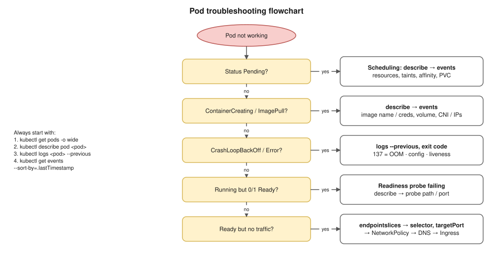

# 17 · Kubernetes Troubleshooting ⭐

## The method (say it in this order)

1. `kubectl get pods -o wide`: status, restarts, node, IP
2. `kubectl describe pod <pod>`: **Events** at the bottom, last state, exit code
3. `kubectl logs <pod> [-c <container>] --previous`: what the crashed container said
4. `kubectl get events --sort-by=.lastTimestamp`: what the cluster has been doing
5. `kubectl exec` / `kubectl debug`: look inside (env, files, DNS, connectivity)
6. Traffic: `kubectl get svc,endpointslices`, selectors and ports, NetworkPolicy, Ingress
7. The node: `kubectl describe node`, conditions (MemoryPressure, DiskPressure), `kubectl top`

## Flowchart



## Every common problem ⭐

| You see | It means | Usual causes | Check / fix |
|---|---|---|---|
| `Pending` | Not scheduled | Requests too big, taints, affinity, PVC not bound or in another AZ, quota | `describe pod` events; see [13](13-scheduling.md) |
| `ContainerCreating` (stuck) | Scheduled, but the sandbox or volumes aren't ready | Volume attach or mount failure, no IPs left (EKS VPC CNI), missing ConfigMap/Secret volume, CNI broken | `describe pod` events |
| `ImagePullBackOff` / `ErrImagePull` | Can't pull the image | Typo in name or tag, private registry without `imagePullSecrets` or IAM, rate limit, wrong architecture | Events show the exact pull error |
| `CrashLoopBackOff` | Starts, then exits, again and again | App error, bad config or missing env, failed DB connection, **OOMKilled**, liveness too aggressive, wrong command | `logs --previous`, exit code in `describe` |
| `CreateContainerConfigError` | Can't build the container's config | A ConfigMap, Secret or key used in `env` is missing | `describe` names the missing object |
| `OOMKilled` (exit 137) | Went over its memory limit | Leak, or the limit is too low | Raise the limit or fix the leak; check `kubectl top` |
| `Running` but `0/1` READY | Readiness probe failing | Wrong path or port, app not ready, dependency down | `describe` shows probe failures ([06](06-probes.md)) |
| `Completed` in a Deployment | The main process **exited 0** | The command runs once and exits (a script, not a server) | Fix the command so it stays in the foreground |
| `Evicted` | The kubelet removed it under node pressure | Node low on memory or disk; BestEffort pods go first | `describe node`, set requests ([12](12-resources-and-autoscaling.md)) |
| `Terminating` (stuck) | Can't finish deleting | Finalizers; the node is gone | Fix the finalizer's controller; last resort: `--grace-period=0 --force` |
| Node `NotReady` | The kubelet isn't reporting | kubelet or runtime down, disk full, network | `describe node`; check the kubelet on the node |
| Service has **no endpoints** | No ready pods match | Selector ≠ labels, pods not Ready, wrong namespace | `get endpointslices`, compare labels ([08](08-services-and-dns.md)) |
| Service reachable but **connection refused** | Traffic reaches the pod on the wrong port | `targetPort` ≠ the container port; app listens on `127.0.0.1` | `exec` and test `localhost:<port>` |
| DNS fails in pods | Name resolution broken | CoreDNS down, NetworkPolicy blocks port 53, `ndots` delays | `nslookup` from a debug pod; check the CoreDNS pods |
| Ingress **503 / 502 / 504 / 404** | Error at the edge | No endpoints / app reset / timeout / no matching rule | See [09](09-ingress-and-gateway-api.md) |
| `Forbidden` | RBAC said no | Missing Role or Binding | `kubectl auth can-i … --as=…` ([15](15-security.md)) |
| `violates PodSecurity` | Rejected by Pod Security Admission | Root, privileged, missing securityContext | Fix the securityContext |

**Exit codes** (as in [Docker 04](../docker/04-containers.md)):
- `0`: finished;
- `1`: app error;
- `127`: command not found;
- `137`: SIGKILL, usually OOM;
- `143`: killed by SIGTERM.

## `kubectl debug` (for distroless images and node problems)

```bash
kubectl debug -it <pod> --image=busybox:1.36 --target=<container>
kubectl debug <pod> -it --copy-to=<pod>-debug --container=<container> -- sh
kubectl debug node/<node> -it --image=busybox:1.36
```

1. The first adds a temporary debug container to a **running** pod. `--target` lets it see the app's processes.
2. The second makes a **copy** of the pod with a shell, without touching the original.
3. The third opens a pod **on the node**, with the node's filesystem mounted at `/host`.

A container full of network tools: `kubectl run tmp --rm -it --image=nicolaka/netshoot --restart=Never -- bash`.

## Interview angle (practise these out loud)

- ⭐ "A pod is in CrashLoopBackOff. Walk me through it." → `describe` (exit code, OOMKilled?), `logs --previous`, config and env, liveness probe settings, then fix and roll out.
- ⭐ "A pod is Pending." → `describe` events → resources, taints, affinity, PVC, quota.
- ⭐ "The pods are Running, but the app isn't reachable." → readiness → endpoints (selector) → `targetPort` → NetworkPolicy → DNS → Ingress or load balancer.
- "A node is NotReady." → `describe node` conditions, kubelet and runtime status, disk, network. Pods are evicted after about 5 minutes and recreated elsewhere by their controllers.

## Practice 🖥️ (break it on purpose; the full table is in the [old plan, Day 2](../devops-interview-prep-plan.md))

```bash
kubectl create deployment broken --image=nginx:does-not-exist
kubectl get pods -w
kubectl describe pod -l app=broken
kubectl set image deployment/broken nginx=nginx:1.27
```

The first command gives `ImagePullBackOff` on purpose. Read the exact pull error in `describe`, then fix it with the last command.
