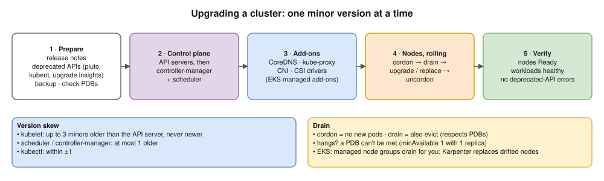

# 18 · Cluster Operations: Nodes, Upgrades, Backups



- ~**3 minor releases a year**, ~14 months of upstream patches each.
- **EKS:** ~14 months standard support, then ~12 months **extended support at extra cost**.
- **One minor at a time** (1.34 → 1.35 → 1.36), no skipping.
- Find deprecated APIs: `kubectl get --raw /metrics | grep apiserver_requested_deprecated_apis`, `pluto`, `kubent`.
- kubeadm: `kubeadm upgrade plan` → `upgrade apply v1.x.y` (first CP node) → `upgrade node` (others) → kubelet + kubectl packages.

## Node maintenance

| Command | Effect |
|---|---|
| `kubectl cordon <node>` | Unschedulable; pods stay |
| `kubectl drain <node> --ignore-daemonsets --delete-emptydir-data` | Cordon + evict all, **respecting PDBs** |
| `kubectl uncordon <node>` | Schedulable again |

## etcd backup and restore (self-managed)

```bash
ETCDCTL_API=3 etcdctl --endpoints=https://127.0.0.1:2379 \
  --cacert=/etc/kubernetes/pki/etcd/ca.crt \
  --cert=/etc/kubernetes/pki/etcd/server.crt \
  --key=/etc/kubernetes/pki/etcd/server.key \
  snapshot save /backup/etcd-$(date +%F).db
etcdutl snapshot restore /backup/etcd-2026-10-05.db --data-dir /var/lib/etcd-restored
# then point the etcd static pod at the new data dir
```

- **EKS: no etcd access.** Back up what you deploy: Git (GitOps), **Velero** (objects + volume snapshots), DB backups (RDS snapshots).

## Certificates, HA, contexts

- kubeadm certs last **1 year**: `kubeadm certs check-expiration`, `kubeadm certs renew all` (upgrades renew too). Expired = broken cluster; alert on it.
- HA: 3+ control plane nodes behind an LB, etcd stacked or external, **odd** count, across AZs ([02](02-architecture.md)).
- ⚠️ **Check the context first:** `kubectl config current-context`. Your Mac points at an EKS cluster. Use `kubectx` / `kubens` or show the context in your prompt.

## Interview angle

| Question | Answer |
|---|---|
| ⭐ EKS upgrade with no downtime? | Deprecated APIs → control plane (one minor) → add-ons → nodes rolling with PDBs, replicas, readiness. |
| ⭐ Cordon vs drain? | Stop new pods vs also evict existing ones. |
| Drain never finishes? | A PDB blocks it, standalone pods (`--force`), or `emptyDir` data. |
| Back up a cluster? | etcd snapshots (self-managed), Velero, GitOps, DB backups. |

## Practice 🖥️

```bash
kubectl cordon kind-control-plane
kubectl drain kind-control-plane --ignore-daemonsets --delete-emptydir-data   # pods go Pending on 1 node
kubectl uncordon kind-control-plane
kubectl config get-contexts
```
