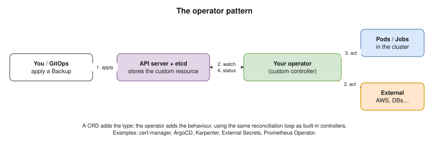

# 19 · Extending Kubernetes: CRDs, Operators, Webhooks

Kubernetes is built to be extended. Many tools you'll name in the interview, like **ArgoCD, Karpenter, cert-manager, External Secrets and Gateway API**, are extensions that use exactly these mechanisms.

## Custom Resource Definitions (CRDs)

- A **CRD** adds a **new object type** to the API, for example `kind: Backup`. The API server then stores and serves it like a built-in type, in etcd, with `kubectl get backups` working.
- A CRD on its own **only stores data**. Something has to **act** on it, and that's a controller.

```yaml
apiVersion: apiextensions.k8s.io/v1
kind: CustomResourceDefinition
metadata:
  name: backups.example.com
spec:
  group: example.com
  scope: Namespaced
  names:
    plural: backups
    singular: backup
    kind: Backup
  versions:
  - name: v1
    served: true
    storage: true
    schema:
      openAPIV3Schema:
        type: object
        properties:
          spec:
            type: object
            properties:
              schedule:
                type: string
              database:
                type: string
---
apiVersion: example.com/v1
kind: Backup
metadata:
  name: nightly
spec:
  schedule: "0 2 * * *"
  database: orders
```

## Controllers and operators ⭐



- A **custom controller** runs the **same reconciliation loop** as the built-in ones ([01](01-fundamentals.md)): watch the custom resources → compare → act (create pods, call AWS, take a backup) → update `status`.
- An **operator** = CRDs + a controller that **packages operational know-how** for one piece of software: installing, upgrading, failover, backups.
- Real examples:

| Operator / controller | Its custom resources |
|---|---|
| Prometheus Operator | `Prometheus`, `ServiceMonitor`, `PrometheusRule` |
| cert-manager | `Certificate`, `Issuer` |
| ArgoCD | `Application`, `ApplicationSet` |
| Karpenter | `NodePool`, `EC2NodeClass` |
| External Secrets | `ExternalSecret`, `SecretStore` |
| CloudNativePG / Strimzi | `Cluster` (Postgres) / `Kafka` |

- Build your own with **kubebuilder** or the **Operator SDK** (Go, using controller-runtime).

## Admission control: policies on every request

- **Mutating webhooks** change objects before they're saved. For example, Istio injects its sidecar, and tools add default labels.
- **Validating webhooks** accept or reject objects, for example **Kyverno** or **OPA Gatekeeper** policies: "no `:latest` tags", "must set limits", "only images from our ECR".
- **ValidatingAdmissionPolicy** (stable since **1.30**) writes simple rules in **CEL** that run **inside the API server**, with no webhook service to keep up.
- ⚠️ A webhook that's **down** with `failurePolicy: Fail` blocks every matching request. Webhooks need high availability too.

## Other extension points

| Interface | Extends | Examples |
|---|---|---|
| **CRI** (container runtime) | How containers run | containerd, CRI-O |
| **CNI** (container network) | Pod networking | Calico, Cilium, AWS VPC CNI ([14](14-cluster-networking.md)) |
| **CSI** (container storage) | Volumes | EBS CSI, EFS CSI ([11](11-storage.md)) |
| Device plugins | Special hardware | NVIDIA GPUs |
| Scheduler plugins | Scheduling decisions | Custom scoring |
| **API aggregation** | Whole extra APIs | **metrics-server** serves `metrics.k8s.io` this way |
| kubectl plugins | The CLI | Installed with **krew** |

## Interview angle

- ⭐ "What is a CRD, and what is an operator?" → a CRD adds a new API type; an operator is a controller that reconciles that type, encoding operations knowledge.
- "How would you enforce 'no images from Docker Hub' across the cluster?" → an admission policy (Kyverno, Gatekeeper, or ValidatingAdmissionPolicy) that checks every pod's image.
- "What are CRI, CNI and CSI?" → the plug-in interfaces for runtime, networking and storage. This is why Kubernetes works on any cloud.

## Practice 🖥️

```bash
kubectl get crds
kubectl apply -f practice/backup-crd.yaml
kubectl wait --for=condition=Established crd/backups.example.com
kubectl apply -f practice/backup.yaml
kubectl get backups
kubectl explain backup.spec
kubectl get apiservices | grep metrics
```

Nothing happens to the Backup, because no controller is watching it. That's the point.
