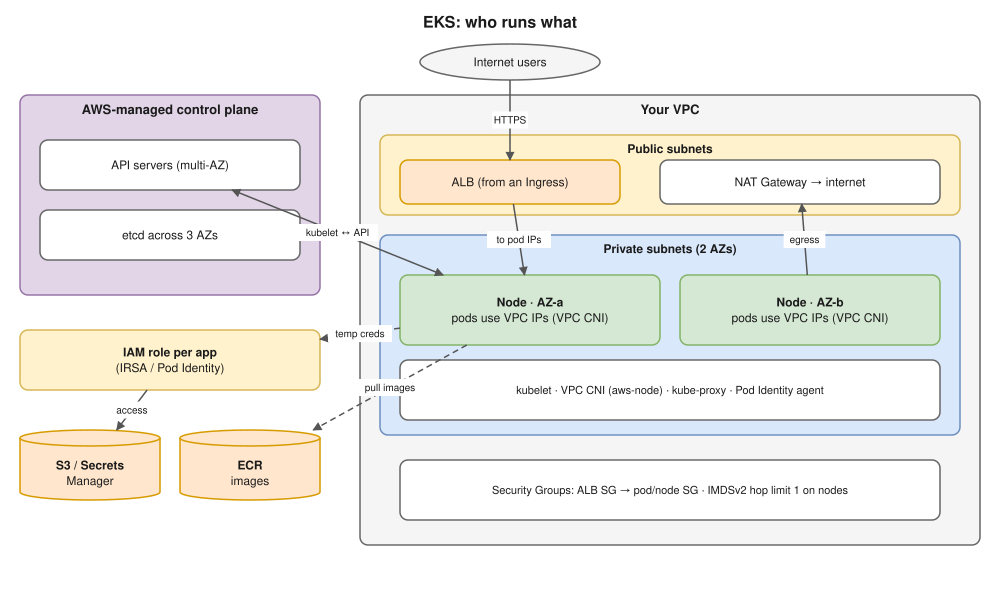

# 20 · Kubernetes on AWS (EKS) ⭐

This file joins two of Hemant's focus topics, **AWS and Kubernetes**.



## Who runs what

| AWS runs | You run |
|---|---|
| The control plane: API servers and **etcd across 3 AZs**, scaling, patching, control plane upgrades when you start them | **Nodes** (unless you use Fargate or Auto Mode), **add-on versions**, workloads, IAM roles, networking, upgrades of your data plane |

## Compute options

| Option | What it is | Good for |
|---|---|---|
| **Managed node groups** | EC2 instances in an Auto Scaling group that AWS helps manage (rolling updates with drain) | The common default |
| Self-managed nodes | Your own ASGs and AMIs | Special setups |
| **Fargate** | Each pod runs in its own small VM; **no nodes to manage** | Small or isolated workloads. ⚠️ No DaemonSets; EFS only for storage. |
| **Karpenter** | Creates **right-sized EC2 nodes directly** for pending pods, uses **Spot**, **consolidates** idle nodes | Cost and speed ([12](12-resources-and-autoscaling.md)) |
| **EKS Auto Mode** | AWS also manages the nodes, load balancing and storage (built on Karpenter) | Teams that want less to operate |

## Networking: the VPC CNI ⭐

- Every pod gets a **real IP from your VPC subnet**, taken from the node's ENIs (network interfaces).
  - Good: no overlay, and pods work with Security Groups and VPC Flow Logs.
- ⚠️ **The number of pods per node is limited** by the instance's ENIs and IPs: `max pods = ENIs × (IPs per ENI − 1) + 2`. For example, an m5.large: 3 × (10 − 1) + 2 = **29 pods**.
- ⚠️ **Subnets run out of IPs.** Fixes:
  - **prefix delegation** (each slot gets a /28 block of 16 IPs, so far more pods per node);
  - **custom networking** with a **secondary CIDR** (for example from `100.64.0.0/10`) just for pods. Hemant asks about this; see ⭐🔥 [Scenario A3](../hemant-scenario-deep-dives.md#a3--nodes-in-one-cidr-pods-in-another-how-is-that-done-) for the full mechanism and EKS Auto Mode's version;
  - bigger subnets.
- **Security groups for pods:** give specific pods their own Security Group (for example, only the payments pods may reach RDS).
- The VPC CNI can **enforce NetworkPolicy** once you turn that feature on ([14](14-cluster-networking.md)).

## Load balancing: the AWS Load Balancer Controller

- **Ingress → ALB** (layer 7).
  - `target-type: ip` sends traffic **straight to pod IPs**;
  - `instance` goes through NodePorts.
- **Service `type: LoadBalancer` → NLB** (layer 4).
- **ACM** for TLS certificates, **ExternalDNS** to create Route 53 records, **WAF** on the ALB.
- The controller needs IAM permissions, through IRSA or Pod Identity. See [09](09-ingress-and-gateway-api.md) for the traffic paths.

## Identity ⭐🔥

### People → cluster
IAM users or roles get Kubernetes permissions through **access entries** (the API way) plus access policies or RBAC groups. The older method, the `aws-auth` ConfigMap, is being phased out.

### Pods → AWS services (no access keys!)

| | **IRSA** (IAM Roles for Service Accounts) | **EKS Pod Identity** (newer, simpler) |
|---|---|---|
| Setup | An IAM **OIDC provider** for the cluster; annotate the ServiceAccount with `eks.amazonaws.com/role-arn` | Install the **Pod Identity Agent** add-on; create a **pod identity association** (cluster + namespace + ServiceAccount → role) |
| Role trust policy | Trusts the cluster's OIDC provider, limited to `system:serviceaccount:<ns>:<sa>` | Trusts `pods.eks.amazonaws.com` (the **same role works for many clusters**) |
| How the pod gets credentials | A projected token → `AssumeRoleWithWebIdentity` (the AWS SDK does it) | The agent on the node hands out credentials |

- **Security:** require **IMDSv2 with a hop limit of 1** on nodes, so pods **can't borrow the node's IAM role** through the instance metadata service.
- Give each app **its own role** with least privilege.

## Storage and add-ons

- **EBS CSI** (gp3, ReadWriteOnce, **tied to one AZ**) and **EFS CSI** (ReadWriteMany) are installed as **EKS add-ons** with IAM permissions ([11](11-storage.md)).
- Core **managed add-ons:** VPC CNI, CoreDNS, kube-proxy, EBS CSI, Pod Identity Agent. Keep them on versions that match your Kubernetes version.

## Security and observability checklist

- **Private** (or IP-restricted) API endpoint
- **KMS envelope encryption** for Secrets ([10](10-configmaps-and-secrets.md))
- Control plane logs (`audit`, `authenticator`) to CloudWatch
- **GuardDuty** EKS protection
- **Container Insights** or Amazon Managed Prometheus

## Upgrades (see [18](18-cluster-operations.md) for the general method)

1. Check **upgrade insights** and **deprecated APIs**.
2. Upgrade the control plane, **one minor version** at a time.
3. Update the **managed add-ons**.
4. Update the node groups (a rolling drain that respects PDBs), or let **Karpenter replace drifted nodes**.
5. Stay within **standard support** (~14 months per version). **Extended support** costs extra.

## Interview angle

- ⭐ "How does a pod on EKS read from S3 without keys?" → Pod Identity or IRSA: ServiceAccount → IAM role → temporary credentials. Mention IMDSv2 hop limit 1, so pods can't use the node's role.
- ⭐ "Pods are stuck in ContainerCreating on EKS with IP errors." → the subnets are out of IPs (VPC CNI). Use prefix delegation, a secondary CIDR, or bigger subnets.
- ⭐ "How does internet traffic reach a pod?" → Route 53 → ALB (created from an Ingress by the AWS Load Balancer Controller) → pod IP (IP mode). Security Groups must allow ALB → pod.
- "Fargate vs managed nodes vs Karpenter?" → no nodes but limits (no DaemonSets) vs the standard option vs right-sized, Spot-friendly autoscaling.
- "How do you upgrade EKS?" → the 5 steps above, one minor version at a time.

## Practice 🖥️ (read-only; ⚠️ only on a cluster you're allowed to use)

```bash
kubectl config current-context
kubectl get nodes -L topology.kubernetes.io/zone,node.kubernetes.io/instance-type
kubectl -n kube-system get daemonset aws-node
kubectl -n kube-system get pods -l k8s-app=kube-dns
kubectl get serviceaccount -A -o jsonpath='{range .items[*]}{.metadata.namespace}/{.metadata.name} {.metadata.annotations.eks\.amazonaws\.com/role-arn}{"\n"}{end}'
```

The last command lists every ServiceAccount with its IRSA role, if it has one.
