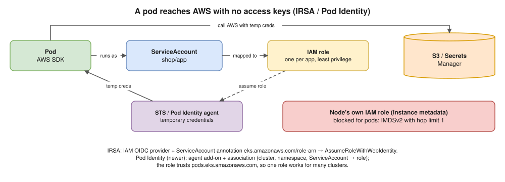

# 20 · Kubernetes on AWS (EKS) ⭐

Two of Hemant's focus topics in one file: **AWS and Kubernetes**.


| AWS runs | You run |
|---|---|
| API servers + **etcd across 3 AZs**, scaling, patching, CP upgrades you start | Nodes (unless Fargate / Auto Mode), add-on versions, workloads, IAM, networking, data-plane upgrades |

## Compute

| Option | What | Good for |
|---|---|---|
| **Managed node groups** | ASG that AWS helps drain and update | The default |
| Self-managed nodes | Your ASGs and AMIs | Special setups |
| **Fargate** | One small VM per pod, no nodes | Small / isolated. ⚠️ No DaemonSets; EFS only |
| **Karpenter** | Right-sized EC2 for pending pods, **Spot**, **consolidation** | Cost and speed ([12](12-resources-and-autoscaling.md)) |
| **EKS Auto Mode** | AWS also runs nodes, LB, storage (Karpenter inside) | Less to operate |

## VPC CNI ⭐

- Pods get **real VPC IPs** from node ENIs: no overlay, works with SGs and Flow Logs.
- ⚠️ **Max pods** = `ENIs × (IPs per ENI − 1) + 2` → m5.large: 3 × 9 + 2 = **29**.
- ⚠️ **Subnets run out of IPs.** Fixes: **prefix delegation** (/28 per slot), **custom networking** with a secondary CIDR like `100.64.0.0/10` (⭐🔥 [Scenario A3](../hemant-scenario-deep-dives.md#a3--nodes-in-one-cidr-pods-in-another-how-is-that-done-)), bigger subnets.
- **Security groups for pods** (only payments pods reach RDS). NetworkPolicy once enabled ([14](14-cluster-networking.md)).

## Load balancing

- AWS Load Balancer Controller: **Ingress → ALB** (`target-type: ip` → pod IPs; `instance` → NodePorts), **Service LoadBalancer → NLB** ([09](09-ingress-and-gateway-api.md)).
- **ACM** for TLS, **ExternalDNS** for Route 53, **WAF** on the ALB. The controller needs IAM (IRSA / Pod Identity).

## Identity ⭐🔥

- **People → cluster:** IAM principals via **access entries** + access policies or RBAC groups (`aws-auth` is legacy).



| | IRSA | EKS Pod Identity (newer) |
|---|---|---|
| Setup | IAM OIDC provider; SA annotation `eks.amazonaws.com/role-arn` | Pod Identity Agent add-on; association (cluster + ns + SA → role) |
| Trust policy | Cluster's OIDC provider, `system:serviceaccount:<ns>:<sa>` | `pods.eks.amazonaws.com` (one role, many clusters) |
| Credentials | Projected token → `AssumeRoleWithWebIdentity` | Agent on the node |

## Storage, add-ons, checklist

- **EBS CSI** (gp3, RWO, **one AZ**) and **EFS CSI** (RWX) as add-ons with IAM ([11](11-storage.md)).
- Managed add-ons: VPC CNI, CoreDNS, kube-proxy, EBS CSI, Pod Identity Agent; keep versions matched.
- Checklist: private API endpoint · **KMS** for Secrets · `audit` + `authenticator` logs · **GuardDuty** · Container Insights or AMP.
- **Upgrades:** insights + deprecated APIs → control plane (one minor) → add-ons → node groups / Karpenter drift → stay in standard support ([18](18-cluster-operations.md)).

## Interview angle

| Question | Answer |
|---|---|
| ⭐ Pod reads S3 without keys? | Pod Identity or IRSA → IAM role → temp creds; IMDSv2 hop limit 1. |
| ⭐ ContainerCreating with IP errors? | Subnet IPs exhausted: prefix delegation, secondary CIDR, bigger subnets. |
| ⭐ Internet → pod? | Route 53 → ALB (from Ingress) → pod IP (IP mode); SGs allow ALB → pod. |
| Fargate vs managed nodes vs Karpenter? | No nodes but limits vs standard vs right-sized, Spot-friendly. |
| Upgrade EKS? | The 5 steps, one minor at a time. |

## Practice 🖥️ (read-only; ⚠️ only on a cluster you may use)

```bash
kubectl config current-context
kubectl get nodes -L topology.kubernetes.io/zone,node.kubernetes.io/instance-type
kubectl -n kube-system get daemonset aws-node
kubectl -n kube-system get pods -l k8s-app=kube-dns
# every ServiceAccount with its IRSA role, if any
kubectl get serviceaccount -A -o jsonpath='{range .items[*]}{.metadata.namespace}/{.metadata.name} {.metadata.annotations.eks\.amazonaws\.com/role-arn}{"\n"}{end}'
```
