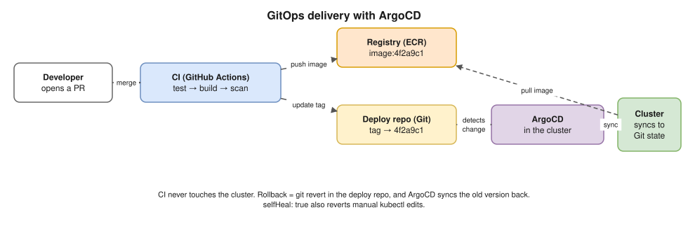

# 21 · Helm, Kustomize and GitOps (the CI/CD link)

How YAML gets **packaged**, **customised per environment** and **delivered** to clusters. This joins Kubernetes to the CI/CD answers in your model answers (Q35–Q40).

## Helm: the package manager

- A **chart** is a package of templated YAML. A **release** is one installed copy of a chart in a cluster. Every upgrade creates a **revision** you can roll back to.

```text
mychart/
├── Chart.yaml        # chart name, chart version, appVersion
├── values.yaml       # default settings (replicas, image tag, resources…)
├── templates/        # YAML with placeholders like {{ .Values.image.tag }}
│   ├── deployment.yaml
│   ├── service.yaml
│   └── _helpers.tpl
└── charts/           # dependency charts
```

| Command | Purpose |
|---|---|
| `helm repo add prometheus-community https://prometheus-community.github.io/helm-charts` · `helm repo update` | Add or update chart repositories |
| `helm install web ./mychart -n shop --create-namespace -f values-prod.yaml` | Install with prod values |
| `helm upgrade --install web ./mychart -f values-prod.yaml --set image.tag=4f2a9c1` | Install or upgrade (what CI uses) |
| `helm list -n shop` · `helm history web -n shop` | Releases and their revisions |
| `helm rollback web 2 -n shop` | Go back to revision 2 |
| `helm template web ./mychart -f values-prod.yaml` | **Render locally** to see the final YAML (great for debugging and CI checks) |
| `helm lint ./mychart` | Check the chart |
| `helm uninstall web -n shop` | Remove the release |

- **Roll pods when config changes:** add a `checksum/config` annotation to the pod template, made from the ConfigMap's content. Any change to the ConfigMap changes the pod template, which starts a rollout.
- ⚠️ **Don't put secrets in `values.yaml`** in Git; see [10](10-configmaps-and-secrets.md).

## Kustomize: patches without templates

- **Plain YAML** with a **base** plus **overlays** per environment. No templating language. Built into kubectl: `kubectl apply -k` and `kubectl kustomize`.

```text
practice/kustomize/
├── base/                 # deployment.yaml, service.yaml, kustomization.yaml
└── overlays/
    └── prod/             # kustomization.yaml + replicas patch
```

```yaml
# overlays/prod/kustomization.yaml
resources:
- ../../base
namespace: shop-prod
images:
- name: myapi
  newTag: "4f2a9c1"         # the git SHA, set by CI
patches:
- path: replicas.yaml
configMapGenerator:
- name: app-config
  literals:
  - LOG_LEVEL=warn          # the generated name gets a hash suffix, so changes roll the pods
```

| | Helm | Kustomize |
|---|---|---|
| Approach | Templates + values | Base + patches (plain YAML) |
| Packaging and sharing | ✅ Charts, repositories, versions | ❌ Just folders |
| Rollback built in | ✅ `helm rollback` | Through Git (revert) |
| Learning curve | Go templates can get messy | Simpler |
| Typical use | Installing third-party software; complex apps | Your own apps' per-environment differences |

They're often **used together**: a Helm chart for third-party software, and Kustomize overlays for your own apps.

## GitOps with ArgoCD ⭐



- **Git is the source of truth** for what runs in each cluster. **ArgoCD runs inside the cluster** and **pulls** changes, so CI never needs cluster credentials (model answer Q35, Q39).
- An **Application** custom resource says: this repo + path + revision → this cluster + namespace.

```yaml
apiVersion: argoproj.io/v1alpha1
kind: Application
metadata:
  name: shop-api
  namespace: argocd
spec:
  project: default
  source:
    repoURL: https://github.com/example/shop-deploy.git
    targetRevision: main
    path: overlays/prod
  destination:
    server: https://kubernetes.default.svc
    namespace: shop-prod
  syncPolicy:
    automated:
      prune: true          # delete what was removed from Git
      selfHeal: true       # undo manual kubectl edits (drift)
    syncOptions:
    - CreateNamespace=true
```

- **States:**
  - **Synced / OutOfSync** (does the cluster match Git?);
  - **Healthy / Degraded / Progressing** (are the resources working?).
- **Without `selfHeal`,** a manual `kubectl edit` just shows **OutOfSync**; nothing is reverted.
- **At scale:** "app of apps" or **ApplicationSets** create Applications for many services or clusters.
- **Flux** is the main alternative (GitRepository + Kustomization / HelmRelease).

## Progressive delivery: canary and blue/green

- A Deployment only does **rolling** or **recreate** ([07](07-workloads.md)).
- For **canary** and **blue/green** with **automatic rollback** on metrics, use **Argo Rollouts** (a `Rollout` custom resource) or Flagger.
  - A canary sends 10% → 50% → 100% of traffic, pausing between steps and checking error rate and latency in Prometheus.
  - Traffic is split by the service mesh, the ALB, or **Gateway API weights** ([09](09-ingress-and-gateway-api.md)).
- **Rolling back with GitOps:** `git revert` the change, and ArgoCD syncs the old version back.

## Interview angle

- ⭐ "Helm vs Kustomize?" → templates and packages vs plain YAML with patches. Often both are used.
- ⭐ "Walk me through deploying a change with GitOps." → PR → CI builds, scans and pushes an image tagged with the SHA → CI updates the tag in the deploy repo → ArgoCD notices the drift and syncs → the rollout follows probes and PDBs → roll back with `git revert`.
- "Someone `kubectl edit`ed production. What happens?" → with `selfHeal`, ArgoCD reverts it; without it, the app shows OutOfSync.
- ⭐🔥 "Someone edited a **Helm** release in the cluster. What happens on the next `helm upgrade`?" → Hemant named this one himself. See [Scenario A1](../hemant-scenario-deep-dives.md#a1--helm-drift-someone-edited-the-cluster-then-we-run-helm-upgrade-again-): Helm 3's 3-way merge, Helm 4's server-side apply conflicts, the custom-resource catch, and HPA vs `replicas`.
- "How would you do a canary on Kubernetes?" → Argo Rollouts or Flagger with metric analysis, or Gateway API weights for a simple split.

## Practice 🖥️

```bash
helm create demo
helm template demo ./demo | head -40
kubectl kustomize practice/kustomize/overlays/prod
kubectl apply -k practice/kustomize/overlays/prod --dry-run=client
```

The last command needs a running cluster (kind) to check the objects against it.
