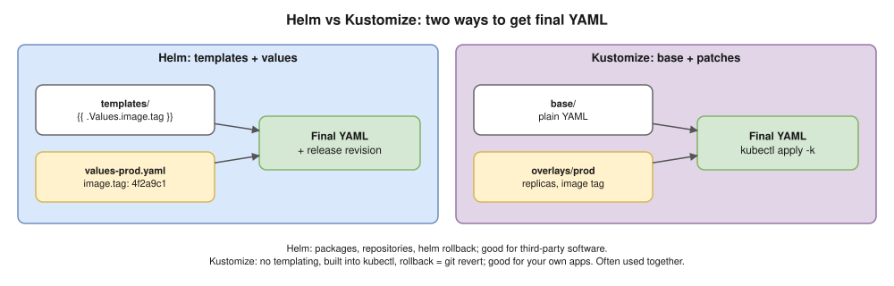

# 21 · Helm, Kustomize and GitOps (the CI/CD link)

How YAML is **packaged**, **customised per environment** and **delivered**. Links to model answers Q35–Q40.



## Helm

> **Go deeper:** the [Helm notes](../helm-chart/README.md) (3-way merge, server-side apply, flags, troubleshooting; tested with Helm 4.2.3).

- **Chart** = templated YAML package · **release** = one installed copy · **revision** = each upgrade, rollback target.

```text
mychart/
├── Chart.yaml        # chart name, chart version, appVersion
├── values.yaml       # default settings (replicas, image tag, resources…)
├── templates/        # YAML with placeholders like {{ .Values.image.tag }}
│   ├── deployment.yaml
│   ├── service.yaml
│   └── _helpers.tpl
└── charts/           # dependency charts
```

| Command | Purpose |
|---|---|
| `helm repo add … && helm repo update` | Add / refresh chart repos |
| `helm upgrade --install web ./mychart -f values-prod.yaml --set image.tag=4f2a9c1` | Install or upgrade (what CI runs) |
| `helm list -n shop` · `helm history web -n shop` | Releases and revisions |
| `helm rollback web 2 -n shop` | Back to revision 2 |
| `helm template web ./mychart -f values-prod.yaml` | **Render locally** |
| `helm lint ./mychart` · `helm uninstall web -n shop` | Check / remove |

- Roll pods on config change: a `checksum/config` annotation on the pod template.
- ⚠️ No secrets in `values.yaml` in Git ([10](10-configmaps-and-secrets.md)).

## Kustomize

```text
practice/kustomize/
├── base/                 # deployment.yaml, service.yaml, kustomization.yaml
└── overlays/
    └── prod/             # kustomization.yaml + replicas patch
```

```yaml
# overlays/prod/kustomization.yaml
resources:
- ../../base
namespace: shop-prod
images:
- name: myapi
  newTag: "4f2a9c1"         # the git SHA, set by CI
patches:
- path: replicas.yaml
configMapGenerator:
- name: app-config
  literals:
  - LOG_LEVEL=warn          # the generated name gets a hash suffix, so changes roll the pods
```

## GitOps with ArgoCD ⭐


- **Git is the source of truth.** ArgoCD runs **in** the cluster and **pulls**, so CI never holds cluster credentials (Q35, Q39).
- States: **Synced / OutOfSync** (matches Git?) and **Healthy / Degraded / Progressing** (working?).
- Without `selfHeal`, a manual `kubectl edit` only shows OutOfSync. At scale: app-of-apps or **ApplicationSets**. Alternative: **Flux**.

```yaml
apiVersion: argoproj.io/v1alpha1
kind: Application
metadata:
  name: shop-api
  namespace: argocd
spec:
  project: default
  source:
    repoURL: https://github.com/example/shop-deploy.git
    targetRevision: main
    path: overlays/prod
  destination:
    server: https://kubernetes.default.svc
    namespace: shop-prod
  syncPolicy:
    automated:
      prune: true          # delete what was removed from Git
      selfHeal: true       # undo manual kubectl edits (drift)
    syncOptions:
    - CreateNamespace=true
```

## Progressive delivery

- Deployments only do rolling or recreate. **Canary / blue-green with auto-rollback:** **Argo Rollouts** or Flagger (10% → 50% → 100%, checking Prometheus error rate and latency).
- Traffic split by a mesh, the ALB, or **Gateway API weights** ([09](09-ingress-and-gateway-api.md)).

## Interview angle

| Question | Answer |
|---|---|
| ⭐ Helm vs Kustomize? | Templates + packages vs plain YAML + patches. Often both. |
| ⭐ GitOps deploy, step by step? | PR → CI builds, scans, pushes `:sha` → CI bumps the tag in the deploy repo → ArgoCD syncs → rollout with probes/PDBs → rollback = `git revert`. |
| Someone `kubectl edit`ed prod? | `selfHeal` reverts it; otherwise OutOfSync. |
| ⭐🔥 Someone edited a Helm release, then `helm upgrade`? | [Scenario A1](../hemant-scenario-deep-dives.md#a1--helm-drift-someone-edited-the-cluster-then-we-run-helm-upgrade-again-): 3-way merge, Helm 4 SSA conflicts, CRs, HPA vs `replicas`. |
| Canary on Kubernetes? | Argo Rollouts / Flagger with metric analysis, or Gateway API weights. |

## Practice 🖥️

```bash
helm create demo
helm template demo ./demo | head -40
kubectl kustomize practice/kustomize/overlays/prod
kubectl apply -k practice/kustomize/overlays/prod --dry-run=client   # needs a running cluster
```
