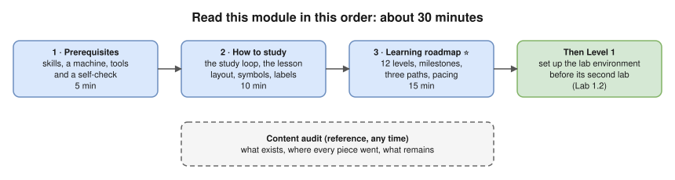

# 00 · Learning Roadmap 🗺️

Read this module first: what you need, how to study, which path to take, and what state the material is in.

| File | Read it for | Time (estimate) |
|---|---|---|
| [Prerequisites](prerequisites.md) | Skills, machine, tools and accounts, with a self-check | 5 min |
| [How to study](how-to-study.md) | The study loop, the lesson layout, symbols and output labels, labs, exercises, what to do when stuck | 10 min |
| [Learning roadmap](learning-roadmap.md) ⭐ | The 12 levels, their prerequisites and time estimates, milestones, three paths (including an interview fast track), pacing | 15 min |
| [Content audit](content-audit.md) | What existed before the reorganisation, where every piece went, what was added, how it was checked, and what remains | reference |

➡️ **Then:** [Level 1 · Networking fundamentals](../01-networking-fundamentals/README.md), or back to the [main README](../README.md).
