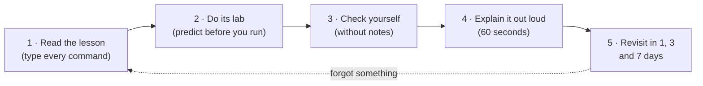

# How to Study with These Notes

Reading feels like learning, but most of what you only read is gone within a week. What sticks is what you **predict, do, explain and recall later**. Every lesson and lab here is built around that.

## The loop for every lesson

1. **Read** one lesson in one sitting. Type every command in "Try it" yourself; don't paste.
2. **Do the lab** it links to. Before each step, write down what you expect to see. Being wrong is where the learning happens.
3. **Check yourself.** Answer the questions at the end of the lesson on paper, then open the answers.
4. **Explain it out loud** in 60 seconds, as if to a colleague, using the lesson's "Interview angle" questions. If you stumble, that's the part to re-read.
5. **Revisit** the "Check yourself" questions after 1, 3 and 7 days. Spaced recall is the cheapest way to make knowledge permanent.

## How a lesson is laid out

Lessons in Levels 1–3 follow the same structure, so you always know where to look:

| Section | What it gives you |
|---|---|
| **What you'll learn** | The objectives: what you'll be able to do afterwards |
| **Before you start** | Prerequisites, with links to the lessons that teach them |
| **The idea in plain words** | A simple explanation, often with an everyday analogy |
| **Why it matters** | Where you'll meet it in real work and interviews |
| **How it works** | The internals, step by step, with diagrams |
| **Worked example** | A full example, solved |
| **Try it** | Commands to run, with their expected output and what to look for |
| **In the real world** | How it shows up in Docker, Kubernetes, AWS and production |
| **Common mistakes** | What people get wrong, and the correct version |
| **Troubleshooting** | Symptoms, causes and the command that proves each |
| **Hands-on lab** | The lab that practises this lesson |
| **Interview angle** | The questions you're likely to be asked, with short model answers |
| **Check yourself** | A knowledge check, with answers to reveal |
| **Summary** | The key points on one screen |
| **Next** | The next lesson |

A few lessons merge or rename sections where the topic needs it (for example, [2.4 · Subnetting](../02-ip-addressing-and-subnetting/04-subnetting-step-by-step.md) is organised around six question types). Two older notes in Levels 8 and 10 keep their original layout; the [content audit](content-audit.md) lists them.

## Symbols and labels

| Mark | Meaning |
|---|---|
| ⭐ | Very likely interview topic |
| 🔥 | A gap from the 9 Oct interview review: give it extra time |
| 🖥️ | You may be asked to show it live |
| 🟢 🟡 🟠 🔴 | Exercise difficulty: beginner, intermediate, advanced, expert |
| 💰 / 💸 | A lab is free / **may cost money** (cloud resources) |
| ✅ / 🚧 / 📝 | A module is written / partly written / planned (outline only) |
| **(tested)** or **(tested in the lab container)** | Output copied from a real run in the lab environment (Ubuntu 24.04, 14 Oct 2026) |
| **(tested on the Mac, Oct 2026)** | Output copied from a real run on macOS with Docker Desktop |
| **(illustrative)** | Shows the shape of real output, but was **not** captured from a run |

Your own output will differ in addresses, ports, MACs, timings and IDs. What should match is the **shape**: which fields appear, which flags are set, which error you get.

## Labs: break things on purpose

- Do each lab **after** its lesson. The labs assume you know the vocabulary.
- **Predict first.** Each step shows the expected output; cover it, write your prediction, then compare.
- Every lab **breaks something on purpose**. Read each error message slowly; you'll meet the same messages at work, and recognising them is half of troubleshooting.
- **Always run the cleanup** step. A half-cleaned lab makes the next one fail with `File exists`.
- Do the **challenges** at the end. They're where you stop following instructions and start thinking.

## Exercises: honest scoring

- Write every answer before you open the [solutions](../14-practice-exercises/solutions/). For calculations, show the method: in an interview, the method is what's marked.
- Below the target score: re-read the sections you missed, and retry the set **on another day**. Retrying straight away tests short-term memory, not learning.
- **Subnetting is a daily habit** 🔥: 15 minutes of [drills](../14-practice-exercises/02-level-2-subnetting-drills.md) a day for a week beats one three-hour session.

## Draw it

Networking is spatial. For every lesson, draw the picture from memory on paper: the packet's path, the layers, the handshake arrows. Interviewers often ask you to draw, and a picture you've drawn ten times comes out clean under pressure. The ones worth practising most are listed in [interview preparation](../15-interview-preparation/README.md#whiteboard-diagrams-to-practise).

## When you're stuck

1. Re-read **Before you start**: a gap usually comes from a lesson earlier.
2. Look the term up in the [glossary](../references/glossary.md).
3. Run the command and **read the output field by field**. The [command cheatsheet](../references/network-commands-cheatsheet.md) says what each tool shows.
4. Capture the packets. `tcpdump` never lies about what was actually sent.
5. Try a second explanation: the [videos and books](../references/videos-and-further-reading.md) cover the same topics differently.
6. Still stuck after 30 minutes? Write down exactly what you don't understand, move on, and come back tomorrow. It often makes sense after sleep.

## Tracking progress

- Tick the **milestone checklist** at the end of each level's README. Don't move on with unticked boxes.
- Tick the **progress checklist** in the [main README](../README.md#progress-checklist).
- Keep a short log: date, what you studied, how long it took, and one thing you got wrong. After a few weeks, your real times replace the estimates.

## A sample study week (Path A, about 10 hours, estimate)

| Day | Session |
|---|---|
| Mon | One lesson (60–90 min) + 15 min drills |
| Tue | That lesson's lab (45–60 min) + 15 min drills |
| Wed | Next lesson + 15 min drills |
| Thu | Its lab + recall Monday's "Check yourself" questions |
| Fri | Explain both lessons out loud; draw their diagrams from memory |
| Sat | Exercises for the week's topics, scored honestly |
| Sun | Rest, or catch up |
