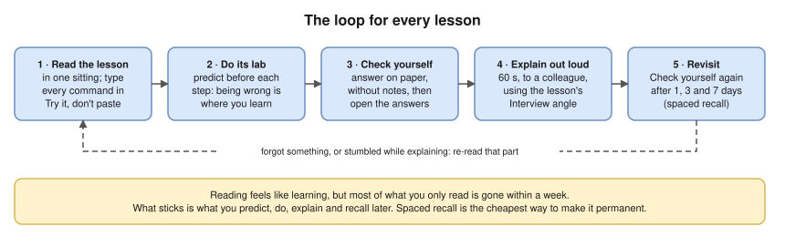
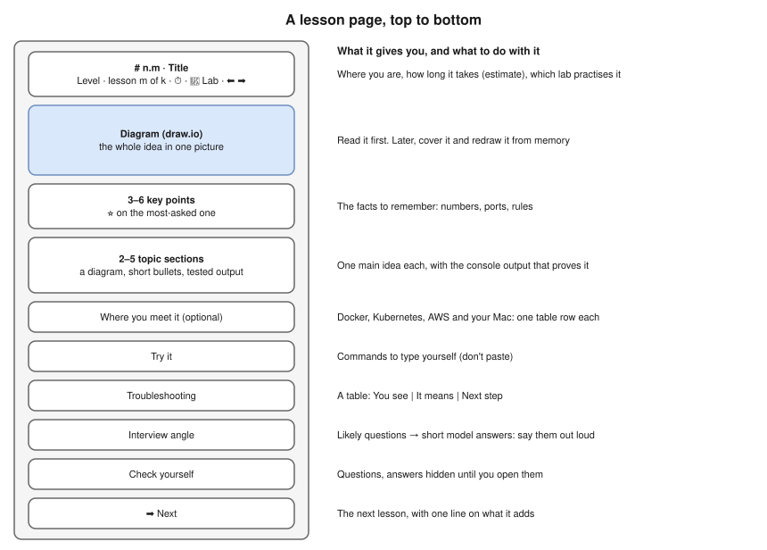

# How to Study with These Notes

- What sticks is what you **predict, do, explain and recall later**. Every lesson and lab is built around that loop.
- One lesson per sitting; type every command in **Try it** yourself, don't paste. If you stumble while explaining, that's the part to re-read.

## How a lesson is laid out

- Lessons in Levels 1–3 follow this layout. The diagram comes first; text only adds what a picture can't: exact commands, tested output, numbers, error strings, interview answers.
- **All diagrams are draw.io files** (`.drawio.svg`, in [../diagrams/](../diagrams/README.md)): GitHub and the VS Code preview show them as pictures; app.diagrams.net, draw.io desktop or the VS Code Draw.io Integration extension edit them.
- **Redraw them yourself:** cover a diagram and draw it from memory on paper ([Draw it](#draw-it)).
- [2.4 · Subnetting](../02-ip-addressing-and-subnetting/04-subnetting-step-by-step.md) is organised around six question types.
- Two older notes keep their original layout, [8.6](../08-linux-networking/06-netfilter-nat-and-conntrack.md) (Level 8) and [10.1](../10-container-and-kubernetes-networking/01-docker-bridge-networking-inside-out.md) (Level 10), plus [Lab 10.1](../13-hands-on-labs/lab-10.1-docker-bridge-nat-and-dns.md): their outputs were tested on Docker Desktop ([content audit](content-audit.md)).

## Symbols and labels

| Mark | Meaning |
|---|---|
| ⭐ | Very likely interview topic |
| 🔥 | A gap from the 9 Oct interview review: give it extra time |
| 🖥️ | You may be asked to show it live |
| 🟢 🟡 🟠 🔴 | Exercise difficulty: beginner, intermediate, advanced, expert |
| 💰 / 💸 | A lab is free / **may cost money** (cloud resources) |
| ✅ / 🚧 / 📝 | A module is written / partly written / planned (outline only) |
| **(tested)** or **(tested in the lab container)** | Output copied from a real run in the lab environment (Ubuntu 24.04, 14 Oct 2026) |
| **(tested on the Mac, Oct 2026)** | Output copied from a real run on macOS with Docker Desktop |
| **(illustrative)** | Shows the shape of real output, but was **not** captured from a run |

Your own output will differ in addresses, ports, MACs, timings and IDs. What should match is the **shape**: which fields appear, which flags are set, which error you get.

## Labs: break things on purpose

- Do each lab **after** its lesson: the labs assume you know the vocabulary.
- **Predict first:** cover each expected output, write your prediction, then compare.
- Every lab **breaks something on purpose**. Read each error slowly; recognising it is half of troubleshooting at work.
- **Always run the cleanup** step: a half-cleaned lab makes the next one fail with `File exists`.
- Do the **challenges** at the end: that's where you stop following instructions and start thinking.

## Exercises: honest scoring

- Write every answer before you open the [solutions](../14-practice-exercises/solutions/). Show the method for calculations: in an interview, the method is what's marked.
- Below the target score: re-read what you missed and retry the set **on another day** (straight away only tests short-term memory).
- **Subnetting is a daily habit** 🔥: 15 minutes of [drills](../14-practice-exercises/02-level-2-subnetting-drills.md) a day for a week beats one three-hour session.

## Draw it

- Networking is spatial: for every lesson, redraw its diagrams from memory on paper (the packet's path, the layers, the handshake arrows).
- Interviewers often ask you to draw; a picture you've drawn ten times comes out clean under pressure. Practise these most: [whiteboard diagrams](../15-interview-preparation/README.md#whiteboard-diagrams-to-practise).

## When you're stuck

1. Go back one lesson (the ⬅️ link in the header): a gap usually comes from a lesson earlier.
2. Look the term up in the [glossary](../references/glossary.md).
3. Run the command and **read the output field by field**. The [command cheatsheet](../references/network-commands-cheatsheet.md) says what each tool shows.
4. Capture the packets. `tcpdump` never lies about what was actually sent.
5. Try a second explanation: the [videos and books](../references/videos-and-further-reading.md) cover the same topics differently.
6. Still stuck after 30 minutes? Write down exactly what you don't understand, move on, and come back tomorrow. It often makes sense after sleep.

## Tracking progress

- Tick the **milestone checklist** at the end of each level's README. Don't move on with unticked boxes.
- Tick the **progress checklist** in the [main README](../README.md#progress-checklist).
- Keep a short log: date, what you studied, how long it took, one thing you got wrong. After a few weeks your real times replace the estimates.

## A sample study week (Path A, about 10 hours, estimate)

| Day | Session |
|---|---|
| Mon | One lesson (60–90 min) + 15 min drills |
| Tue | That lesson's lab (45–60 min) + 15 min drills |
| Wed | Next lesson + 15 min drills |
| Thu | Its lab + recall Monday's "Check yourself" questions |
| Fri | Explain both lessons out loud; draw their diagrams from memory |
| Sat | Exercises for the week's topics, scored honestly |
| Sun | Rest, or catch up |
