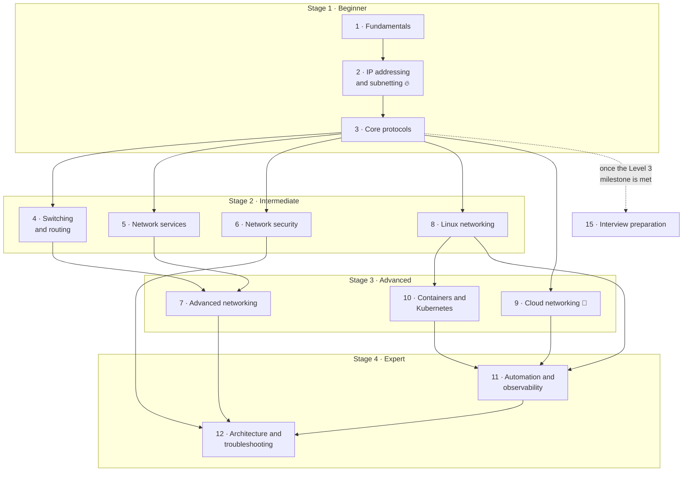

# Learning Roadmap: Zero to Expert

> **Every time in this file is an estimate.** It assumes you read actively, type every command and do every lab. A topic that's new to you can take twice as long; one you already know can take half. Track your own times and adjust.

This roadmap takes you from "what is a network?" to designing, automating and troubleshooting production networks. It has **12 levels** in four stages, then a module that turns the knowledge into interview answers.

## The path at a glance

**Solid arrows** are prerequisites: finish the level at the tail first. Levels in the same stage with no arrow between them can be studied in any order. 💸 marks the only level whose labs will use a paid cloud account.

## Level by level

| Level | Stage | Status | You'll be able to… | Needs | Time (estimate) |
|---|---|---|---|---|---|
| [1 · Networking fundamentals](../01-networking-fundamentals/README.md) | Beginner | ✅ written | Explain networks, devices, addresses, ports and the OSI/TCP-IP models | nothing | 6 h |
| [2 · IP addressing and subnetting](../02-ip-addressing-and-subnetting/README.md) 🔥 | Beginner | ✅ written | Subnet on paper, plan a VPC, read a routing table, explain ARP and DHCP | Level 1 | 12 h + daily drills |
| [3 · Core networking protocols](../03-core-networking-protocols/README.md) ⭐ | Beginner | ✅ written | Capture and explain Ethernet, TCP, UDP, DNS, HTTP, TLS, ICMP and NAT; troubleshoot any connection | Level 2 | 20 h |
| [4 · Switching and routing](../04-switching-and-routing/README.md) | Intermediate | 📝 planned | VLANs, trunks, STP, link aggregation, OSPF, BGP basics | Level 3 | 20 h |
| [5 · Network services and infrastructure](../05-network-services-and-infrastructure/README.md) | Intermediate | 📝 planned | Load balancers, proxies, CDNs, DNS and DHCP at scale, NTP, VPNs | Level 3 | 15 h |
| [6 · Network security](../06-network-security/README.md) | Intermediate | 📝 planned | Firewalls, segmentation and zero trust, layer 2 attacks, DDoS, securing DNS and TLS, detection | Level 3 | 15 h |
| [7 · Advanced networking](../07-advanced-networking/README.md) | Advanced | 📝 planned | Tunnels and overlays, traffic engineering, QoS, multicast, IPv6 transition | Levels 4 and 5 | 15 h |
| [8 · Linux networking](../08-linux-networking/README.md) | Intermediate | 🚧 1 of 9 lessons | `iproute2`, namespaces, policy routing, `sysctl`, `tc`, netfilter, nftables, eBPF | Level 3 + namespace labs | 15 h |
| [9 · Cloud networking](../09-cloud-networking/README.md) 💸 | Advanced | 📝 planned | VPC design, IGW vs NAT gateway, SG vs NACL, endpoints, Transit Gateway, hybrid | Level 3 + drills set E | 20 h |
| [10 · Container and Kubernetes networking](../10-container-and-kubernetes-networking/README.md) | Advanced | 🚧 1 of 9 lessons | Docker networking, the Kubernetes network model, CNI, Services, Ingress, NetworkPolicy | Level 3 (8.6 recommended) | 20 h |
| [11 · Network automation and observability](../11-network-automation-and-observability/README.md) | Expert | 📝 planned | Networks as code, flow logs, metrics, packet capture at scale | Level 3 + one of 8, 9, 10 | 12 h |
| [12 · Expert architecture and troubleshooting](../12-expert-architecture-and-troubleshooting/README.md) | Expert | 📝 planned | Design for failure and scale; lead investigations of intermittent problems | Levels 1–11 | 20 h + ongoing |
| [15 · Interview preparation](../15-interview-preparation/README.md) 🎤 | Any | ✅ written | Answer clearly, in order, with proof; whiteboard; mock interviews | Level 3 milestone | 10 h |

**Totals (estimates):** Levels 1–3 about **38 hours**; all 12 levels about **190 hours**; with interview preparation about **200 hours**.

What "planned" means: the level's README has a full outline (lessons, labs, related material that already exists), but the lessons aren't written yet. The [content audit](content-audit.md) lists exactly what remains.

## Milestones

Each level's README ends with a **milestone checklist**: tick every box before moving on. These six checkpoints sit across the levels:

| # | After | You can… | Proof |
|---|---|---|---|
| M1 | Level 1 | Draw and explain your own home network, layer by layer | [Level 1 milestone](../01-networking-fundamentals/README.md#milestone-youre-ready-for-level-2-when-you-can), 80% on the [Level 1 exercises](../14-practice-exercises/01-level-1-fundamentals.md) |
| M2 | Level 2 | Subnet on paper in under a minute, and plan a VPC without overlaps | [Level 2 milestone](../02-ip-addressing-and-subnetting/README.md#milestone-youre-ready-for-level-3-when-you-can), 90% on the [drills](../14-practice-exercises/02-level-2-subnetting-drills.md) |
| M3 ⭐ | Level 3 | Troubleshoot any connection with the 6-step method, with evidence | [Level 3 milestone](../03-core-networking-protocols/README.md#milestone-youre-ready-for-level-4-when-you-can), 8/8 in [Lab 3.5](../13-hands-on-labs/lab-03.5-troubleshooting-challenge.md) |
| M4 | Levels 4–6 | Design, build and secure a small organisation's network | Planned |
| M5 | Levels 8–10 | Debug Linux, cloud and Kubernetes networking from the packet up | Planned |
| M6 | Levels 7, 11, 12 | Design for scale and failure, automate it, and lead an incident | Planned |

**M3 is the most important checkpoint.** It's the point where you're interview-ready for networking fundamentals in a DevOps, SRE or cloud role, and everything after it builds on the same method.

## Choose a path

You don't have to do every level in order. Pick the path that matches your goal; all three start with Levels 1–3.

### Path A · DevOps, SRE and cloud engineers (the main path for these notes)

Levels **1 → 2 → 3 → 8 → 10 → 9 → 11**, then 12. Skip or skim 4–7 until you need them: you'll meet VLANs, BGP and QoS mostly through cloud abstractions.

### Path B · Network engineers

Levels **1 → 2 → 3 → 4 → 5 → 6 → 7**, then 8, 9 and 12. The vendor-neutral fundamentals here prepare you for vendor certifications, but don't replace their device-specific material.

### Path C · Interview fast track (about 35–40 hours, estimate)

For an interview in about two weeks, at 2–3 hours a day. This covers what DevOps interviews ask most, based on the [past interview questions](../../hemant-past-interview-questions.md):

| Order | Study | Time (estimate) |
|---|---|---|
| 1 | Level 1: [1.3](../01-networking-fundamentals/03-addresses-ports-and-protocols.md) and [1.5](../01-networking-fundamentals/05-osi-and-tcp-ip-models.md) | 2.5 h |
| 2 | All of Level 2, plus **15 minutes of [drills](../14-practice-exercises/02-level-2-subnetting-drills.md) every day** from day 1 🔥 | 10 h + drills |
| 3 | Level 3: [3.2](../03-core-networking-protocols/02-tcp-and-udp.md), [3.4](../03-core-networking-protocols/04-dns.md), [3.6](../03-core-networking-protocols/06-tls-and-certificates.md), [3.8](../03-core-networking-protocols/08-nat-pat-and-port-forwarding.md), [3.10](../03-core-networking-protocols/10-packet-flow-end-to-end.md), [3.11](../03-core-networking-protocols/11-troubleshooting-connectivity.md) | 9 h |
| 4 | [8.6 · Netfilter and NAT](../08-linux-networking/06-netfilter-nat-and-conntrack.md) and [10.1 · Docker bridge networking](../10-container-and-kubernetes-networking/01-docker-bridge-networking-inside-out.md) | 1.5 h |
| 5 | Labs [2.1](../13-hands-on-labs/lab-02.1-subnetting-by-hand-then-verify.md), [3.1](../13-hands-on-labs/lab-03.1-capture-a-tcp-handshake.md), [3.5](../13-hands-on-labs/lab-03.5-troubleshooting-challenge.md) and [10.1](../13-hands-on-labs/lab-10.1-docker-bridge-nat-and-dns.md) | 4.5 h |
| 6 | [Interview preparation](../15-interview-preparation/README.md): question bank, scenarios, drills, one mock | 10 h |

The fast track is a shortcut, not a substitute: go back and fill in the skipped lessons afterwards.

## Pacing

| Hours per week | Levels 1–3 | All 12 levels |
|---|---|---|
| 5 (an hour on weekdays) | about 8 weeks | about 9 months |
| 10 | about 4 weeks | about 4–5 months |
| 20 (full-time study, half days) | about 2 weeks | about 10 weeks |

All of these are estimates from the level totals above. Spaced practice beats cramming: five one-hour sessions teach more than one five-hour session. See [how to study](how-to-study.md).

## Where everything else fits

| Module | When to use it |
|---|---|
| [13 · Hands-on labs](../13-hands-on-labs/README.md) | After each lesson that links to one. Set up the [lab environment](../13-hands-on-labs/00-lab-environment-setup.md) before Level 1's second lab |
| [14 · Practice exercises](../14-practice-exercises/README.md) | At the end of each level, before its milestone |
| [15 · Interview preparation](../15-interview-preparation/README.md) | From the Level 3 milestone on |
| [References](../references/README.md) | Any time: glossary, ports, commands, RFCs, further reading |
| [Diagrams](../diagrams/README.md) | The editable sources of the diagrams in the lessons |
