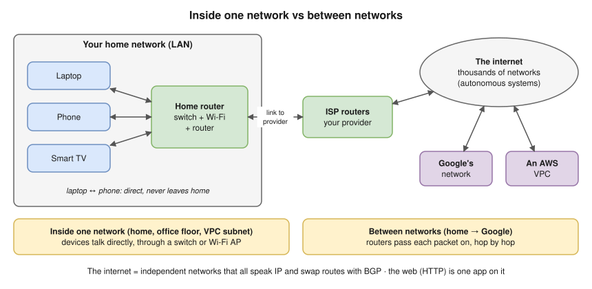
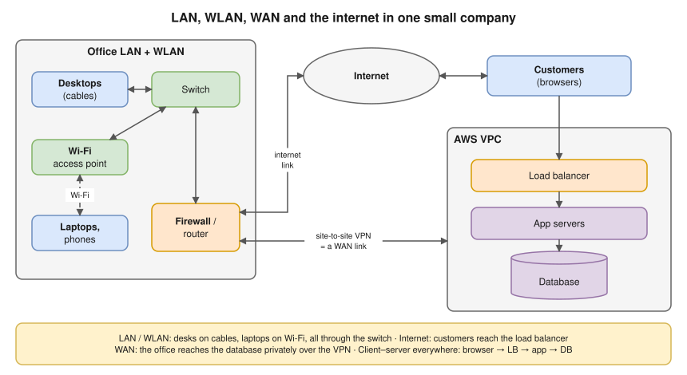
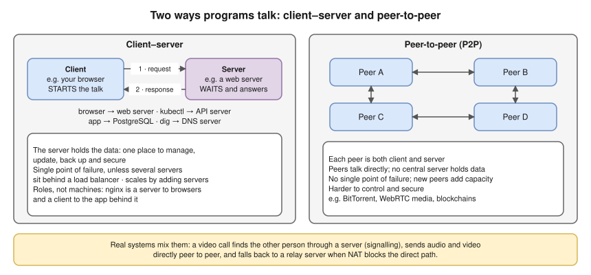

# 1.1 · What Is a Computer Network?

> **Level 1 · Networking fundamentals** · Lesson 1 of 5 · ⏱️ about 45 minutes (estimate) · 🧪 [Lab 1.1](../13-hands-on-labs/lab-01.1-inspect-your-own-network.md)
> ⬅️ [Level 1 overview](README.md) · ➡️ [1.2 Network devices](02-network-devices.md)



- A **network** = two or more **devices** (nodes, hosts) + **links** (copper, fibre, Wi-Fi, 4G/5G radio) + **protocols** (Ethernet, Wi-Fi, IP, TCP, HTTP).
- A **protocol** = agreed rules: the **format** of a message, the **order** messages are sent in, and what each one **means** ([1.3](03-addresses-ports-and-protocols.md), [Level 3](../03-core-networking-protocols/README.md)).
- ⭐ **Inside one network** (home, office floor, one VPC subnet) devices reach each other **directly**, through a switch or Wi-Fi access point. **Between networks**, **routers** pass each packet on, hop by hop.
- The **internet** = tens of thousands of independent networks (**autonomous systems, AS**: ISPs, universities, companies, clouds) that all speak **IP** and exchange routes with **BGP** ([Level 4](../04-switching-and-routing/README.md)).
- **The internet is not the web.** The web (pages sent with **HTTP**) is one application on it. Email, video calls, games, SSH and DNS are others.
- Big messages are cut into small **packets**, each with the full address; they travel separately and are put back together at the end. The picture used in these notes: device = house, packet = letter, IP address = the address on the envelope, link = road, router = sorting office, protocol = the rules of the post.

## Types of network



| Type | Covers | Typical technology | Example |
|---|---|---|---|
| **PAN** (Personal Area Network) | A few metres around one person | Bluetooth, USB | Your phone and earbuds |
| **LAN** (Local Area Network) | One home, office floor or building | Ethernet cables, switches | Office desks plugged into a switch |
| **WLAN** (Wireless LAN) | The same, without cables | Wi-Fi (IEEE 802.11) | Your home Wi-Fi |
| **CAN** (Campus Area Network) | Several buildings on one site | Fibre between buildings | A university campus |
| **MAN** (Metropolitan Area Network) | A city | Fibre rings run by a provider | A city-wide network linking bank branches |
| **WAN** (Wide Area Network) | Cities, countries, continents | Leased lines, MPLS, VPNs over the internet, SD-WAN | A company linking offices in Pune, London and New York |
| **The internet** | The whole world | Thousands of networks joined by routers and BGP | Everything public |

- **Don't memorise the boundaries.** A **LAN** is *yours and local*; a **WAN** connects *distant* sites, usually over links you rent from a provider. A LAN is about scope, not cables: a Wi-Fi LAN (WLAN) is still a LAN.
- **VPC** (Virtual Private Cloud): a private network you create inside a cloud provider; a LAN (or a set of LANs, called **subnets**) you design yourself ([Level 9](../09-cloud-networking/README.md)).
- **Overlay network**: a virtual network built **on top of** another, e.g. the one connecting pods across Kubernetes nodes ([Level 7](../07-advanced-networking/README.md), [Level 10](../10-container-and-kubernetes-networking/README.md)).
- **Topology** = the shape of the connections. **Star**: every device to one central box (almost every LAN: switch or Wi-Fi AP). **Mesh**: many to many (the internet's core, data-centre leaf–spine, mesh Wi-Fi). **Bus / ring**: one shared cable or a loop (mostly historical: old Ethernet, Token Ring).

## How programs talk: client–server and peer-to-peer



- A **server** is a program that **waits** for requests and answers them, usually on an always-on machine with a well-known address. A **client** **starts** the conversation.
- Client–server is used for almost all business systems, APIs, websites and databases. P2P for file sharing, some real-time media, distributed ledgers.
- "P2P means no servers at all" is a myth: most P2P systems still use servers to find peers.

## Try it: look at your own network

You'll explore properly in [Lab 1.1](../13-hands-on-labs/lab-01.1-inspect-your-own-network.md). Your laptop's address on the home network:

```bash
ipconfig getifaddr en0
```

The box that leads out of your network (the **default gateway**, your home router):

```bash
route -n get default
```

**Expected output (tested on the Mac, Oct 2026),** shortened:

```
   route to: default
destination: default
       mask: default
    gateway: 192.168.29.1
  interface: en0
```

`192.168.29.1` is your home router: everything **not** on your home network is sent there first. On Linux, use `ip -br addr` and `ip route`.

## Where you meet it

| Where | The network in disguise |
|---|---|
| A website | A **client** (the browser) talking to a **server** over the internet |
| Docker | Containers talk over a **virtual network** inside your computer |
| Kubernetes | A cluster is a network of nodes and pods |
| AWS | A VPC is a private network you design: its addresses, subnets (its LANs), routes, and which subnets reach the internet ([Level 9](../09-cloud-networking/README.md)) |
| Microservices | One page load: browser → load balancer → API → three other services → a database. Each arrow is a network call that can fail |
| "Works on the office Wi-Fi, not at home" | The app is only reachable on the company's private network (a VPN or VPC), not on the internet |

## Troubleshooting: inside or outside?

"The internet is down": **test from the closest point outwards**, and let each result tell you which half to keep ([3.11](../03-core-networking-protocols/11-troubleshooting-connectivity.md)).

| You see | It means | Next step |
|---|---|---|
| `ipconfig getifaddr en0` prints no address | You're not on the LAN: Wi-Fi off, wrong network, or no address from DHCP ([2.8](../02-ip-addressing-and-subnetting/08-dhcp.md)) | Reconnect, check DHCP |
| `ping -c 3 192.168.29.1` (your own gateway) fails | The problem is **inside**: Wi-Fi signal, cable, the router itself | Fix the local link |
| The router answers, `ping -c 3 1.1.1.1` fails | The router's connection to the provider is down (the problem is **outside**) | Check the provider link |
| `1.1.1.1` answers, websites still fail | The internet path works | Suspect **DNS** ([3.4](../03-core-networking-protocols/04-dns.md)) |

- Connected to Wi-Fi ≠ connected to the internet: Wi-Fi reaches only the **local** network; the router still has to reach your provider.
- ⚠️ `ping` uses **ICMP**, which some networks block. A failed ping is a hint, not proof ([3.7](../03-core-networking-protocols/07-icmp-ping-and-traceroute.md)).

## Interview angle

- **"What's the difference between a LAN and a WAN?"** → A LAN is a local network you own (one site); a WAN connects distant sites, usually over a provider's links or VPNs over the internet.
- **"What is the internet?"** → A network of independent networks (autonomous systems) that all speak IP and exchange routes with BGP.
- **"Client–server vs peer-to-peer?"** → In client–server, clients start requests and a central server answers and holds the data; easy to manage, but the server must be scaled and made redundant. In P2P, peers talk directly and share the work; resilient but harder to control and secure.

## Check yourself

1. Name the three things every network needs.
2. Your phone and your laptop are on the same home Wi-Fi. Does a packet between them go through your internet provider?
3. Is a company's link between its Pune and London offices a LAN or a WAN?
4. nginx receives requests from browsers and forwards them to an app. Is nginx a client or a server?
5. You can ping your router but no website loads. Which half of the network is working?

<details>
<summary><b>Answers</b> (try first)</summary>

1. Devices (nodes), links, and protocols.
2. No. They are on the same local network, so the packet goes through the home router's built-in switch or Wi-Fi only.
3. A WAN: it connects distant sites.
4. Both: a **server** to the browsers and a **client** to the app.
5. The local network (inside) works. The problem is beyond the router: the provider link, or DNS.

</details>

➡️ **Next:** [1.2 · Network devices](02-network-devices.md): the boxes in these diagrams, what each one reads, and what it does with a packet.
