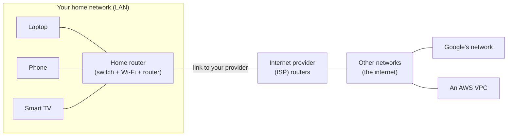
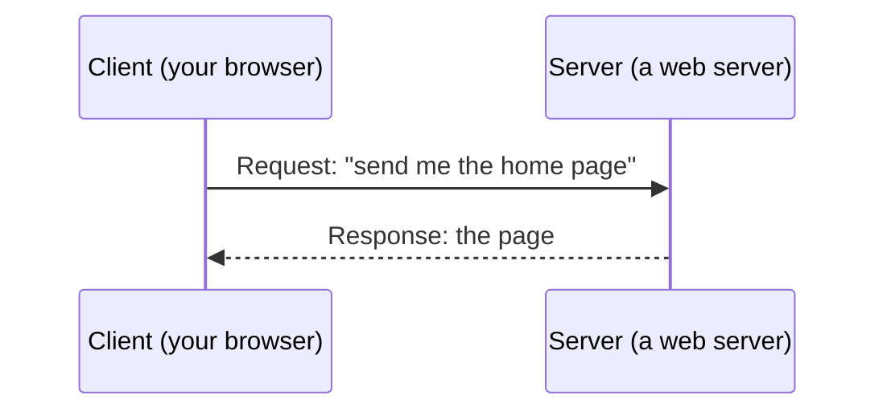
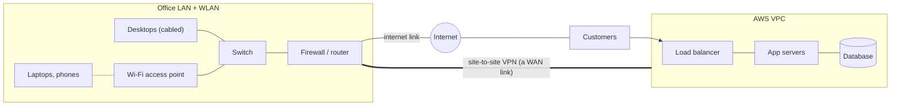

# 1.1 · What Is a Computer Network?

> **Level 1 · Networking fundamentals** · Lesson 1 of 5 · ⏱️ about 45 minutes (estimate)
> ⬅️ [Level 1 overview](README.md) · ➡️ [1.2 Network devices](02-network-devices.md)

## What you'll learn

- What a computer network is, and the three things every network needs.
- The kinds of network you will hear about: **PAN, LAN, WLAN, MAN, WAN** and **the internet**.
- The two ways programs talk to each other: **client–server** and **peer-to-peer**.
- Why "the internet" and "the web" are not the same thing.
- How to tell, in one minute, whether a problem is in **your** network or **outside** it.

## Before you start

Nothing. This is the first lesson. If you can use a browser and open a terminal, you're ready.

---

## The idea in plain words

A **computer network** is two or more devices connected so they can **send data to each other**.

That's it. Your laptop and your Wi-Fi router form a network. A data centre with 50,000 servers is a network. The **internet** is millions of networks connected to each other.

Throughout these notes we use one picture: **the postal system**.

| Networking | Postal system |
|---|---|
| A **device** (laptop, phone, server) | A **house** |
| A **packet** (a small piece of data) | A **letter** |
| An **address** (IP address) | The **address on the envelope** |
| A **link** (cable, Wi-Fi radio) | The **road** between houses |
| A **router** | A **sorting office**: reads the address and sends the letter on towards it |
| A **protocol** | The **rules of the post**: where to write the address, how big a letter can be |

Big messages (a video, a web page) don't travel as one piece. They are cut into many small **packets**, each with the full address on it. They travel separately and are put back together at the other end.

## Why it matters

Almost every system you'll work on is a network problem in disguise:

- A website is a **client** (the browser) talking to a **server** over the internet.
- A Docker container talks to another container over a **virtual network** inside your computer.
- A Kubernetes cluster is a network of nodes and pods.
- An AWS VPC is a private network that you design: its addresses, its subnets, its routes.

When "the app doesn't work", the cause is very often the network between two programs. You can only find it if you know what that network looks like.

## How it works

### The three things every network needs

| Need | What it is | Example |
|---|---|---|
| 1 · **Devices** (also called **nodes** or **hosts**) | Things that send or receive data | Laptop, phone, server, printer, smart TV |
| 2 · **Links** | A way to carry signals between them | Copper cable, fibre-optic cable, Wi-Fi radio, mobile radio (4G/5G) |
| 3 · **Protocols** | Agreed rules, so both sides understand each other | Ethernet, Wi-Fi, IP, TCP, HTTP |

> A **protocol** is a set of rules for communication: the **format** of a message, the **order** messages are sent in, and what each one **means**. Two devices can only talk if they follow the same protocol, like two people who speak the same language. You'll meet the important ones in [1.3](03-addresses-ports-and-protocols.md) and [Level 3](../03-core-networking-protocols/README.md).

### Inside a network vs between networks

This distinction is the single most useful idea in this lesson:

- **Inside one network** (your home, one office floor, one subnet in a VPC), devices reach each other **directly**, through a **switch** or a Wi-Fi access point.
- **Between networks** (your home → Google), a **router** passes the packet from one network to the next, hop by hop, until it arrives.



Your laptop reaches your phone **inside** the home network. It reaches Google **through** your router and many other routers.

### The internet: a network of networks

The **internet** is not one network owned by one company. It is tens of thousands of independent networks run by internet providers (ISPs), universities, companies and cloud providers, all **connected to each other** and all speaking the same protocol, **IP** (Internet Protocol).

Each big independent network is called an **autonomous system (AS)**. They agree to carry each other's traffic and tell each other which addresses they can reach, using a routing protocol called **BGP**. You will meet BGP in [Level 4](../04-switching-and-routing/README.md); for now, remember: *the internet works because independent networks agreed on common rules.*

> **The internet is not the web.** The **internet** is the network: the roads. The **World Wide Web** is one application that runs on it: web pages, sent with **HTTP**. Email, video calls, online games, SSH and DNS also run on the internet, and they aren't "the web".

## Types of network

Networks are named by **how big an area** they cover and **who runs them**.

| Type | Full form | Covers | Typical technology | Example |
|---|---|---|---|---|
| **PAN** | Personal Area Network | A few metres around one person | Bluetooth, USB | Your phone and earbuds |
| **LAN** | Local Area Network | One home, office floor or building | Ethernet cables, switches | Office desks plugged into a switch |
| **WLAN** | Wireless LAN | The same, without cables | Wi-Fi (IEEE 802.11) | Your home Wi-Fi |
| **CAN** | Campus Area Network | Several buildings on one site | Fibre between buildings | A university campus |
| **MAN** | Metropolitan Area Network | A city | Fibre rings run by a provider | A city-wide network linking bank branches |
| **WAN** | Wide Area Network | Cities, countries, continents | Leased lines, MPLS, VPNs over the internet, SD-WAN | A company linking offices in Pune, London and New York |
| **The internet** | n/a | The whole world | Thousands of networks joined by routers and BGP | Everything public |

Two cloud-era additions you'll use constantly:

| Term | What it is |
|---|---|
| **VPC** (Virtual Private Cloud) | A private network you create inside a cloud provider. It behaves like a LAN (or a set of LANs, called **subnets**) that you design yourself. Covered in [Level 9](../09-cloud-networking/README.md). |
| **Overlay network** | A virtual network built **on top of** another network, for example the network that connects pods across Kubernetes nodes. Covered in [Level 7](../07-advanced-networking/README.md) and [Level 10](../10-container-and-kubernetes-networking/README.md). |

**Don't memorise the boundaries.** "LAN" and "WAN" are about *ownership and distance*, not exact sizes. What matters: a **LAN** is *yours and local*; a **WAN** connects *distant* sites, usually over links you rent from a provider.

### A quick word on topology

**Topology** = the shape of the connections.

| Topology | Shape | Where you see it |
|---|---|---|
| **Star** | Every device connects to one central box | Almost every LAN: devices → switch or Wi-Fi access point |
| **Mesh** | Many devices connect to many others | The internet's core; data-centre "leaf–spine" networks; mesh Wi-Fi |
| **Bus / ring** | One shared cable, or a loop | Mostly historical (old Ethernet, Token Ring) |

## How programs talk: client–server and peer-to-peer

The network carries packets. **Programs** decide who talks to whom.

### Client–server

- A **server** is a program that **waits** for requests and **answers** them. It usually runs on a machine that is always on, with a well-known address.
- A **client** is a program that **starts** the conversation by sending a request.



Examples: browser → web server, `kubectl` → Kubernetes API server, your app → PostgreSQL database, `dig` → DNS server.

> The words describe **roles**, not machines. One program can be both: an nginx reverse proxy is a **server** to browsers and a **client** to the app behind it.

### Peer-to-peer (P2P)

Every device (a **peer**) can be both client and server, and peers talk **directly** to each other, with no central server holding the data.

Examples: BitTorrent file sharing, some video calls (WebRTC sends media peer to peer when it can), blockchain networks.

### Side by side

| | Client–server | Peer-to-peer |
|---|---|---|
| Who holds the data? | The server | Spread across the peers |
| Who starts the conversation? | Always the client | Any peer |
| Easy to manage and secure? | ✅ Yes: one place to update, back up and protect | ❌ Harder: data and control are spread out |
| Single point of failure? | ⚠️ Yes, unless you run several servers behind a load balancer | ✅ No: other peers keep working |
| Scales by | Adding servers | More peers (each new peer also adds capacity) |
| Used for | Almost all business systems, APIs, websites, databases | File sharing, some real-time media, distributed ledgers |

**Real systems are often hybrid.** A video call app uses servers to find the other person and set up the call (**signalling**), then tries to send the audio and video **directly** between the two devices, and falls back to a relay server when the network (usually NAT, [3.8](../03-core-networking-protocols/08-nat-pat-and-port-forwarding.md)) doesn't allow a direct path.

## Worked example: a small company's network

A company has one office and runs its app in AWS.



- **LAN / WLAN:** desktops on cables and laptops on Wi-Fi, all reaching each other through the switch.
- **Internet:** customers reach the load balancer in the VPC.
- **WAN:** the office reaches the database **privately** over a VPN, not over the open internet.
- **Client–server everywhere:** browser → load balancer, load balancer → app, app → database.

## Try it: look at your own network

You'll explore properly in [Lab 1.1](../13-hands-on-labs/lab-01.1-inspect-your-own-network.md). For now, two commands on your Mac:

Your laptop's address on the home network:

```bash
ipconfig getifaddr en0
```

The address of the box that leads out of your network (the **default gateway**, your home router):

```bash
route -n get default
```

**Expected output (tested on the Mac, Oct 2026),** shortened:

```
   route to: default
destination: default
       mask: default
    gateway: 192.168.29.1
  interface: en0
```

`192.168.29.1` is your home router. Everything **not** on your home network is sent there first. That's the boundary between "inside" and "outside" from the diagram above.

On Linux, the same two questions are answered by `ip -br addr` and `ip route`.

## In the real world

- **"It works on the office Wi-Fi but not at home"** usually means the app is only reachable on the **company's private network** (inside a VPN or a VPC), not on the internet.
- **Cloud design is network design.** When you create a VPC, you decide its address ranges, its subnets (its LANs), and which of them can reach the internet. [Level 9](../09-cloud-networking/README.md) covers this.
- **Microservices are client–server, many times over.** One page load can be a chain: browser → load balancer → API → three other services → a database. Each arrow is a network call that can fail.

## Common mistakes

| Mistake | Reality |
|---|---|
| "The internet and the web are the same." | The web (HTTP pages) is **one application** on the internet. |
| "Connected to Wi-Fi means connected to the internet." | Wi-Fi connects you to the **local** network only. The router still has to reach your provider. |
| "A LAN must use cables." | A LAN is about **scope** (local, yours). Wi-Fi LANs are called WLANs, but they're still LANs. |
| "Client and server are kinds of computer." | They are **roles** of programs. A laptop can run a server; a server machine runs many clients. |
| "P2P means no servers at all." | Most P2P systems still use servers to find peers. |

## Troubleshooting: inside or outside?

**Symptom:** "The internet is down."

Split the problem in two with one test:

| Step | Command (Mac) | If it works | If it fails |
|---|---|---|---|
| 1 · Do I have an address on the local network? | `ipconfig getifaddr en0` | Continue | You're not connected to the LAN: Wi-Fi off, wrong network, or no address from DHCP ([2.8](../02-ip-addressing-and-subnetting/08-dhcp.md)) |
| 2 · Can I reach my router? | `ping -c 3 192.168.29.1` (use your own gateway) | The **local** network works. The problem is **outside**: the router's link to the provider, the provider, or DNS | The problem is **inside**: Wi-Fi signal, cable, the router itself |
| 3 · Can I reach a well-known address outside? | `ping -c 3 1.1.1.1` | The internet path works. If websites still fail, suspect **DNS** ([3.4](../03-core-networking-protocols/04-dns.md)) | The router's connection to the provider is down |

Notice the method: **test from the closest point outwards**, and let each result tell you which half of the problem to keep. You'll use this idea in every troubleshooting session ([3.11](../03-core-networking-protocols/11-troubleshooting-connectivity.md)).

> ⚠️ `ping` uses **ICMP**, which some networks block. A failed ping is a hint, not proof. You'll learn why in [3.7](../03-core-networking-protocols/07-icmp-ping-and-traceroute.md).

## Hands-on lab

[Lab 1.1 · Inspect your own network](../13-hands-on-labs/lab-01.1-inspect-your-own-network.md): find your addresses, your gateway, your DNS servers and what's listening on your machine (20 minutes, Mac and Linux).

## Interview angle

- **"What's the difference between a LAN and a WAN?"** → A LAN is a local network you own (one site); a WAN connects distant sites, usually over a provider's links or VPNs over the internet.
- **"What is the internet?"** → A network of independent networks (autonomous systems) that all speak IP and exchange routes with BGP.
- **"Client–server vs peer-to-peer?"** → In client–server, clients start requests and a central server answers and holds the data; easy to manage, but the server must be scaled and made redundant. In P2P, peers talk directly and share the work; resilient but harder to control and secure.

## Check yourself

1. Name the three things every network needs.
2. Your phone and your laptop are on the same home Wi-Fi. Does a packet between them go through your internet provider?
3. Is a company's link between its Pune and London offices a LAN or a WAN?
4. nginx receives requests from browsers and forwards them to an app. Is nginx a client or a server?
5. You can ping your router but no website loads. Which half of the network is working?

<details>
<summary><b>Answers</b> (try first)</summary>

1. Devices (nodes), links, and protocols.
2. No. They are on the same local network, so the packet goes through the home router's built-in switch or Wi-Fi only.
3. A WAN: it connects distant sites.
4. Both: a **server** to the browsers and a **client** to the app.
5. The local network (inside) works. The problem is beyond the router: the provider link, or DNS.

</details>

## Summary

- A network = **devices + links + protocols**.
- Inside one network, devices talk **directly** (through a switch or access point). Between networks, **routers** forward packets hop by hop.
- The **internet** is a network of networks that all speak **IP**. The **web** is just one application on it.
- PAN → LAN/WLAN → MAN → WAN describes **scope and ownership**. A **VPC** is a LAN you design in the cloud.
- **Client–server**: clients ask, servers answer. **P2P**: peers do both. Real systems mix them.
- Troubleshoot from the **inside out**: your address → your router → the outside world.

## Next

➡️ [1.2 · Network devices](02-network-devices.md): the boxes in the diagrams above (switch, router, modem, access point, firewall, load balancer), what each one reads, and what each one does with a packet.
