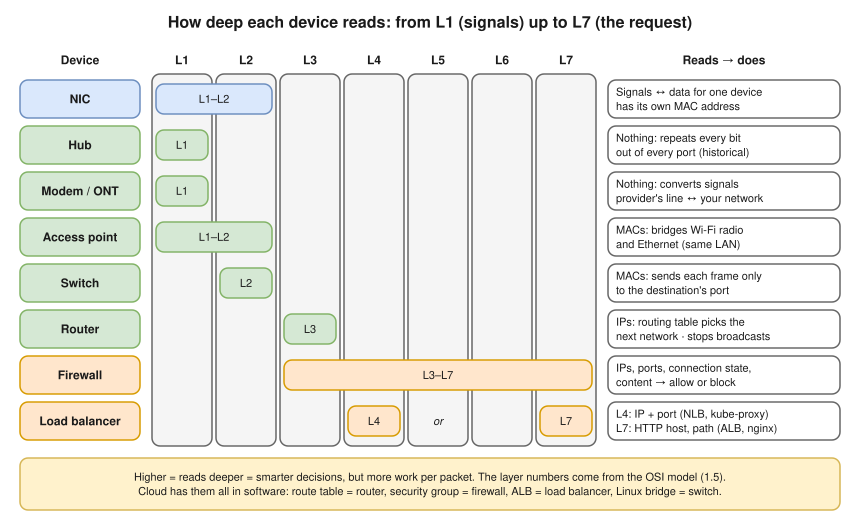
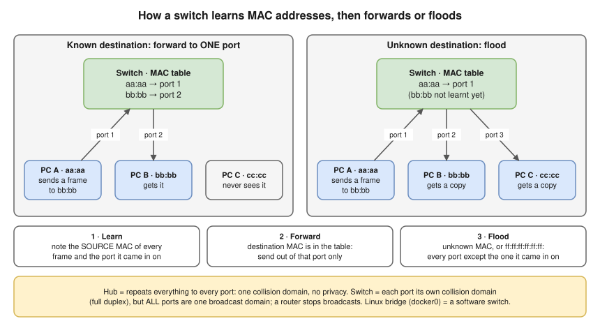
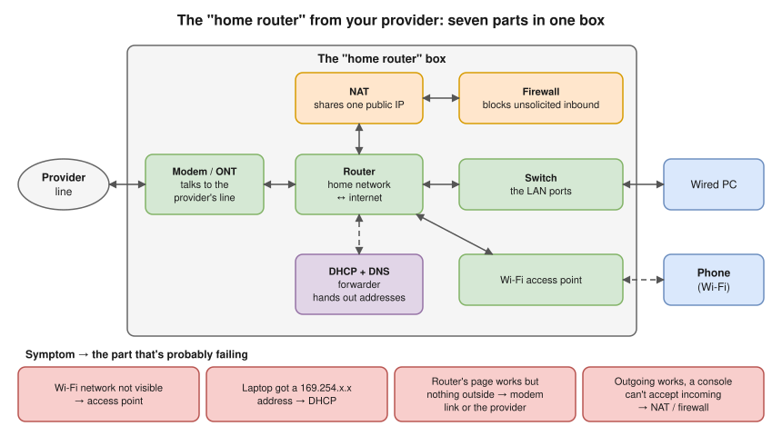

# 1.2 · Network Devices: What Each Box Does

> **Level 1 · Networking fundamentals** · Lesson 2 of 5 · ⏱️ about 60 minutes (estimate) · 🧪 [Lab 1.2](../13-hands-on-labs/lab-01.2-build-a-tiny-network-with-namespaces.md)
> ⬅️ [1.1 What is a network?](01-what-is-a-network.md) · ➡️ [1.3 Addresses, ports and protocols](03-addresses-ports-and-protocols.md)



- Every device decides **where data goes next**. They differ in **how much of it they read**: the deeper, the smarter the decision and the more work per packet. (Layer numbers: [1.5](05-osi-and-tcp-ip-models.md).)
- **MAC address** = hardware address of a card, used **inside** one network. **IP address** = logical address, used **across** networks ([1.3](03-addresses-ports-and-protocols.md)).
- ⭐ **Switch** forwards **frames** by **MAC** inside one network. **Router** forwards **packets** by **IP** between networks, and stops broadcasts.
- **Firewall** allows or blocks by rules. **Load balancer** spreads connections across healthy servers.
- Cloud and Kubernetes have the same devices in software: VPC route table = router, security group = firewall, ALB = load balancer, Linux bridge = switch.

## Switch · L2 (and the hub before it)



- A switch connects devices **inside one local network** and forwards each **frame** (a packet wrapped with MAC addresses) only to the port where the destination MAC lives.
- The table is the **MAC address table** (also **CAM table** or **forwarding database, FDB**). It learns `bb:bb`'s port when `bb:bb` replies.
- [Lab 1.2](../13-hands-on-labs/lab-01.2-build-a-tiny-network-with-namespaces.md) proves it: the third machine sees the broadcast "who has this address?" question, but not the conversation that follows **(tested in the lab container)**.
- **Hub · L1 (historical):** repeats every bit out of every other port. Everyone sees everything; only one device can send at a time, or the signals **collide** and both retry: all ports are one **collision domain**. Replaced by switches in the 2000s; the idea survives as **flooding**.
- A **VLAN** splits one physical switch into several separate switches ([Level 4](../04-switching-and-routing/README.md)).

## The other devices

| Device · layer | What it does |
|---|---|
| **NIC** (network interface card / adapter) · L1–L2 | Connects a device to the network (Ethernet port, Wi-Fi chip, or a virtual card in a VM or container) and turns data into signals (electricity, light, radio) and back. Has a **MAC** burned in by the manufacturer, like `a4:83:e7:1c:2b:9f` (virtual NICs get a generated one). Linux names: `eth0`, `ens5`, `wlan0`; Mac: `en0` (Wi-Fi), `en1`… A device can have several |
| **Router** · L3 | Has an interface (and an address) in **each network** it connects. Looks up the destination IP in its **routing table** and picks the best match: "`10.0.2.0/24` goes out of interface 2", "everything else to my provider" ([2.7](../02-ip-addressing-and-subnetting/07-default-gateway-routing-table-and-arp.md)). **Doesn't forward broadcasts** (it's the edge of a broadcast domain). Decreases **TTL** by one, so a looping packet dies ([3.7](../03-core-networking-protocols/07-icmp-ping-and-traceroute.md)). Any Linux box with `net.ipv4.ip_forward=1` is a router; Docker does this on your host ([10.1](../10-container-and-kubernetes-networking/01-docker-bridge-networking-inside-out.md)) |
| **Layer 3 switch** | A switch that also routes between VLANs in hardware (offices, data centres) |
| **Modem** (modulator–demodulator) · L1 | Converts your network's digital signal into what the provider's line carries: **DSL modem** (telephone line), **cable modem** (cable TV line), **ONT** (optical network terminal, fibre to the home), cellular modem (4G/5G). Doesn't route or filter |
| **Wireless access point (AP)** · L1–L2 | A bridge between radio and Ethernet, using MACs. Everyone on the same **SSID** (network name) is in the same LAN. Many APs with one SSID let you walk around (**roaming**). Wi-Fi is **half duplex** and shared by everyone nearby, one reason it's slower and less steady than a cable |
| **Load balancer** · L4 or L7 | Receives connections on one address, spreads them across several servers, runs **health checks**. **L4** reads IPs and ports, forwards TCP/UDP (AWS **NLB**, Kubernetes `kube-proxy`): fast, doesn't understand HTTP. **L7** reads the HTTP request, routes by host, path or header, terminates TLS (AWS **ALB**, nginx, Envoy, HAProxy, Kubernetes Ingress and Gateway API controllers). [Level 5](../05-network-services-and-infrastructure/README.md) |
| Repeater · Bridge | Boosts a weak signal (L1) · joins two segments at L2 (a switch is a many-port bridge) |
| Proxy · VPN gateway | Makes requests **on behalf of** clients · builds encrypted tunnels between networks or for remote users ([Level 5](../05-network-services-and-infrastructure/README.md)) |
| IDS / IPS | Intrusion detection / prevention: watch traffic for attacks ([Level 6](../06-network-security/README.md)) |

**Firewall · L3–L7:**

| Kind | Looks at | Example rule |
|---|---|---|
| **Packet filter** (stateless) | IP addresses, protocol, ports, one packet at a time | "Allow TCP from anywhere to port 443" |
| **Stateful firewall** | The same, plus **connection state**: it remembers connections it allowed, so replies are let back in automatically | "Allow outgoing connections; allow only their replies back in" |
| **Next-generation firewall (NGFW)** / **WAF** (web application firewall) | The application data: URLs, headers, known attack patterns | "Block requests that look like SQL injection" |

- **DROP** = silently throw the packet away: the sender eventually sees a **timeout**. **REJECT** = throw it away **and** tell the sender: an immediate error like **connection refused**. Both on the wire in [Lab 3.1](../13-hands-on-labs/lab-03.1-capture-a-tcp-handshake.md).
- Most firewalls also **route** and often **NAT**.

## Everything at a glance

| Device | Layer | Forwards by | Breaks a broadcast domain? | Cloud / Kubernetes equivalent |
|---|---|---|---|---|
| NIC | L1–L2 | n/a | n/a | ENI (AWS elastic network interface), a pod's `eth0` |
| Hub | L1 | Repeats to all | No | n/a |
| Switch | L2 | MAC table | No (VLANs can split it) | Linux bridge, `docker0`, the VPC fabric |
| Access point | L1–L2 | Radio ↔ Ethernet | No | n/a |
| Router | L3 | Routing table | **Yes** | VPC route table, internet gateway, Transit Gateway, a Linux host with `ip_forward=1` |
| Modem / ONT | L1 | n/a | n/a | n/a |
| Firewall | L3–L7 | Allow / deny rules | Usually also routes | Security group, NACL, AWS Network Firewall, Kubernetes NetworkPolicy |
| Load balancer | L4 or L7 | Health + algorithm | Acts as a proxy | NLB / ALB, Service (`kube-proxy`), Ingress / Gateway API |

## Your "home router" is seven parts in one box



One box going wrong can look like "everything is broken", but each part fails separately ([2.8](../02-ip-addressing-and-subnetting/08-dhcp.md) DHCP, [3.8](../03-core-networking-protocols/08-nat-pat-and-port-forwarding.md) port forwarding).

## Try it: see devices from a Linux machine

The interfaces (NICs), one line each:

```bash
ip -br link
```

**Expected output (tested in the lab container):**

```
lo               UNKNOWN        00:00:00:00:00:00 <LOOPBACK,UP,LOWER_UP>
ifb0             DOWN           52:b8:98:c5:7b:93 <BROADCAST,NOARP>
ifb1             DOWN           6e:59:df:76:13:4f <BROADCAST,NOARP>
eth0             UP             02:fc:00:00:00:01 <BROADCAST,MULTICAST,UP,LOWER_UP>
```

- `lo` = **loopback**, a virtual card for the machine to talk to itself. `UP` / `DOWN` = on and has a link. `02:fc:00:00:00:01` = the MAC. `UP` = turned on by software; `LOWER_UP` = the "cable" (physical or virtual) is connected. (`ifb0`, `ifb1`: special virtual interfaces this container happens to have; ignore them.)

Your next hop, and its MAC address:

```bash
ip route
```

```bash
ip neigh
```

**Expected output (tested in the lab container):**

```
default via 192.0.2.1 dev eth0
192.0.2.0/24 dev eth0 proto kernel scope link src 192.0.2.2
```

```
192.0.2.1 dev eth0 lladdr 02:fc:00:00:00:05 REACHABLE
```

- Anything not local goes **via 192.0.2.1**, this machine's router. `ip neigh` shows the router's MAC (`lladdr`, link-layer address): frames to the router are sent to it. On a Mac: `arp -a`.

## Where you meet it

| Where | The devices |
|---|---|
| Data centres | **Leaf–spine**: every server to a "leaf" switch, every leaf to every "spine" switch. Routing often runs all the way to the leaf |
| AWS | You never see a switch or a cable: the VPC is one switch-and-router fabric, controlled through **route tables** (routers), **security groups and NACLs** (firewalls) and **load balancers** |
| Kubernetes | On every node: a bridge or eBPF program (switching), the node's routing table (routing), iptables / nftables / eBPF (firewalling and load balancing) |

## Troubleshooting: which box?

Work from your own device outwards:

| You see | It means | Next step |
|---|---|---|
| Interface `DOWN` or no `LOWER_UP` | NIC, cable, Wi-Fi association | `ip -br link`; on a Mac, the Wi-Fi menu |
| Can't reach the gateway, `ip neigh` shows `FAILED` for it | The switch / AP between you and the router, or the router itself | `ip neigh`, then `ping <gateway>` |
| Gateway reachable, other networks not | Router (routes) or provider link | `traceroute 1.1.1.1` shows where it stops ([3.7](../03-core-networking-protocols/07-icmp-ping-and-traceroute.md)) |
| Connections **time out** to one port, others work | A firewall **dropping** that port | `nc -zv <host> <port>` ([3.11](../03-core-networking-protocols/11-troubleshooting-connectivity.md)) |
| Some requests succeed, some fail, at random | A load balancer sending to an unhealthy server | The load balancer's target health |

- "A switch sends everything to everyone": no, that's a **hub**; a switch floods only broadcasts and unknown MACs.
- "The modem is the router": the modem only translates signals; routing, NAT, Wi-Fi and DHCP are separate functions, often in the same box.
- "A load balancer is only for websites": L4 ones handle any TCP/UDP: databases, DNS, game servers, the Kubernetes API.

## Interview angle

- ⭐ **"Switch vs router?"** → A switch forwards **frames** by **MAC address** inside one network (L2) and learns MACs from source addresses. A router forwards **packets** by **IP address** between networks (L3), using a routing table, and stops broadcasts.
- **"Hub vs switch?"** → A hub repeats to every port (one collision domain, no privacy). A switch learns MACs and sends only to the right port.
- **"What does a stateful firewall remember?"** → The connections it has allowed, so reply packets are allowed back without a separate rule. AWS security groups are stateful; NACLs are not.
- **"L4 vs L7 load balancer?"** → L4 forwards connections by IP and port (NLB). L7 reads the HTTP request and routes by host, path or header, and can terminate TLS (ALB). More in [1.5](05-osi-and-tcp-ip-models.md) and [Level 5](../05-network-services-and-infrastructure/README.md).

## Check yourself

1. Which device would you need to connect two different subnets?
2. A switch receives a frame for a MAC address it has never seen. What does it do?
3. Why does a router stop a broadcast?
4. Your laptop shows a `169.254.x.x` address. Which part of the home router box is the first suspect?
5. A connection to port 5432 waits 30 seconds and then fails, while port 443 on the same server works. Which kind of device, doing what, is the likely cause?

<details>
<summary><b>Answers</b> (try first)</summary>

1. A router (or a layer 3 switch).
2. It **floods** it out of every port except the one it arrived on, and learns the destination's port when it replies.
3. Broadcasts are meant for "everyone on **this** local network". A router's job is to connect **different** networks, so it doesn't pass local broadcasts on. That's what keeps broadcast traffic contained.
4. DHCP: the laptop asked for an address and got no answer, so it gave itself a link-local one.
5. A firewall (or security group) **dropping** traffic to port 5432 silently, which causes a timeout.

</details>

➡️ **Next:** [1.3 · Addresses, ports and protocols](03-addresses-ports-and-protocols.md): the labels these devices read, and what a protocol really is.
