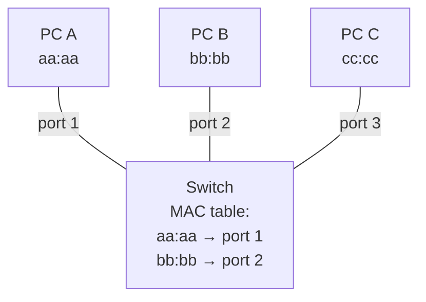
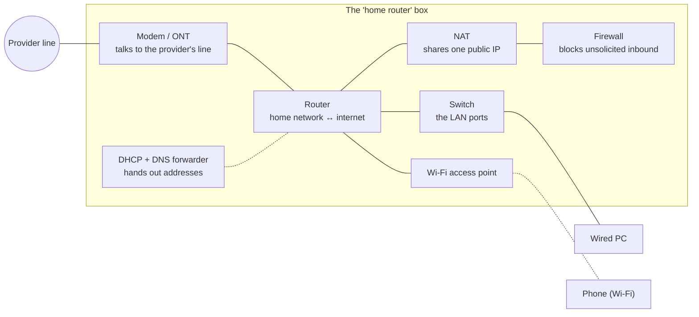

# 1.2 · Network Devices: What Each Box Does

> **Level 1 · Networking fundamentals** · Lesson 2 of 5 · ⏱️ about 60 minutes (estimate)
> ⬅️ [1.1 What is a network?](01-what-is-a-network.md) · ➡️ [1.3 Addresses, ports and protocols](03-addresses-ports-and-protocols.md)

## What you'll learn

- What a **network interface card (NIC)**, **hub**, **switch**, **router**, **modem**, **access point**, **firewall** and **load balancer** each do.
- The one question that separates them: **how much of the packet does the device read?**
- Why your "home router" is really six devices in one box.
- What each physical device looks like in the cloud and in Kubernetes.
- How to work out which box is failing.

## Before you start

- [1.1 What is a network?](01-what-is-a-network.md): inside a network vs between networks.
- Two words you'll meet here and learn properly in [1.3](03-addresses-ports-and-protocols.md):
  - a **MAC address** is the hardware address of a network card, used **inside** one network;
  - an **IP address** is the logical address of a device, used to reach it **across** networks.

---

## The idea in plain words

Every network device takes in data and decides **where it goes next**. They differ in **how much of the data they look at** before deciding:

| Device | Looks at | In the postal story |
|---|---|---|
| **Hub** | Nothing: it repeats every signal to everyone | Someone who photocopies every letter and hands a copy to every house on the street |
| **Switch** | The **MAC address** (local hardware address) | The street's postman, who knows which house is behind which door |
| **Router** | The **IP address** (the destination network) | The sorting office, which sends letters on to other towns |
| **Firewall** | Addresses, **ports**, connection state, sometimes the content | Security at the gate, checking each letter against a list of rules |
| **Load balancer** | Ports, and often the **request itself** (URL, headers) | A receptionist who spreads incoming letters across several clerks |

The deeper a device reads, the smarter its decisions can be, and the more work each packet costs. The layer numbers below (L1, L2, L3…) come from the OSI model in [1.5](05-osi-and-tcp-ip-models.md). Don't worry about them yet; just notice they go up as the device reads deeper.

## Why it matters

- **Troubleshooting** means finding *which box* dropped the packet. You can't do that if you don't know what each box does.
- **Cloud and Kubernetes** have the same devices, in software: a VPC route table is a router, a security group is a firewall, an ALB is a load balancer, a Linux bridge is a switch.
- **Interviews** love "switch vs router" and "L4 vs L7 load balancer".

## The devices, one by one

### Network interface card (NIC) · L1–L2

The **NIC** (network interface card, or network adapter) is the part of a device that connects it to the network: an Ethernet port, a Wi-Fi chip, or a virtual card in a VM or container.

- It turns data into signals (electricity, light, radio) and back.
- Every NIC has a **MAC address** burned in by the manufacturer, like `a4:83:e7:1c:2b:9f`. Virtual NICs get a generated one.
- On Linux you see NICs as **interfaces**: `eth0`, `ens5`, `wlan0`. On a Mac: `en0` (Wi-Fi), `en1`… A device can have several.

### Hub · L1 (historical)

A **hub** has several ports and **repeats every bit it receives out of every other port**. It doesn't read addresses at all.

- Every device sees every other device's traffic (no privacy).
- Only one device can send at a time; if two send together, the signals **collide** and both must retry. All ports form one **collision domain**.

Hubs were replaced by switches in the 2000s. You'll still see them in exam questions, and the idea of "send to everyone" survives as **flooding** (below).

### Switch · L2

A **switch** connects devices **inside one local network**. It forwards each **frame** (a packet wrapped with MAC addresses) **only to the port where the destination MAC lives**.

How it knows where each MAC lives: it **learns**.

1. A frame arrives on port 1 from MAC `aa:aa`. The switch writes down: "`aa:aa` is on port 1". This list is the **MAC address table** (also called the **CAM table** or **forwarding database, FDB**).
2. The frame is for MAC `bb:bb`:
   - if the table says "`bb:bb` is on port 2", it sends the frame **only** to port 2 (**forwarding**);
   - if `bb:bb` isn't in the table yet, it sends the frame to **every port except the one it came from** (**flooding**), and learns `bb:bb`'s port when `bb:bb` replies.
3. A frame for the **broadcast** address `ff:ff:ff:ff:ff:ff` always goes to every port.



A frame from A to B leaves on port 2 only. **C never sees it.** You'll prove this yourself in [Lab 1.2](../13-hands-on-labs/lab-01.2-build-a-tiny-network-with-namespaces.md): the third machine sees the broadcast "who has this address?" question, but not the conversation that follows **(tested in the lab container)**.

Every switch port is its own collision domain, and modern links are **full duplex** (send and receive at the same time), so collisions no longer happen. But all ports are still **one broadcast domain**: a broadcast reaches every device on the switch.

> A **Linux bridge** (like Docker's `docker0`) is a switch made of software. A **VLAN** splits one physical switch into several separate switches ([Level 4](../04-switching-and-routing/README.md)).

### Router · L3

A **router** connects **different networks** and forwards **packets** between them using the **destination IP address**.

- It has an interface (and an address) in **each network** it connects.
- For every packet, it looks up the destination IP in its **routing table** and picks the best matching route: "packets for `10.0.2.0/24` go out of interface 2", "everything else goes to my provider". You'll learn exactly how in [2.7](../02-ip-addressing-and-subnetting/07-default-gateway-routing-table-and-arp.md).
- It **does not forward broadcasts**. So a router is the edge of a broadcast domain.
- It **decreases a counter called TTL** in each packet by one, so a packet stuck in a loop eventually dies ([3.7](../03-core-networking-protocols/07-icmp-ping-and-traceroute.md)).

Any Linux machine can be a router: turn on `net.ipv4.ip_forward=1`. Docker does exactly this on your host ([10.1](../10-container-and-kubernetes-networking/01-docker-bridge-networking-inside-out.md)).

> **Layer 3 switch:** a switch that can also route between VLANs in hardware. Common in offices and data centres. It's a switch and a router in one box.

### Modem · L1

A **modem** (**mo**dulator–**dem**odulator) converts your network's digital signal into the kind of signal your provider's line carries, and back:

| Line type | Device you get |
|---|---|
| Telephone line (DSL) | DSL modem |
| Cable TV line | Cable modem |
| Fibre to the home | **ONT** (optical network terminal), which does the same job for light |
| Mobile (4G/5G) | A cellular modem in your phone or hotspot |

A modem doesn't route or filter; it only translates signals. Your provider's box often combines a modem with a home router.

### Wireless access point (AP) · L1–L2

An **access point** connects Wi-Fi devices to a wired network. It's a **bridge between radio and Ethernet**: Wi-Fi frames in, Ethernet frames out, using MAC addresses.

- Every device on the same Wi-Fi network (the same **SSID**, the network name) is in the same LAN.
- Offices use many APs with the same SSID so you can walk around without dropping (**roaming**).
- Wi-Fi is **half duplex** on the radio and shared by everyone nearby, which is one reason Wi-Fi is slower and less steady than a cable.

### Firewall · L3–L7

A **firewall** decides which traffic is **allowed** and which is **blocked**, using rules.

| Kind | Looks at | Example rule |
|---|---|---|
| **Packet filter** (stateless) | IP addresses, protocol, ports, one packet at a time | "Allow TCP from anywhere to port 443" |
| **Stateful firewall** | The same, plus **connection state**: it remembers connections it allowed, so replies are let back in automatically | "Allow outgoing connections; allow only their replies back in" |
| **Next-generation firewall (NGFW)** / **WAF** (web application firewall) | The application data: URLs, headers, known attack patterns | "Block requests that look like SQL injection" |

Two behaviours you'll meet again and again:

- **DROP** = silently throw the packet away. The sender waits and eventually sees a **timeout**.
- **REJECT** = throw it away **and** tell the sender. The sender gets an immediate error, like **connection refused**.

You'll see both on the wire in [Lab 3.1](../13-hands-on-labs/lab-03.1-capture-a-tcp-handshake.md).

### Load balancer · L4 or L7

A **load balancer** receives connections on one address and **spreads them across several servers**, so no single server is overloaded and one can fail without an outage.

- It runs **health checks** and only sends traffic to healthy servers.
- An **L4 load balancer** looks at IP addresses and ports only and forwards TCP or UDP connections (AWS **NLB**, Kubernetes `kube-proxy`). Fast, and doesn't understand HTTP.
- An **L7 load balancer** reads the HTTP request and can route by host name, path or header, and terminate TLS (AWS **ALB**, nginx, Envoy, HAProxy, Kubernetes Ingress and Gateway API controllers).

You'll go deep in [Level 5](../05-network-services-and-infrastructure/README.md).

### Smaller devices you may hear about

| Device | What it does |
|---|---|
| **Repeater** | Boosts a weak signal to go further (L1) |
| **Bridge** | Joins two network segments at L2; a switch is a many-port bridge |
| **Proxy** | A server that makes requests **on behalf of** clients, e.g. a company web proxy ([Level 5](../05-network-services-and-infrastructure/README.md)) |
| **VPN gateway** | Builds encrypted tunnels between networks or for remote users ([Level 5](../05-network-services-and-infrastructure/README.md)) |
| **IDS / IPS** | Intrusion detection / prevention systems: watch traffic for attacks ([Level 6](../06-network-security/README.md)) |

## Everything at a glance

| Device | Layer | Reads | Forwards by | Breaks a broadcast domain? | Cloud / Kubernetes equivalent |
|---|---|---|---|---|---|
| NIC | L1–L2 | Signals, its own MAC | n/a | n/a | ENI (AWS elastic network interface), a pod's `eth0` |
| Hub | L1 | Nothing | Repeats to all | No | n/a |
| Switch | L2 | MAC addresses | MAC table | No (VLANs can split it) | Linux bridge, `docker0`, the VPC fabric |
| Access point | L1–L2 | MAC addresses | Radio ↔ Ethernet | No | n/a |
| Router | L3 | IP addresses | Routing table | **Yes** | VPC route table, internet gateway, Transit Gateway, a Linux host with `ip_forward=1` |
| Modem / ONT | L1 | Signals | n/a | n/a | n/a |
| Firewall | L3–L7 | IPs, ports, state, content | Allow / deny rules | Usually also routes | Security group, NACL, AWS Network Firewall, Kubernetes NetworkPolicy |
| Load balancer | L4 or L7 | Ports; HTTP for L7 | Health + algorithm | Acts as a proxy | NLB / ALB, Service (`kube-proxy`), Ingress / Gateway API |

## Worked example: your "home router" is six devices

The box from your provider usually contains:



That's why one box going wrong can look like "everything is broken". Each part can fail separately:

| Symptom | Part that's probably failing |
|---|---|
| Wi-Fi network not visible | Access point |
| Connected to Wi-Fi, but you got a `169.254.x.x` address | DHCP ([2.8](../02-ip-addressing-and-subnetting/08-dhcp.md)) |
| You can reach the router's page, but nothing outside | The modem link or the provider |
| Outgoing works, but a game console can't accept incoming connections | NAT / firewall (port forwarding, [3.8](../03-core-networking-protocols/08-nat-pat-and-port-forwarding.md)) |

## Try it: see devices from a Linux machine

The interfaces (NICs) on a machine, one line each:

```bash
ip -br link
```

**Expected output (tested in the lab container):**

```
lo               UNKNOWN        00:00:00:00:00:00 <LOOPBACK,UP,LOWER_UP>
ifb0             DOWN           52:b8:98:c5:7b:93 <BROADCAST,NOARP>
ifb1             DOWN           6e:59:df:76:13:4f <BROADCAST,NOARP>
eth0             UP             02:fc:00:00:00:01 <BROADCAST,MULTICAST,UP,LOWER_UP>
```

| Column | Meaning |
|---|---|
| `lo`, `eth0` | The interface name. `lo` is **loopback**, a virtual card for the machine to talk to itself |
| `UP` / `DOWN` | Whether the interface is on and has a link |
| `02:fc:00:00:00:01` | The **MAC address** of that card |
| `<…,UP,LOWER_UP>` | `UP` = turned on by software; `LOWER_UP` = the "cable" (physical or virtual) is connected |

(`ifb0` and `ifb1` are special virtual interfaces this container happens to have; ignore them.)

Which device is your next hop, and its MAC address:

```bash
ip route
```

```bash
ip neigh
```

**Expected output (tested in the lab container):**

```
default via 192.0.2.1 dev eth0
192.0.2.0/24 dev eth0 proto kernel scope link src 192.0.2.2
```

```
192.0.2.1 dev eth0 lladdr 02:fc:00:00:00:05 REACHABLE
```

`ip route` says "anything that isn't local goes **via 192.0.2.1**": that's this machine's router. `ip neigh` shows the router's IP next to its **MAC address** (`lladdr`, link-layer address): the address frames to the router are sent to. On a Mac, `arp -a` shows the same table.

## In the real world

- **Data centres** use a **leaf–spine** design: every server connects to a "leaf" switch, and every leaf connects to every "spine" switch. Routing (not just switching) often runs all the way to the leaf.
- **In AWS you never see a switch or a cable.** The VPC acts like one big switch-and-router fabric. You control it through **route tables** (routers), **security groups and NACLs** (firewalls) and **load balancers**.
- **Kubernetes** builds the same devices in software on every node: a bridge or eBPF program for switching, the node's routing table for routing, iptables / nftables / eBPF for firewalling and load balancing.

## Common mistakes

| Mistake | Reality |
|---|---|
| "A switch and a router are the same." | A switch forwards **inside** one network by **MAC**. A router forwards **between** networks by **IP**. |
| "A switch sends everything to everyone." | That's a **hub**. A switch sends to everyone only for broadcasts and for unknown MACs (flooding). |
| "The modem is the router." | The modem only translates signals. Routing, NAT, Wi-Fi and DHCP are separate functions, often in the same box. |
| "A firewall only blocks." | Most firewalls also **route** and often **NAT**. Stateful ones also *remember* connections. |
| "A load balancer is only for websites." | L4 load balancers handle any TCP/UDP: databases, DNS, game servers, the Kubernetes API. |

## Troubleshooting: which box?

Work from your own device outwards, and match the symptom to the device:

| Symptom | Suspect | How to check |
|---|---|---|
| Interface shows `DOWN` or no `LOWER_UP` | NIC, cable, Wi-Fi association | `ip -br link`; on a Mac, the Wi-Fi menu |
| You can't reach the gateway, and `ip neigh` shows `FAILED` for it | The switch / AP between you and the router, or the router itself | `ip neigh`, then `ping <gateway>` |
| You can reach the gateway but not other networks | Router (routes) or provider link | `traceroute 1.1.1.1` shows where it stops ([3.7](../03-core-networking-protocols/07-icmp-ping-and-traceroute.md)) |
| Connections **time out** to one port, while others work | A firewall **dropping** that port | Test the port with `nc -zv <host> <port>` ([3.11](../03-core-networking-protocols/11-troubleshooting-connectivity.md)) |
| Some requests succeed and some fail, at random | A load balancer sending to an unhealthy server | Check the load balancer's target health |

## Hands-on lab

[Lab 1.2 · Build a tiny network with namespaces](../13-hands-on-labs/lab-01.2-build-a-tiny-network-with-namespaces.md): build two "PCs" connected by a virtual cable, then three PCs on a software **switch**, and watch it learn MAC addresses (30 minutes, Linux lab container).

## Interview angle

- ⭐ **"Switch vs router?"** → A switch forwards **frames** by **MAC address** inside one network (L2) and learns MACs from source addresses. A router forwards **packets** by **IP address** between networks (L3), using a routing table, and stops broadcasts.
- **"Hub vs switch?"** → A hub repeats to every port (one collision domain, no privacy). A switch learns MACs and sends only to the right port.
- **"What does a stateful firewall remember?"** → The connections it has allowed, so reply packets are allowed back without a separate rule. AWS security groups are stateful; NACLs are not.
- **"L4 vs L7 load balancer?"** → L4 forwards connections by IP and port (NLB). L7 reads the HTTP request and routes by host, path or header, and can terminate TLS (ALB). More in [1.5](05-osi-and-tcp-ip-models.md) and [Level 5](../05-network-services-and-infrastructure/README.md).

## Check yourself

1. Which device would you need to connect two different subnets?
2. A switch receives a frame for a MAC address it has never seen. What does it do?
3. Why does a router stop a broadcast?
4. Your laptop shows a `169.254.x.x` address. Which part of the home router box is the first suspect?
5. A connection to port 5432 waits 30 seconds and then fails, while port 443 on the same server works. Which kind of device, doing what, is the likely cause?

<details>
<summary><b>Answers</b> (try first)</summary>

1. A router (or a layer 3 switch).
2. It **floods** it out of every port except the one it arrived on, and learns the destination's port when it replies.
3. Broadcasts are meant for "everyone on **this** local network". A router's job is to connect **different** networks, so it doesn't pass local broadcasts on. That's what keeps broadcast traffic contained.
4. DHCP: the laptop asked for an address and got no answer, so it gave itself a link-local one.
5. A firewall (or security group) **dropping** traffic to port 5432 silently, which causes a timeout.

</details>

## Summary

- Devices differ by **how deep they read**: hub (nothing) → switch (MAC) → router (IP) → firewall and load balancer (ports, state, content).
- **Switches** learn MAC addresses and forward inside one network. **Routers** forward between networks and stop broadcasts.
- A **modem** only translates signals. Your home router box combines modem, router, NAT, firewall, switch, Wi-Fi and DHCP.
- **Firewalls** allow or block (DROP = timeout, REJECT = immediate error). **Load balancers** spread connections across healthy servers, at L4 or L7.
- Cloud and Kubernetes have **all of these, in software**.

## Next

➡️ [1.3 · Addresses, ports and protocols](03-addresses-ports-and-protocols.md): the labels these devices read (MAC addresses, IP addresses and ports), and what a protocol really is.
