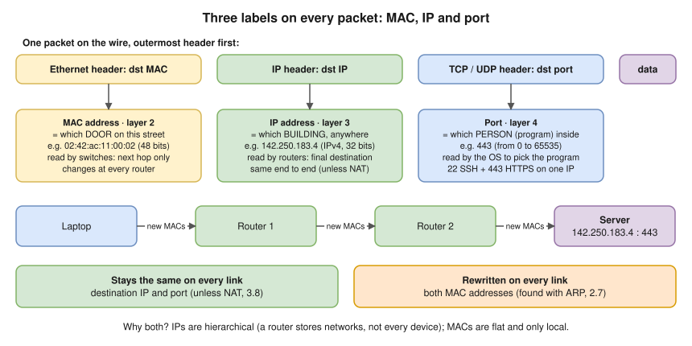
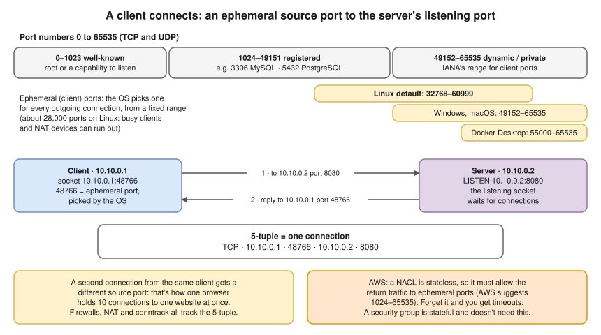
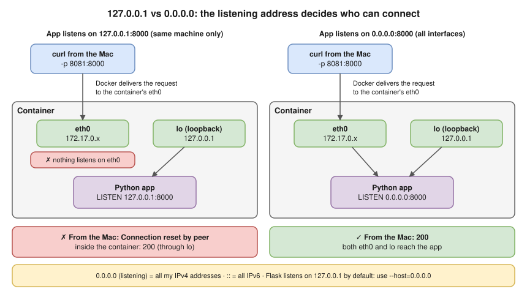

# 1.3 · Addresses, Ports and Protocols

> **Level 1 · Networking fundamentals** · Lesson 3 of 5 · ⏱️ about 60 minutes (estimate) · 🧪 [Lab 1.1](../13-hands-on-labs/lab-01.1-inspect-your-own-network.md) · [Lab 1.2](../13-hands-on-labs/lab-01.2-build-a-tiny-network-with-namespaces.md)
> ⬅️ [1.2 Network devices](02-network-devices.md) · ➡️ [1.4 Network performance](04-network-performance.md)



- **IP** = the **building**, anywhere (read by routers; same start to finish unless NAT, [3.8](../03-core-networking-protocols/08-nat-pat-and-port-forwarding.md)). **MAC** = the **door** on this street, next hop only (switches; changes at every hop). **Port** = the **program** inside (the OS: web server on 443 and SSH on 22 at one IP).
- A connection = the **5-tuple**; clients use **ephemeral ports** from a limited range.
- ⭐ An app listening on `127.0.0.1` is reachable only from the same machine; on `0.0.0.0`, from anywhere that can reach the machine.
- Nearly every "it can't connect" is a wrong or unreachable **address**, a wrong **port**, or a program listening on the wrong **interface**.

## Network interfaces

An **interface** is a connection point on a device, real or virtual. It has a MAC address and one or more IP addresses; one device can have many interfaces and many addresses.

| Name | What it is |
|---|---|
| `lo` | **Loopback**: a virtual interface for the machine to talk **to itself**, always `127.0.0.1` (and `::1` in IPv6). Traffic never leaves the machine. |
| `eth0`, `ens5`, `enp0s3` | A wired (or cloud) network card on Linux. Also the name of the card **inside every Docker container**. |
| `wlan0` · `en0` | A Wi-Fi card on Linux · the Wi-Fi card on a Mac |
| `docker0` | Docker's default **bridge** (a software switch), `172.17.0.1` |
| `br-xxxxxxxx` | One bridge per **user-defined** Docker network |
| `vethxxxxxxx` | One end of a **virtual Ethernet pair** (a virtual cable). The other end is a container's `eth0`. |

All seen on this Mac and in Docker Desktop's VM **(tested on the Mac, Oct 2026)**.

## MAC vs IP

| | MAC address | IP address |
|---|---|---|
| Layer | 2 (data link) | 3 (network) |
| Size, looks like | 48 bits, 6 hex pairs: `d6:15:f1:59:b2:a3` ([hex: 2.1](../02-ip-addressing-and-subnetting/01-binary-decimal-and-hex.md)) | IPv4: 32 bits, `192.168.29.1` (4 numbers, 0–255), about 4.3 billion: not enough. IPv6: 128 bits, `2405:201:1006:e906::c0a8:1d01`, 2¹²⁸ |
| Assigned by | The manufacturer (or software, for virtual cards) | The network: an admin, DHCP ([2.8](../02-ip-addressing-and-subnetting/08-dhcp.md)), or the cloud. Move a laptop and its IP changes; its MAC doesn't |
| Structure | Flat: says nothing about location | **Hierarchical**: the network part says where the device is |
| Scope | One local network | End to end, across the world |
| Changes as the packet travels? | **Yes, at every router** (the server sees the **last router's** MAC) | **No** (unless NAT) |

- **MAC details:** the first 24 bits are the **OUI** (Organizationally Unique Identifier, the manufacturer); the rest is chosen by the manufacturer. One bit in the first byte says **globally unique** (factory) or **locally administered** (software: VMs, containers, phones in privacy mode). Wireshark shows it: `LG bit: Locally administered address (this is NOT the factory default)` **(tested in the lab container)**. `ff:ff:ff:ff:ff:ff` = **broadcast**, every device on this local network.
- **Why both?** A router can't list every MAC in the world, but it can list **networks** ("`10.0.2.0/24` is that way"). The last hop then uses **ARP** to find the MAC ([2.7](../02-ip-addressing-and-subnetting/07-default-gateway-routing-table-and-arp.md)).
- **On your Mac (tested on the Mac, Oct 2026):** the router's IPv6 `2405:201:…::c0a8:1d01` ends in `c0a8:1d01`, hex for **192.168.29.1**, its IPv4 address.
- More on IP: [2.2](../02-ip-addressing-and-subnetting/02-ipv4-addresses-and-ranges.md) (IPv4), [2.3](../02-ip-addressing-and-subnetting/03-subnet-masks-and-cidr.md) (subnets), [2.6](../02-ip-addressing-and-subnetting/06-ipv6-fundamentals.md) (IPv6).

## Ports (layer 4)

| Port | Used by |
|---|---|
| 22 | SSH |
| 53 | DNS (UDP, and TCP for large answers) |
| 80 / 443 | HTTP / HTTPS |
| 3306 · 5432 · 6379 | MySQL · PostgreSQL · Redis |
| 6443 | Kubernetes API server |
| 10250 | kubelet |
| 2379–2380 | etcd |

- Ports are **0 to 65535**, used by **TCP** and **UDP** ([3.2](../03-core-networking-protocols/02-tcp-and-udp.md)). Ranges (IANA): **0–1023 well-known** (on Linux, listening needs root or a special capability), **1024–49151 registered**, **49152–65535 dynamic / private** (suggested for client ports).
- Ports are conventions: any program can listen on any port (HTTP on 8080 is common, nothing enforces it).
- Full list, checked against IANA: [references/common-ports.md](../references/common-ports.md). The protocols: [3.9](../03-core-networking-protocols/09-everyday-protocols-and-ports.md).

### Ephemeral ports: the client's side



- A program that **connects out** gets a temporary **ephemeral port** from the OS. On Linux the range is **32768–60999** by default **(tested in the lab container)**. Check it with:
  ```bash
  cat /proc/sys/net/ipv4/ip_local_port_range
  ```
- Docker Desktop's VM uses **55000–65535** **(tested on the Mac, Oct 2026)**. Windows and macOS use IANA's 49152–65535.

> **AWS link ⭐:** a **NACL is stateless**, so it must allow the **return traffic to ephemeral ports** (AWS suggests 1024–65535). A security group is stateful and doesn't need this. Forgetting it gives **timeouts**.

## Sockets and the 5-tuple

- A **socket** = one end of a conversation: **IP + port + protocol**, held open by a program. A server's listening socket looks like `0.0.0.0:443`; a client's like `10.10.0.1:48766`.
- Two connections from one client to one server differ by **source port**. Firewalls, NAT and Linux connection tracking all work on the 5-tuple ([3.8](../03-core-networking-protocols/08-nat-pat-and-port-forwarding.md), [8.6](../08-linux-networking/06-netfilter-nat-and-conntrack.md)).

```
protocol   source IP   source port   destination IP   destination port
TCP        10.10.0.1   48766         10.10.0.2        8080
```

```bash
ss -tan
```

`-t` TCP, `-a` all states, `-n` numbers. **Expected output (tested in the lab container, [Lab 3.1](../13-hands-on-labs/lab-03.1-capture-a-tcp-handshake.md)),** on the server:

```
State     Recv-Q Send-Q Local Address:Port Peer Address:Port Process
LISTEN    0      5          10.10.0.2:8080      0.0.0.0:*
TIME-WAIT 0      0          10.10.0.2:8080    10.10.0.1:48766
```

- `LISTEN` = the **server socket**. `TIME-WAIT` = a finished connection from a client that used **ephemeral port 48766** (TIME-WAIT: [3.3](../03-core-networking-protocols/03-tcp-in-depth.md)).

## Names for data, and who writes the rules

| Name | Layer | It's… | Its addresses |
|---|---|---|---|
| **Data** / message | Application | What the program sends, e.g. `GET /index.html` | n/a |
| **Segment** (TCP) / **datagram** (UDP) | Transport | Data + a TCP or UDP header | **Ports** |
| **Packet** | Network | A segment + an IP header | **IP addresses** |
| **Frame** | Data link | A packet + an Ethernet (or Wi-Fi) header and trailer | **MAC addresses** |
| **Bits** | Physical | The frame as signals on the wire | n/a |

People say "packet" for all of these; the right word at the right layer shows you understand the stack ([1.5](05-osi-and-tcp-ip-models.md)).

A **protocol** defines **syntax** (the format: "the first 6 bytes of an Ethernet frame are the destination MAC"), **semantics** (the meaning: "a TCP packet with the SYN flag asks to open a connection") and **timing and order** ("after SYN, wait for SYN-ACK, then send ACK").

| Body | Writes | Examples |
|---|---|---|
| **IETF** (Internet Engineering Task Force) | **RFCs** (Requests for Comments): the internet's standards | IP (RFC 791), TCP (RFC 9293), HTTP (RFC 9110), DNS (RFC 1034/1035) |
| **IEEE** (Institute of Electrical and Electronics Engineers) | LAN standards | Ethernet (802.3), Wi-Fi (802.11), VLANs (802.1Q) |
| **IANA** (Internet Assigned Numbers Authority) | The number registries | Port numbers, protocol numbers, the root of IP address allocation |

RFCs used in these notes: [references/standards-and-rfcs.md](../references/standards-and-rfcs.md).

## ⭐ `127.0.0.1` vs `0.0.0.0`: the most common "it doesn't work" cause



- `127.0.0.1:8000`: **only programs on the same machine** (through `lo`); in a container, only the same container.
- `0.0.0.0:8000`: **anyone who can reach any of the machine's addresses**, including traffic arriving through `-p` port publishing. As a listening address `0.0.0.0` = "all my IPv4 addresses" (`::` for IPv6); as a **destination** it's not valid (Linux treats a connect to it as local, which only confuses things).
- A specific address, e.g. `10.10.0.2:8000`: only traffic sent to that address.

**Proof (tested on the Mac, Oct 2026):** the same Python app in a container, published with `-p 8081:8000`. Listening on `127.0.0.1` (`ss -lntp` inside the container), then from the Mac:

```
LISTEN 0  5   127.0.0.1:8000   0.0.0.0:*
```

```
curl: (56) Recv failure: Connection reset by peer
```

Listening on `0.0.0.0` instead, the Mac gets `200` ✅:

```
LISTEN 0  5     0.0.0.0:8000   0.0.0.0:*
```

**The same on plain Linux (tested in the lab container, [Lab 3.5](../13-hands-on-labs/lab-03.5-troubleshooting-challenge.md) fault 7):** a server on `127.0.0.1:8080` refuses a client on another machine:

```
LISTEN 0      5          127.0.0.1:8080      0.0.0.0:*    users:(("python3",pid=4442,fd=3))
```

```
curl: (7) Failed to connect to app.lab port 8080 after 1 ms: Couldn't connect to server
```

That's why the Flask example needs `--host=0.0.0.0`: Flask listens on `127.0.0.1` by default.

## Where you meet it

| Where | What it means |
|---|---|
| Kubernetes | All containers in a pod share one network namespace: they talk over `localhost` and can't both use port 80. The app must listen on `0.0.0.0` (or the pod IP) for a Service to reach it |
| Security | Binding admin interfaces (databases, debug ports) to `127.0.0.1` is deliberate protection; exposing them on `0.0.0.0` on a public server is a classic breach cause |
| AWS | An EC2 instance's **ENI** has a MAC and private IPs; its public IP is mapped by the internet gateway and never appears on the interface |

## Troubleshooting

| You see | It means | Next step |
|---|---|---|
| `curl localhost:8000` works on the server, fails from another machine | App listens on `127.0.0.1` | `ss -lntp` on the server: look at the local address |
| `Connection refused` from another machine | Nothing listens on that IP:port (or a firewall REJECTs) | `ss -lntp`, and check the port number |
| `bind: address already in use` when starting an app | Another program already holds that port | `ss -lntp \| grep :8000`; on a Mac `lsof -nP -iTCP:8000 -sTCP:LISTEN` |
| Two LAN machines can't talk; `ip neigh` shows `FAILED` | ARP failed: wrong subnet, cable, or the other machine is off | `ip neigh`, then check both IPs and masks ([2.7](../02-ip-addressing-and-subnetting/07-default-gateway-routing-table-and-arp.md)) |
| Outgoing connections fail on a busy client or NAT device | Ephemeral ports ran out (about 28,000 on Linux) | [3.8](../03-core-networking-protocols/08-nat-pat-and-port-forwarding.md) |

## Interview angle

- ⭐ **"The app works inside the container but not from outside."** → It listens on `127.0.0.1`, not `0.0.0.0`; or the port isn't published. Check with `ss -lntp`.
- **"MAC vs IP address?"** → MAC = hardware address, used by switches for the **next hop** only, changes at every router. IP = logical, hierarchical address of the **final destination**, stays the same end to end unless NAT.
- **"What's a socket? What's the 5-tuple?"** → A socket is an IP + port + protocol endpoint. A connection is identified by protocol, source IP, source port, destination IP and destination port.
- **"Why do NACLs need ephemeral ports open?"** → Because they're stateless: the reply comes back to the client's ephemeral port and must be allowed explicitly.

## Check yourself

1. Which of MAC address, IP address and port changes at every router hop?
2. A client at `10.0.1.25` opens two connections to `10.0.2.15:443`. What makes the two connections different?
3. What is the PDU called at layer 3? At layer 2?
4. `ss -lnt` on a server shows `127.0.0.1:5432`. Can an app on another server connect to this database?
5. Is a MAC address starting with `02:` likely burned in by a manufacturer?

<details>
<summary><b>Answers</b> (try first)</summary>

1. The MAC addresses (source and destination). IPs and ports stay the same unless NAT changes them.
2. The client's **source port** (two different ephemeral ports).
3. Layer 3: packet. Layer 2: frame.
4. No. It listens only on loopback. It must listen on `0.0.0.0` or the server's own IP (and the firewall must allow it).
5. No. `02` has the "locally administered" bit set, so it was made up by software (a VM, container or privacy setting).

</details>

➡️ **Next:** [1.4 · Network performance](04-network-performance.md): bandwidth, latency, jitter and loss, and why bits and bytes are not the same.
