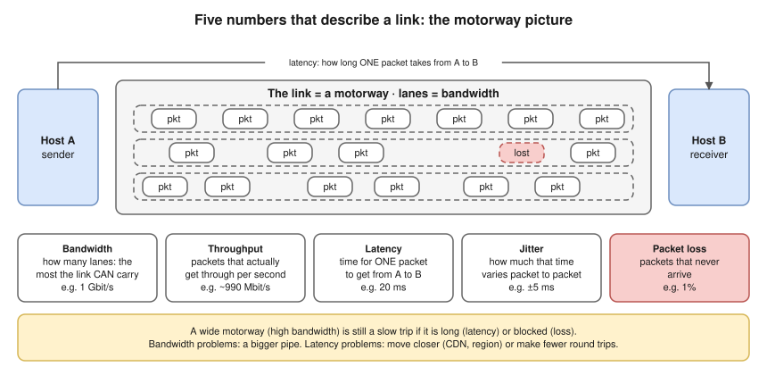
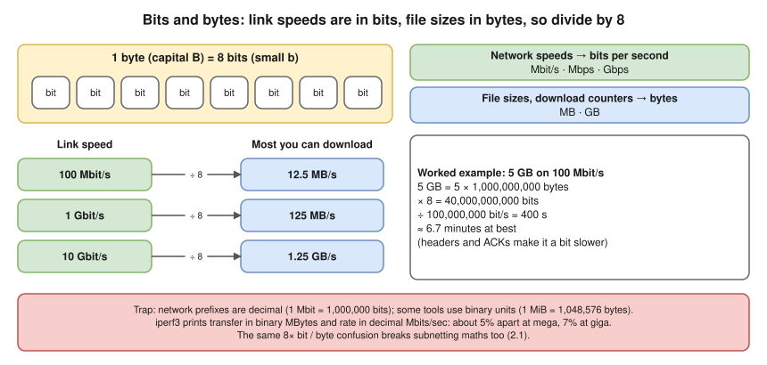
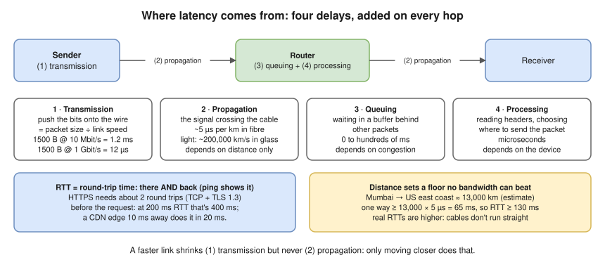

# 1.4 · Network Performance: Bandwidth, Throughput, Latency, Jitter, Loss

> **Level 1 · Networking fundamentals** · Lesson 4 of 5 · ⏱️ about 60 minutes (estimate) · 🧪 [Lab 1.2](../13-hands-on-labs/lab-01.2-build-a-tiny-network-with-namespaces.md) part D
> ⬅️ [1.3 Addresses, ports and protocols](03-addresses-ports-and-protocols.md) · ➡️ [1.5 The OSI and TCP/IP models](05-osi-and-tcp-ip-models.md)



- "The app is slow" is a performance question: find **which** number is bad before fixing it.
- Bandwidth problems (a full link) are fixed by **bigger pipes**; more bandwidth changes nothing if latency or loss is the problem. Latency problems by **moving things closer** (CDNs, regions) or **fewer round trips**. You can't buy your way out of latency with bandwidth.
- 🔥 **1 byte = 8 bits.** Link speeds are in bits, file sizes in bytes: divide by 8.
- **Latency** = propagation + transmission + queuing + processing. **RTT** = there and back.
- **BDP = bandwidth × RTT**: how much data must be in flight to fill the pipe.
- Cloud costs, video calls, cross-region database replication and Kubernetes cross-zone traffic all depend on these numbers.

## 🔥 Bits and bytes: get this right first



- **bit** = lowercase **b** (one 0 or 1); **byte** = uppercase **B** (8 bits). Speeds: Mbit/s, Mbps, Gbps. Files and download counters: MB, GB.
- Real downloads are a bit slower than the ÷ 8 figure: headers and acknowledgements use some capacity (goodput, below).
- This was the exact point an interviewer flagged ("bit and byte are very different"). The same 8× confusion breaks subnetting maths too, which is why [2.1](../02-ip-addressing-and-subnetting/01-binary-decimal-and-hex.md) starts with it.

## Bandwidth, throughput and goodput

| Term | Meaning | Example on a 1 Gbit/s link |
|---|---|---|
| **Bandwidth** (capacity) | The maximum rate the link can carry | 1 Gbit/s |
| **Throughput** | The rate actually achieved, including headers | ~990 Mbit/s |
| **Goodput** | The **useful** data rate the application gets, after headers, retransmissions and protocol overhead | ~940 Mbit/s of file data |

Goodput is lower because each 1500-byte packet carries about 40–60 bytes of IP and TCP headers, the receiver sends acknowledgements, lost packets are resent, and the slowest link on the path sets the limit.

**Proof (tested in the lab container):** a 5,000,000-byte file over a link limited to **20 Mbit/s**:

```
connect=0.000330s first_byte=0.001749s total=2.099752s size=5000000B speed=2381233B/s
```

- Theory: 5,000,000 × 8 ÷ 20,000,000 = **2.0 s**. Measured: **2.1 s**. 2,381,233 bytes/s × 8 = **19.05 Mbit/s** of goodput: about 95%.

## Latency, jitter and loss



- Most protocols need several round trips before useful data flows (TCP handshake, TLS handshake), so **RTT multiplies**. Mumbai to the US east coast **(estimate)**: RTT ≥ 130 ms from physics alone; real RTTs are noticeably higher (cables don't follow the shortest path, every router adds a little).
- **Jitter** = variation in latency, packet to packet. Downloads barely care (TCP smooths it out). **Voice and video care a lot**: late audio must be waited for (delay) or skipped (glitches); apps use a **jitter buffer**. `ping` shows a rough figure as **`mdev`** (mean deviation).
- **Packet loss** = the percentage of packets that never arrive. Causes: **congestion** (a full router queue drops new packets), bad links (weak Wi-Fi, damaged cable, faulty transceiver), **policing / rate limits** (provider or cloud), firewalls (looks like 100% loss for that traffic).
- **TCP** resends lost data, so files arrive complete, but **throughput falls sharply**: TCP reads loss as congestion and slows down ([3.3](../03-core-networking-protocols/03-tcp-in-depth.md)). Even 1% loss can cut a long-distance transfer to a fraction of the link speed. **Real-time UDP** (calls, games) doesn't resend: you hear a gap or see a frozen frame.

## The bandwidth-delay product (BDP)

How much data must be **in flight** (sent, not yet acknowledged) to keep the link full: **BDP = bandwidth × RTT**.

- 100 Mbit/s with 100 ms RTT: 100,000,000 bit/s × 0.1 s = 10,000,000 bits = **1.25 MB** in flight.
- If the sender allows only 64 KB in flight before waiting for an acknowledgement: 64 KB per 100 ms ≈ **5.2 Mbit/s**, on a 100 Mbit/s link.
- Hence TCP **window scaling** ([3.3](../03-core-networking-protocols/03-tcp-in-depth.md)), and "the link is fast but the transfer is slow" on long-distance links.

## Bufferbloat: when queues add latency

When a link is full, routers **queue** packets instead of dropping them: the link stays busy, but every packet waits.

**Proof (tested in the lab container):** two machines on a link limited to 20 Mbit/s. Idle link, then the same `ping` **while a download fills the link**:

```
rtt min/avg/max/mdev = 0.033/0.048/0.078/0.015 ms
```

```
rtt min/avg/max/mdev = 3.939/4.788/6.024/0.771 ms
```

Latency up **100×**, jitter (`mdev`) **50×**, no packet lost: every ping waited behind the download. On home links with big buffers this reaches hundreds of ms, which is why a video call stutters while someone uploads a large file.

## Try it: measure your network

**RTT, loss and jitter** to your router, then to a host on the internet:

```bash
ping -c 10 192.168.29.1
```

```bash
ping -c 10 1.1.1.1
```

Read the last two lines **(illustrative)**: `0% packet loss` = loss; `avg` = typical RTT; `max` and `mdev` = jitter.

```
10 packets transmitted, 10 received, 0% packet loss, time 9012ms
rtt min/avg/max/mdev = 3.1/4.0/7.9/1.3 ms
```

**Loss per hop** along the path:

```bash
mtr -r -c 20 1.1.1.1
```

`mtr` = `traceroute` + `ping` ([3.7](../03-core-networking-protocols/07-icmp-ping-and-traceroute.md)). Only loss that **continues to the last hop** is real; loss at one middle hop alone usually means that router doesn't bother answering pings.

**Where the time goes in a web request:**

```bash
curl -s -o /dev/null -w 'dns=%{time_namelookup}s connect=%{time_connect}s tls=%{time_appconnect}s first_byte=%{time_starttransfer}s total=%{time_total}s\n' https://example.com
```

| Field | Time until… | If it's large |
|---|---|---|
| `time_namelookup` | DNS answered ([3.4](../03-core-networking-protocols/04-dns.md)) | Slow DNS |
| `time_connect` | The TCP handshake finished | High RTT |
| `time_appconnect` | The TLS handshake finished ([3.6](../03-core-networking-protocols/06-tls-and-certificates.md)) | |
| `time_starttransfer` | The first byte of the response arrived (**TTFB**, time to first byte) | A big gap after `tls` = a slow **server**, not a slow network |
| `time_total` | Everything was downloaded | |

**Throughput** between two machines you control, with `iperf3`. On the server:

```bash
iperf3 -s
```

On the client:

```bash
iperf3 -c <server-ip> -t 10
```

**Expected output (tested in the lab container),** on a link limited to 10 Mbit/s:

```
[  5]   0.00-4.00   sec  6.00 MBytes  12.6 Mbits/sec    0             sender
[  5]   0.00-4.01   sec  4.50 MBytes  9.42 Mbits/sec                  receiver
```

Trust the **receiver** line: that's what arrived (data still in buffers counts as "sent"). Without the limit, the same virtual link measured **9.11 Gbits/sec**.

> **Optional, not tested here:** add latency, jitter and loss to an interface with `tc qdisc add dev eth0 root netem delay 50ms 10ms loss 1%`. My test container's kernel had no `netem` module, so this command is untested in these notes.

## Where you meet it

| Where | What matters |
|---|---|
| Cloud zones and regions | Between availability zones: about a millisecond **(estimate)**, and billed. Across regions: tens to hundreds of ms. Chatty services belong in the same zone or region as their database |
| AWS instance size | Sets bandwidth: "up to 10 Gigabit" instances can burst, then drop to a lower baseline. A "slow network" on a small instance is often this limit |
| SLOs | Written in these terms: "p99 latency under 300 ms", "error rate under 0.1%" |
| Video calls | Hurt most by jitter and loss, not bandwidth |

## Troubleshooting slowness

| You see | It means | Next step |
|---|---|---|
| Everything slow while a big upload or download runs | Queuing (bufferbloat) on the busy link | `ping` while the transfer runs vs when idle |
| Single transfers slow over a long distance, several in parallel fast | Window / BDP limit, or loss | Compare one `iperf3` stream with `iperf3 -P 4` |
| Slow only to one site; `curl` shows a big `connect` time | High RTT on that path | `mtr` to that site |
| `curl` shows a fast connect but a slow `first_byte` | The server is slow, not the network | Server logs and metrics |
| Calls stutter but downloads are fine | Jitter or loss | `ping` `mdev`, `mtr` loss |
| "My 100 Mbps plan should download at 100 MB/s" | Bits vs bytes | 100 ÷ 8 = 12.5 MB/s at most |
| "Ping is the speed of my connection" | Ping measures **latency**, not bandwidth; 0% loss can still hide terrible latency and jitter (bufferbloat) | Measure throughput with `iperf3` |
| Loss at hop 5 in `mtr` | Only real if it continues to every later hop | Look at the last hop |

## Interview angle

- **"Bandwidth vs latency?"** → Bandwidth is how much data per second the link can carry; latency is how long one packet takes to arrive. A satellite link can have high bandwidth and terrible latency.
- **"Why is my transfer between regions slow on a 10 Gbit/s link?"** → High RTT plus a limited TCP window: throughput ≤ window ÷ RTT. Check loss, tune or parallelise, or move the data closer.
- 🔥 **"A 1 Gbps link: how long to copy 100 GB?"** → 100 GB × 8 = 800 Gbit; ÷ 1 Gbit/s = 800 s ≈ 13–14 minutes at best, realistically a bit more.

## Check yourself

1. A provider sells you "200 Mbps". What's the most MB/s you can download?
2. Which part of latency does a faster link reduce? Which part can it never reduce?
3. A call app stutters, yet `ping` shows 0% loss. What else should you look at?
4. Calculate the BDP for a 1 Gbit/s link with 40 ms RTT.
5. In the bufferbloat test above, what caused the ping time to rise from 0.05 ms to about 5 ms?

<details>
<summary><b>Answers</b> (try first)</summary>

1. 200 ÷ 8 = **25 MB/s**, a little less in practice.
2. A faster link reduces **transmission (serialisation) delay**. It never reduces **propagation delay**, which depends only on distance.
3. **Jitter** (`mdev`, and the `max` time) and latency spikes.
4. 1,000,000,000 × 0.04 = 40,000,000 bits = **5 MB** in flight.
5. **Queuing delay**: pings waited in the shaper's queue behind the download's packets.

</details>

➡️ **Next:** [1.5 · The OSI and TCP/IP models](05-osi-and-tcp-ip-models.md): the layers that headers, devices and protocols belong to, and how data is wrapped on the way out and unwrapped on the way in.
