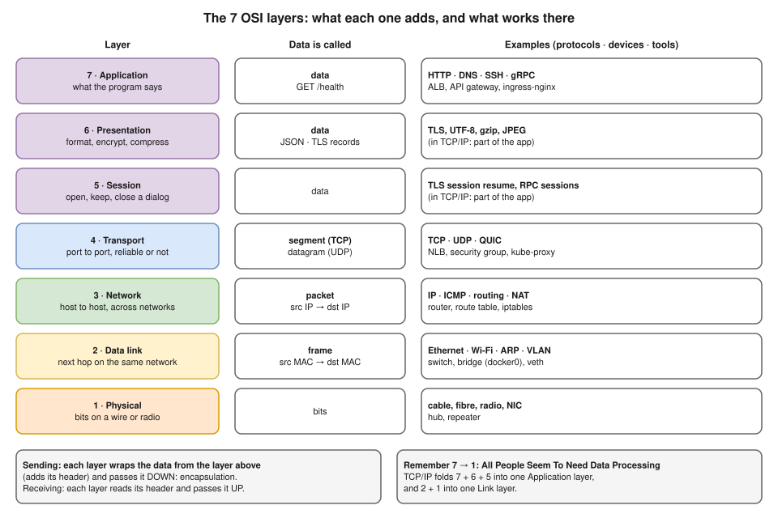
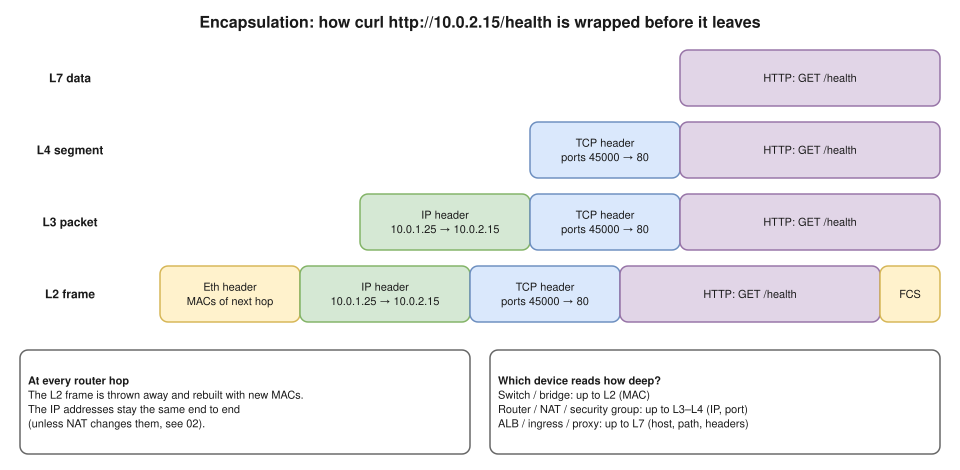
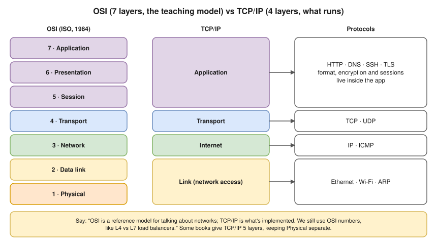
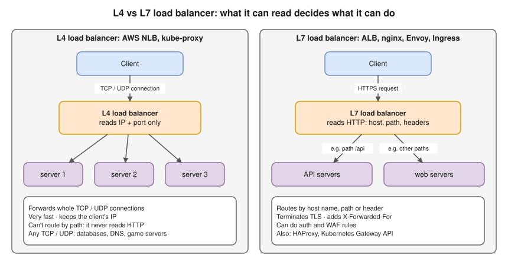

# 1.5 · The OSI and TCP/IP Models, Layer by Layer ⭐

> **Level 1 · Networking fundamentals** · Lesson 5 of 5 · ⏱️ about 90 minutes (estimate) · 🧪 [Lab 1.2](../13-hands-on-labs/lab-01.2-build-a-tiny-network-with-namespaces.md) · [Lab 3.1](../13-hands-on-labs/lab-03.1-capture-a-tcp-handshake.md)
> ⬅️ [1.4 Network performance](04-network-performance.md) · ➡️ [Level 2: IP addressing and subnetting](../02-ip-addressing-and-subnetting/README.md)



- **7 layers**, each with one job, each talking only to the layer just above and below. Real networks run **TCP/IP**, but everyone uses the OSI **numbers**: "an L4 load balancer", "an L7 rule", "it's an L2 problem".
- Remember the order: 7 → 1 **A**ll **P**eople **S**eem **T**o **N**eed **D**ata **P**rocessing · 1 → 7 **P**lease **D**o **N**ot **T**hrow **S**ausage **P**izza **A**way.
- ⭐ **Encapsulation:** on the way out (down the stack), each layer wraps the data from above in its own header, like a letter going into envelopes. **Decapsulation:** on the way in (up), each layer reads its header and passes the rest up.
- ⭐ **MACs (L2) change at every hop; IPs (L3) stay the same** end to end, unless NAT ([3.8](../03-core-networking-protocols/08-nat-pat-and-port-forwarding.md)).
- **Debug bottom up**, and read the error message: it often names the layer.
- ARP, TCP, TLS, NAT and DNS are explained later (each links forward); for now, learn **which layer** each belongs to.

## The 7 layers on one page ⭐

| # | Layer | Its one job | Data is called | Address it uses | Examples | Devices that work here |
|---|---|---|---|---|---|---|
| 7 | **Application** | What the program wants to say | data | URL, hostname | HTTP, HTTPS, DNS, SSH, SMTP, gRPC | ALB, API gateway, ingress-nginx, WAF |
| 6 | **Presentation** | How the data is written: format, encryption, compression | data | – | TLS, JSON, UTF-8, gzip, JPEG | (in software) |
| 5 | **Session** | Open, keep and close a conversation | data | session ID | TLS session resume, RPC sessions, NetBIOS | (in software) |
| 4 | **Transport** | Program to program: ports, reliability, order | **segment** (TCP) / **datagram** (UDP) | **port** | TCP, UDP, QUIC | NLB, security group, kube-proxy, L4 firewall |
| 3 | **Network** | Machine to machine, across networks | **packet** | **IP address** | IPv4, IPv6, ICMP, IPsec, BGP / OSPF (routing) | Router, route table, NAT gateway, iptables |
| 2 | **Data link** | Next hop on the **same** network | **frame** | **MAC address** | Ethernet, Wi-Fi (802.11), ARP, VLAN (802.1Q) | Switch, bridge (`docker0`), veth, NIC |
| 1 | **Physical** | Bits as electricity, light or radio | **bits** | – | Ethernet cables, fibre, Wi-Fi radio | Cable, hub, repeater, NIC |

## How the layers work together: encapsulation ⭐



`curl http://10.0.2.15/health` from `10.0.1.25`, going down the stack:

1. **L7:** curl writes `GET /health HTTP/1.1` and `Host: 10.0.2.15`.
2. **L6 / L5:** nothing for plain HTTP. For HTTPS, TLS encrypts the request here.
3. **L4:** TCP header: source port `45000` (ephemeral), destination port `80`, sequence numbers.
4. **L3:** IP header: source `10.0.1.25`, destination `10.0.2.15`, TTL `64`.
5. **L2:** Ethernet header: source MAC (my card), destination MAC (**the next hop**: the gateway if `10.0.2.15` is in another subnet), plus a checksum at the end (FCS).
6. **L1:** the NIC turns the frame into signals on the wire or radio.

### A real packet, layer by layer (tested in the lab container)

One real frame from [Lab 3.1](../13-hands-on-labs/lab-03.1-capture-a-tcp-handshake.md): `curl` asking a small web server for `/index.html`, decoded by `tshark` (command-line Wireshark), outermost envelope first:

```
Frame 4: 153 bytes on wire (1224 bits), 153 bytes captured (1224 bits)
Ethernet II, Src: 1e:ad:fb:02:dc:58, Dst: 36:81:b2:dd:53:a4
    Type: IPv4 (0x0800)
Internet Protocol Version 4, Src: 10.10.0.1, Dst: 10.10.0.2
    .... 0101 = Header Length: 20 bytes (5)
    Time to Live: 64
    Protocol: TCP (6)
Transmission Control Protocol, Src Port: 48766, Dst Port: 8080, Seq: 1, Ack: 1, Len: 87
    1000 .... = Header Length: 32 bytes (8)
    Flags: 0x018 (PSH, ACK)
Hypertext Transfer Protocol
    GET /index.html HTTP/1.1\r\n
    Host: 10.10.0.2:8080\r\n
    User-Agent: curl/8.5.0\r\n
    Accept: */*\r\n
```

| Layer | Header | Size | What it says |
|---|---|---|---|
| L2 Ethernet | MACs + type | **14 bytes** | "Next hop is `36:81:…`; inside is IPv4 (`0x0800`)" |
| L3 IPv4 | IPs, TTL, protocol | **20 bytes** | "From `10.10.0.1` to `10.10.0.2`; inside is TCP (protocol 6)" |
| L4 TCP | Ports, sequence numbers, flags | **32 bytes** (20 + 12 bytes of options) | "From port 48766 to port 8080, bytes 1–87 of this connection" |
| L7 HTTP | The request itself | **87 bytes** | `GET /index.html` |
| **Total** | | **14 + 20 + 32 + 87 = 153 bytes** | Exactly the "153 bytes on wire" on the first line ✅ |

- The 4-byte FCS isn't counted: network cards normally strip it before a capture tool sees the frame, and a virtual link like this one never adds one.
- Each header names **what's inside it** (Ethernet `Type` → IPv4, IPv4 `Protocol` → TCP, TCP **port** → the program). That's how decapsulation knows where to hand the data next.
- **Same layer talks to same layer:** my TCP "talks" to the server's TCP (sequence numbers, ACKs), though the bytes really go down my stack and up theirs (**peer-to-peer communication between layers**).

## Layer by layer

### L1 · Physical

- Moves **bits** as electricity (copper), light (fibre) or radio: voltage / light pulses / frequencies, connector, cable length, speed (1 Gbit/s, 10 Gbit/s). **No addresses.**
- **Full duplex** = send and receive at once (modern Ethernet); **half duplex** = one at a time (old hubs, Wi-Fi radio).
- Devices: cables (Cat6, fibre), hub, repeater, the physical part of the NIC, Wi-Fi radio. **Breaks:** loose cable, bad transceiver, link down, speed / duplex mismatch (slow, many errors).
- In the cloud AWS owns L1; the closest thing you control is the **instance type**, which sets bandwidth ("up to 10 Gbit").

```bash
ip link show eth0          # "state UP" and "LOWER_UP" = the cable / link is up
ethtool eth0               # speed, duplex, "Link detected: yes"
```

### L2 · Data link

- Delivers a **frame** to the **next device on the same local network**. MAC: 48 bits, like `02:42:ac:11:00:02`, local only.
- A **switch learns** MACs from source addresses and forwards only to the right port, or **floods** unknown ones. **Broadcast** `ff:ff:ff:ff:ff:ff` reaches the whole **broadcast domain**; a router stops it.
- **ARP** links L3 to L2: "Who has `172.17.0.3`? Tell `172.17.0.2`." The answer is cached in the **ARP table**. **VLAN** (802.1Q) tags frames so one switch acts as several networks. The **FCS** checksum ends the frame; a bad one means the frame is dropped. Sub-layers: **LLC** (talks to L3) and **MAC** (talks to the wire).
- Virtual L2: **`docker0`**, `br-xxxx` (Linux bridges), **veth pairs**, **VXLAN** (L2 frames inside UDP: Flannel, Docker overlay).
- **Docker:** containers on the same bridge talk at L2 (ARP + frames through the bridge), no router, no NAT ([10.1](../10-container-and-kubernetes-networking/01-docker-bridge-networking-inside-out.md)).
- **Breaks:** wrong VLAN, duplicate MAC, stale ARP entry, **MTU mismatch** (big packets disappear, small ones work: common with VXLAN, which adds 50 bytes of headers).
- **AWS:** a VPC does no real broadcast or ARP flooding; AWS answers ARP from its own mapping table, so you can't run your own "floating IP" with ARP tricks.

```bash
ip link show                       # MAC address of every interface ("link/ether ...")
ip neigh                           # the ARP table: IP → MAC
bridge link                        # which veths are plugged into which bridge
```

### L3 · Network ⭐

- Gets a **packet** from source **machine** to destination **machine** across many networks. Each machine has an **IP** and a **subnet** (CIDR, [2.3](../02-ip-addressing-and-subnetting/03-subnet-masks-and-cidr.md)) that says what's local.
- **Routing decision:** destination in my subnet → send directly (ARP for its MAC); otherwise → the **gateway** (ARP for the gateway's MAC). **Longest prefix match:** `10.0.2.0/24` beats `10.0.0.0/16` beats `0.0.0.0/0`.
- **TTL:** every router subtracts 1; at 0 the packet is dropped and ICMP "time exceeded" goes back (stops loops; how `traceroute` works). **Fragmentation:** a packet bigger than the next link's **MTU** (usually 1500 bytes) is split, or dropped if "Don't Fragment" is set (ICMP "fragmentation needed" goes back).
- **ICMP** = L3's helper for errors and tests (`ping` echo request / reply, "destination unreachable", "time exceeded"). **NAT** changes IPs (and usually ports) here.
- Devices: router, L3 switch, the Linux kernel (`net.ipv4.ip_forward=1`; Docker turns it on). AWS: **VPC router**, **route tables**, **internet gateway**, **NAT gateway**, **Transit Gateway**, **VPC peering**; **NACLs** filter IP (and port), so L3–L4.
- **Kubernetes:** each pod gets its own IP and the CNI (AWS VPC CNI, Calico, Cilium) lets every pod reach every pod IP without NAT: a layer-3 promise.
- **Breaks:** no route, wrong gateway, overlapping CIDRs (two VPCs both `10.0.0.0/16` can't be peered), blocked ICMP breaking MTU discovery.

```bash
ip addr                    # my IP addresses and subnets
ip route                   # the route table ("default via ..." = gateway)
ip route get 8.8.8.8       # which route and interface this one packet would use
ping -c 3 10.0.2.15        # L3 reachability (only if ICMP is allowed)
traceroute 10.0.2.15       # every router on the way (uses TTL)
```

### L4 · Transport ⭐

- L3 finds the machine; **L4 finds the program**, using **ports**. A connection = the **5-tuple** (protocol, source IP, source port, destination IP, destination port), exactly what conntrack tracks ([8.6](../08-linux-networking/06-netfilter-nat-and-conntrack.md)).
- **TCP** (reliable, like a phone call): **3-way handshake** `SYN` → `SYN-ACK` → `ACK`; **sequence numbers + ACKs** (lost data resent, out-of-order data reordered); **flow control** (the receive window); **congestion control** (slow start, CUBIC, BBR); **close** `FIN` → `ACK` both ways (4 steps), the side closing first waits in **TIME_WAIT**; **RST** = "no, go away" when nothing listens (**connection refused**).
- **UDP** (a postcard): no handshake, order or resend; a small header with ports, length, checksum. DNS, video, VXLAN, WireGuard. **QUIC** (HTTP/3) runs on UDP with TCP-like reliability and built-in TLS in user space.
- Devices: **NLB**, **security groups** (stateful, allow by protocol + port), stateful firewalls, **kube-proxy** (Service IP:port → pod IP:port with iptables or IPVS), Kubernetes **Services** (`ClusterIP`, `NodePort`).

| Symptom | What it means at L4 |
|---|---|
| `Connection refused` | The packet reached the machine, and it answered **RST**: nothing listens on that port |
| `Connection timed out` | No answer at all: a firewall, SG or NACL **dropped** the SYN |
| Many `TIME_WAIT` / port exhaustion | Too many short connections from one IP: use keep-alive / connection pooling |
| Slow transfers, retransmits | Packet loss or a small window: check `ss -ti` |

```bash
ss -lntp                   # which programs listen on which TCP ports
ss -tan                    # all TCP connections and their states (ESTAB, TIME_WAIT, ...)
nc -zv 10.0.2.15 5432      # can I open a TCP connection to this port?
sudo tcpdump -ni any 'tcp port 80'   # watch SYN, SYN-ACK, ACK, FIN on the wire
```

### L5 · Session

- **Opens, keeps and closes** a conversation; adds **checkpoints** so a long transfer can resume after a failure. TCP/IP has **no separate session layer**: the app or a library does it (**TLS session resumption**, **HTTP keep-alive**, RPC sessions, **sticky sessions** on a load balancer with cookies).
- Often-asked examples: NetBIOS, RPC, PPTP, SOCKS (often called L5), SQL sessions, SMB sessions.
- **Breaks:** idle timeouts drop sessions (ALB default **60 s**, NLB TCP idle timeout **350 s**), so long-lived connections need keep-alives.

### L6 · Presentation

- Makes the data **understandable**: encoding (ASCII, UTF-8; JSON, XML, Protobuf; JPEG, MP4), **encryption** (TLS / SSL usually placed here; some say L5 or "between L4 and L7": OSI doesn't fit TLS perfectly), **compression** (gzip, brotli: `Content-Encoding: gzip`). In TCP/IP it's part of the app or its libraries (OpenSSL, the JSON parser).
- **Breaks:** TLS certificate error (expired, wrong name), TLS version or cipher mismatch, wrong character encoding (garbled text).

```bash
openssl s_client -connect example.com:443 -servername example.com   # see the cert and the TLS version
curl -v https://example.com                                          # shows the TLS handshake, then HTTP
```

### L7 · Application ⭐

- The protocol **the program speaks** (not the app itself). **HTTP/HTTPS:** method, path, host, headers, status codes (`200`, `404`, `502`). **DNS** turns names into IPs ([3.4](../03-core-networking-protocols/04-dns.md)): L7, though usually carried in UDP. Others: SSH, FTP, SMTP/IMAP, DHCP (carried in UDP), gRPC (HTTP/2), MQTT, SNMP.
- Devices: **ALB**, **reverse proxy** (nginx, Envoy, HAProxy in HTTP mode), Kubernetes **Ingress** and **Gateway API**, **API gateway**, **WAF**, a service mesh sidecar (Istio / Linkerd).
- **Breaks:** `502` (the proxy got a bad answer from the backend), `503` (no healthy backend), `504` (the backend was too slow), a wrong `Host` header or path rule, DNS returning the wrong IP.

```bash
curl -v http://10.0.2.15/health      # the full L7 request and response
dig +short google.com                # L7 DNS query
```

## OSI vs TCP/IP ⭐



## L4 vs L7 load balancing



## Where common things sit (quick reference)

| Thing | Layer | Why |
|---|---|---|
| Hub | L1 | Repeats bits to every port |
| Switch, Linux bridge, `docker0` | L2 | Forwards by MAC |
| ARP | L2 / L3 | Finds the MAC for an IP (it's carried in L2 frames, and it serves L3) |
| Router, route table, VPC router | L3 | Forwards by IP |
| `ping`, `traceroute` (ICMP) | L3 | ICMP has no ports |
| NAT, MASQUERADE, DNAT | L3 / L4 | Changes IPs, and usually ports too |
| NACL | L3 / L4 | Stateless, filters IP + port |
| Security group, stateful firewall | L4 | Stateful, filters protocol + port |
| NLB, kube-proxy, `NodePort` | L4 | Forwards TCP/UDP by IP + port |
| TLS | L6 (or L5 / "4.5") | Encryption; the OSI fit isn't perfect |
| ALB, Ingress, nginx proxy, API gateway, WAF | L7 | Reads HTTP host, path, headers |
| Kubernetes NetworkPolicy | L3 / L4 | Pod IPs / labels + ports (Cilium can also do L7) |
| DNS, DHCP | L7 | Application protocols (carried in UDP) |

## Debugging bottom up ⭐🔥

Walk the layers from the bottom; the [6-step debugging method](../03-core-networking-protocols/11-troubleshooting-connectivity.md) is this idea in practice. **The fastest shortcut:** read the error (last column).

| Layer | Question | Command | The error names it |
|---|---|---|---|
| L1 | Is the link up? | `ip link show eth0` | |
| L2 | Do I know the next hop's MAC? | `ip neigh` | |
| L3 | Is there a route, and can I reach the IP? | `ip route get <ip>`, `ping`, `traceroute` | `No route to host` = L3 |
| L4 | Can I open the port? Is anyone listening? | `nc -zv <ip> <port>`, `ss -lntp` | `refused` = L4, nothing listening · `timed out` = something dropped it (L3/L4 firewall) |
| L6 | Does TLS work? | `openssl s_client -connect <host>:443` | |
| L7 | Does the app answer correctly? | `curl -v`, `dig` | `could not resolve host` = DNS (L7) · `502 / 503 / 504` = L7, the network is fine |

## Try it

Full walk-through: [Lab 1.2](../13-hands-on-labs/lab-01.2-build-a-tiny-network-with-namespaces.md) (layers 1–3) and [Lab 3.1](../13-hands-on-labs/lab-03.1-capture-a-tcp-handshake.md) (layers 4 and 7). Quick version on your own machine.

L1 / L2: interfaces, state, MACs (on the Mac: `ifconfig en0`):

```bash
docker run --rm alpine ip link show
```

L2: the ARP table (IP → MAC):

```bash
arp -a
```

L3: routes and the gateway:

```bash
docker run --rm alpine ip route
```

```bash
traceroute -m 5 8.8.8.8
```

L4: who is listening, and a TCP handshake to a port:

```bash
lsof -nP -iTCP -sTCP:LISTEN
```

```bash
nc -zv google.com 443
```

L6 / L7: the TLS handshake, then the HTTP request and response:

```bash
curl -v https://example.com -o /dev/null
```

All layers at once: the handshake, the request and the close in one capture (Linux or inside a container with `NET_ADMIN`):

```bash
docker run --rm --cap-add NET_ADMIN nicolaka/netshoot \
  sh -c "tcpdump -ni eth0 -c 12 'tcp port 80' & sleep 1; curl -s http://example.com -o /dev/null; sleep 2"
```

## Interview angle

- ⭐ **"Explain the OSI model."** → 7 layers, each with one job. Go top down with one line each and one example: HTTP, TLS, sessions, TCP/UDP, IP, Ethernet/MAC, cables. Then say "real networks use TCP/IP's 4 layers; OSI is how we talk about them".
- ⭐ **"What happens when you type `google.com` in the browser?"** → Walk the layers: DNS (L7) gets the IP → TCP handshake to port 443 (L4) → TLS handshake (L6) → HTTP GET (L7). On the way down, the IP header (L3) gets the destination IP, the Ethernet frame (L2) gets the **gateway's MAC** (found by ARP), and the NIC sends bits (L1). Every router swaps the L2 frame; NAT at the home router changes the source IP.
- ⭐ **"L4 vs L7 load balancer?"** → L4 (NLB) sees only IP + port, forwards TCP/UDP, very fast, keeps the client IP, can't route by path. L7 (ALB) reads HTTP, routes by host / path / headers, terminates TLS, adds `X-Forwarded-For`, can do auth and WAF.
- **"Switch vs router?"** → A switch forwards **frames by MAC** inside one network (L2). A router forwards **packets by IP** between networks (L3), and it stops broadcasts.
- **"MAC vs IP address?"** → MAC = who carries it on **this hop** (changes at every router). IP = the **final destination** (stays the same end to end, unless NAT).
- **"What is encapsulation?"** → Each layer wraps the data from above in its own header on the way down; the receiver unwraps it on the way up. Segment → packet → frame → bits.
- **"At which layer does ping work? Does it use a port?"** → L3, ICMP. No ports, so `ping` working doesn't prove a TCP port is open, and a blocked ICMP doesn't mean the host is down.
- **"Where does TLS sit?"** → Usually L6 (presentation, encryption). Say that it really runs on top of TCP, inside the app, so it doesn't fit OSI exactly.
- **"Security group vs NACL in OSI terms?"** → Both filter at L3/L4 (IP + port). The SG is **stateful** (returns are allowed automatically), the NACL is **stateless** (allow the ephemeral return ports, see [1.3](03-addresses-ports-and-protocols.md#ephemeral-ports-the-clients-side)).
- **"Where do Docker containers on the same bridge talk?"** → L2: ARP and frames through the bridge, no NAT. Going to the internet, they cross L3 (routing + MASQUERADE).
- **"Big requests hang, small ones work. Which layer?"** → An **MTU** problem (L2/L3): often an overlay (VXLAN adds 50 bytes) or a VPN, with ICMP "fragmentation needed" blocked.
- **"Is ARP L2 or L3?"** → It works between them: it's carried in L2 frames and its job is to find the MAC for an L3 address. Most people call it L2.

## Check yourself

1. Which layer's address changes at every router hop, and which layer's stays the same?
2. A firewall rule says "allow TCP port 443 from `10.0.0.0/16`". Up to which layer does the firewall read?
3. Put these in order from the outside of a frame inwards: TCP header, Ethernet header, HTTP request, IP header.
4. Name the 4 layers of the TCP/IP model and the OSI layers each one covers.
5. `curl` prints `Could not resolve host`. At which layer did the problem happen, and what's the protocol?
6. In the captured packet above, how many bytes were headers and how many were the HTTP request?

<details>
<summary><b>Answers</b> (try first)</summary>

1. Layer 2 (MAC addresses) changes at every hop. Layer 3 (IP addresses) stays the same end to end, unless NAT changes it.
2. Layer 4 (it reads IP addresses at L3 and the protocol and port at L4).
3. Ethernet header → IP header → TCP header → HTTP request.
4. Application (OSI 5, 6, 7) · Transport (4) · Internet (3) · Link / network access (2 and 1).
5. Layer 7: DNS, the name-to-address lookup, failed. The network path may be fine.
6. Headers: 14 + 20 + 32 = **66 bytes**. HTTP request: **87 bytes**. Small requests are almost half headers.

</details>

➡️ **Next:** Level 1 is done. Try the [Level 1 exercises](../14-practice-exercises/01-level-1-fundamentals.md), then [Level 2 · IP addressing and subnetting](../02-ip-addressing-and-subnetting/README.md), starting with [2.1 · Binary, decimal and hexadecimal](../02-ip-addressing-and-subnetting/01-binary-decimal-and-hex.md): the number skills for reading IP addresses and masks.
