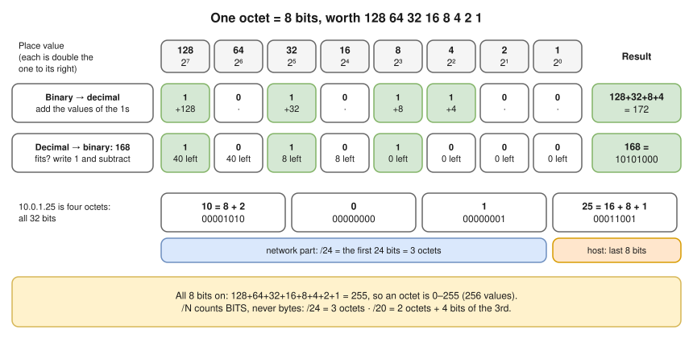
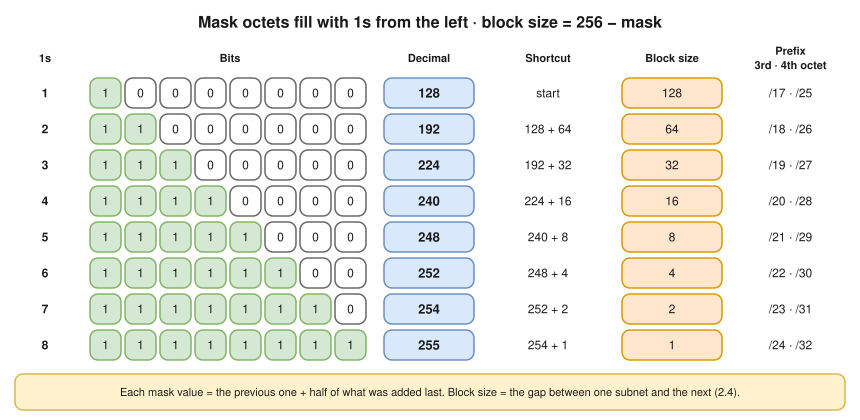
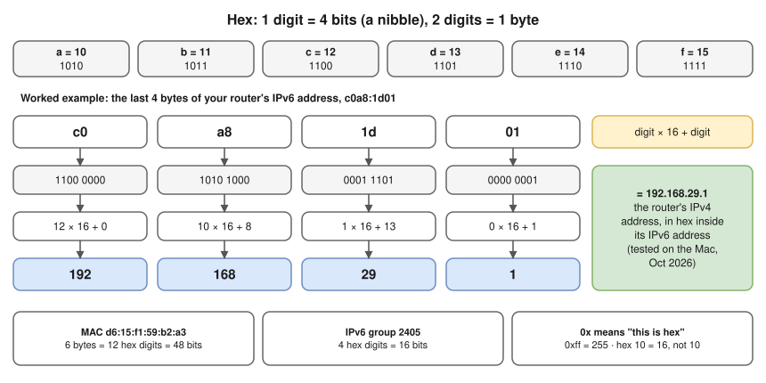

# 2.1 · Binary, Decimal and Hexadecimal for Networking 🔥

> **Level 2 · IP addressing and subnetting** · Lesson 1 of 8 · ⏱️ about 60 minutes + daily practice (estimate)
> ⬅️ [Level 2 overview](README.md) · ➡️ [2.2 IPv4 addresses and ranges](02-ipv4-addresses-and-ranges.md)



- 🔥 Feedback from the 9 Oct interview: *"calculation is totally wrong, conceptually totally wrong. Bit and byte are very different. Calculate on pen and paper, not with a website."* Every subnetting mistake traces back to this page. No calculator here.
- An **IP address is just a 32-bit binary number**: `192.168.1.10` is the human-friendly way to write it. Masks, prefixes and "which subnet?" are all questions about **bits**.
- ⭐ **Learn by heart: 128 64 32 16 8 4 2 1.** Binary → decimal: add the values under the 1s. Decimal → binary: walk left to right; if the value fits into what's left, write 1 and subtract, else write 0.
- **`/N` counts bits, never bytes** (see [1.4](../01-networking-fundamentals/04-network-performance.md#-bits-and-bytes-get-this-right-first)). `/24` = 3 octets; `/20` = 2 octets **plus 4 bits** of the 3rd. Treat `/20` as "20 bytes" or "the first 2 octets" and every answer after that is wrong.

## Bits, octets and bytes

| Word | Means | Where you see it |
|---|---|---|
| **bit** | One binary digit: 0 or 1 | "a /24 has 8 host **bits**" |
| **octet** | **8 bits** | Each of the 4 numbers in an IPv4 address |
| **byte** | 8 bits (on every system you'll use, a byte *is* an octet) | File sizes; "an IPv4 address is 4 bytes" |
| **nibble** | 4 bits = one hex digit | Hex in IPv6 and MAC addresses |

- **IPv4** = 4 bytes = **32 bits** · **IPv6** = 16 bytes = **128 bits** · **MAC** = 6 bytes = **48 bits**.

**Check the conversions with Python (tested in the lab container):**

```bash
python3 -c "print(format(168, '08b'), int('10101100', 2))"
```

```
10101000 172
```

`format(n, '08b')` = "n in binary, 8 digits, zero-padded". `int(text, 2)` = "read this text as base 2".

## The numbers you'll see constantly



- Every mask octet is **1s filling from the left**. Each value is the previous one **plus half of what was added last**: 128, +64 = 192, +32 = 224, +16 = 240 …
- **Block size = 256 − mask octet**: the gap between one subnet and the next, used in [2.4](04-subnetting-step-by-step.md). A `/20` mask has 240 in the 3rd octet; a `/30` mask ends in 252.

## Powers of 2: how many addresses

With **n** bits you get **2ⁿ** combinations. In subnetting, n = the host bits, so 2ⁿ = the addresses in a subnet.

| n | 2ⁿ | | n | 2ⁿ |
|---|---|---|---|---|
| 1 | 2 | | 9 | 512 |
| 2 | 4 | | 10 | 1,024 |
| 3 | 8 | | 11 | 2,048 |
| 4 | 16 | | 12 | 4,096 |
| 5 | 32 | | 13 | 8,192 |
| 6 | 64 | | 14 | 16,384 |
| 7 | 128 | | 15 | 32,768 |
| 8 | 256 | | 16 | 65,536 |

Anchors to memorise: **2⁸ = 256, 2¹⁰ = 1,024, 2¹² = 4,096, 2¹⁶ = 65,536, 2³² ≈ 4.3 billion.** Everything else is a doubling or halving away.

## A whole IP address in binary

Convert each octet separately and join them (the bottom of the first diagram):

```bash
python3 -c "import ipaddress; print('.'.join(format(o, '08b') for o in ipaddress.ip_address('10.0.1.25').packed))"
```

**Expected output (tested in the lab container):**

```
00001010.00000000.00000001.00011001
```

For `/24`, draw the line after the 24th bit: left = **network**, right = **host**.

## Hexadecimal (base 16)



- Hex packs **4 bits into one digit** (a = 10 … f = 15). **Two hex digits = one byte**: `ff` = `11111111` = 255.
- **Hex → decimal:** first digit × 16 + second digit. `c0` = 12 × 16 + 0 = **192**.
- A MAC address is 6 bytes, each written as 2 hex digits. An IPv6 group like `2405` is 4 hex digits = 16 bits.
- Your router's IPv6 address ends in `c0a8:1d01` = **192.168.29.1**, its IPv4 address, written in hex **(tested on the Mac, Oct 2026)**. Checked with Python (tested in the lab container):

```bash
python3 -c "import ipaddress; print(ipaddress.ip_address('192.168.29.1').packed.hex())"
```

```
c0a81d01
```

## Where you meet it

| Where | What |
|---|---|
| Masks, CIDR, route tables, security groups, Kubernetes pod CIDRs | Bit patterns written in decimal |
| Wireshark, `tcpdump -X` | Raw packets shown in hex |
| IPv6 and MAC addresses | Always hex |
| Linux permissions (`chmod 755`) | Octal: the same idea with 3 bits per digit |

## Common mistakes

| Mistake | Fix |
|---|---|
| Treating `/24` as bytes | `/N` is always **bits**. 8 bits per octet. |
| Writing fewer than 8 bits for an octet (`101` for 5) | Pad to 8: `00000101`. The position of each bit matters. |
| Starting the bit values from the left with 1 | The **leftmost** bit is worth **128**; the rightmost is worth 1. |
| Forgetting that 256 values means 0–255 | 8 bits make 256 combinations, from 0 **to 255**. |
| Mixing up hex `10` and decimal 10 | Hex `10` = 16. Write `0x10` when it could be confused. |

## Practice (do it every day this week, on paper)

Convert, then check with `python3 -c "print(format(N, '08b'))"`:

1. 10, 172, 192, 224, 240, 248, 252, 255
2. 37, 100, 127, 129, 200
3. Binary → decimal: `11100000`, `01111111`, `10000001`, `00110010`
4. Hex → decimal: `ff`, `80`, `0a`, `fe`, `1d`
5. How many addresses do 5, 7, 11 and 14 host bits give?

More drills, with worked solutions: [Level 2 subnetting drills](../14-practice-exercises/02-level-2-subnetting-drills.md), set A.

## Check yourself

1. How many bits are in an IPv4 address? In a byte? In an IPv6 address?
2. Convert 200 to binary.
3. What's the decimal value of `11111000`?
4. A subnet has 6 host bits. How many addresses does it have?
5. What decimal number is the hex byte `a8`?

<details>
<summary><b>Answers</b> (try first)</summary>

1. 32 · 8 · 128.
2. 200 = 128 + 64 + 8 = **`11001000`**.
3. 128+64+32+16+8 = **248**.
4. 2⁶ = **64**.
5. 10 × 16 + 8 = **168**.

</details>

➡️ **Next:** [2.2 · IPv4 addresses and ranges](02-ipv4-addresses-and-ranges.md): network and host parts, the old classes, and which ranges are private, public or special.
