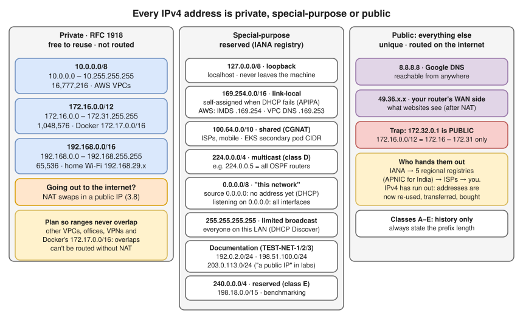
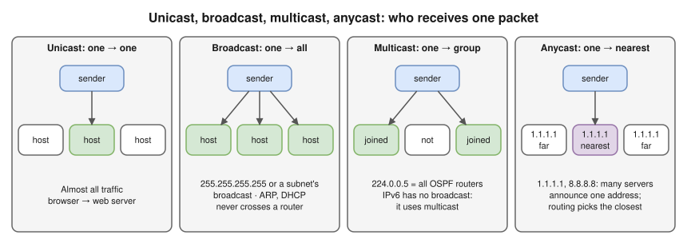
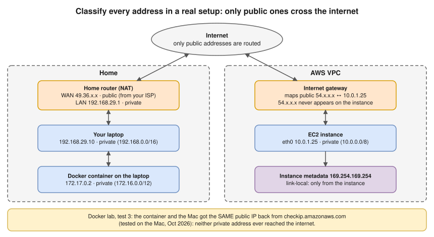

# 2.2 · IPv4 Addresses and Ranges

> **Level 2 · IP addressing and subnetting** · Lesson 2 of 8 · ⏱️ about 60 minutes (estimate) · 🧪 [Lab 2.1](../13-hands-on-labs/lab-02.1-subnetting-by-hand-then-verify.md) (part A)
> ⬅️ [2.1 Binary, decimal and hex](01-binary-decimal-and-hex.md) · ➡️ [2.3 Subnet masks and CIDR](03-subnet-masks-and-cidr.md)



- An IPv4 address = **32 bits** as 4 decimal octets (**dotted-decimal**). It has a **network part** (prefix, the same for every device on that network) and a **host part**. In `192.168.1.10/24`: network `192.168.1`, host `.10`. The split is not in the address: the **mask / `/24`** gives it ([2.3](03-subnet-masks-and-cidr.md)).
- Routers forward by the **network part** only: one entry per network, not per device. That's what lets the internet scale.
- ⭐ **Private (RFC 1918):** `10.0.0.0/8`, `172.16.0.0/12` (**172.16–172.31 only**), `192.168.0.0/16`. Reusable by anyone, never routed on the internet, so going out needs **NAT** ([3.8](../03-core-networking-protocols/08-nat-pat-and-port-forwarding.md)). Private addressing plus NAT kept IPv4 alive after the public addresses ran out.
- ⚠️ **Trap:** `172.32.0.1` is **public**. (Why a `/12` stops at 31 is a block-size question: [2.4](04-subnetting-step-by-step.md).)
- Two VPCs (or a VPN and Docker) with the **same** range can't be connected without NAT. Overlap is one of the most expensive mistakes to undo ([scenario deep dives](../../hemant-scenario-deep-dives.md), A2).

## Address classes (historical context)

Before 1993 the **first bits** fixed the network/host split (**classful** addressing):

| Class | First bits | First octet | Default network part | Hosts per network | Meant for |
|---|---|---|---|---|---|
| **A** | `0` | 1–126 | 8 bits (`/8`) | ~16.7 million | Huge organisations |
| **B** | `10` | 128–191 | 16 bits (`/16`) | 65,534 | Large organisations |
| **C** | `110` | 192–223 | 24 bits (`/24`) | 254 | Small networks |
| **D** | `1110` | 224–239 | n/a | n/a | **Multicast** |
| **E** | `1111` | 240–255 | n/a | n/a | Reserved / experimental |

- 127 is in class A's range but reserved for loopback.
- **Why they died:** too coarse. A company needing 2,000 addresses got a class B (65,534) and wasted 63,000. In 1993 **CIDR** ([2.3](03-subnet-masks-and-cidr.md)) let the split fall at **any** bit.
- You still hear "class C" in old docs, exams and some defaults (a tool may assume `/24` for `192.168.x.x`). It says nothing about how a network is really split: **always state the prefix length**.

## Public vs private, and the special ranges

| | Public address | Private address |
|---|---|---|
| Unique… | Worldwide | Only within your own network |
| Routed on the internet? | ✅ Yes | ❌ No: internet routers drop them |
| Who assigns it | Regional registries → providers → you (or your cloud provider) | You, freely |
| Example | `8.8.8.8` (Google DNS) | `192.168.29.10` (your laptop at home) |

**Special-purpose ranges** (first diagram; reserved by the IETF in IANA's special-purpose registry):

- `127.0.0.0/8` loopback · `169.254.0.0/16` link-local (self-assigned when DHCP fails; AWS IMDS `169.254.169.254`, VPC DNS `169.254.169.253`) · `100.64.0.0/10` shared / CGNAT (EKS secondary pod CIDR, [scenario deep dives](../../hemant-scenario-deep-dives.md) A3).
- `224.0.0.0/4` multicast (OSPF `224.0.0.5`) · `240.0.0.0/4` reserved · `255.255.255.255` limited broadcast (DHCP Discover) · `198.18.0.0/15` benchmarking.
- `0.0.0.0/8` "this network": source `0.0.0.0` = no address yet (DHCP); listening on `0.0.0.0` = all interfaces ([1.3](../01-networking-fundamentals/03-addresses-ports-and-protocols.md)); `0.0.0.0/0` in a route = **everything** (the default route).
- Documentation (TEST-NET-1/2/3): `192.0.2.0/24`, `198.51.100.0/24`, `203.0.113.0/24`, never routed; labs here use `203.0.113.x` as "a public address".

**Check any address with Python (tested in the lab container):**

```bash
python3 -c "import ipaddress as i; [print(a, i.ip_address(a).is_private, i.ip_address(a).is_global) for a in ['10.0.1.25','172.32.0.1','100.64.0.10','169.254.169.254','8.8.8.8','203.0.113.50']]"
```

```
10.0.1.25 True False
172.32.0.1 False True
100.64.0.10 False False
169.254.169.254 True False
8.8.8.8 False True
203.0.113.50 True False
```

- `172.32.0.1` → **global**: the trap, confirmed. `100.64.0.10` → **neither**: shared space is its own category.
- Python's `is_private` means "**not globally routable**" (IANA's list), broader than RFC 1918: `True` for `169.254.x.x` and documentation ranges too.

## Network, broadcast and the four "casts"

| Address | Host bits | Meaning | In `192.168.1.0/24` |
|---|---|---|---|
| **Network address** | All **0** | The name of the subnet itself | `192.168.1.0` |
| **Broadcast address** | All **1** | "Every device in this subnet" | `192.168.1.255` |

So a `/24` has 256 addresses but **254 usable**. (`/31`, `/32` and AWS's extra reserved addresses: [2.3](03-subnet-masks-and-cidr.md).)



- Broadcasts **never cross a router** ([1.2](../01-networking-fundamentals/02-network-devices.md)). IPv6 has no broadcast; it uses multicast ([2.6](06-ipv6-fundamentals.md)).

## Who hands out public addresses

- **IANA** → five **Regional Internet Registries**: ARIN (North America), RIPE NCC (Europe, Middle East), **APNIC (Asia-Pacific, including India)**, LACNIC (Latin America), AFRINIC (Africa) → providers and large organisations → customers.
- The registries have run out of free IPv4, or ration the last small blocks. Addresses are now re-used, transferred or **bought**: that's why AWS charges for every public IPv4 address, and why [IPv6](06-ipv6-fundamentals.md) matters.

## Classify every address in a real setup



To see your own public address, ask something outside what it sees:

```bash
curl http://checkip.amazonaws.com
```

## Where you meet it

| Where | What |
|---|---|
| AWS | VPCs use any RFC 1918 range, plus `100.64.0.0/10` as a secondary range. A public range you don't own is allowed inside a VPC, but those real internet addresses become unreachable from it |
| Kubernetes | Needs two more private ranges that don't overlap the nodes': one for **pods**, one for **Services** |
| Docker | Default bridge `172.17.0.0/16`, Compose networks `172.18–172.20`; Docker Desktop's VM `192.168.65.x`. In the [Docker lab](../13-hands-on-labs/lab-10.1-docker-bridge-nat-and-dns.md) (test 3) a container and the Mac got the same public IP back **(tested on the Mac, Oct 2026)** |
| Labs | [Lab 3.4 · NAT and port forwarding](../13-hands-on-labs/lab-03.4-nat-and-port-forwarding.md), step 1: a "public" server fails to answer a private address before NAT is switched on |

## Troubleshooting

| You see | It means | Next step |
|---|---|---|
| Your IP is `169.254.x.x` | No DHCP answer (not "fine but slow") | Check the Wi-Fi/cable and the DHCP server ([2.8](08-dhcp.md)) |
| Your container or VPN can't reach `172.17.x.x` / `10.x.x.x` addresses in the office | An address overlap: your machine thinks that range is local (e.g. Docker's bridge) | `ip route` / `netstat -rn`, look for two routes covering the same range ([2.7](07-default-gateway-routing-table-and-arp.md)) |
| A server with a private IP can't be reached from the internet | Expected: private addresses aren't routed | Use a public IP, a load balancer, or port forwarding (NAT) |
| Two VPCs refuse to peer | Their CIDRs overlap | Re-plan the ranges, or use NAT-based options |
| "My computer's IP is the one websites see" | At home, websites see your router's **public** IP, after NAT | `curl http://checkip.amazonaws.com` |
| "Private addresses are more secure" | Not routable from the internet helps, but it isn't a security control | Firewalls are the control |

## Interview angle

- **"Why do private IP ranges exist?"** → There aren't enough IPv4 addresses, and private addresses can be reused everywhere. They aren't routable on the internet, so to go out they need NAT.
- **"Name the private ranges."** → `10.0.0.0/8`, `172.16.0.0/12` (172.16–31), `192.168.0.0/16`. Bonus: `100.64.0.0/10` shared space, `169.254.0.0/16` link-local.
- **"What's `169.254.169.254`?"** → The link-local address of the EC2 instance metadata service (IMDS); only reachable from the instance.
- **"Why did classful addressing die?"** → Fixed sizes (/8, /16, /24) wasted huge numbers of addresses. CIDR allows any prefix length.

## Check yourself

1. Is `172.20.5.4` private or public? And `172.40.5.4`?
2. What are the network and broadcast addresses of `192.168.1.0/24`? How many usable hosts?
3. A laptop shows `169.254.33.7`. What happened?
4. Which special range might EKS use for a secondary pod CIDR?
5. Under the old class system, what class was `150.10.0.1`, and what was its default prefix?

<details>
<summary><b>Answers</b> (try first)</summary>

1. `172.20.5.4` is private (inside 172.16–31). `172.40.5.4` is public.
2. Network `192.168.1.0`, broadcast `192.168.1.255`, **254** usable.
3. It didn't get an answer from a DHCP server, so it gave itself a link-local address.
4. `100.64.0.0/10` (shared address space).
5. Class **B** (first octet 128–191), default `/16`.

</details>

➡️ **Next:** [2.3 · Subnet masks and CIDR](03-subnet-masks-and-cidr.md): how `/N` and `255.255.255.0` mark where the network part ends, and how to work out any subnet by hand.
