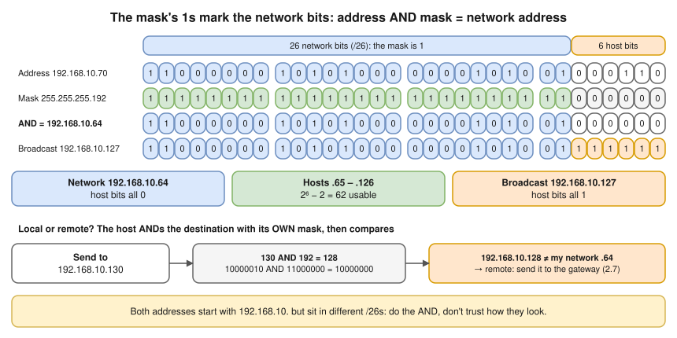
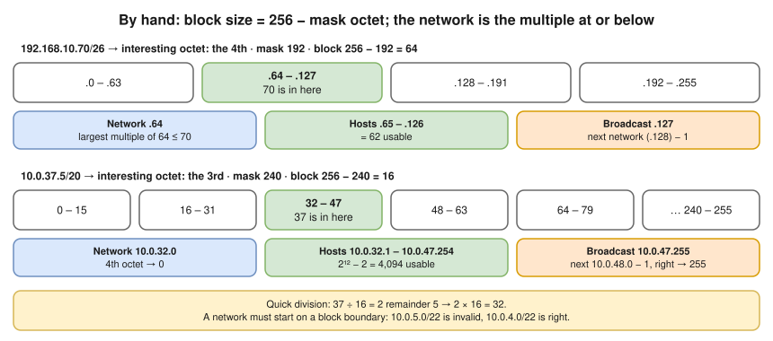
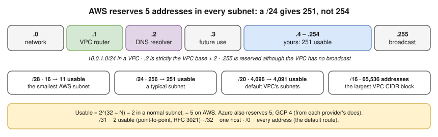

# 2.3 · Subnet Masks and CIDR ⭐

> **Level 2 · IP addressing and subnetting** · Lesson 3 of 8 · ⏱️ about 75 minutes (estimate) · 🧪 [Lab 2.1](../13-hands-on-labs/lab-02.1-subnetting-by-hand-then-verify.md)
> ⬅️ [2.2 IPv4 addresses and ranges](02-ipv4-addresses-and-ranges.md) · ➡️ [2.4 Subnetting step by step](04-subnetting-step-by-step.md)



- A **subnet** is a slice of addresses that forms **one local network**: devices in it reach each other directly, and everything else through a router.
- The **mask** is 32 bits of **1s then 0s**: 1s = network part, 0s = host part. **CIDR** (Classless Inter-Domain Routing) just counts the 1s: `/24` = `255.255.255.0`.
- ⭐ **Addresses = 2^(32 − N)** · **usable = 2^(32 − N) − 2** (network and broadcast) · **− 5 on AWS**. `/26`: 6 host bits → 64 addresses → 62 usable.
- **Network address = address AND mask** (a bit is 1 only if both are 1). To decide **local or remote**, a host ANDs the destination with **its own** mask and compares with its own network: different → send to the **default gateway** ([2.7](07-default-gateway-routing-table-and-arp.md)).
- **Bigger prefix = smaller network**: `/16` (65,536) is far bigger than `/28` (16). `/24` is the number of network **bits**, not "the 24th address".
- 🔥 This is the topic interviewers test on paper. Every interface, route, security group rule, VPC, subnet and Kubernetes CIDR is written this way.

## Mask and prefix: two ways to write the same thing

| Prefix | Mask | Addresses | Usable hosts* | Block size |
|---|---|---|---|---|
| `/8` | `255.0.0.0` | 16,777,216 | 16,777,214 | 1 in the 1st octet |
| `/12` | `255.240.0.0` | 1,048,576 | 1,048,574 | 16 in the 2nd octet |
| `/16` | `255.255.0.0` | 65,536 | 65,534 | 1 in the 2nd octet |
| `/19` | `255.255.224.0` | 8,192 | 8,190 | 32 in the 3rd octet |
| `/20` | `255.255.240.0` | 4,096 | 4,094 | 16 in the 3rd octet |
| `/21` | `255.255.248.0` | 2,048 | 2,046 | 8 in the 3rd octet |
| `/22` | `255.255.252.0` | 1,024 | 1,022 | 4 in the 3rd octet |
| `/23` | `255.255.254.0` | 512 | 510 | 2 in the 3rd octet |
| `/24` | `255.255.255.0` | 256 | 254 | 1 in the 3rd octet |
| `/25` | `255.255.255.128` | 128 | 126 | 128 in the 4th octet |
| `/26` | `255.255.255.192` | 64 | 62 | 64 |
| `/27` | `255.255.255.224` | 32 | 30 | 32 |
| `/28` | `255.255.255.240` | 16 | 14 | 16 |
| `/29` | `255.255.255.248` | 8 | 6 | 8 |
| `/30` | `255.255.255.252` | 4 | 2 | 4 |
| `/31` | `255.255.255.254` | 2 | 2 (point-to-point, below) | 2 |
| `/32` | `255.255.255.255` | 1 | 1 (one host) | 1 |

\* Usable = addresses − 2, in a normal subnet. AWS uses 5, below.

**Build any mask without the table:** `/N` = N ones. Whole octets of 255 first, then one partial octet from [2.1](01-binary-decimal-and-hex.md#the-numbers-youll-see-constantly), then zeros. `/20` = 8 + 8 + **4** → `255.255.240.0`. `/27` = 8 + 8 + 8 + **3** → `255.255.255.224`.

## Calculating everything about a subnet, by hand

1. **Interesting octet**: the one where the mask isn't 255 or 0.
2. **Block size** = 256 − the mask value in that octet.
3. **Network** = the largest **multiple of the block size** ≤ the address's value in that octet. Octets to the right → 0.
4. **Broadcast** = next network − 1. Octets to the right → 255.
5. **First host** = network + 1; **last host** = broadcast − 1.



**Check both with `ipcalc` (tested in the lab container, ipcalc 0.51):**

```bash
ipcalc 192.168.10.70/26
```

```
Address:   192.168.10.70        11000000.10101000.00001010.01 000110
Netmask:   255.255.255.192 = 26 11111111.11111111.11111111.11 000000
Wildcard:  0.0.0.63             00000000.00000000.00000000.00 111111
=>
Network:   192.168.10.64/26     11000000.10101000.00001010.01 000000
HostMin:   192.168.10.65        11000000.10101000.00001010.01 000001
HostMax:   192.168.10.126       11000000.10101000.00001010.01 111110
Broadcast: 192.168.10.127       11000000.10101000.00001010.01 111111
Hosts/Net: 62                    Class C, Private Internet
```

The space in the binary column is the network/host line. Ignore "Class C": classes are historical ([2.2](02-ipv4-addresses-and-ranges.md#address-classes-historical-context)).

```bash
ipcalc 10.0.37.5/20
```

```
Network:   10.0.32.0/20         00001010.00000000.0010 0000.00000000
HostMin:   10.0.32.1            00001010.00000000.0010 0000.00000001
HostMax:   10.0.47.254          00001010.00000000.0010 1111.11111110
Broadcast: 10.0.47.255          00001010.00000000.0010 1111.11111111
Hosts/Net: 4094                  Class A, Private Internet
```

(Shortened to the result lines.) No `ipcalc`? Python's standard library does the same:

```bash
python3 -c "import ipaddress as i; n=i.ip_interface('192.168.10.70/26').network; print(n, n.netmask, n.broadcast_address, n.num_addresses)"
```

```
192.168.10.64/26 255.255.255.192 192.168.10.127 64
```

> 🔥 **Do it on paper first, then check.** The tools are for *checking*. In an interview you'll have a whiteboard.

## Special prefix lengths

| Prefix | What it is | Where you see it |
|---|---|---|
| **`/0`** | `0.0.0.0/0`: **every** address | The **default route**; "allow from anywhere" in a security group |
| **`/32`** | Exactly **one** address | A security group rule for one host; a loopback or a load balancer's single IP; routes to one host |
| **`/31`** | **Two** addresses, **both usable**, no network or broadcast address (**RFC 3021**) | **Point-to-point links** between two routers: saves addresses compared with `/30` |
| **`/30`** | 4 addresses, **2 usable** | The traditional point-to-point link (used between the routers in [Lab 2.2](../13-hands-on-labs/lab-02.2-routing-between-two-subnets.md)) |

Python agrees `/31` has two usable hosts **(tested in the lab container)**:

```bash
python3 -c "import ipaddress as i; print(list(i.ip_network('10.0.0.0/31').hosts()))"
```

```
[IPv4Address('10.0.0.0'), IPv4Address('10.0.0.1')]
```

## ⭐ AWS reserves 5 addresses in every subnet



- Reserved in `10.0.1.0/24`: `.0` network · `.1` **VPC router** · `.2` **DNS resolver** (strictly the **VPC base + 2**; AWS reserves +2 in every subnet) · `.3` future use · `.255` broadcast (reserved although the VPC doesn't support broadcast).
- `/28` (16 → **11** usable) is the **smallest** AWS subnet · `/24` → **251** · `/20` → **4,091** (default subnet size in a default VPC) · `/16` (65,536) is the **largest** VPC CIDR block (and Docker's default bridge size).
- Azure also reserves **5** addresses per subnet; GCP reserves **4** (from each provider's documentation).

## Wildcard masks (inverse masks)

Cisco ACLs and OSPF configs use a **wildcard mask**: the mask with the bits **flipped** (0 = "must match", 1 = "don't care"). **Wildcard = 255.255.255.255 − mask**: `/26` → `0.0.0.63` (the `Wildcard:` line in `ipcalc` above). Used in [Level 4](../04-switching-and-routing/README.md); for now, recognise them.

## Why the mask must match on both ends

A = `10.0.1.10/24`, B = `10.0.1.200/25` (a typo: should be `/24`), same switch:

1. A → B: `10.0.1.200` is in A's `/24` → **local** → ARP for B directly. ✅ B receives it.
2. B → A: B's network is `10.0.1.128/25` (`.128`–`.255`); `10.0.1.10` is outside → **remote** → the reply goes to B's gateway. No gateway, or no route back: **the reply is lost**.
3. A's connections hang while B's logs show requests arriving. It looks like a firewall problem. **Check both ends' masks.**

## Where you meet it

| Where | What |
|---|---|
| AWS VPC design | Choosing prefix lengths: a `/16` VPC split into `/24` or `/20` subnets ([2.4](04-subnetting-step-by-step.md)) |
| Security groups, firewalls | `10.0.0.0/16` = the whole VPC; `203.0.113.7/32` = one office IP; `0.0.0.0/0` = anyone (dangerous for SSH) |
| Kubernetes | `--pod-network-cidr=10.244.0.0/16` and a Service CIDR like `10.96.0.0/12`: must not overlap the node network |
| EKS | With the VPC CNI every pod takes a subnet IP. A `/24` (251 usable) runs out fast: bigger subnets, prefix delegation or a secondary CIDR ([scenario deep dives](../../hemant-scenario-deep-dives.md), A3) |

## Troubleshooting

| You see | It means | Next step |
|---|---|---|
| Two hosts on the same switch can't talk | One has the wrong mask (or they're in different subnets) | `ip -br addr` on both; compute both network addresses |
| Replies go to the router instead of straight back | A mask mismatch (above) | `ip route get <peer IP>` on each side: `via` means "through a router" |
| `Error: Invalid prefix for given prefix length.` (`ip route add 10.0.5.0/22 …`) or `ValueError: 10.0.5.0/22 has host bits set` (Python) **(tested in the lab container)** | Not on a block boundary: a `/22` starts at a multiple of 4 in the 3rd octet | Use `10.0.4.0/22` |
| A new subnet can't be created in a VPC | It **overlaps** an existing subnet, or is outside the VPC CIDR | List subnets and compare ranges ([2.4](04-subnetting-step-by-step.md)) |
| "A `/26` holds 64 hosts" | Forgot the −2 (−5 on AWS) | 62 usable; 59 on AWS |
| `192.168.10.70` and `.130` "look" like one subnet | Under `/26` they're in different subnets | Do the AND |

## Interview angle

- 🔥 **"How many usable IPs in a `/24` subnet on AWS?"** → 251: 256 minus 5 reserved.
- 🔥 **"What range does `10.0.16.0/20` cover?"** → Block size 16 in the 3rd octet → `10.0.16.0`–`10.0.31.255`, 4,096 addresses.
- **"Mask for `/27`?"** → `255.255.255.224`, 32 addresses, 30 usable.
- **"What's a `/31` for?"** → Point-to-point links: two usable addresses, no broadcast (RFC 3021).
- **"How does a host know if a destination is local?"** → It ANDs the destination with its own mask and compares the result with its own network address.

## Check yourself

1. Write the mask for `/22` and `/29`.
2. `172.16.45.200/21`: network, broadcast, first and last host, usable count.
3. Are `10.1.1.5/23` and `10.1.0.200/23` in the same subnet?
4. How many usable addresses does a `/26` have in AWS?
5. What's the wildcard mask for `/20`?

<details>
<summary><b>Answers</b> (try first)</summary>

1. `/22` = `255.255.252.0`; `/29` = `255.255.255.248`.
2. Block size 8 in the 3rd octet → multiples of 8 ≤ 45 → **40**. Network `172.16.40.0`, broadcast `172.16.47.255`, hosts `172.16.40.1`–`172.16.47.254`, **2,046** usable.
3. **Yes.** `/23` → block size 2 in the 3rd octet → `10.1.0.0`–`10.1.1.255` contains both.
4. 64 − 5 = **59**.
5. `255.255.255.255 − 255.255.240.0` = **`0.0.15.255`**.

</details>

➡️ **Next:** [2.4 · Subnetting step by step](04-subnetting-step-by-step.md): split a network into many subnets, size them for a number of hosts, and plan a VPC without overlaps.
