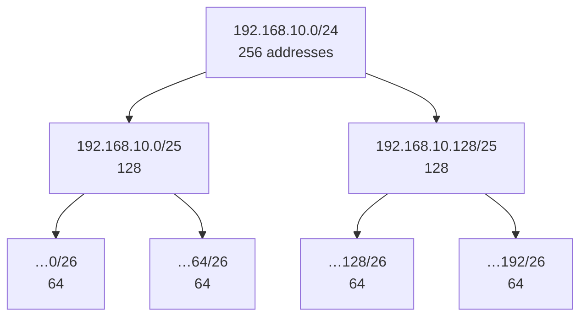

# 2.4 · Subnetting, Step by Step ⭐🔥

> **Level 2 · IP addressing and subnetting** · Lesson 4 of 8 · ⏱️ about 2 hours, plus 15 minutes of drills a day for a week (estimate)
> ⬅️ [2.3 Subnet masks and CIDR](03-subnet-masks-and-cidr.md) · ➡️ [2.5 VLSM and route summarisation](05-vlsm-and-route-summarization.md)

## What you'll learn

One method, applied to the six questions subnetting always asks:

1. Which subnet does this address belong to?
2. Split a network into **N equal subnets**.
3. Size a subnet for **H hosts** (normal networks and AWS).
4. List the subnets of a given size inside a bigger block, and find "the next subnet".
5. Do two ranges **overlap**?
6. Plan a real **VPC** with no overlaps and room to grow.

## Before you start

- [2.1](01-binary-decimal-and-hex.md): bit values and powers of 2, **by heart**.
- [2.3](03-subnet-masks-and-cidr.md): masks, prefix lengths, block size, network and broadcast addresses.
- Paper and a pen. 🔥 Check with tools only **after** you've written your answer.

---

## The idea in plain words

**Subnetting = moving the line between the network part and the host part to the right.**

Each bit you move the line ("**borrow**" from the host part):

- **doubles** the number of subnets;
- **halves** the size of each subnet.



Borrow 1 bit: 2 subnets of 128. Borrow 2 bits: 4 subnets of 64. And so on.

## Why it matters

- 🔥 Interviewers test it on paper ("calculate on pen and paper, not with a website").
- Every VPC, subnet, Kubernetes pod range and VPN you set up needs a plan. A bad plan (too small, or overlapping) is very expensive to fix later: you often have to rebuild the network.

## The method: block size

Everything below uses one tool from [2.3](03-subnet-masks-and-cidr.md#calculating-everything-about-a-subnet-by-hand):

> **Block size = 256 − (the mask value in the interesting octet)** = 2^(host bits in that octet)
>
> Subnets of that size start at **0, block, 2×block, 3×block…** in the interesting octet.

Keep this chart in your head (or redraw it at the top of your paper in an exam):

| Prefix (in the 4th octet) | /25 | /26 | /27 | /28 | /29 | /30 |
|---|---|---|---|---|---|---|
| Mask octet | 128 | 192 | 224 | 240 | 248 | 252 |
| **Block size** | **128** | **64** | **32** | **16** | **8** | **4** |
| Subnets per /24 | 2 | 4 | 8 | 16 | 32 | 64 |
| Usable hosts | 126 | 62 | 30 | 14 | 6 | 2 |

Same block sizes one octet to the left: `/17` = 128, `/18` = 64, `/19` = 32, **`/20` = 16**, `/21` = 8, `/22` = 4, `/23` = 2 (in the **3rd** octet).

---

## Question 1 · Which subnet does an address belong to?

**Example: `10.0.37.5/20`.** (Done in detail in [2.3](03-subnet-masks-and-cidr.md); the short version.)

1. `/20` → interesting octet is the **3rd**, mask 240 → **block 16**.
2. Multiples of 16: 0, 16, **32**, 48… The largest ≤ 37 is **32**.
3. Network **`10.0.32.0/20`**, range `10.0.32.0`–`10.0.47.255`.

**Quick division trick:** 37 ÷ 16 = 2 remainder 5 → 2 × 16 = **32**.

## Question 2 · Split a network into N equal subnets

> **Borrow b bits, where 2^b ≥ N.** New prefix = old prefix + b.

**Example A: split `192.168.10.0/24` into 4 subnets.**

1. 2^b ≥ 4 → **b = 2** → `/24 + 2 = /26`.
2. Block size for `/26` = **64**.
3. The subnets start at 0, 64, 128, 192:

| # | Subnet | Range | Usable hosts |
|---|---|---|---|
| 1 | `192.168.10.0/26` | .0 – .63 | .1 – .62 |
| 2 | `192.168.10.64/26` | .64 – .127 | .65 – .126 |
| 3 | `192.168.10.128/26` | .128 – .191 | .129 – .190 |
| 4 | `192.168.10.192/26` | .192 – .255 | .193 – .254 |

**Example B: split the same `/24` into 6 subnets.**

1. 2² = 4 is too few; 2³ = 8 ≥ 6 → **b = 3** → **`/27`**, block **32**.
2. You get **8** subnets (2 spare): `.0`, `.32`, `.64`, `.96`, `.128`, `.160`, `.192`, `.224`, each with 30 usable hosts.

You can't make exactly 6 equal subnets; you always get a power of 2. (Unequal sizes are [VLSM](05-vlsm-and-route-summarization.md).)

**Check (tested in the lab container):**

```bash
python3 -c "import ipaddress as i; print([str(s) for s in i.ip_network('192.168.10.0/24').subnets(new_prefix=27)])"
```

```
['192.168.10.0/27', '192.168.10.32/27', '192.168.10.64/27', '192.168.10.96/27', '192.168.10.128/27', '192.168.10.160/27', '192.168.10.192/27', '192.168.10.224/27']
```

## Question 3 · Size a subnet for H hosts

> **Find the smallest h where 2^h − 2 ≥ H** (on AWS: 2^h − 5 ≥ H). Prefix = 32 − h.

**Example A: a LAN needs 50 hosts.**

| h | 2^h − 2 | Enough? |
|---|---|---|
| 5 | 30 | ❌ |
| **6** | **62** | ✅ |

→ 6 host bits → **`/26`** (62 usable).

**Example B: an AWS subnet for 500 pods.**

| h | 2^h − 5 | Enough? |
|---|---|---|
| 8 | 251 | ❌ |
| **9** | **507** | ✅ but no room to grow |
| 10 | 1,019 | ✅ with headroom |

→ The minimum is **`/23`** (507), but plan for growth: pods come and go and scale up. A **`/22`** (1,019) or bigger is the sensible choice.

> **Rule of thumb for real networks:** size for **2× today's need**. Subnets are hard to grow later; address space inside a private range is free.

## Question 4 · List subnets inside a block, and find "the next one"

**Example: how many `/20` subnets fit in `10.0.0.0/16`, and what are they?**

1. 2^(20 − 16) = 2⁴ = **16** subnets.
2. `/20` → block **16** in the **3rd** octet: `10.0.0.0`, `10.0.16.0`, `10.0.32.0`, … `10.0.240.0`.

| # | Subnet | Range |
|---|---|---|
| 1 | `10.0.0.0/20` | 10.0.0.0 – 10.0.15.255 |
| 2 | `10.0.16.0/20` | 10.0.16.0 – 10.0.31.255 |
| 3 | `10.0.32.0/20` | 10.0.32.0 – 10.0.47.255 |
| … | … | … |
| 16 | `10.0.240.0/20` | 10.0.240.0 – 10.0.255.255 |

**"What's the next subnet?"** Add the block size in the interesting octet:

| After… | Next is… | Because |
|---|---|---|
| `10.0.2.0/24` | `10.0.3.0/24` | `/24` steps by **1** in the 3rd octet |
| `10.0.16.0/20` | `10.0.32.0/20` | `/20` steps by **16** in the 3rd octet |
| `192.168.10.64/26` | `192.168.10.128/26` | `/26` steps by **64** in the 4th octet |
| `10.0.252.0/22` | `10.1.0.0/22` | 252 + 4 = 256 → carries into the 2nd octet |

🔥 This is the exact question from the 9 Oct interview: `/24`s go up by one in the third octet; `/20`s go up by **16**.

## Question 5 · Do two ranges overlap?

> Two CIDR blocks overlap **if and only if one contains the other**. (Aligned blocks can't partly overlap.) So: work out the **range of the bigger one** and see if the smaller one's network address falls in it.

**Example A: `10.0.16.0/20` and `10.0.20.0/24`.**

- `10.0.16.0/20` covers `10.0.16.0`–`10.0.31.255`.
- `10.0.20.0` is inside → **they overlap**. ❌

**Example B: `10.0.16.0/20` and `10.0.32.0/24`.**

- `10.0.32.0` is outside `10.0.16.0`–`10.0.31.255` → **no overlap**. ✅

**Example C: Docker vs the office VPN.** Docker's default bridge is `172.17.0.0/16`. The office network is `172.17.20.0/24`. `172.17.20.0` is inside `172.17.0.0/16` → overlap → your laptop sends office traffic into Docker's bridge instead of the VPN. (A real scenario: [3.11](../03-core-networking-protocols/11-troubleshooting-connectivity.md) and [15 · troubleshooting scenarios](../15-interview-preparation/troubleshooting-scenarios-docker-kubernetes-aws.md), N4.)

**Check (tested in the lab container):**

```bash
python3 -c "import ipaddress as i; print(i.ip_network('10.0.16.0/20').overlaps(i.ip_network('10.0.20.0/24')), i.ip_network('10.0.16.0/20').overlaps(i.ip_network('10.0.32.0/24')))"
```

```
True False
```

## Question 6 · Plan a VPC

**Brief:** a VPC in 3 availability zones (AZs), with 3 tiers per AZ:

- **public** subnets for load balancers and NAT gateways (small: a few dozen addresses);
- **private app** subnets for EKS nodes and pods (big: thousands);
- **data** subnets for databases (small).

**Step 1 · Pick the VPC range.** `10.0.0.0/16` (65,536 addresses): private, the largest size AWS allows for one CIDR block, and chosen so it **doesn't overlap** other VPCs, offices or VPNs you might connect later (for example, the next environment gets `10.1.0.0/16`).

**Step 2 · Size each tier** (with growth):

| Tier | Need per AZ | Choice | Usable in AWS |
|---|---|---|---|
| Public | Load balancer nodes, NAT gateway | `/24` | 251 |
| Private app | Nodes + pods (VPC CNI gives each pod a VPC IP) | `/20` | 4,091 |
| Data | A few database instances | `/24` | 251 |

**Step 3 · Place them on block boundaries, biggest first** (so the big blocks don't get fragmented):

| Tier | AZ a | AZ b | AZ c |
|---|---|---|---|
| Private app (`/20`, block 16) | `10.0.16.0/20` | `10.0.32.0/20` | `10.0.48.0/20` |
| Public (`/24`) | `10.0.0.0/24` | `10.0.1.0/24` | `10.0.2.0/24` |
| Data (`/24`) | `10.0.64.0/24` | `10.0.65.0/24` | `10.0.66.0/24` |

- The public `/24`s sit inside the first `/20` slot (`10.0.0.0`–`10.0.15.255`), leaving `10.0.3.0`–`10.0.15.255` free.
- The app `/20`s take the next three `/20` slots.
- The data `/24`s start a fresh `/20` slot at `10.0.64.0`.
- `10.0.80.0`–`10.0.255.255` is **spare** for new tiers or more AZs.

**Step 4 · Verify (tested in the lab container):** every subnet is inside the VPC, nothing overlaps, and how much is used:

```bash
python3 - <<'EOF'
import ipaddress as i, itertools
vpc = i.ip_network('10.0.0.0/16')
plan = [i.ip_network(p) for p in '''10.0.0.0/24 10.0.1.0/24 10.0.2.0/24
  10.0.16.0/20 10.0.32.0/20 10.0.48.0/20 10.0.64.0/24 10.0.65.0/24 10.0.66.0/24'''.split()]
print('all in vpc', all(n.subnet_of(vpc) for n in plan))
print('overlaps', [(str(a), str(b)) for a, b in itertools.combinations(plan, 2) if a.overlaps(b)])
print('used', sum(n.num_addresses for n in plan), 'of', vpc.num_addresses)
EOF
```

```
all in vpc True
overlaps []
used 13824 of 65536
```

About 21% used, with room to grow. The full VPC drawing (internet gateway, NAT gateways and route tables) is [diagram r1](../../diagrams/r1-vpc-subnets-nat-igw.drawio.svg) from the interview review, and [Level 9](../09-cloud-networking/README.md) builds it.

## Common mistakes 🔥

| Mistake | Example | Fix |
|---|---|---|
| Counting **bytes** instead of **bits** | Treating `/20` as "the first 2 octets" | 20 bits = 2 octets **+ 4 bits** of the 3rd |
| Confusing "number of subnets" with "hosts per subnet" | Needing 6 subnets and choosing 6 host bits | Subnets → **borrowed** bits (2^b ≥ N). Hosts → **remaining** bits (2^h − 2 ≥ H) |
| Forgetting the −2 (or −5 on AWS) | "A `/26` holds 64 hosts" | 62 hosts; 59 on AWS |
| Starting a subnet off its block boundary | `10.0.20.0/20` | `/20` starts at multiples of 16: `10.0.16.0/20` |
| Stepping by the wrong amount | After `10.0.16.0/20`, writing `10.0.17.0/20` | Step by the **block size**: `10.0.32.0/20` |
| Sizing exactly to today's need | A `/24` for an EKS node group with 200 pods | Plan 2× growth; pods need IPs |
| Planning without checking other networks | A VPC `10.0.0.0/16` when the office already uses `10.0.0.0/8` | List every range you might connect **before** choosing |

## Troubleshooting

| Symptom | Subnetting cause | Check |
|---|---|---|
| AWS refuses to create a subnet | Its CIDR overlaps an existing subnet, or isn't inside the VPC CIDR | List subnet CIDRs; compare ranges (question 5) |
| Pods stuck `ContainerCreating`: "failed to assign an IP address" | The subnet ran out of IPs | `aws ec2 describe-subnets … AvailableIpAddressCount`; bigger subnets or prefix delegation ([15 · scenarios](../15-interview-preparation/troubleshooting-scenarios-docker-kubernetes-aws.md), N10) |
| VPC peering is refused, or traffic to the other side goes nowhere | The two CIDRs overlap | Compare both VPC ranges |
| A VPN connects but some office hosts are unreachable | Your local network (or Docker) overlaps an office range | `ip route` / `netstat -rn`: two routes for the same addresses |

## Hands-on lab

[Lab 2.1 · Subnetting by hand, then verify](../13-hands-on-labs/lab-02.1-subnetting-by-hand-then-verify.md): plan a network on paper, then check every answer with `ipcalc` and Python, including the overlap test.

## Practice

- 🔥 **First**: the [12-question worksheet](../../interview-transcript-review-oct-9.md#worksheet-do-it-on-paper-then-check) from the interview review. Target: all 12 right, on paper, in under 15 minutes.
- Then: [Level 2 subnetting drills](../14-practice-exercises/02-level-2-subnetting-drills.md), sets B–E (40+ problems with worked solutions).

## Interview angle

- 🔥 **"Split `10.0.0.0/24` into 4 equal subnets."** → Borrow 2 bits → `/26`, block 64: `.0/26`, `.64/26`, `.128/26`, `.192/26`, 62 usable each (59 on AWS).
- 🔥 **"Which `/20` contains `10.0.37.5`?"** → Block 16 in the 3rd octet; 37 → 32 → `10.0.32.0/20`.
- **"How many `/24`s fit in a `/16`?"** → 2^(24−16) = 256.
- **"Design the subnets for a 3-AZ VPC."** → State the VPC CIDR and why (no overlap with other networks), the tiers and their sizes, and lay them out on block boundaries, biggest first, leaving spare space. Say the AWS 5-address reservation.

## Check yourself

1. Split `172.16.0.0/16` into 8 equal subnets. What's the prefix, and what are the first three subnets?
2. A department needs 120 hosts. What's the smallest prefix (normal network)?
3. What's the subnet after `10.0.48.0/20`? After `192.168.1.224/27`?
4. Do `192.168.0.0/22` and `192.168.3.128/25` overlap?
5. How many `/26` subnets fit in a `/22`?

<details>
<summary><b>Answers</b> (try first)</summary>

1. 2³ = 8 → borrow 3 → **`/19`**, block 32 in the 3rd octet: `172.16.0.0/19`, `172.16.32.0/19`, `172.16.64.0/19`.
2. 2⁷ − 2 = 126 ≥ 120 → 7 host bits → **`/25`**.
3. `10.0.64.0/20`. `192.168.1.224/27` is the last `/27` in that `/24`, so the next is **`192.168.2.0/27`**.
4. **Yes.** `192.168.0.0/22` covers `192.168.0.0`–`192.168.3.255`, which contains `192.168.3.128`.
5. 2^(26−22) = **16**.

</details>

## Summary

- Subnetting = **borrowing host bits**: each bit doubles the subnets and halves their size.
- **N subnets → borrow b where 2^b ≥ N. H hosts → keep h where 2^h − 2 ≥ H** (− 5 on AWS).
- Subnets start at multiples of the **block size**; the next subnet = current + block size.
- Aligned blocks overlap **only if one contains the other**.
- Plan VPCs **biggest blocks first**, on boundaries, with spare space, and **no overlap** with anything you'll ever connect.

## Next

➡️ [2.5 · VLSM and route summarisation](05-vlsm-and-route-summarization.md): subnets of **different** sizes in one network without wasting addresses, and the reverse operation: combining many routes into one.
