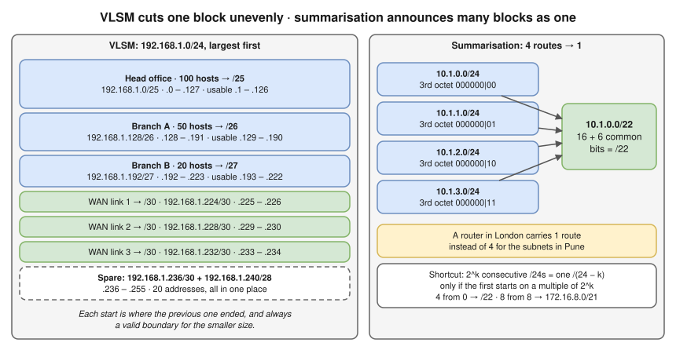
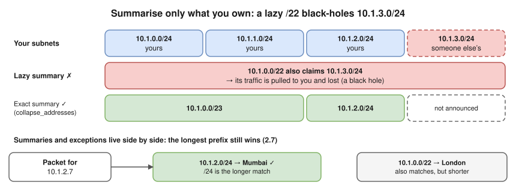
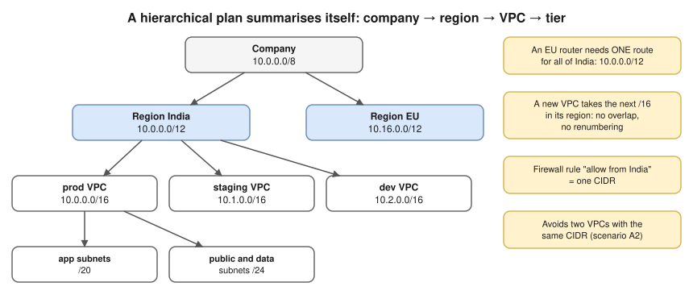

# 2.5 · VLSM and Route Summarisation (CIDR Aggregation)

> **Level 2 · IP addressing and subnetting** · Lesson 5 of 8 · ⏱️ about 75 minutes (estimate) · 🧪 [Lab 2.1](../13-hands-on-labs/lab-02.1-subnetting-by-hand-then-verify.md) (part C)
> ⬅️ [2.4 Subnetting step by step](04-subnetting-step-by-step.md) · ➡️ [2.6 IPv6 fundamentals](06-ipv6-fundamentals.md)



- **VLSM** (variable-length subnet masking) = one network split **unevenly**, each subnet sized to its need. Every real network is addressed this way: VPC tiers of different sizes ([2.4 question 6](04-subnetting-step-by-step.md#question-6--plan-a-vpc) was already VLSM), offices of different sizes, `/30` or `/31` router links.
- ⭐ **The rule: largest first**, each at the **next free block boundary** of its size.
- **Summarisation** (aggregation, supernetting) is the reverse: neighbouring subnets announced as **one** shorter prefix, so routers elsewhere carry one route. It keeps routing tables small and stable (the internet's would be far larger without it) and decides how many routes a Transit Gateway, VPN or on-premises router must carry.
- A good **address plan** makes summarisation possible; a messy one makes it impossible forever.

## VLSM, step by step

**Brief:** `192.168.1.0/24` for a head office (100 hosts), branch A (50), branch B (20) and 3 router-to-router WAN links (2 each).

1. **Size each one** (2^h − 2 ≥ H, from [2.4](04-subnetting-step-by-step.md#question-3--size-a-subnet-for-h-hosts)): 100 → 7 host bits (126) → `/25`, block 128 · 50 → 6 (62) → `/26`, block 64 · 20 → 5 (30) → `/27`, block 32 · links → 2 (2) → `/30`, block 4.
2. **Allocate, largest first,** each at the next free address that is a multiple of its block size (the left half of the diagram): head office `192.168.1.0/25` · branch A `192.168.1.128/26` · branch B `192.168.1.192/27` · links `192.168.1.224/30`, `.228/30`, `.232/30` · spare `.236`–`.255` (20 addresses).
3. **Verify (tested in the lab container):** no overlaps, and what's left over:

```bash
python3 - <<'EOF'
import ipaddress as i, itertools
nets = [i.ip_network(p) for p in ['192.168.1.0/25', '192.168.1.128/26', '192.168.1.192/27',
        '192.168.1.224/30', '192.168.1.228/30', '192.168.1.232/30']]
print('overlaps', [(str(a), str(b)) for a, b in itertools.combinations(nets, 2) if a.overlaps(b)])
used = set().union(*[set(n) for n in nets])
free = [i.ip_network(f'{a}/32') for a in i.ip_network('192.168.1.0/24') if a not in used]
print('spare', list(i.collapse_addresses(free)))
EOF
```

```
overlaps []
spare [IPv4Network('192.168.1.236/30'), IPv4Network('192.168.1.240/28')]
```

**Why largest first?**

- With sizes going **down**, each subnet starts where the previous one ended, and that address is **always** a valid boundary for the smaller size (every multiple of 128 is also a multiple of 64, 32, 4…). No gaps, no checking.
- The other way breaks at once: a `/30` at `.0`–`.3` leaves `.4` as the next address, which is **not** a valid start for a `/26` (multiple of 64). You skip to `.64` and leave a gap at `.4`–`.63`.
- Largest-first leaves all the spare space in **one** region at the end, ready for the next request.
- **Modern alternative for WAN links:** `/31` (two usable addresses, no broadcast, RFC 3021) halves the space router links use ([2.3](03-subnet-masks-and-cidr.md#special-prefix-lengths)).

## Route summarisation, step by step

> **Method:** write the octet where the subnets differ in **binary**, and count the **leading bits that are the same in all of them**. Summary prefix = the bits before that octet + the common bits; network = the common bits with the rest set to 0.

1. **A:** `10.1.0.0/24` – `10.1.3.0/24` (four subnets in Pune, seen from London). `10.1` is common; the 3rd octet 0–3 = `000000`**`00`**…`000000`**`11`** → **6** common bits → 16 + 6 = **`10.1.0.0/22`**.
2. **B:** `172.16.8.0/24` – `172.16.15.0/24` (8 subnets). 8 = `00001`**`000`**, 15 = `00001`**`111`** → 5 common bits → 16 + 5 = **`172.16.8.0/21`**.
3. **Quick check without binary:** 2^k consecutive `/24`s are a `/(24 − k)`, **if the first starts on a multiple of 2^k**. Four from 0 → `/22`. Eight from 8 → `/21`. ✅

**Verify (tested in the lab container):**

```bash
python3 -c "import ipaddress as i; print(list(i.collapse_addresses([i.ip_network(f'10.1.{x}.0/24') for x in range(4)])))"
```

```
[IPv4Network('10.1.0.0/22')]
```

### ⚠️ Over-summarising



- A lazy `/22` over space you don't own pulls that traffic to you and loses it (a **black hole**), or hides a missing route. The exact summary is **two** routes (tested in the lab container):

```bash
python3 -c "import ipaddress as i; print(list(i.collapse_addresses([i.ip_network(f'10.1.{x}.0/24') for x in range(3)])))"
```

```
[IPv4Network('10.1.0.0/23'), IPv4Network('10.1.2.0/24')]
```

- Summarise only space you **own and reach**. Some networks summarise on purpose and add a "discard" route for unused space, so the black hole is explicit and local ([Level 4](../04-switching-and-routing/README.md)).
- **The more specific route still wins:** routers pick the **longest matching prefix** ([2.7](07-default-gateway-routing-table-and-arp.md#longest-prefix-match)), so summaries and exceptions live side by side: with `10.1.0.0/22 → London` and `10.1.2.0/24 → Mumbai`, a packet for `10.1.2.7` goes to **Mumbai**.

## Putting both together: a hierarchical IP plan



- Every India VPC sits inside `10.0.0.0/12`, so an EU router needs **one** route for all of India, and a firewall rule "allow from India" is one CIDR.
- A new VPC takes the next `/16` in its region's block: no overlap, no renumbering. This is exactly the planning that avoids "two VPCs with the same CIDR" ([scenario deep dives](../../hemant-scenario-deep-dives.md), A2).

## Where you meet it

| Where | What |
|---|---|
| The internet | Relies on aggregation: providers announce their large blocks, not every customer's subnet (and many networks filter announcements longer than `/24`) |
| AWS | Route tables and Transit Gateways have **route limits**; summarised plans stay under them. **Managed prefix lists** group CIDRs for security groups and route tables |
| Kubernetes | Each node gets a slice of the pod CIDR (e.g. a `/24` per node from a `/16`): VLSM-style allocation done by the cluster |
| IPAM tools | AWS VPC IPAM, NetBox keep these plans consistent across teams |

## Troubleshooting

| You see | It means | Next step |
|---|---|---|
| Traffic to one remote subnet vanishes, other subnets in the same summary work | An over-broad summary pulls traffic to a site that doesn't have that subnet | Compare the summary with the real subnets behind it (`ip route get <addr>` on the router) |
| A specific route is ignored | It's actually less specific (shorter prefix) than another route | List all matching routes and compare prefix lengths ([2.7](07-default-gateway-routing-table-and-arp.md)) |
| A new subnet can't be placed although "there's enough space" | Free space is fragmented into blocks too small or misaligned | List the free blocks (`address_exclude` / `collapse_addresses`), then re-plan |
| Small subnets were allocated first | Gaps and misaligned big blocks | Largest first, each on its own block boundary |
| A summary of a range that doesn't start on a boundary, e.g. `10.1.1.0`–`10.1.4.0` as `10.1.0.0/22` | The first network isn't a multiple of the summary's block size | Use several summaries |
| Random VPC ranges per team | No plan, so nothing summarises | One central plan: region → environment → VPC → tier |

## Interview angle

- **"What's VLSM?"** → Using different prefix lengths within one network so each subnet is sized to its need. Allocate largest first, on block boundaries.
- **"Summarise `172.16.8.0/24` to `172.16.15.0/24`."** → Eight consecutive `/24`s starting at a multiple of 8 → `172.16.8.0/21`.
- **"Why summarise?"** → Smaller, more stable routing tables; one change inside the summary doesn't ripple everywhere. Risk: black-holing space you don't own.

## Check yourself

1. From `10.10.0.0/24`, allocate (largest first): 60 hosts, 25 hosts, 12 hosts, and two `/30` links. List the subnets.
2. Summarise `192.168.4.0/24`, `192.168.5.0/24`, `192.168.6.0/24`, `192.168.7.0/24`.
3. Can `192.168.5.0/24` – `192.168.8.0/24` be summarised as one `/22`?
4. A router has `10.0.0.0/8 → A` and `10.20.0.0/16 → B`. Where does a packet for `10.20.3.4` go? For `10.21.3.4`?

<details>
<summary><b>Answers</b> (try first)</summary>

1. 60 → `/26` = `10.10.0.0/26` · 25 → `/27` = `10.10.0.64/27` · 12 → `/28` = `10.10.0.96/28` · links → `10.10.0.112/30` and `10.10.0.116/30`. Spare from `10.10.0.120`.
2. 4 consecutive, starting at 4 (a multiple of 4) → **`192.168.4.0/22`**.
3. **No.** 5 isn't a multiple of 4, so they straddle two `/22` blocks (`192.168.4.0/22` and `192.168.8.0/22`). Exact summary: `192.168.5.0/24`, `192.168.6.0/23`, `192.168.8.0/24`.
4. `10.20.3.4` → **B** (the `/16` is the longer match). `10.21.3.4` → **A** (only the `/8` matches).

</details>

➡️ **Next:** [2.6 · IPv6 fundamentals](06-ipv6-fundamentals.md): the 128-bit successor to IPv4, how to shorten its addresses, and why it doesn't need NAT or ARP.
