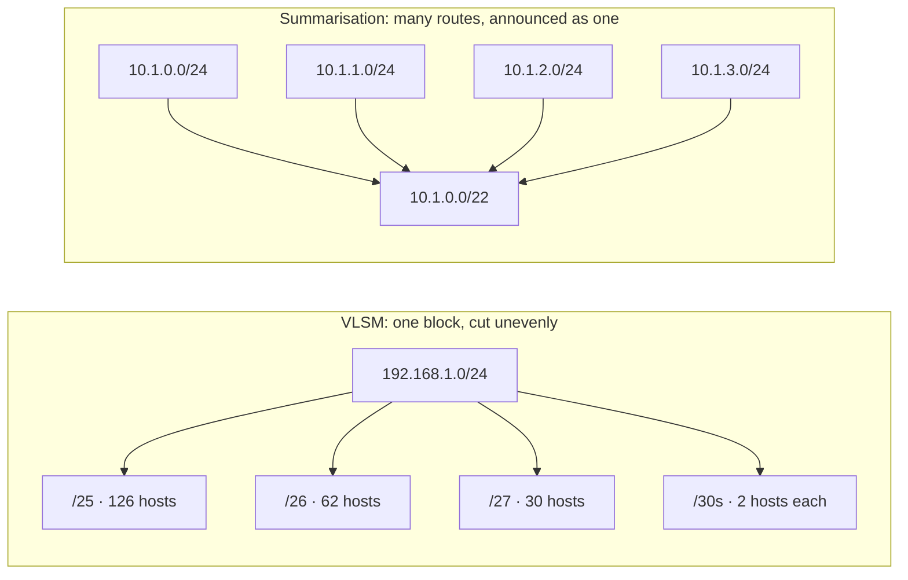
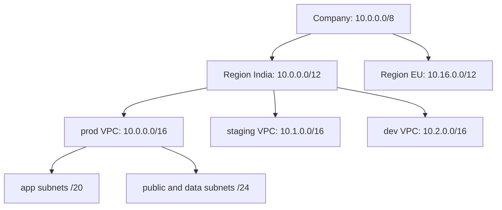

# 2.5 · VLSM and Route Summarisation (CIDR Aggregation)

> **Level 2 · IP addressing and subnetting** · Lesson 5 of 8 · ⏱️ about 75 minutes (estimate)
> ⬅️ [2.4 Subnetting step by step](04-subnetting-step-by-step.md) · ➡️ [2.6 IPv6 fundamentals](06-ipv6-fundamentals.md)

## What you'll learn

- **VLSM** (variable-length subnet masking): carving one network into subnets of **different sizes** without waste or overlap.
- The rule that makes VLSM safe: **allocate the largest subnets first**.
- **Route summarisation** (also called **aggregation** or **supernetting**): combining many routes into one shorter prefix, and how to find it in binary.
- The danger of **over-summarising**.
- How both ideas shape real IP address plans (regions, environments, VPCs).

## Before you start

- [2.4](04-subnetting-step-by-step.md): block sizes, sizing for H hosts, overlap checks.
- [2.1](01-binary-decimal-and-hex.md): writing an octet in binary.

---

## The idea in plain words

- **VLSM** = splitting a network **unevenly**: a big slice for the big office, a small slice for the small one, a tiny slice for a link between two routers. Equal-size subnetting ([2.4](04-subnetting-step-by-step.md)) wastes addresses when needs differ.
- **Summarisation** is the **reverse**: several neighbouring subnets are described as **one bigger block**, so a router elsewhere needs **one** route instead of many.



## Why it matters

- **VLSM** is how every real network is addressed: VPC tiers of different sizes ([2.4](04-subnetting-step-by-step.md#question-6--plan-a-vpc) was already VLSM), offices of different sizes, `/30` or `/31` router links.
- **Summarisation** keeps routing tables small and stable. The global internet routing table would be far larger without it. In your own networks it decides how many routes a Transit Gateway, VPN or on-premises router must carry.
- A good **address plan** makes summarisation possible; a messy one makes it impossible forever.

---

## VLSM, step by step

> **The rule:** sort the needs from **largest to smallest**, and give each one the **next free block boundary** of its size. Doing the big ones first keeps them aligned; small subnets then fill the gaps.

**Brief:** you have `192.168.1.0/24`. You need:

| Network | Hosts needed |
|---|---|
| Head office LAN | 100 |
| Branch A LAN | 50 |
| Branch B LAN | 20 |
| 3 router-to-router WAN links | 2 each |

**Step 1 · Size each one** (2^h − 2 ≥ H, from [2.4](04-subnetting-step-by-step.md#question-3--size-a-subnet-for-h-hosts)):

| Network | Hosts | Host bits | Prefix | Block size |
|---|---|---|---|---|
| Head office | 100 | 7 (126) | `/25` | 128 |
| Branch A | 50 | 6 (62) | `/26` | 64 |
| Branch B | 20 | 5 (30) | `/27` | 32 |
| WAN links | 2 | 2 (2) | `/30` | 4 |

**Step 2 · Allocate, largest first,** each at the next free address that is a multiple of its block size:

| Network | Subnet | Range | Usable |
|---|---|---|---|
| Head office | `192.168.1.0/25` | .0 – .127 | .1 – .126 |
| Branch A | `192.168.1.128/26` | .128 – .191 | .129 – .190 |
| Branch B | `192.168.1.192/27` | .192 – .223 | .193 – .222 |
| WAN link 1 | `192.168.1.224/30` | .224 – .227 | .225 – .226 |
| WAN link 2 | `192.168.1.228/30` | .228 – .231 | .229 – .230 |
| WAN link 3 | `192.168.1.232/30` | .232 – .235 | .233 – .234 |
| **Spare** | `192.168.1.236/30` + `192.168.1.240/28` | .236 – .255 | 20 addresses left |

**Step 3 · Verify (tested in the lab container):** no overlaps, and what's left over:

```bash
python3 - <<'EOF'
import ipaddress as i, itertools
nets = [i.ip_network(p) for p in ['192.168.1.0/25', '192.168.1.128/26', '192.168.1.192/27',
        '192.168.1.224/30', '192.168.1.228/30', '192.168.1.232/30']]
print('overlaps', [(str(a), str(b)) for a, b in itertools.combinations(nets, 2) if a.overlaps(b)])
used = set().union(*[set(n) for n in nets])
free = [i.ip_network(f'{a}/32') for a in i.ip_network('192.168.1.0/24') if a not in used]
print('spare', list(i.collapse_addresses(free)))
EOF
```

```
overlaps []
spare [IPv4Network('192.168.1.236/30'), IPv4Network('192.168.1.240/28')]
```

**Why largest first?** When the sizes go **down**, each new subnet starts exactly where the previous one ended, and that address is **always** a valid boundary for the smaller size (every multiple of 128 is also a multiple of 64, 32, 4…). You just keep counting up, with no gaps and no checking. Go the other way and it breaks immediately: put the `/30` at `.0`–`.3`, and the "next address", `.4`, is **not** a valid start for a `/26` (it must be a multiple of 64). You have to skip to `.64`, leave a gap at `.4`–`.63`, and remember to come back and fill it. Largest-first also leaves all the spare space in **one** region at the end, ready for the next request.

> **Modern alternative for WAN links:** `/31` (two usable addresses, no broadcast, RFC 3021) halves the space used by router links ([2.3](03-subnet-masks-and-cidr.md#special-prefix-lengths)).

---

## Route summarisation, step by step

**Why:** a router in London needs to reach four subnets in Pune: `10.1.0.0/24`, `10.1.1.0/24`, `10.1.2.0/24`, `10.1.3.0/24`. Instead of four routes, it can carry **one**: `10.1.0.0/22`.

> **Method:** write the octet where the subnets differ in **binary**, and count how many **leading bits are the same in all of them**. The summary prefix = the bits before that octet + the common bits.

**Example A:** `10.1.0.0/24` – `10.1.3.0/24`. The first two octets (`10.1`) are the same. The 3rd octet differs:

| 3rd octet | Binary |
|---|---|
| 0 | `000000`**`00`** |
| 1 | `000000`**`01`** |
| 2 | `000000`**`10`** |
| 3 | `000000`**`11`** |

The first **6 bits** are common. Summary prefix = 16 (two whole octets) + 6 = **`/22`**, network = the common bits with the rest set to 0 = **`10.1.0.0/22`**.

**Example B:** `172.16.8.0/24` – `172.16.15.0/24` (8 subnets). 8 = `00001`**`000`**, 15 = `00001`**`111`**: 5 common bits → 16 + 5 = **`172.16.8.0/21`**.

**Quick check without binary:** a summary of **2^k** consecutive `/24`s is a `/(24 − k)`, **if the first one starts on a multiple of 2^k**. Four `/24`s starting at 0 → `/22`. Eight starting at 8 → `/21`. ✅

**Verify (tested in the lab container):**

```bash
python3 -c "import ipaddress as i; print(list(i.collapse_addresses([i.ip_network(f'10.1.{x}.0/24') for x in range(4)])))"
```

```
[IPv4Network('10.1.0.0/22')]
```

### ⚠️ Over-summarising

Now say you only own **three** of those subnets: `10.1.0.0/24`, `10.1.1.0/24`, `10.1.2.0/24`.

- A lazy summary `10.1.0.0/22` **also claims `10.1.3.0/24`**, which you don't have. If someone else uses `10.1.3.0/24`, traffic for it is pulled to you and lost (a **black hole**), or it hides a missing route.
- The exact summary is **two** routes (tested in the lab container):

```bash
python3 -c "import ipaddress as i; print(list(i.collapse_addresses([i.ip_network(f'10.1.{x}.0/24') for x in range(3)])))"
```

```
[IPv4Network('10.1.0.0/23'), IPv4Network('10.1.2.0/24')]
```

Summarise only space you **own and reach**. (Some networks deliberately summarise and add a "discard" route for unused space so the black hole is explicit and local; that's a [Level 4](../04-switching-and-routing/README.md) topic.)

### Why the more specific route still wins

If a router has both `10.1.0.0/22 → London` and `10.1.2.0/24 → Mumbai`, a packet for `10.1.2.7` goes to **Mumbai**: routers always pick the **longest matching prefix** ([2.7](07-default-gateway-routing-table-and-arp.md#longest-prefix-match)). Summaries and exceptions can live side by side.

---

## Putting both together: a hierarchical IP plan

The real payoff comes when you **plan** addresses so they summarise naturally:



- Every VPC in India sits inside `10.0.0.0/12`, so a router in the EU needs **one** route for all of India.
- New VPCs take the next `/16` in the region's block: no overlap, no renumbering.
- Firewall rules can say "allow from India" with one CIDR.

This is exactly the planning that avoids the "two VPCs with the same CIDR" problem ([scenario deep dives](../../hemant-scenario-deep-dives.md), A2).

## In the real world

- **The internet's routing table** relies on aggregation: providers announce their large blocks rather than every customer's subnet (and many networks filter announcements longer than `/24`).
- **AWS:** route tables and Transit Gateways have **route limits**; summarised plans stay under them. **Managed prefix lists** group CIDRs for security groups and route tables.
- **Kubernetes:** each node gets a slice of the pod CIDR (e.g. a `/24` per node from a `/16`): that's VLSM-style allocation done by the cluster.
- **IP address management (IPAM)** tools (AWS VPC IPAM, NetBox) exist to keep these plans consistent across teams.

## Common mistakes

| Mistake | Fix |
|---|---|
| Allocating small subnets first | Largest first, each on its own block boundary |
| Summarising a range that doesn't start on a boundary, e.g. `10.1.1.0`–`10.1.4.0` as `10.1.0.0/22` | Check that the first network is a multiple of the summary's block size; otherwise you need several summaries |
| Summarising space you don't own | Use exact summaries (`collapse_addresses`), or add an explicit discard route |
| Random VPC ranges per team | One central plan: region → environment → VPC → tier |

## Troubleshooting

| Symptom | Cause | Check |
|---|---|---|
| Traffic to one remote subnet vanishes, other subnets in the same summary work | An over-broad summary is pulling traffic to a site that doesn't have that subnet | Compare the summary with the real subnets behind it (`ip route get <addr>` on the router) |
| A specific route is ignored | It's actually less specific than another route (shorter prefix) | List all matching routes and compare prefix lengths ([2.7](07-default-gateway-routing-table-and-arp.md)) |
| A new subnet can't be placed although "there's enough space" | Free space is fragmented into blocks too small or misaligned | List the free blocks (`address_exclude` / `collapse_addresses`), then re-plan |

## Hands-on lab

[Lab 2.1 · Subnetting by hand, then verify](../13-hands-on-labs/lab-02.1-subnetting-by-hand-then-verify.md), part C: a VLSM plan and a summarisation, checked with Python.

## Interview angle

- **"What's VLSM?"** → Using different prefix lengths within one network so each subnet is sized to its need. Allocate largest first, on block boundaries.
- **"Summarise `172.16.8.0/24` to `172.16.15.0/24`."** → Eight consecutive `/24`s starting at a multiple of 8 → `172.16.8.0/21`.
- **"Why summarise?"** → Smaller, more stable routing tables; one change inside the summary doesn't ripple everywhere. Risk: black-holing space you don't own.

## Check yourself

1. From `10.10.0.0/24`, allocate (largest first): 60 hosts, 25 hosts, 12 hosts, and two `/30` links. List the subnets.
2. Summarise `192.168.4.0/24`, `192.168.5.0/24`, `192.168.6.0/24`, `192.168.7.0/24`.
3. Can `192.168.5.0/24` – `192.168.8.0/24` be summarised as one `/22`?
4. A router has `10.0.0.0/8 → A` and `10.20.0.0/16 → B`. Where does a packet for `10.20.3.4` go? For `10.21.3.4`?

<details>
<summary><b>Answers</b> (try first)</summary>

1. 60 → `/26` = `10.10.0.0/26` · 25 → `/27` = `10.10.0.64/27` · 12 → `/28` = `10.10.0.96/28` · links → `10.10.0.112/30` and `10.10.0.116/30`. Spare from `10.10.0.120`.
2. 4 consecutive, starting at 4 (a multiple of 4) → **`192.168.4.0/22`**.
3. **No.** 5 isn't a multiple of 4, so they straddle two `/22` blocks (`192.168.4.0/22` and `192.168.8.0/22`). Exact summary: `192.168.5.0/24`, `192.168.6.0/23`, `192.168.8.0/24`.
4. `10.20.3.4` → **B** (the `/16` is the longer match). `10.21.3.4` → **A** (only the `/8` matches).

</details>

## Summary

- **VLSM** = different-size subnets in one network. **Largest first, on block boundaries.**
- **Summarisation** = many routes → one shorter prefix. Count the common leading bits.
- 2^k consecutive blocks summarise cleanly **only if the first starts on a multiple of 2^k**.
- Don't summarise space you don't own; the **longest prefix still wins** for exceptions.
- A **hierarchical plan** (company → region → environment → VPC → tier) gives you both.

## Next

➡️ [2.6 · IPv6 fundamentals](06-ipv6-fundamentals.md): the 128-bit successor to IPv4, how to read and shorten its addresses, and why it doesn't need NAT or ARP.
