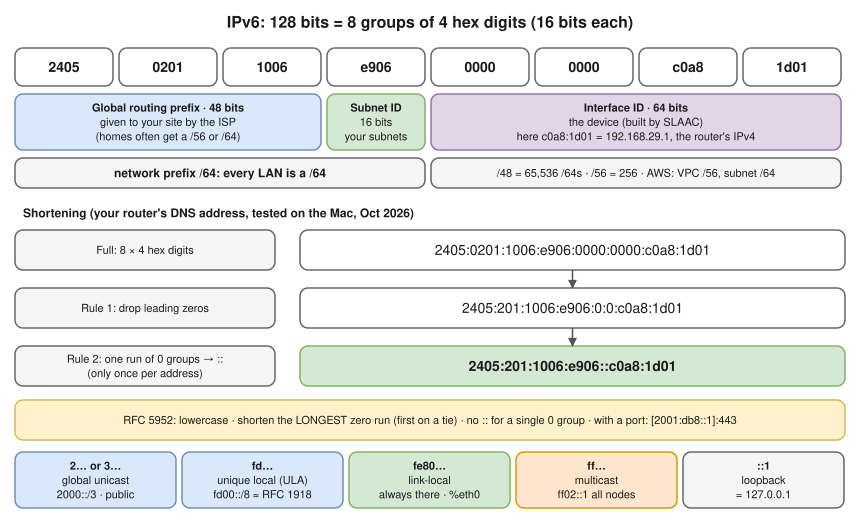
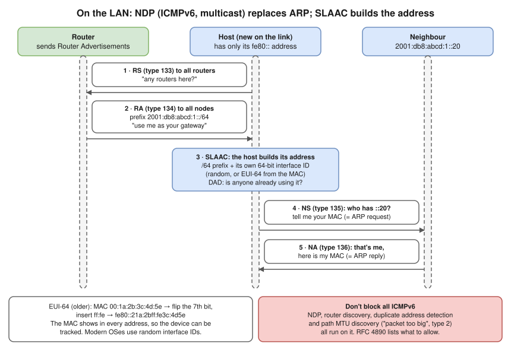

# 2.6 · IPv6 Fundamentals

> **Level 2 · IP addressing and subnetting** · Lesson 6 of 8 · ⏱️ about 90 minutes (estimate)
> ⬅️ [2.5 VLSM and route summarisation](05-vlsm-and-route-summarization.md) · ➡️ [2.7 Default gateway, routing table and ARP](07-default-gateway-routing-table-and-arp.md)



- **Why:** IPv4's ~4.3 billion addresses ran out ([2.2](02-ipv4-addresses-and-ranges.md#who-hands-out-public-addresses)); NAT stretched them at the cost of complexity ([3.8](../03-core-networking-protocols/08-nat-pat-and-port-forwarding.md)). IPv6 has **128 bits** (2¹²⁸ ≈ 3.4 × 10³⁸): every LAN gets 2⁶⁴ addresses (18 quintillion), so every device can have a **globally unique address** (no NAT needed), **almost every LAN is a `/64`**, and devices **configure their own address** from what the router advertises.
- A **separate protocol** running **alongside** IPv4 (**dual stack**) on most networks, not a "bigger IPv4" you switch on. No broadcast, no ARP, no NAT by default: **firewall rules matter more**.
- Already here: your Mac's DNS server is an IPv6 address (below); mobile networks and large providers run mostly on IPv6; **AWS charges for every public IPv4 address** while IPv6 is free, and **EKS IPv6 clusters** escape pod IP exhaustion ([scenario deep dives](../../hemant-scenario-deep-dives.md), A2 option 5).

## Reading an IPv6 address

- **8 groups of 4 hex digits**, each group = 16 bits ([2.1](01-binary-decimal-and-hex.md#hexadecimal-base-16)). Rule 1: drop leading zeros. Rule 2: replace **one** run of all-zero groups with `::` (only once, or you couldn't tell how many zeros each `::` stands for).
- **RFC 5952 (the standard form):** lowercase; shorten the **longest** zero run; on a tie, the **first**; no `::` for a single zero group.

**Check with Python (tested in the lab container):**

```bash
python3 -c "import ipaddress as i; a=i.ip_address('2001:0db8:0000:0000:0000:ff00:0042:8329'); print(a.compressed); print(a.exploded)"
```

```
2001:db8::ff00:42:8329
2001:0db8:0000:0000:0000:ff00:0042:8329
```

- The tie rule: `2001:db8:0:0:1:0:0:1` compresses to **`2001:db8::1:0:0:1`** (the first of two equal runs) **(tested in the lab container)**.
- **Your own router (tested on the Mac, Oct 2026):** `nslookup` reported its DNS server as `2405:201:1006:e906::c0a8:1d01`. Its interface ID embeds its IPv4 address: `c0a8:1d01` = **192.168.29.1**.
- **Ports and URLs** use square brackets because colons are taken: `[2001:db8::1]:443`, `https://[2001:db8::1]/`.

## The structure: prefix and interface ID

- **`/64` is the standard subnet size.** SLAAC (below) only works on a `/64`. Don't make LANs smaller (`/127` is fine for router-to-router links).
- A site typically gets a **`/48`** (65,536 `/64`s) or a **`/56`** (256) from its provider; homes often get a `/56` or `/64`. **AWS:** a VPC gets a `/56`, each subnet a `/64` (or larger prefixes in recent options).
- **Subnetting is easier:** you almost never count hosts; you just number subnets in the 16-bit subnet ID:

```bash
python3 -c "import ipaddress as i; n=i.ip_network('2001:db8:abcd::/48'); print(2**(64-48), list(n.subnets(new_prefix=64))[:3])"
```

**Output (tested in the lab container):**

```
65536 [IPv6Network('2001:db8:abcd::/64'), IPv6Network('2001:db8:abcd:1::/64'), IPv6Network('2001:db8:abcd:2::/64')]
```

Subnet 0, 1, 2… is the 4th group counting up. Nibble (4-bit) boundaries (`/48`, `/52`, `/56`, `/60`, `/64`) keep it readable.

## Address types

| Type | Prefix | Like IPv4's… | Notes |
|---|---|---|---|
| **Global unicast** | `2000::/3` (starts with `2` or `3`) | Public addresses | Routed on the internet. `2405:201:…` is one (APNIC region). |
| **Unique local (ULA)** | `fc00::/7` (in practice **`fd00::/8`**) | RFC 1918 private | Not routed on the internet. Pick a random `/48` inside `fd00::/8` to avoid collisions. The [DNS lab](../13-hands-on-labs/lab-03.2-trace-dns-resolution.md) uses `fd00:53::80`. |
| **Link-local** | `fe80::/10` | `169.254.0.0/16` | **Every IPv6 interface always has one**, automatically. Valid on that one link only; never forwarded. Used by NDP and routing protocols. Every link has the same `fe80::/10`, so name the interface: `ping fe80::1%eth0` (`%eth0` is the **zone ID**). |
| **Multicast** | `ff00::/8` | Multicast **and broadcast** | `ff02::1` = all nodes on the link; `ff02::2` = all routers. **IPv6 has no broadcast.** |
| **Loopback** | `::1/128` | `127.0.0.1` | |
| **Unspecified** | `::/128` | `0.0.0.0` | "No address yet"; `[::]:80` in `ss` = listening on all IPv6 addresses |
| **IPv4-mapped** | `::ffff:0:0/96` | n/a | How an IPv6 socket shows an IPv4 client: `::ffff:192.0.2.10` |
| **Documentation** | `2001:db8::/32` | `192.0.2.0/24` etc. | For examples only |

## How IPv6 works on a LAN



- **NDP** (Neighbor Discovery Protocol) uses **ICMPv6** messages sent to **multicast** groups instead of ARP broadcasts: **RS 133** (host: "any routers here?") · **RA 134** (router: the prefix, "use me as your gateway") · **NS 135** (= ARP request) · **NA 136** (= ARP reply) · **Redirect 137** ("use a better router for that destination").
- **DAD** (duplicate address detection, part of NDP): before using an address, a host asks whether anyone else has it.
- ⚠️ **Blocking ICMPv6 breaks IPv6.** In IPv4 blocking all ICMP is merely harmful ([3.7](../03-core-networking-protocols/07-icmp-ping-and-traceroute.md)); in IPv6 NDP, router discovery and path MTU discovery all run on it.

| Method | How | Who decides the address |
|---|---|---|
| **SLAAC** (stateless address autoconfiguration) | The host hears an RA with a `/64` prefix and builds the last 64 bits **itself** | The host |
| **Stateless DHCPv6** | SLAAC for the address, DHCPv6 only for extras (DNS servers, domain) | The host (address) + server (options) |
| **Stateful DHCPv6** | A DHCPv6 server hands out addresses, like IPv4 DHCP | The server |

Flags in the RA tell hosts which to use. Android doesn't support stateful DHCPv6, one reason most LANs use SLAAC.

- **Interface ID, EUI-64** (older): from the MAC. `00:1a:2b:3c:4d:5e` → flip the 7th bit of the first byte, insert `ff:fe` in the middle → `fe80::21a:2bff:fe3c:4d5e` **(calculated, checked with Python in the lab container)**. Downside: the MAC shows in every address, so the device can be tracked across networks.
- **Privacy / stable random** interface IDs (the modern default on macOS, Windows, iOS, Android and most Linux) change over time or per network.

| | IPv4 | IPv6 |
|---|---|---|
| Address size | 32 bits | 128 bits |
| Header | 20–60 bytes, with a checksum | **Fixed 40 bytes**, no checksum (L2 and L4 already check) |
| Broadcast | Yes | **No** (multicast instead) |
| Address resolution | ARP | **NDP** (ICMPv6) |
| Auto-configuration | DHCP | **SLAAC** (and DHCPv6) |
| Fragmentation | Routers may fragment | **Only the sender** fragments; routers send ICMPv6 "packet too big". Minimum MTU **1280** bytes |
| TTL field | TTL | **Hop limit** (same job) |
| NAT | Everywhere | Normally **not used**: devices have global addresses, so **firewalls do the protecting** |
| DNS record | `A` | **`AAAA`** ([3.4](../03-core-networking-protocols/04-dns.md)) |

## Living with both: dual stack and transition

- **Dual stack** (the normal case today): both an IPv4 and an IPv6 address; use whichever works. **Happy Eyeballs (RFC 8305):** with both `A` and `AAAA` records, browsers and many libraries try IPv6 and IPv4 **nearly in parallel** and use whichever connects first, so a broken IPv6 path doesn't cause long waits.
- **NAT64 / DNS64:** IPv6-only clients reach IPv4-only servers (common on mobile networks; EKS IPv6 clusters use it for IPv4 destinations). **Tunnels** (6in4 and others) carry IPv6 inside IPv4 across IPv4-only networks.

## Where you meet it

| Where | What |
|---|---|
| AWS | VPC IPv6 addresses are **global**. Outbound-only internet for private subnets uses an **egress-only internet gateway** (the IPv6 answer to a NAT gateway); security groups filter. IPv6-only subnets and **EKS IPv6 clusters** remove pod IP exhaustion |
| Docker | IPv6 is off by default on bridge networks; it can be enabled per network |
| Kubernetes | IPv4, IPv6 and **dual-stack** clusters (Services and pods with both families) |
| Security | No NAT, so "deny unsolicited inbound" must be an explicit firewall policy. "It's behind NAT" is no longer a hidden protection |

## Try it (on your Mac)

> **Not tested in my lab container:** its kernel had no IPv6 support, so the commands below are **illustrative**; your addresses will differ. The Python checks above were tested.

Your IPv6 addresses (`inet6`; one will be `fe80::…%en0`, link-local):

```bash
ifconfig en0 | grep inet6
```

Ping the IPv6 loopback, then all nodes on your Wi-Fi (several devices may answer):

```bash
ping6 -c 2 ::1
```

```bash
ping6 -c 2 ff02::1%en0
```

The IPv6 neighbour table (NDP's version of `arp -a`):

```bash
ndp -an
```

Does your connection work over IPv6 end to end?

```bash
curl -6 -sS -o /dev/null -w '%{http_code}\n' https://www.google.com
```

On Linux: `ip -6 addr`, `ip -6 route`, `ip -6 neigh`, `ping -6`.

## Troubleshooting

| You see | It means | Next step |
|---|---|---|
| Some sites slow to start, then work | A broken IPv6 path; the client waits before falling back to IPv4 | `curl -6` vs `curl -4` to the same site |
| A host has only an `fe80::` address | No Router Advertisement received (no router, RA blocked, or ICMPv6 filtered) | Capture ICMPv6 type 134; check the router's RA config |
| IPv6 works on the LAN but not to the internet | No default route, or the provider/cloud has no IPv6 path | `ip -6 route`; check the gateway |
| Large transfers over IPv6 hang | ICMPv6 "packet too big" blocked, so PMTUD fails ([3.7](../03-core-networking-protocols/07-icmp-ping-and-traceroute.md)) | Allow ICMPv6 type 2 (RFC 4890 lists the types to allow) |
| An address with `::` twice is rejected | Ambiguous: `::` may appear only once | Shorten only one zero run |
| SLAAC doesn't work on a LAN | The subnet is smaller than `/64` | Use `/64` for LANs |
| "IPv6 is off, so no IPv6 firewall rules needed" | Many OSes enable it by default; link-local works with no configuration | Write IPv6 rules too |
| A ULA (`fd…`) isn't reachable from the internet | Expected: ULAs aren't routed on the internet | Use a global address |
| A URL with an IPv6 address fails | Missing brackets | `http://[2001:db8::1]:8080/` |

## Interview angle

- **"Why IPv6?"** → IPv4 exhaustion. 128-bit addresses remove the need for NAT, simplify subnetting (`/64` everywhere) and allow auto-configuration.
- **"What replaces ARP and broadcast?"** → NDP over ICMPv6, using multicast.
- **"What's `fe80::`?"** → Link-local: auto-assigned on every interface, valid only on that link.
- **"Private addresses in IPv6?"** → ULA, `fd00::/8`. But usually you use global addresses and protect them with firewalls.
- **"How do EKS IPv6 clusters help?"** → Each pod gets an IPv6 address from a huge range, so subnets never run out; NAT64 / egress rules handle IPv4 destinations.

## Check yourself

1. Shorten `2001:0db8:0000:0000:0000:0000:0000:0001`.
2. Expand `fe80::1:2`.
3. How many `/64` subnets are in a `/56`?
4. Which address type would you see on every IPv6 interface, even with no router?
5. Why must ICMPv6 not be blocked completely?

<details>
<summary><b>Answers</b> (try first)</summary>

1. `2001:db8::1`.
2. `fe80:0000:0000:0000:0000:0000:0001:0002`.
3. 2^(64 − 56) = **256**.
4. A **link-local** address (`fe80::/10`).
5. NDP (address resolution, router discovery, duplicate detection) and path MTU discovery all use ICMPv6.

</details>

➡️ **Next:** [2.7 · Default gateway, routing table and ARP](07-default-gateway-routing-table-and-arp.md): how a host decides where each packet goes, and finds the next hop's MAC address.
