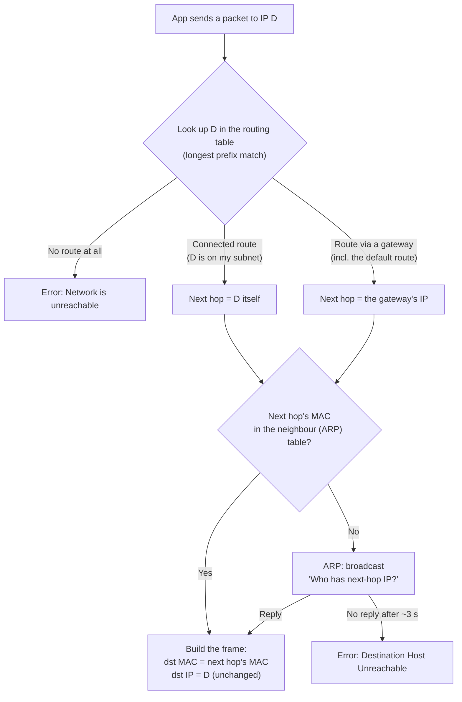
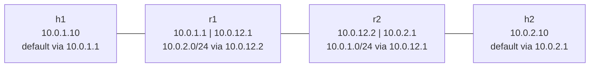

# 2.7 · Default Gateway, Routing Table and ARP

> **Level 2 · IP addressing and subnetting** · Lesson 7 of 8 · ⏱️ about 75 minutes (estimate)
> ⬅️ [2.6 IPv6 fundamentals](06-ipv6-fundamentals.md) · ➡️ [2.8 DHCP](08-dhcp.md)

## What you'll learn

- The two questions a host asks for **every** packet it sends: *"Is the destination on my subnet?"* and *"What MAC address do I put on the frame?"*
- What the **default gateway** is, and why a wrong one breaks only off-subnet traffic.
- How to read a **routing table**, and the rule that picks a route: **longest prefix match**.
- How **ARP** finds a MAC address, and what the neighbour states (`REACHABLE`, `STALE`, `FAILED` …) mean.
- What changes at every hop (**MAC addresses, TTL**) and what doesn't (**IP addresses**).
- Why a route has to exist **in both directions**, and the three different "unreachable" errors.

## Before you start

- [2.3](03-subnet-masks-and-cidr.md): masks, and the AND operation that finds a network address.
- [1.3](../01-networking-fundamentals/03-addresses-ports-and-protocols.md): MAC vs IP addresses.
- [1.2](../01-networking-fundamentals/02-network-devices.md): what a switch and a router do.

---

## The idea in plain words

Think of an office building.

- **Same floor** (same subnet): you walk the parcel straight to the person's desk. You only need to know **which desk** (their MAC address).
- **Another building** (another subnet): you don't go there yourself. You hand the parcel to the **post room** on your floor (the **default gateway**), and the post room forwards it.
- The **routing table** is the sign on the wall that says which way to go for each destination.
- **ARP** is shouting across the floor: *"Who sits at 10.0.1.1? Tell me your desk number."* The owner shouts back.



The key insight: **the IP address says where the packet is going; the MAC address says who should pick it up next.**

## Why it matters

- "I can ping my neighbour but not the internet" is almost always the **gateway** or a **route**.
- In AWS, the **route table** decides whether a subnet is "public" (route to an internet gateway) or "private" (route to a NAT gateway or nothing).
- Docker, Kubernetes and VPNs all work by **adding routes**. When two routes overlap, **longest prefix match** decides who wins, and that explains many "the VPN broke Docker" mysteries.
- Interviewers love "what happens when you type a URL": the gateway and ARP are steps 2 and 3.

---

## How it works

### Step 1: is the destination on my subnet?

The host ANDs the destination with **its own mask** and compares it with its own network ([2.3](03-subnet-masks-and-cidr.md)).

| My address | Destination | My network | Destination's network (same mask) | Same subnet? |
|---|---|---|---|---|
| `10.0.1.10/24` | `10.0.1.77` | `10.0.1.0` | `10.0.1.0` | ✅ Deliver directly |
| `10.0.1.10/24` | `10.0.2.10` | `10.0.1.0` | `10.0.2.0` | ❌ Send to the gateway |
| `192.168.1.50/25` | `192.168.1.200` | `192.168.1.0` | `192.168.1.128` | ❌ Send to the gateway, even though it "looks" local |

In practice the host doesn't do this as a separate step: the **connected route** in the routing table (next section) is exactly this test.

### Step 2: the routing table

Every host and router has one. Here is host `h1` from [Lab 2.2](../13-hands-on-labs/lab-02.2-routing-between-two-subnets.md), right after its IP was configured **(tested in the lab container)**:

```console
$ ip route
10.0.1.0/24 dev eth0 proto kernel scope link src 10.0.1.10
```

Only one route: the **connected route**, which the kernel adds automatically when you give an interface an address. `scope link` means "directly reachable on this link, no gateway needed".

Try to reach another subnet **(tested in the lab container)**:

```console
$ ping -c 1 -W 1 10.0.2.10
ping: connect: Network is unreachable
```

No packet left the machine: the kernel found **no matching route** and refused immediately. Now add a **default route** **(tested in the lab container)**:

```console
$ ip route add default via 10.0.1.1
$ ip route
default via 10.0.1.1 dev eth0
10.0.1.0/24 dev eth0 proto kernel scope link src 10.0.1.10
```

`default` is shorthand for `0.0.0.0/0`: a prefix with **zero** fixed bits, so it matches **every** address. It's the route of last resort, and the **default gateway** is its next hop.

How to read a route:

| Part | Meaning |
|---|---|
| `10.0.1.0/24` / `default` | **Destination prefix**: which addresses this route covers |
| `via 10.0.1.1` | **Next hop** (gateway): who to hand the packet to. Missing = the destination is on this link |
| `dev eth0` | Which interface to send it out of |
| `proto kernel` | Who added it: `kernel` (connected), `static` / `boot` (an admin), `dhcp`, `bgp` … |
| `src 10.0.1.10` | The source IP to use for packets this host originates |
| `metric 50` | Preference among routes with the **same** prefix (lower wins) |

The next hop must itself be reachable on a connected subnet. A gateway of `10.9.9.9` on a host whose only subnet is `10.0.1.0/24` makes no sense, and Linux refuses it.

### Longest prefix match

When several routes match a destination, the router picks the one with the **longest prefix** (the most fixed bits, i.e. the **most specific**). Length is compared first; the metric only breaks ties between routes of the **same** length.

To see it, `h1` was given four overlapping routes with **different** next hops (a second interface `vx0` provides a fake second gateway) **(tested in the lab container)**:

```console
$ ip route
default via 10.0.1.1 dev eth0
10.0.0.0/8 via 172.31.0.8 dev vx0
10.0.1.0/24 dev eth0 proto kernel scope link src 10.0.1.10
10.0.2.0/24 via 10.0.1.1 dev eth0
10.0.2.128/25 via 172.31.0.25 dev vx0
172.31.0.0/24 dev vx0 proto kernel scope link src 172.31.0.1
```

`ip route get` asks the kernel which route it would use **(tested in the lab container)**:

```console
$ ip route get 10.0.2.10
10.0.2.10 via 10.0.1.1 dev eth0 src 10.0.1.10 uid 0
$ ip route get 10.0.2.200
10.0.2.200 via 172.31.0.25 dev vx0 src 172.31.0.1 uid 0
$ ip route get 10.9.9.9
10.9.9.9 via 172.31.0.8 dev vx0 src 172.31.0.1 uid 0
$ ip route get 8.8.8.8
8.8.8.8 via 10.0.1.1 dev eth0 src 10.0.1.10 uid 0
$ ip route get 10.0.1.77
10.0.1.77 dev eth0 src 10.0.1.10 uid 0
```

| Destination | Routes that match | Winner (longest) | Why |
|---|---|---|---|
| `10.0.2.10` | `/0`, `/8`, `/24` | `10.0.2.0/24` | `.10` is in the lower half, so the `/25` (`.128`–`.255`) doesn't match |
| `10.0.2.200` | `/0`, `/8`, `/24`, `/25` | `10.0.2.128/25` | 25 bits beat 24 |
| `10.9.9.9` | `/0`, `/8` | `10.0.0.0/8` | Only the `/8` and the default match |
| `8.8.8.8` | `/0` | `default` | Nothing else matches |
| `10.0.1.77` | `/0`, `/8`, `/24` (connected) | `10.0.1.0/24` | No `via`: deliver directly on `eth0` |

Notice the **source address changes** with the route (`src 172.31.0.1` on `vx0`). That's why a VPN route can change which IP your traffic appears to come from.

> **Vendor detail.** When two **different routing sources** offer the **same** prefix, Cisco uses **administrative distance** (connected 0, static 1, eBGP 20, OSPF 110, RIP 120, iBGP 200; lower wins); Juniper calls it **route preference**. Linux uses the **metric** for this. All of them apply longest prefix match **first**. More in [Level 4](../04-switching-and-routing/README.md).

### Step 3: ARP, finding the next hop's MAC address

The routing table gave us a **next-hop IP** (the gateway, or the destination itself). But Ethernet frames are delivered by **MAC address** ([1.3](../01-networking-fundamentals/03-addresses-ports-and-protocols.md)). **ARP** (Address Resolution Protocol, RFC 826) translates.

1. **Request** (broadcast to `ff:ff:ff:ff:ff:ff`): "Who has `10.0.1.1`? Tell `10.0.1.10`."
2. **Reply** (unicast, straight back): "`10.0.1.1` is at `e2:42:f7:66:fc:1c`."
3. The sender stores the answer in its **neighbour table** (ARP cache) and sends the real packet.

Captured on `h1` with an empty cache, pinging the **remote** host `10.0.2.10` **(tested in the lab container)**:

```console
$ tcpdump -i eth0 -nn -e
76:d6:81:66:2c:06 > ff:ff:ff:ff:ff:ff, ethertype ARP (0x0806), length 42: Request who-has 10.0.1.1 tell 10.0.1.10, length 28
e2:42:f7:66:fc:1c > 76:d6:81:66:2c:06, ethertype ARP (0x0806), length 42: Reply 10.0.1.1 is-at e2:42:f7:66:fc:1c, length 28
76:d6:81:66:2c:06 > e2:42:f7:66:fc:1c, ethertype IPv4 (0x0800), length 98: 10.0.1.10 > 10.0.2.10: ICMP echo request, id 5625, seq 1, length 64
e2:42:f7:66:fc:1c > 76:d6:81:66:2c:06, ethertype IPv4 (0x0800), length 98: 10.0.2.10 > 10.0.1.10: ICMP echo reply, id 5625, seq 1, length 64
```

Read it carefully. ⭐ The host asked for the **gateway's** MAC (`who-has 10.0.1.1`), **not** for `10.0.2.10`. A host **never ARPs for an off-subnet address**. The echo request then carries **destination IP `10.0.2.10`** inside a frame addressed to the **gateway's MAC**.

The neighbour table afterwards **(tested in the lab container)**:

```console
$ ip neigh
10.0.1.1 dev eth0 lladdr e2:42:f7:66:fc:1c REACHABLE
```

Neighbour states on Linux:

| State | Meaning |
|---|---|
| `INCOMPLETE` | ARP request sent, no reply yet |
| `REACHABLE` | Confirmed recently (about 30 s by default, randomised) |
| `STALE` | Not confirmed lately; still used, but re-checked on next use |
| `DELAY` / `PROBE` | Re-checking a stale entry |
| `FAILED` | No reply to the probes: the neighbour is not there |
| `PERMANENT` | Added by hand (`ip neigh add … nud permanent`) |

Two related ideas you'll meet:

- **Gratuitous ARP**: a host announces its own IP/MAC unprompted. Used after a failover so switches and neighbours update at once (keepalived/VRRP, cloud "floating" IPs).
- **ARP spoofing**: ARP has no authentication, so anyone on the LAN can claim to be the gateway. Defences (Dynamic ARP Inspection, private VLANs) are in [Level 6](../06-network-security/README.md).
- In **IPv6**, ARP is replaced by **Neighbor Discovery** (NDP), which uses ICMPv6 multicast instead of broadcast ([2.6](06-ipv6-fundamentals.md)).

### What changes at each hop

The same ping, captured on all three links of the lab (`h1 → r1 → r2 → h2`) **(tested in the lab container)**:

```text
on h1's link:  76:d6:81:66:2c:06 > e2:42:f7:66:fc:1c ... 10.0.1.10 > 10.0.2.10: ICMP echo request, id 5733, seq 1
on r1–r2 link: e2:9b:17:f4:1a:69 > 92:1d:44:82:d4:8d ... 10.0.1.10 > 10.0.2.10: ICMP echo request, id 5733, seq 1
on h2's link:  02:fb:23:27:f7:29 > da:76:bc:64:20:a3 ... 10.0.1.10 > 10.0.2.10: ICMP echo request, id 5733, seq 1
```

| | Link 1 (h1 → r1) | Link 2 (r1 → r2) | Link 3 (r2 → h2) |
|---|---|---|---|
| Source MAC | h1 | r1's `eth1` | r2's `eth0` |
| Destination MAC | r1's `eth0` | r2's `eth1` | h2 |
| Source IP | `10.0.1.10` | `10.0.1.10` | `10.0.1.10` |
| Destination IP | `10.0.2.10` | `10.0.2.10` | `10.0.2.10` |
| TTL (IPv4) | 64 | 63 | 62 |

- **MAC addresses are rewritten at every router** (each link is its own little LAN, with its own ARP).
- **IP addresses stay the same** end to end (unless NAT is in the path: [3.8](../03-core-networking-protocols/08-nat-pat-and-port-forwarding.md)).
- **TTL** drops by 1 per router; the reply arrived with `ttl=62` (64 − 2 routers). That's also how `traceroute` works ([3.7](../03-core-networking-protocols/07-icmp-ping-and-traceroute.md)).

### Routes are needed in both directions

A ping needs a route **there** and a route **back**. Lab 2.2 shows it step by step **(tested in the lab container)**:

| Step | State | What `ping 10.0.2.10` from h1 shows |
|---|---|---|
| 1 | h1 has no default route | `ping: connect: Network is unreachable` (instant, local) |
| 2 | Default route added, routers don't forward (`net.ipv4.ip_forward = 0`) | `100% packet loss`, no error: r1 silently drops it |
| 3 | Forwarding on, r1 has no route to `10.0.2.0/24` | `From 10.0.1.1 icmp_seq=1 Destination Net Unreachable` |
| 4 | r1 has the route, but **h2 has no route back** | `100% packet loss`, no error. h2's capture shows only `ICMP echo request`, never a reply |
| 5 | h2 has a default route, **r2 has no route back to `10.0.1.0/24`** | `100% packet loss`. r2 tells h2: `ICMP net 10.0.1.10 unreachable` (h1 never sees it) |
| 6 | All routes in place | `64 bytes from 10.0.2.10: icmp_seq=1 ttl=62` ✅ |



Steps 4 and 5 are the classic trap: **the forward path works, the problem is on the return path**, and the side that sent the packet sees nothing but a timeout. Always ask: *"Does the far end know how to get back to me?"*

### The default gateway in different places

| Where | Its gateway | How to see it |
|---|---|---|
| Your Mac | `192.168.29.1`, your home router **(tested on the Mac, Oct 2026)** | `route -n get default` |
| A Docker container on the default bridge | `172.17.0.1` (the `docker0` bridge on the host) | `docker exec <c> ip route` → `default via 172.17.0.1 dev eth0` |
| A Kubernetes pod | Depends on the CNI plugin; often a link-local or node address | `kubectl exec <pod> -- ip route` |
| An AWS subnet | The **VPC router** at the subnet's `.1` address; the **route table** then sends `0.0.0.0/0` to an **internet gateway** (public subnet) or a **NAT gateway** (private subnet) | Console, or `aws ec2 describe-route-tables` |

---

## Worked example: h1 pings h2, step by step

`h1` (`10.0.1.10/24`, gateway `10.0.1.1`) pings `h2` (`10.0.2.10`).

1. **Route lookup on h1.** `10.0.2.10` matches only `default` → next hop `10.0.1.1` on `eth0`.
2. **ARP on h1.** Is `10.0.1.1` in the neighbour table? No → broadcast "who-has 10.0.1.1", get `e2:42:…:1c`.
3. **Send.** Frame: dst MAC `e2:42:…:1c`, dst IP `10.0.2.10`, TTL 64.
4. **r1 receives.** The frame's MAC is its own, so it accepts it, removes the Ethernet header and looks at the IP. Not for me → forwarding is on → route lookup: `10.0.2.0/24 via 10.0.12.2` → ARP for `10.0.12.2` → new frame with r1's MAC as source, r2's as destination. TTL 63.
5. **r2** does the same: `10.0.2.10` is on its connected `10.0.2.0/24` → ARP for `10.0.2.10` itself → deliver. TTL 62.
6. **h2 replies** to `10.0.1.10`: its own route lookup (default via `10.0.2.1`), its own ARP, and the whole process in reverse.

## Try it

**On your Mac** (outputs differ per network, so none are shown here):

```bash
route -n get default        # gateway and interface
netstat -rn -f inet         # the IPv4 routing table
route -n get 10.0.2.10      # which route a given destination would use
arp -a                      # the ARP cache
```

**On Linux:**

```bash
ip route                    # the routing table
ip route get 8.8.8.8        # which route wins for this destination
ip neigh                    # the neighbour (ARP) table
sudo ip neigh flush all     # empty it (it refills on the next packet)
sudo tcpdump -i eth0 -nn -e arp   # watch ARP requests and replies
```

## In the real world

- **AWS:** every subnet's route table starts with a **local** route for the VPC CIDR. Extra routes send traffic to an internet gateway, NAT gateway, VPC peering, Transit Gateway or a firewall endpoint. AWS route tables also use **longest prefix match**: a `/24` to a firewall beats the `/0` to the internet gateway.
- **Docker:** `docker network create` adds a connected route on the host for each bridge network (e.g. `172.18.0.0/16 dev br-…`). If that overlaps your office or VPN range, the more specific route wins and traffic goes to Docker instead.
- **VPNs:** a "full tunnel" VPN replaces your default route; a "split tunnel" adds only specific prefixes. Longest prefix match is what makes split tunnelling work.
- **Kubernetes:** many CNI plugins add one route per node's pod CIDR (e.g. `10.244.1.0/24 via <node-2-ip>`).
- **Cloud and ARP:** in an AWS VPC the virtual network itself handles ARP and only delivers traffic to the instance that owns the address, so the classic home-LAN ARP spoofing attack doesn't work there (inferred from AWS's documented design, not tested here).

## Common mistakes

| Mistake | Fix |
|---|---|
| Thinking a host ARPs for a remote IP | It ARPs for the **gateway's** IP. If you see ARP requests for remote addresses, the host's mask is wrong (it thinks they're local) |
| Debugging only the forward path | Check the **return route** on the far end and every router in between |
| Picking routes by metric first | **Longest prefix first**; metric only breaks ties for the same prefix |
| A gateway outside your own subnet | The next hop must be on a connected subnet |
| Forgetting that a Linux box doesn't route by default | `net.ipv4.ip_forward=1` (and firewall FORWARD rules) on anything acting as a router |

## Troubleshooting

| What you see | What it means | Next step |
|---|---|---|
| `connect: Network is unreachable` (instant) | **Your own** routing table has no matching route; nothing was sent | `ip route` / `netstat -rn`: is there a default route? |
| `From <your own IP> … Destination Host Unreachable` | ARP for the next hop failed (no reply after about 3 seconds). Neighbour shows `FAILED` | Is the gateway (or local host) up and on the same subnet/VLAN? Check `ip neigh`, cable, Wi-Fi, VLAN |
| `From <router IP> … Destination Net Unreachable` | That **router** has no route onward | Log in to that router and add or fix its route |
| Timeouts, no error at all | Packet dropped silently: forwarding off, a firewall, or **no return route** | Capture on the far end: does the request arrive? Does a reply leave? |
| Works to the local subnet only | Wrong or missing default gateway | `ip route` / `route -n get default` |
| Works to some hosts in a remote subnet but not others | A more specific route (VPN, Docker, a `/25`) is stealing part of the range | `ip route get <failing IP>` vs `ip route get <working IP>` |

The tested "Destination Host Unreachable" case, pinging a local address that no machine owns **(tested in the lab container)**:

```console
$ ping -c 5 10.0.1.99
From 10.0.1.10 icmp_seq=1 Destination Host Unreachable
...
5 packets transmitted, 0 received, +5 errors, 100% packet loss, time 4074ms
$ ip neigh
10.0.1.99 dev eth0 FAILED
```

The error comes **from your own address**: it's your machine reporting that ARP failed.

## Hands-on lab

[Lab 2.2 · Routing between two subnets](../13-hands-on-labs/lab-02.2-routing-between-two-subnets.md): build `h1 — r1 — r2 — h2` with namespaces and break it in each of the six ways shown above.

## Interview angle

- ⭐ **"What is a default gateway?"** → The next hop for any destination with no more specific route (`0.0.0.0/0`). It must be on the host's own subnet.
- ⭐ **"Two routes match. Which one wins?"** → Longest prefix match. Administrative distance / metric only break ties for the **same** prefix.
- ⭐ **"What does ARP do?"** → Maps an IPv4 address to a MAC on the local link. Request is broadcast, reply is unicast. A host ARPs for the gateway, never for remote IPs.
- **"What changes as a packet crosses routers?"** → MACs every hop, TTL −1 per router; IPs stay (unless NAT).
- **"Ping works one way / not at all, routes look fine."** → Check the return path and IP forwarding.
- **"Network unreachable vs host unreachable?"** → No route (local or at a router) vs ARP failure for the final hop.

## Check yourself

1. Host `192.168.10.20/24`, gateway `192.168.10.1`. It pings `192.168.10.30` and then `8.8.8.8`. Which IP does it ARP for in each case?
2. A router has `0.0.0.0/0 → A`, `172.16.0.0/12 → B`, `172.16.4.0/22 → C`, `172.16.5.0/24 → D`. Where does each go: `172.16.5.9`, `172.16.6.9`, `172.20.0.1`, `172.40.0.1`?
3. You see `From 10.0.1.10 icmp_seq=1 Destination Host Unreachable` where `10.0.1.10` is your own IP. What failed?
4. A packet crosses three routers. What is its TTL when it arrives, if it left with 64? What happened to its source MAC?
5. h1 can ping r2's near interface but not h2, and h2's capture shows the echo requests arriving. Name two likely causes.

<details>
<summary><b>Answers</b> (try first)</summary>

1. `192.168.10.30` is on the same `/24` → ARP for **`192.168.10.30`**. `8.8.8.8` is not → ARP for the gateway **`192.168.10.1`**.
2. `172.16.5.9` → **D** (`/24`). `172.16.6.9` → **C** (`/22` covers `172.16.4.0`–`172.16.7.255`). `172.20.0.1` → **B** (`/12` covers `172.16`–`172.31`). `172.40.0.1` → **A** (only the default matches).
3. ARP for the next hop failed: no device answered for that IP (gateway down, wrong VLAN, wrong address).
4. **61** (64 − 3). The source MAC was replaced at every router; it is now the MAC of the last router's outgoing interface.
5. h2 has **no route back** to h1's subnet (missing or wrong default gateway), or a **firewall on h2** drops the requests or the replies. (Also possible: r2 has no route back to `10.0.1.0/24`.)

</details>

## Summary

- For each packet: **route lookup** (longest prefix match) → **next hop** → **ARP** for the next hop's MAC → send.
- The **default route** `0.0.0.0/0` matches everything and is used only when nothing more specific does. Its next hop is the **default gateway**.
- **ARP**: broadcast request, unicast reply, cached in the neighbour table. A host ARPs for the gateway, not for remote IPs.
- **MACs change at every hop; IPs don't; TTL drops by one per router.**
- Routing must work **both ways**. Silence (no error) usually means a drop or a missing return route.

## Next

➡️ [2.8 · DHCP](08-dhcp.md): how a machine gets its IP address, mask, gateway and DNS servers automatically, the DORA exchange, and what to check when it doesn't.
