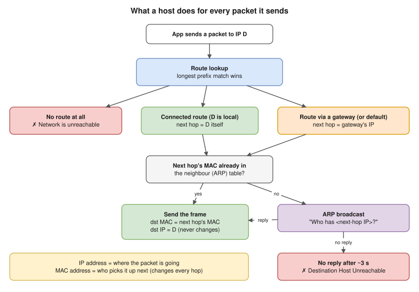
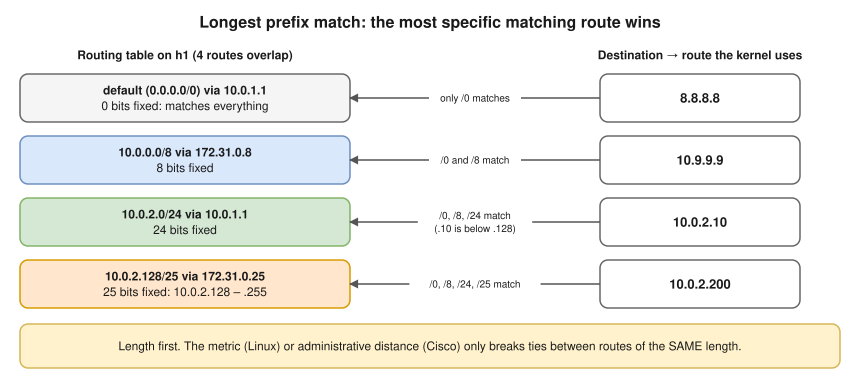
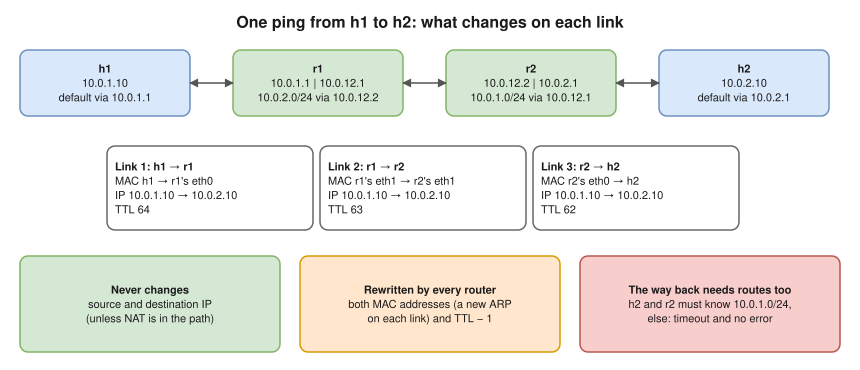

# 2.7 · Default Gateway, Routing Table and ARP

> **Level 2 · IP addressing and subnetting** · Lesson 7 of 8 · ⏱️ about 75 minutes (estimate) · 🧪 [Lab 2.2](../13-hands-on-labs/lab-02.2-routing-between-two-subnets.md)
> ⬅️ [2.6 IPv6 fundamentals](06-ipv6-fundamentals.md) · ➡️ [2.8 DHCP](08-dhcp.md)



- **Default gateway** = the next hop of the default route `0.0.0.0/0`, which matches every address. It's used only when nothing more specific matches, and it must be on your own subnet.
- ⭐ A host **never ARPs for an off-subnet IP**. It ARPs for the **gateway's** IP, then sends a frame to the gateway's MAC with the far destination IP inside.
- **ARP** (RFC 826): the request is **broadcast** (`ff:ff:ff:ff:ff:ff`), the reply is **unicast**, and the answer is cached in the **neighbour table**. IPv6 uses **Neighbor Discovery** (ICMPv6) instead ([2.6](06-ipv6-fundamentals.md)).
- A Linux box doesn't route by default: anything acting as a router needs `net.ipv4.ip_forward=1`.

## Reading a routing table

Host `h1` from Lab 2.2 **(tested in the lab container)**:

```console
$ ip route
default via 10.0.1.1 dev eth0
10.0.1.0/24 dev eth0 proto kernel scope link src 10.0.1.10
```

| Part | Meaning |
|---|---|
| `10.0.1.0/24` / `default` | Destination prefix (`default` = `0.0.0.0/0`) |
| `via 10.0.1.1` | Next hop. Missing = the destination is on this link: a **connected route**, added by the kernel when you give the interface an address (`scope link`) |
| `dev eth0` | The interface to send out of |
| `proto kernel` | Who added it: `kernel` (connected), `static` / `boot` (an admin), `dhcp`, `bgp` … |
| `src 10.0.1.10` | The source IP for packets this host originates |
| `metric 50` | Tie-break between routes with the **same** prefix (lower wins) |

## Longest prefix match



- **Length first, metric second.** Cisco's **administrative distance** (connected 0, static 1, eBGP 20, OSPF 110, RIP 120, iBGP 200; lower wins) and Juniper's **route preference** also only decide between routes for the **same** prefix. More in [Level 4](../04-switching-and-routing/README.md).
- `ip route get <IP>` shows the winner **(tested in the lab container)**:

```console
$ ip route get 10.0.2.200
10.0.2.200 via 172.31.0.25 dev vx0 src 172.31.0.1 uid 0
$ ip route get 8.8.8.8
8.8.8.8 via 10.0.1.1 dev eth0 src 10.0.1.10 uid 0
```

- The **source IP changes with the route** (`src 172.31.0.1` on `vx0`). That's how a VPN route changes the IP your traffic appears to come from.

## ARP and the neighbour table

`h1` pings the remote `10.0.2.10` with an empty cache **(tested in the lab container)**. It asks for the **gateway's** MAC, not for `10.0.2.10`:

```console
$ tcpdump -i eth0 -nn -e
76:d6:81:66:2c:06 > ff:ff:ff:ff:ff:ff, ethertype ARP (0x0806), length 42: Request who-has 10.0.1.1 tell 10.0.1.10, length 28
e2:42:f7:66:fc:1c > 76:d6:81:66:2c:06, ethertype ARP (0x0806), length 42: Reply 10.0.1.1 is-at e2:42:f7:66:fc:1c, length 28
76:d6:81:66:2c:06 > e2:42:f7:66:fc:1c, ethertype IPv4 (0x0800), length 98: 10.0.1.10 > 10.0.2.10: ICMP echo request, id 5625, seq 1, length 64
```

| `ip neigh` state | Meaning |
|---|---|
| `INCOMPLETE` | ARP request sent, no reply yet |
| `REACHABLE` | Confirmed recently (about 30 s by default, randomised) |
| `STALE` | Not confirmed lately; still used, re-checked on next use (`DELAY` / `PROBE` while checking) |
| `FAILED` | No reply to the probes: the neighbour is not there |
| `PERMANENT` | Added by hand (`ip neigh add … nud permanent`) |

- **Gratuitous ARP**: a host announces its own IP/MAC unprompted, so neighbours update at once after a failover (keepalived/VRRP, cloud "floating" IPs).
- **ARP spoofing**: ARP has no authentication, so anyone on the LAN can claim to be the gateway. Defences are in [Level 6](../06-network-security/README.md). In an AWS VPC the network itself handles ARP, so the classic attack doesn't work there (inferred from AWS's documented design, not tested here).

## Hop by hop, and the way back



Each fault in Lab 2.2 looks different from h1 **(tested in the lab container)**:

| Fault | What `ping 10.0.2.10` from h1 shows |
|---|---|
| h1 has no default route | `ping: connect: Network is unreachable` (instant: nothing was sent) |
| Routers don't forward (`net.ipv4.ip_forward = 0`) | `100% packet loss`, no error: r1 silently drops it |
| r1 has no route to `10.0.2.0/24` | `From 10.0.1.1 icmp_seq=1 Destination Net Unreachable` |
| **h2 has no route back** | `100% packet loss`, no error. h2's capture shows only `ICMP echo request`, never a reply |
| **r2 has no route back** to `10.0.1.0/24` | `100% packet loss`. r2 tells h2: `ICMP net 10.0.1.10 unreachable` (h1 never sees it) |
| All routes in place | `64 bytes from 10.0.2.10: icmp_seq=1 ttl=62` ✅ (64 − 2 routers) |

The last two are the classic trap: the forward path works and the sender sees only a timeout. Always ask: *"Does the far end know how to get back to me?"*

## Where you meet it

| Where | Gateway and routes |
|---|---|
| Your Mac | Your home router, e.g. `192.168.29.1` **(tested on the Mac, Oct 2026)**: `route -n get default` |
| Docker (default bridge) | `default via 172.17.0.1 dev eth0`, the `docker0` bridge. Each `docker network create` adds a connected route on the host (e.g. `172.18.0.0/16 dev br-…`); if it overlaps your office or VPN range, the more specific route wins |
| Kubernetes | Depends on the CNI plugin. Many add one route per node's pod CIDR (e.g. `10.244.1.0/24 via <node-2-ip>`) |
| AWS | The VPC router at the subnet's `.1`. Every route table starts with a **local** route for the VPC CIDR; `0.0.0.0/0` goes to an **internet gateway** (public subnet) or a **NAT gateway** (private subnet). Longest prefix match applies: a `/24` to a firewall beats the `/0` |
| VPNs | A full tunnel replaces your default route; a split tunnel adds specific prefixes, which works because of longest prefix match |

## Try it

**On your Mac** (outputs differ per network, so none are shown here):

```bash
route -n get default        # gateway and interface
netstat -rn -f inet         # the IPv4 routing table
route -n get 10.0.2.10      # which route a given destination would use
arp -a                      # the ARP cache
```

**On Linux:**

```bash
ip route                    # the routing table
ip route get 8.8.8.8        # which route wins for this destination
ip neigh                    # the neighbour (ARP) table
sudo ip neigh flush all     # empty it (it refills on the next packet)
sudo tcpdump -i eth0 -nn -e arp   # watch ARP requests and replies
```

## Troubleshooting

| You see | It means | Next step |
|---|---|---|
| `connect: Network is unreachable` (instant) | **Your own** routing table has no matching route | `ip route` / `netstat -rn`: is there a default route? |
| `From <your own IP> … Destination Host Unreachable` | ARP for the next hop failed (no reply after about 3 s); `ip neigh` shows `FAILED` | Is the gateway or local host up, on the same subnet and VLAN? |
| `From <router IP> … Destination Net Unreachable` | That **router** has no route onward | Fix that router's route |
| Timeouts, no error at all | Silent drop: forwarding off, a firewall, or **no return route** | Capture on the far end: does the request arrive? Does a reply leave? |
| Works to the local subnet only | Wrong or missing default gateway | `ip route` / `route -n get default` |
| Some hosts in a remote subnet fail, others work | A more specific route (VPN, Docker, a `/25`) steals part of the range | Compare `ip route get <failing IP>` with a working one |
| ARP requests for remote addresses | The host's **mask is wrong**: it thinks they're local | Fix the prefix length |

The "Destination Host Unreachable" case, pinging a local address nobody owns **(tested in the lab container)**. The error comes from **your own** address:

```console
$ ping -c 5 10.0.1.99
From 10.0.1.10 icmp_seq=1 Destination Host Unreachable
...
5 packets transmitted, 0 received, +5 errors, 100% packet loss, time 4074ms
$ ip neigh
10.0.1.99 dev eth0 FAILED
```

## Interview angle

- ⭐ **"What is a default gateway?"** → The next hop for any destination with no more specific route (`0.0.0.0/0`). It must be on the host's own subnet.
- ⭐ **"Two routes match. Which one wins?"** → Longest prefix match. Administrative distance / metric only break ties for the **same** prefix.
- ⭐ **"What does ARP do?"** → Maps an IPv4 address to a MAC on the local link. Request is broadcast, reply is unicast. A host ARPs for the gateway, never for remote IPs.
- **"What changes as a packet crosses routers?"** → MACs every hop, TTL −1 per router; IPs stay (unless NAT).
- **"Ping works one way / not at all, routes look fine."** → Check the return path and IP forwarding.
- **"Network unreachable vs host unreachable?"** → No route (local or at a router) vs ARP failure for the final hop.

## Check yourself

1. Host `192.168.10.20/24`, gateway `192.168.10.1`. It pings `192.168.10.30` and then `8.8.8.8`. Which IP does it ARP for in each case?
2. A router has `0.0.0.0/0 → A`, `172.16.0.0/12 → B`, `172.16.4.0/22 → C`, `172.16.5.0/24 → D`. Where does each go: `172.16.5.9`, `172.16.6.9`, `172.20.0.1`, `172.40.0.1`?
3. You see `From 10.0.1.10 icmp_seq=1 Destination Host Unreachable` where `10.0.1.10` is your own IP. What failed?
4. A packet crosses three routers. What is its TTL when it arrives, if it left with 64? What happened to its source MAC?
5. h1 can ping r2's near interface but not h2, and h2's capture shows the echo requests arriving. Name two likely causes.

<details>
<summary><b>Answers</b> (try first)</summary>

1. `192.168.10.30` is on the same `/24` → ARP for **`192.168.10.30`**. `8.8.8.8` is not → ARP for the gateway **`192.168.10.1`**.
2. `172.16.5.9` → **D** (`/24`). `172.16.6.9` → **C** (`/22` covers `172.16.4.0`–`172.16.7.255`). `172.20.0.1` → **B** (`/12` covers `172.16`–`172.31`). `172.40.0.1` → **A** (only the default matches).
3. ARP for the next hop failed: no device answered for that IP (gateway down, wrong VLAN, wrong address).
4. **61** (64 − 3). The source MAC was replaced at every router; it is now the MAC of the last router's outgoing interface.
5. h2 has **no route back** to h1's subnet (missing or wrong default gateway), or a **firewall on h2** drops the requests or the replies. (Also possible: r2 has no route back to `10.0.1.0/24`.)

</details>

➡️ **Next:** [2.8 · DHCP](08-dhcp.md): how a machine gets its address, mask, gateway and DNS servers automatically.
