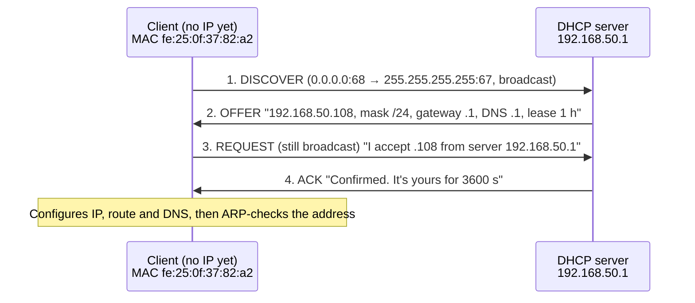
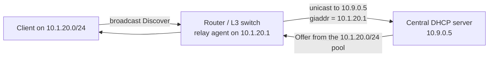

# 2.8 · DHCP: Getting an Address Automatically

> **Level 2 · IP addressing and subnetting** · Lesson 8 of 8 · ⏱️ about 45 minutes (estimate)
> ⬅️ [2.7 Default gateway, routing table and ARP](07-default-gateway-routing-table-and-arp.md) · ➡️ [Level 3 · Core networking protocols](../03-core-networking-protocols/README.md)

## What you'll learn

- What **DHCP** (Dynamic Host Configuration Protocol) hands out: IP, mask, gateway, DNS servers and more.
- The four-message **DORA** exchange, and why it starts with a **broadcast**.
- **Leases**: how long an address is yours, and when the client renews (**T1**) and rebinds (**T2**).
- **Relay agents**, which let one DHCP server serve many subnets.
- What happens when there is **no** DHCP server, and how to troubleshoot.
- Where DHCP is (and isn't) used in AWS, Docker and Kubernetes.

## Before you start

- [2.7](07-default-gateway-routing-table-and-arp.md): what a default gateway is.
- [1.3](../01-networking-fundamentals/03-addresses-ports-and-protocols.md): UDP ports and MAC addresses.

---

## The idea in plain words

When you join a Wi-Fi network, your laptop has **no IP address yet**. It can't ask anyone directly because it doesn't know who to ask. So it shouts to the whole room: *"I'm new here, can someone give me an address?"* The **DHCP server** (usually your home router) answers: *"Take `192.168.29.42` for the next 24 hours; your gateway is `192.168.29.1` and your DNS server is `192.168.29.1`."*

That one exchange configures everything from Level 2 for you: the **address** ([2.2](02-ipv4-addresses-and-ranges.md)), the **mask** ([2.3](03-subnet-masks-and-cidr.md)) and the **default gateway** ([2.7](07-default-gateway-routing-table-and-arp.md)), plus the **DNS servers** for [3.4](../03-core-networking-protocols/04-dns.md).

## Why it matters

- If DHCP fails, the machine has **no usable address** and nothing works: it's the first thing to check for "no internet at all".
- Wrong DHCP options (a bad gateway or DNS server) break **every** client on the network at once.
- A **rogue DHCP server** (someone's travel router plugged into the office LAN) can hijack traffic; switches defend against it with **DHCP snooping** ([Level 6](../06-network-security/README.md)).
- Cloud VMs get their addresses through DHCP too, and AWS lets you change what's handed out with **DHCP option sets**.

---

## How it works

### The four messages: DORA

DHCP runs over **UDP**: the **server listens on port 67**, the **client on port 68** (RFC 2131).



| # | Message | From → to | Why it's sent that way |
|---|---|---|---|
| 1 | **Discover** | `0.0.0.0` → `255.255.255.255` | The client has no address and doesn't know the server, so it broadcasts |
| 2 | **Offer** | Server → client | Proposes an address and options. Several servers may offer |
| 3 | **Request** | `0.0.0.0` → `255.255.255.255` | Still broadcast, so **every** server learns which offer was accepted; the others withdraw theirs |
| 4 | **Ack** | Server → client | Confirms the lease. (A **NAK** instead means "no, start again") |

Later messages: **Release** (the client gives the address back), **Decline** (the client found the address already in use), **Inform** (the client has an address and only wants options).

Because Discover is a **broadcast**, it never crosses a router on its own. That's why relay agents exist (below).

### What it looks like (tested)

A client namespace `laptop` and a `dnsmasq` DHCP server, joined by a veth pair (the setup from [Lab 2.3](../13-hands-on-labs/lab-02.3-dhcp-dora-capture.md)). Before DHCP, the laptop's `eth0` has **no address** **(tested in the lab container)**:

```console
$ ip -br addr show eth0
eth0@if2         DOWN
```

The client's own log during DORA **(tested in the lab container)**:

```console
$ dhclient -v -1 eth0
DHCPDISCOVER on eth0 to 255.255.255.255 port 67 interval 3 (xid=0xbaf0a29)
DHCPDISCOVER on eth0 to 255.255.255.255 port 67 interval 5 (xid=0xbaf0a29)
DHCPOFFER of 192.168.50.108 from 192.168.50.1
DHCPREQUEST for 192.168.50.108 on eth0 to 255.255.255.255 port 67 (xid=0x290aaf0b)
DHCPACK of 192.168.50.108 from 192.168.50.1 (xid=0xbaf0a29)
bound to 192.168.50.108 -- renewal in 1503 seconds.
```

(The first Discover went unanswered because the server was still starting.) Afterwards, the address, the route and the DNS setting all came from DHCP **(tested in the lab container)**:

```console
$ ip -br addr show eth0
eth0@if2         UP             192.168.50.108/24
$ ip route
default via 192.168.50.1 dev eth0
192.168.50.0/24 dev eth0 proto kernel scope link src 192.168.50.108
$ cat /etc/resolv.conf
nameserver 192.168.50.1
```

The packet capture of an earlier run (`tcpdump -v 'udp port 67 or udp port 68'`), trimmed to the useful lines **(tested in the lab container)**:

```text
0.0.0.0.68 > 255.255.255.255.67: BOOTP/DHCP, Request from c2:ca:e3:9e:fd:85, length 300, xid 0x8ca96847
    DHCP-Message (53), length 1: Discover
    Parameter-Request (55): Subnet-Mask (1), BR (28), Time-Zone (2), Default-Gateway (3), Domain-Name (15), Domain-Name-Server (6), ...
192.168.50.1.67 > 192.168.50.128.68: BOOTP/DHCP, Reply, length 300, xid 0x8ca96847
    Your-IP 192.168.50.128
    DHCP-Message (53), length 1: Offer
    Server-ID (54), length 4: 192.168.50.1
    Lease-Time (51), length 4: 3600
    RN (58), length 4: 1800
    RB (59), length 4: 3150
    Subnet-Mask (1), length 4: 255.255.255.0
    Domain-Name-Server (6), length 4: 192.168.50.1
    Default-Gateway (3), length 4: 192.168.50.1
0.0.0.0.68 > 255.255.255.255.67: BOOTP/DHCP, Request from c2:ca:e3:9e:fd:85, length 300, xid 0x8ca96847
    DHCP-Message (53), length 1: Request
    Server-ID (54), length 4: 192.168.50.1
    Requested-IP (50), length 4: 192.168.50.128
192.168.50.1.67 > 192.168.50.128.68: BOOTP/DHCP, Reply, length 300, xid 0x8ca96847
    DHCP-Message (53), length 1: ACK
    Lease-Time (51), length 4: 3600
```

What to notice:

- The client lists the options it wants (**Parameter-Request**); the server fills them in. Common option numbers: **1** mask, **3** router (gateway), **6** DNS servers, **15** domain name, **51** lease time, **53** message type, **54** server ID.
- The **xid** (transaction ID) ties the four messages together.
- **"BOOTP/DHCP"**: DHCP grew out of the older **BOOTP** protocol and still uses its packet format and ports.
- This server sent the Offer and Ack **unicast** to the offered address. Servers can also broadcast them; it depends on a flag the client sets.

The server's lease file records who has what **(tested in the lab container)**:

```text
1792010421 fe:25:0f:37:82:a2 192.168.50.108 vm *
```

(Expiry time as a Unix timestamp, MAC, IP, hostname, client ID.)

### Leases, renewal and rebinding

An address is **leased**, not owned. In the capture: lease 3600 s, **RN** (renewal, T1) 1800 s, **RB** (rebinding, T2) 3150 s.

| When | What the client does |
|---|---|
| **T1**, default 50% of the lease | **Renew**: unicast Request to the server that gave the lease |
| **T2**, default 87.5% of the lease | **Rebind**: that server didn't answer, so broadcast a Request to **any** server |
| Lease expires | Stop using the address and start again from Discover |

(`dhclient` said "renewal in 1503 seconds", a bit under 1800, because it randomises renewal times slightly so that clients don't all renew at once.)

A **reservation** (static lease) ties an address to a MAC, so a printer or server always gets the same IP while still being managed centrally.

### Releasing an address

`dhclient -r` sends a **Release** unicast to the server and removes the address **(tested in the lab container)**:

```console
$ dhclient -v -r eth0
DHCPRELEASE of 192.168.50.108 on eth0 to 192.168.50.1 port 67 (xid=0xe728a7b)
$ ip -br addr show eth0
eth0@if2         UP
```

### When there is no DHCP server

With the server stopped, the client keeps broadcasting Discovers with growing gaps and never gets an answer **(tested in the lab container)**:

```console
DHCPDISCOVER on eth0 to 255.255.255.255 port 67 interval 3 (xid=0x21d92f41)
DHCPDISCOVER on eth0 to 255.255.255.255 port 67 interval 8 (xid=0x21d92f41)
DHCPDISCOVER on eth0 to 255.255.255.255 port 67 interval 12 (xid=0x21d92f41)
DHCPDISCOVER on eth0 to 255.255.255.255 port 67 interval 15 (xid=0x21d92f41)
```

Eventually `dhclient` gives up ("No DHCPOFFERS received." **(illustrative)**, the run above was stopped before that point). What happens next depends on the operating system:

- **macOS and Windows** give themselves a **link-local** address from `169.254.0.0/16` (RFC 3927, often called **APIPA** on Windows). Seeing `169.254.x.x` on a laptop almost always means **"DHCP failed"**.
- **Linux** with `dhclient` keeps the interface without an IPv4 address, unless a network manager is configured to fall back to link-local.

### Relay agents: one server, many subnets

A Discover is a broadcast and stops at the router. Rather than putting a DHCP server on every subnet, the router acts as a **DHCP relay**:



- The relay writes its own interface address into the **giaddr** field; the server uses it to choose the **right pool** for that subnet.
- On Cisco it's `ip helper-address 10.9.0.5` on the client-facing interface **(vendor-specific)**. Option 82 lets the relay add which switch port the client is on.

### IPv6

IPv6 hosts usually configure themselves with **SLAAC** from Router Advertisements, and may use **DHCPv6** (UDP ports 546/547) for extra options or managed addresses. DHCPv6 does **not** hand out the default gateway; that always comes from Router Advertisements ([2.6](06-ipv6-fundamentals.md)).

---

## Try it

**On your Mac** (outputs differ per network, so none are shown):

```bash
ipconfig getpacket en0          # the full DHCP reply your Mac received: lease, router, DNS, server
ipconfig getoption en0 router   # one option: the gateway
sudo ipconfig set en0 DHCP      # ask for a new lease
```

**On Linux:**

```bash
sudo dhclient -v eth0           # request a lease and show DORA (ISC dhclient)
sudo dhclient -r eth0           # release it
journalctl -u systemd-networkd | grep -i dhcp     # on systemd-networkd hosts
nmcli -f DHCP4 device show eth0                   # on NetworkManager hosts
sudo tcpdump -i eth0 -nn -v 'udp port 67 or udp port 68'
```

## In the real world

- **Home:** your router is the DHCP server, the gateway and usually the DNS forwarder, all on one address.
- **AWS:** an EC2 instance gets its private IP by DHCP, but the address is fixed to the network interface for its whole life. **DHCP option sets** control the domain name, DNS servers (default `AmazonProvidedDNS`) and NTP servers handed out in a VPC.
- **Docker:** containers do **not** use DHCP. Docker's own **IPAM** picks the address from the network's subnet and writes it directly into the container's namespace.
- **Kubernetes:** pods don't use DHCP either; the **CNI plugin's IPAM** assigns addresses (e.g. `host-local` from the node's pod CIDR, or the AWS VPC CNI from the VPC itself).
- **Data centres:** servers often PXE-boot: DHCP hands them an address **and** the location of a boot image (options 66/67).

## Common mistakes

| Mistake | Fix |
|---|---|
| Two DHCP servers with overlapping pools on one LAN | One authoritative server per subnet (or split pools without overlap) |
| A static IP inside the DHCP pool | Put static addresses outside the pool, or use reservations |
| A new VLAN/subnet with no relay configured | Add the relay (`ip helper-address`) on the router interface for that subnet |
| Assuming containers or pods "get DHCP" | They get addresses from Docker IPAM or the CNI plugin |
| Pool too small for the number of devices (phones, IoT) | Size the subnet for peak devices ([2.4](04-subnetting-step-by-step.md)) or shorten the lease |

## Troubleshooting

| Symptom | Likely cause | Check |
|---|---|---|
| Laptop shows `169.254.x.x` | No DHCP reply: server down, wrong VLAN, Wi-Fi not really associated, relay missing | Capture on the client: do Discovers go out? Does any Offer come back? |
| Got an address, but no internet | Wrong gateway or DNS option | `ip route` / `route -n get default`, `cat /etc/resolv.conf` / `scutil --dns` |
| Some clients get addresses, new ones don't | **Pool exhausted** | Lease table on the server; size of the range vs the number of devices |
| Clients get a strange subnet or gateway | **Rogue DHCP server** | Capture the Offer and read **Server-ID**; enable DHCP snooping |
| "Address already in use" / duplicate-IP warnings | A static IP inside the pool, or two servers handing out the same range | Reserve or move the static address; check server pools |

## Hands-on lab

[Lab 2.3 · DHCP: capture the DORA exchange](../13-hands-on-labs/lab-02.3-dhcp-dora-capture.md): run `dnsmasq` as a DHCP server in a namespace, watch DORA with `tcpdump`, release and renew, and see what a client does when the server is gone.

## Interview angle

- ⭐ **"Explain DHCP."** → DORA: Discover (broadcast), Offer, Request (broadcast, so other servers know), Ack. UDP 67 (server) / 68 (client). It hands out IP, mask, gateway, DNS and a lease time.
- **"Why is the Request broadcast if the client already knows the server?"** → So every server that made an offer learns which one was accepted.
- **"How does DHCP work across subnets?"** → A relay agent on the router forwards the broadcast as unicast to the server, and fills in `giaddr` so the server picks the right pool.
- **"A user has `169.254.x.x`."** → DHCP failed. Check the link/VLAN, then whether Discovers get an Offer.
- **"Do Docker containers use DHCP?"** → No, Docker IPAM assigns them directly; Kubernetes uses CNI IPAM.

## Check yourself

1. Put these in order and say which are broadcast: Ack, Discover, Request, Offer.
2. A lease is 8 hours. When does the client first try to renew, and when does it start broadcasting to any server?
3. A new subnet's clients get no address, but clients on other subnets are fine with the same central server. What's the most likely missing piece?
4. Why can't the first DHCP message be sent to the server's IP address?
5. Which UDP ports does DHCPv4 use, and which side uses which?

<details>
<summary><b>Answers</b> (try first)</summary>

1. **Discover → Offer → Request → Ack.** Discover and Request are broadcast by the client; Offer and Ack may be unicast or broadcast depending on the client's broadcast flag.
2. T1 = 50% = **4 hours** (unicast renew to the same server). T2 = 87.5% = **7 hours** (broadcast rebind to any server).
3. A **DHCP relay** (`ip helper-address` or equivalent) on the router interface for that subnet.
4. The client doesn't know the server's address yet, and has no IP address of its own, so it can only broadcast.
5. **UDP 67** on the server, **UDP 68** on the client.

</details>

## Summary

- DHCP gives a host its **IP, mask, gateway, DNS** and more, for a limited **lease**.
- **DORA**: Discover and Request are broadcast; Offer and Ack confirm. UDP **67** (server) / **68** (client).
- Clients **renew at T1 (50%)** and **rebind at T2 (87.5%)**.
- Broadcasts don't cross routers, so multi-subnet networks use **relay agents**.
- **`169.254.x.x`** on a Mac or Windows laptop means DHCP failed.
- Docker and Kubernetes assign addresses with their own **IPAM**, not DHCP.

## Next

➡️ You've finished Level 2. Do the [Level 2 subnetting drills](../14-practice-exercises/02-level-2-subnetting-drills.md) until they're automatic, then start [Level 3 · Core networking protocols](../03-core-networking-protocols/README.md), beginning with how Ethernet and switches move frames.
