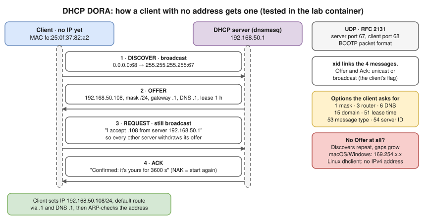
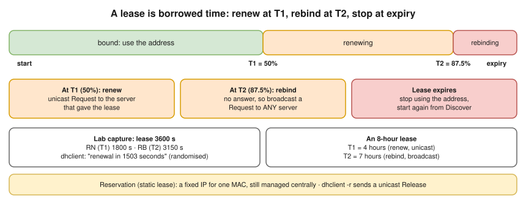
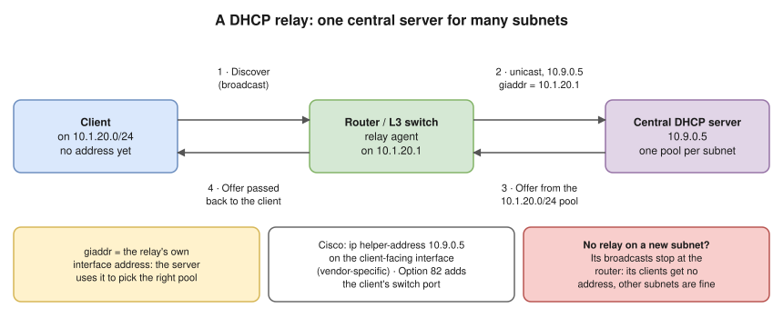

# 2.8 · DHCP: Getting an Address Automatically

> **Level 2 · IP addressing and subnetting** · Lesson 8 of 8 · ⏱️ about 45 minutes (estimate) · 🧪 [Lab 2.3](../13-hands-on-labs/lab-02.3-dhcp-dora-capture.md)
> ⬅️ [2.7 Default gateway, routing table and ARP](07-default-gateway-routing-table-and-arp.md) · ➡️ [Level 3 · Core networking protocols](../03-core-networking-protocols/README.md)



- **DHCP** (Dynamic Host Configuration Protocol) hands a new device its **IP** ([2.2](02-ipv4-addresses-and-ranges.md)), **mask** ([2.3](03-subnet-masks-and-cidr.md)), **default gateway** ([2.7](07-default-gateway-routing-table-and-arp.md)) and **DNS servers** ([3.4](../03-core-networking-protocols/04-dns.md)), for a limited **lease**. At home your router is the DHCP server.
- ⭐ **DORA:** Discover → Offer → Request → Ack. **UDP 67 (server) / 68 (client)** (RFC 2131). The client has no address and doesn't know the server, so **Discover is a broadcast**; **Request is still broadcast** so every server that offered learns which offer won.
- Later messages: **Release** (client gives the address back), **Decline** (address already in use), **Inform** (client has an address, wants only options). A **NAK** instead of an Ack means "no, start again". Broadcasts **never cross a router**, so multi-subnet networks need a **relay** (below).
- If DHCP fails, nothing works: it's the first check for "no internet at all". Wrong options (gateway, DNS) break **every** client at once. A **rogue DHCP server** can hijack traffic; switches defend with **DHCP snooping** ([Level 6](../06-network-security/README.md)).

## What it looks like (tested)

A client namespace `laptop` and a `dnsmasq` server joined by a veth pair (the [Lab 2.3](../13-hands-on-labs/lab-02.3-dhcp-dora-capture.md) setup). Before DHCP, `eth0` has **no address** **(tested in the lab container)**:

```console
$ ip -br addr show eth0
eth0@if2         DOWN
```

The client's own log during DORA **(tested in the lab container)**:

```console
$ dhclient -v -1 eth0
DHCPDISCOVER on eth0 to 255.255.255.255 port 67 interval 3 (xid=0xbaf0a29)
DHCPDISCOVER on eth0 to 255.255.255.255 port 67 interval 5 (xid=0xbaf0a29)
DHCPOFFER of 192.168.50.108 from 192.168.50.1
DHCPREQUEST for 192.168.50.108 on eth0 to 255.255.255.255 port 67 (xid=0x290aaf0b)
DHCPACK of 192.168.50.108 from 192.168.50.1 (xid=0xbaf0a29)
bound to 192.168.50.108 -- renewal in 1503 seconds.
```

The first Discover went unanswered and the client retried (in some runs only; likely dnsmasq pinging the address before offering it). Afterwards the address, route and DNS setting all came from DHCP **(tested in the lab container)**:

```console
$ ip -br addr show eth0
eth0@if2         UP             192.168.50.108/24
$ ip route
default via 192.168.50.1 dev eth0
192.168.50.0/24 dev eth0 proto kernel scope link src 192.168.50.108
$ cat /etc/resolv.conf
nameserver 192.168.50.1
```

The capture of an earlier run (`tcpdump -v 'udp port 67 or udp port 68'`), trimmed **(tested in the lab container)**:

```text
0.0.0.0.68 > 255.255.255.255.67: BOOTP/DHCP, Request from c2:ca:e3:9e:fd:85, length 300, xid 0x8ca96847
    DHCP-Message (53), length 1: Discover
    Parameter-Request (55): Subnet-Mask (1), BR (28), Time-Zone (2), Default-Gateway (3), Domain-Name (15), Domain-Name-Server (6), ...
192.168.50.1.67 > 192.168.50.128.68: BOOTP/DHCP, Reply, length 300, xid 0x8ca96847
    Your-IP 192.168.50.128
    DHCP-Message (53), length 1: Offer
    Server-ID (54), length 4: 192.168.50.1
    Lease-Time (51), length 4: 3600
    RN (58), length 4: 1800
    RB (59), length 4: 3150
    Subnet-Mask (1), length 4: 255.255.255.0
    Domain-Name-Server (6), length 4: 192.168.50.1
    Default-Gateway (3), length 4: 192.168.50.1
0.0.0.0.68 > 255.255.255.255.67: BOOTP/DHCP, Request from c2:ca:e3:9e:fd:85, length 300, xid 0x8ca96847
    DHCP-Message (53), length 1: Request
    Server-ID (54), length 4: 192.168.50.1
    Requested-IP (50), length 4: 192.168.50.128
192.168.50.1.67 > 192.168.50.128.68: BOOTP/DHCP, Reply, length 300, xid 0x8ca96847
    DHCP-Message (53), length 1: ACK
    Lease-Time (51), length 4: 3600
```

- The client lists the options it wants (**Parameter-Request**); the server fills them in. Common options: **1** mask, **3** router (gateway), **6** DNS servers, **15** domain name, **51** lease time, **53** message type, **54** server ID. The **xid** (transaction ID) ties the four messages together.
- **"BOOTP/DHCP":** DHCP grew out of **BOOTP** and still uses its packet format and ports. This server sent Offer and Ack **unicast** to the offered address; servers can also broadcast them, depending on a flag the client sets.

The server's lease file **(tested in the lab container)**: expiry (Unix time), MAC, IP, hostname, client ID.

```text
1792010421 fe:25:0f:37:82:a2 192.168.50.108 vm *
```

## Leases, renewal and rebinding



- An address is **leased**, not owned. **T1** (default **50%** of the lease): **renew** with a unicast Request to the server that gave it. **T2** (default **87.5%**): no answer, so **rebind** with a broadcast Request to **any** server. At expiry: stop using the address, start again from Discover.
- In the capture: lease **3600 s**, RN (T1) **1800 s**, RB (T2) **3150 s**. `dhclient` said "renewal in 1503 seconds", a bit under 1800, because it randomises renewal slightly so clients don't all renew at once.
- A **reservation** (static lease) ties an address to a MAC: a printer or server always gets the same IP, still managed centrally.

`dhclient -r` sends a **Release** unicast to the server and removes the address **(tested in the lab container)**:

```console
$ dhclient -v -r eth0
DHCPRELEASE of 192.168.50.108 on eth0 to 192.168.50.1 port 67 (xid=0xe728a7b)
$ ip -br addr show eth0
eth0@if2         UP
```

## When there is no DHCP server

With the server stopped, Discovers repeat with growing gaps and never get an answer **(tested in the lab container)**:

```console
DHCPDISCOVER on eth0 to 255.255.255.255 port 67 interval 3 (xid=0x21d92f41)
DHCPDISCOVER on eth0 to 255.255.255.255 port 67 interval 8 (xid=0x21d92f41)
DHCPDISCOVER on eth0 to 255.255.255.255 port 67 interval 12 (xid=0x21d92f41)
DHCPDISCOVER on eth0 to 255.255.255.255 port 67 interval 15 (xid=0x21d92f41)
```

- Eventually `dhclient` gives up ("No DHCPOFFERS received." **(illustrative)**: the run above was stopped before that point). **macOS and Windows** then self-assign a **link-local** address from `169.254.0.0/16` (RFC 3927, **APIPA** on Windows). ⭐ `169.254.x.x` on a laptop almost always means **"DHCP failed"**.
- **Linux** with `dhclient` keeps the interface without an IPv4 address, unless a network manager falls back to link-local.

## Relay agents: one server, many subnets



- The router forwards the broadcast Discover as **unicast** to the central server and writes its own interface address into **giaddr**; the server uses it to pick the **right pool** for that subnet.
- Cisco: `ip helper-address 10.9.0.5` on the client-facing interface **(vendor-specific)**. **Option 82** lets the relay add which switch port the client is on.

## IPv6

- IPv6 hosts usually configure themselves with **SLAAC** from Router Advertisements, and may use **DHCPv6** (UDP ports 546/547) for extra options or managed addresses. DHCPv6 does **not** hand out the default gateway: that always comes from Router Advertisements ([2.6](06-ipv6-fundamentals.md)).

## Try it

**On your Mac** (outputs differ per network, so none are shown):

```bash
ipconfig getpacket en0          # the full DHCP reply your Mac received: lease, router, DNS, server
ipconfig getoption en0 router   # one option: the gateway
sudo ipconfig set en0 DHCP      # ask for a new lease
```

**On Linux:**

```bash
sudo dhclient -v eth0           # request a lease and show DORA (ISC dhclient)
sudo dhclient -r eth0           # release it
journalctl -u systemd-networkd | grep -i dhcp     # on systemd-networkd hosts
nmcli -f DHCP4 device show eth0                   # on NetworkManager hosts
sudo tcpdump -i eth0 -nn -v 'udp port 67 or udp port 68'
```

## Where you meet it

| Where | What |
|---|---|
| Home | Your router is the DHCP server, the gateway and usually the DNS forwarder, all on one address |
| AWS | An EC2 instance gets its private IP by DHCP, but it's fixed to the network interface for its whole life. **DHCP option sets** control the domain name, DNS servers (default `AmazonProvidedDNS`) and NTP servers in a VPC |
| Docker | Containers do **not** use DHCP: Docker's **IPAM** picks the address from the network's subnet and writes it straight into the container's namespace |
| Kubernetes | Pods don't use DHCP: the **CNI plugin's IPAM** assigns addresses (e.g. `host-local` from the node's pod CIDR, or the AWS VPC CNI from the VPC) |
| Data centres | Servers often PXE-boot: DHCP hands them an address **and** the boot image location (options 66/67) |

## Troubleshooting

| You see | It means | Next step |
|---|---|---|
| Laptop shows `169.254.x.x` | No DHCP reply: server down, wrong VLAN, Wi-Fi not really associated, relay missing | Capture on the client: do Discovers go out? Does any Offer come back? |
| Got an address, but no internet | Wrong gateway or DNS option | `ip route` / `route -n get default`, `cat /etc/resolv.conf` / `scutil --dns` |
| Some clients get addresses, new ones don't | **Pool exhausted** (phones, IoT) | Lease table vs number of devices; size the subnet for peak ([2.4](04-subnetting-step-by-step.md)) or shorten the lease |
| Clients get a strange subnet or gateway | **Rogue DHCP server**, or two servers with overlapping pools | Capture the Offer and read **Server-ID**; one authoritative server per subnet (or split pools); enable DHCP snooping |
| "Address already in use" / duplicate-IP warnings | A static IP inside the pool, or two servers handing out the same range | Put static addresses outside the pool, or use reservations |
| A new VLAN/subnet gets no addresses, others are fine | No relay on its router interface | Add `ip helper-address` (or equivalent) |
| "My container should get DHCP" | Containers and pods don't use DHCP | Docker IPAM or the CNI plugin assigns them |

## Interview angle

- ⭐ **"Explain DHCP."** → DORA: Discover (broadcast), Offer, Request (broadcast, so other servers know), Ack. UDP 67 (server) / 68 (client). It hands out IP, mask, gateway, DNS and a lease time.
- **"Why is the Request broadcast if the client already knows the server?"** → So every server that made an offer learns which one was accepted.
- **"How does DHCP work across subnets?"** → A relay agent on the router forwards the broadcast as unicast to the server, and fills in `giaddr` so the server picks the right pool.
- **"A user has `169.254.x.x`."** → DHCP failed. Check the link/VLAN, then whether Discovers get an Offer.
- **"Do Docker containers use DHCP?"** → No, Docker IPAM assigns them directly; Kubernetes uses CNI IPAM.

## Check yourself

1. Put these in order and say which are broadcast: Ack, Discover, Request, Offer.
2. A lease is 8 hours. When does the client first try to renew, and when does it start broadcasting to any server?
3. A new subnet's clients get no address, but clients on other subnets are fine with the same central server. What's the most likely missing piece?
4. Why can't the first DHCP message be sent to the server's IP address?
5. Which UDP ports does DHCPv4 use, and which side uses which?

<details>
<summary><b>Answers</b> (try first)</summary>

1. **Discover → Offer → Request → Ack.** Discover and Request are broadcast by the client; Offer and Ack may be unicast or broadcast depending on the client's broadcast flag.
2. T1 = 50% = **4 hours** (unicast renew to the same server). T2 = 87.5% = **7 hours** (broadcast rebind to any server).
3. A **DHCP relay** (`ip helper-address` or equivalent) on the router interface for that subnet.
4. The client doesn't know the server's address yet, and has no IP address of its own, so it can only broadcast.
5. **UDP 67** on the server, **UDP 68** on the client.

</details>

➡️ **Next:** you've finished Level 2. Do the [Level 2 subnetting drills](../14-practice-exercises/02-level-2-subnetting-drills.md) until they're automatic, then start [Level 3 · Core networking protocols](../03-core-networking-protocols/README.md), beginning with how Ethernet and switches move frames.
