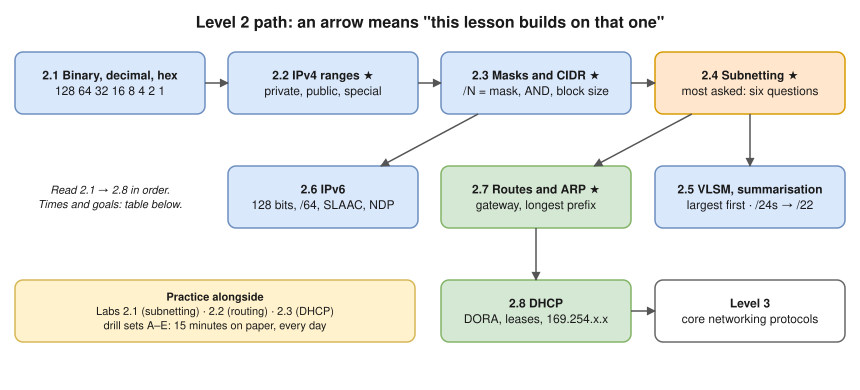

# Level 2 · IP Addressing and Subnetting

- **Goal:** read, split and plan IP ranges without a calculator; know how a host picks where each packet goes and how it gets its address.
- **Start here if:** you've finished [Level 1](../01-networking-fundamentals/README.md), or already know what IP addresses, MAC addresses and routers are.
- 🔥 **Interview feedback topic.** Subnetting was the clearest gap in the [Oct 9 interview review](../../interview-transcript-review-oct-9.md). The skill comes from **15 minutes of paper drills a day** until the answers are automatic, not from reading.
- ⏱️ About 12 hours (lessons ~10 h, labs ~2 h), plus 15 minutes of drills a day for at least a week (estimate).

## Lessons (read in this order)

| # | Lesson | You'll be able to… | ⏱️ (estimate) |
|---|---|---|---|
| 2.1 | [Binary, decimal and hex](01-binary-decimal-and-hex.md) | Convert any octet between decimal, binary and hex in your head | 60 min + daily practice |
| 2.2 | [IPv4 addresses and ranges](02-ipv4-addresses-and-ranges.md) ⭐ | Classify any address: private (RFC 1918), public, loopback, link-local, CGNAT, multicast | 60 min |
| 2.3 | [Subnet masks and CIDR](03-subnet-masks-and-cidr.md) ⭐ | Convert `/n` ↔ mask, find network/broadcast/host range, count usable hosts (incl. AWS's 5 reserved) | 75 min |
| 2.4 | [Subnetting step by step](04-subnetting-step-by-step.md) 🔥 | Answer the six standard subnetting questions on paper; split a VPC into tiers | 2 h + drills |
| 2.5 | [VLSM and route summarisation](05-vlsm-and-route-summarization.md) | Allocate different-size subnets without overlap; summarise routes in binary | 75 min |
| 2.6 | [IPv6 fundamentals](06-ipv6-fundamentals.md) | Read and shorten IPv6 addresses; explain /64, SLAAC, NDP and dual stack | 90 min |
| 2.7 | [Default gateway, routing table and ARP](07-default-gateway-routing-table-and-arp.md) ⭐ | Read a routing table; apply longest prefix match; explain ARP and what changes per hop | 75 min |
| 2.8 | [DHCP](08-dhcp.md) | Explain DORA, leases, relays, and what `169.254.x.x` means | 45 min |

## Practice

| Type | Link |
|---|---|
| 🖥️ Lab 2.1 | [Subnetting by hand, then verify](../13-hands-on-labs/lab-02.1-subnetting-by-hand-then-verify.md) (paper + Python/`ipcalc`, 60 min, any machine) |
| 🖥️ Lab 2.2 | [Routing between two subnets](../13-hands-on-labs/lab-02.2-routing-between-two-subnets.md) (Linux lab container, 45 min) |
| 🖥️ Lab 2.3 | [DHCP: capture the DORA exchange](../13-hands-on-labs/lab-02.3-dhcp-dora-capture.md) (Linux lab container, 30 min) |
| ✍️ Drills | [Level 2 subnetting drills](../14-practice-exercises/02-level-2-subnetting-drills.md) (sets A–E) · [solutions](../14-practice-exercises/solutions/02-level-2-subnetting-drills-solutions.md) |
| 🔥 Worksheet | The [12-question worksheet](../../interview-transcript-review-oct-9.md#worksheet-do-it-on-paper-then-check) from the interview review |

## Milestone: you're ready for Level 3 when you can…

- [ ] Write the binary for any number 0–255 in under 10 seconds.
- [ ] Name the three RFC 1918 ranges and say why `172.32.0.1` is **not** private.
- [ ] Given `10.20.37.140/26`: network, broadcast, first and last host, and usable count, on paper, in under 60 seconds.
- [ ] Split `10.0.0.0/16` into public, app and data tiers across three AZs, with no overlap, and explain your choice of sizes.
- [ ] Summarise four consecutive `/24`s, and explain when you can't.
- [ ] Shorten `2001:0db8:0000:0000:0000:ff00:0042:8329` correctly.
- [ ] Given a routing table with overlapping routes, say which one a packet uses and why.
- [ ] Explain why a host ARPs for its gateway and not for `8.8.8.8`.
- [ ] Describe DORA and say what `169.254.x.x` on a laptop means.
- [ ] Score 100% on drill sets A–C and at least 80% on D–E.

➡️ **Next level:** [Level 3 · Core networking protocols](../03-core-networking-protocols/README.md)
