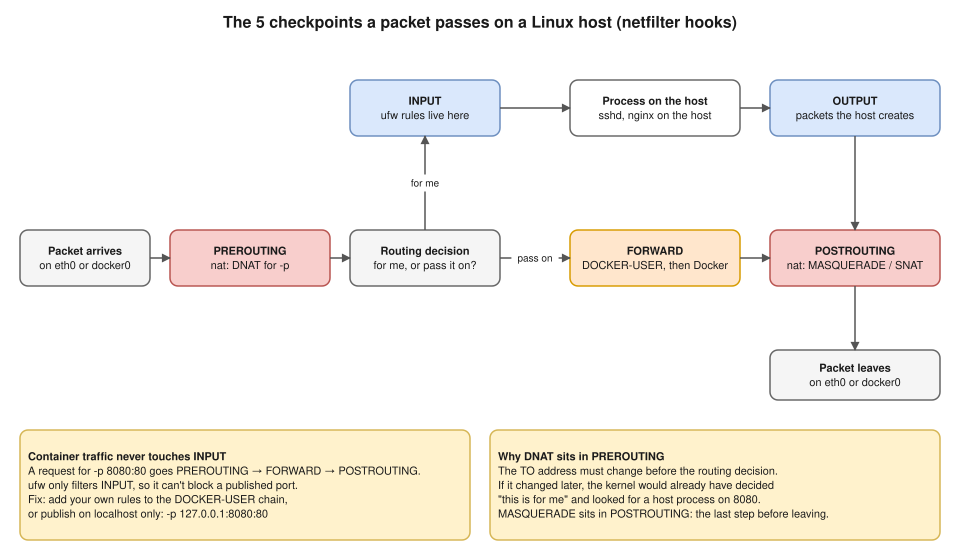

# 02 · NAT: MASQUERADE, SNAT, DNAT ⭐

**NAT changes an address on a letter.** It's the "reception" of the building story, and the only place where an address changes on the way.

## Full forms

| Term | Full form | What it changes | Direction |
|---|---|---|---|
| **NAT** | **N**etwork **A**ddress **T**ranslation | An address on a packet | n/a |
| **SNAT** | **S**ource NAT | The **FROM** address | Going **out** |
| **MASQUERADE** | Not an abbreviation: English for *wearing a mask* | The **FROM** address (a kind of SNAT) | Going **out** |
| **DNAT** | **D**estination NAT | The **TO** address | Coming **in** |

> 🧠 **MASQUERADE masks the FROM when going out. DNAT changes the TO when coming in.**

## Why NAT exists

A container's address (`172.17.0.2`) and a VPC address (`10.0.1.25`) are **private**: they only mean something inside their own network ([01](01-basics.md#private-vs-public-ip-addresses-)). So:

- **Going out:** if a letter reaches Google with `FROM 172.17.0.2`, Google's reply has no way back. → **MASQUERADE / SNAT**
- **Coming in:** your browser only knows the **host's** address, never the container's. → **DNAT**

## MASQUERADE: mask the FROM address (going out)

**The rule Docker creates (tested, from your Docker Desktop VM):**

```
-A POSTROUTING -s 172.17.0.0/16 ! -o docker0 -j MASQUERADE
```

| Part | Meaning |
|---|---|
| `POSTROUTING` | The **last checkpoint**, just before the packet leaves the host |
| `-s 172.17.0.0/16` | The packet comes **from a container** on this bridge |
| `! -o docker0` | It is **not** going back into docker0, so it's **leaving the host** |
| `-j MASQUERADE` | **Replace the FROM address** with the IP of the card it leaves through |

**The journey of `curl google.com` from a container** (host IP `10.0.1.25`):

1. The container sends `FROM 172.17.0.2:45000 → TO 142.250.x.x:443`.
2. It goes through the veth door into docker0, and the host's routing sends it to `eth0`.
3. MASQUERADE rewrites it to `FROM 10.0.1.25:45000`.
4. Google replies to `10.0.1.25:45000`.
5. conntrack remembers step 3 and reverses it, so the reply goes back to `172.17.0.2`.

### SNAT vs MASQUERADE

Both change the FROM address. The difference is **where the new address comes from**:

| | SNAT | MASQUERADE |
|---|---|---|
| New FROM address | **You write it:** `-j SNAT --to-source 10.0.1.25` | **Looked up automatically** from the outgoing card |
| If the host's IP changes | ❌ The rule is now wrong | ✅ Still works |
| Best for | Hosts with a fixed IP | Hosts whose IP can change (laptops, home Wi-Fi, cloud VMs) |

**Why Docker uses MASQUERADE:** it doesn't know the host's IP in advance, and that IP can change.

## DNAT: change the TO address (coming in)

**The rules Docker creates for `-p 8080:80` (tested):**

```
-A PREROUTING -m addrtype --dst-type LOCAL -j DOCKER
-A DOCKER -p tcp -m tcp --dport 8080 -j DNAT --to-destination 172.17.0.2:80
```

1. `PREROUTING` is the **first checkpoint**, the moment a packet arrives.
2. `--dst-type LOCAL`: "is it addressed to one of this host's own IPs?" If yes, jump to the `DOCKER` chain.
3. `--dport 8080 -j DNAT`: "TCP port 8080?" If yes, **change the TO** to `172.17.0.2:80`.

There's also `-A OUTPUT -m addrtype --dst-type LOCAL -j DOCKER`: packets **created by the host itself** skip PREROUTING and pass through OUTPUT instead.

**Why DNAT must be in PREROUTING:** the TO address has to change **before the routing decision**. If it changed later, the kernel would already have decided "this is for me" and looked for a program on the host listening on 8080.

**Each published port gets its own rule.** In the lab, stopping the container made its DNAT line disappear, and starting it brought the line back **(tested)**.

## conntrack: reception's register ⭐

**conntrack** (connection tracking) is the kernel's table of every connection, and of every address change made to it.

- It's why **replies** find their way back: the kernel reverses each change automatically.
- It's why **only the first packet** of a connection goes through the NAT rules. **Proof (tested):** after a full web page was downloaded through the DNAT rule, its counter showed **1 packet, 60 bytes**: the TCP SYN that opened the connection.

An entry for a DNAT'd connection looks like this (the second half is the reply direction, which shows the translation):

```
tcp 6 431999 ESTABLISHED src=49.36.x.x dst=10.0.1.25 sport=51000 dport=8080 src=172.17.0.2 dst=49.36.x.x sport=80 dport=51000 [ASSURED]
```

**A production problem worth knowing:** on a very busy host (a NAT box, or a Kubernetes node with many connections), the table can fill up. The kernel log then shows `nf_conntrack: table full, dropping packet`, and new connections **time out at random**. Compare `conntrack -C` with `sysctl net.netfilter.nf_conntrack_max`.

## The 5 checkpoints a packet passes (netfilter hooks)



| Checkpoint (chain) | When | What lives there |
|---|---|---|
| **PREROUTING** | The packet has just arrived | **DNAT** (`-p` rules, kube-proxy Service rules) |
| **INPUT** | It's for a program **on this host** | Host firewall rules (**ufw**) |
| **FORWARD** | It's **passing through** (e.g. to a container) | **DOCKER-USER** (your rules), then Docker's rules |
| **OUTPUT** | The host itself created it | DNAT for the host's own connections |
| **POSTROUTING** | Just before it leaves | **MASQUERADE / SNAT** |

Rules are grouped into **tables**: `nat` changes addresses; `filter` allows or drops.

## 🔥 The ufw bypass (a security question he may ask)

**The situation:** ufw blocks port 8080 on a Linux server, yet a container published with `-p 8080:80` is still reachable from the internet.

**Why:** traffic to a container is **forwarded**. It goes PREROUTING → **FORWARD** → POSTROUTING and **never passes INPUT**, which is where ufw's rules live.

**Fixes:**

1. **Publish only on localhost** when only the host needs access (e.g. behind a reverse proxy):
   ```bash
   docker run -d -p 127.0.0.1:8080:80 nginx
   ```
2. **Put your rules in the `DOCKER-USER` chain.** Docker checks it before its own rules and never overwrites it. For example, allow only the office network to reach containers:
   ```bash
   sudo iptables -I DOCKER-USER -i eth0 ! -s 203.0.113.0/24 -j DROP
   ```
   Packets there are **already DNAT'd**, so to match the host port you must use conntrack: `-m conntrack --ctorigdstport 8080`.
3. **On AWS, the security group still protects you:** it filters **outside** the instance, before the packet reaches iptables.

## nftables: the newer system underneath

On your Docker Desktop, the `iptables` command is really `iptables-nft` **(tested: `/usr/sbin/xtables-nft-multi`)**. The rules are stored in **nftables**, but you still read and write them with `iptables`. `nft list ruleset` shows them too, with the warning "managed by iptables-nft, do not touch!".

## Kubernetes link ⭐

- **A Service is DNAT.** kube-proxy writes rules that change `TO <ClusterIP>:80` into `TO <a pod IP>:8080`, picking one ready pod. Modes: iptables, **nftables** (stable since 1.33), and IPVS (deprecated in 1.35).
- **A NodePort is like `-p`** on every node.
- **`externalTrafficPolicy`:** `Cluster` (the default) SNATs traffic arriving at a node, so the app **loses the client's real IP**. `Local` keeps the client IP but only sends traffic to pods on the node it arrived at.
- **Pods going out on EKS:** pods have real VPC IPs, so there's **no NAT inside the VPC**. Traffic to addresses outside the VPC is SNAT'd to the node's primary IP by the VPC CNI (unless `AWS_VPC_K8S_CNI_EXTERNALSNAT=true`).

## AWS link ⭐

| AWS piece | The NAT it does |
|---|---|
| **NAT gateway** | **MASQUERADE for a private subnet.** The private subnet's route `0.0.0.0/0 → nat-xxxx`. The NAT gateway sits in a **public** subnet with an Elastic IP. Use one per AZ, for availability and to avoid cross-AZ charges. |
| **Internet gateway** | **1:1 NAT** between an instance's private IP and its public IP. The instance never sees its public IP on its own card: `ip addr` shows only the private one. |
| **Private NAT gateway** | SNAT to a routable **private** IP, with no internet. Used for **overlapping CIDRs** ([scenario deep dives](../hemant-scenario-deep-dives.md), A2). |

## Interview angle

- ⭐ **"How does `-p 8080:80` work?"** → A DNAT rule in PREROUTING changes the destination from host port 8080 to the container's IP and port 80. Then routing sends it to docker0 and through the veth into the container. conntrack reverses the change on replies.
  - **He'll push: "Why PREROUTING?"** → The address must change before the routing decision.
- ⭐ **"How does a container reach the internet?"** → Through docker0 to the host. MASQUERADE in POSTROUTING swaps its private source IP for the host's IP.
  - **He'll push: "SNAT vs MASQUERADE?"** → SNAT uses a fixed IP you give it. MASQUERADE reads the outgoing card's current IP, so it survives IP changes.
- 🔥 **"ufw blocks the port, but it's still open. Why?"** → Container traffic goes through FORWARD, not INPUT. Use DOCKER-USER, `-p 127.0.0.1:…`, or a cloud security group.
- **"Connections time out randomly on a busy node."** → Check for a full conntrack table: `nf_conntrack: table full` in `dmesg`, and `conntrack -C` vs `nf_conntrack_max`.
- **"Why does my app behind a NodePort see the node's IP, not the client's?"** → `externalTrafficPolicy: Cluster` SNATs. Use `Local`, or read `X-Forwarded-For` from the load balancer.

## Practice 🖥️

Do the [lab](05-hands-on-lab.md): Test 3 (MASQUERADE) and Test 4 (DNAT) show these rules and their counters on your own Mac.
