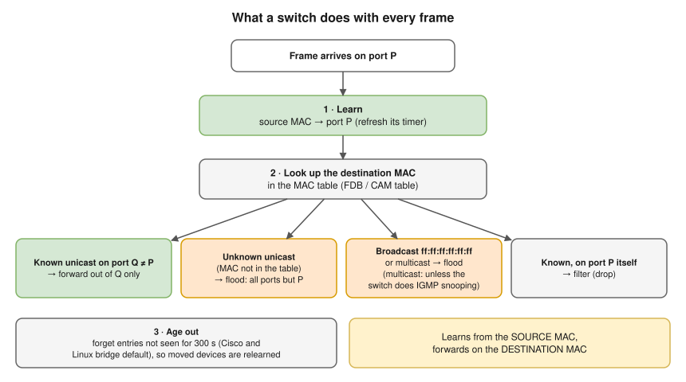
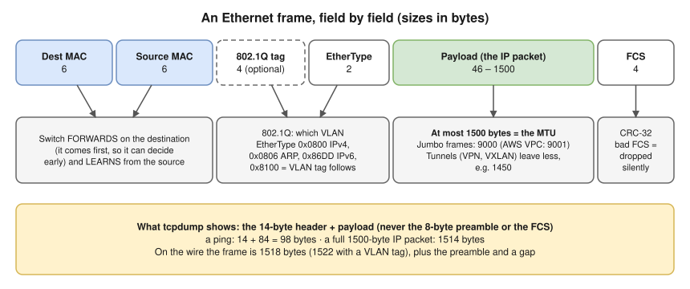
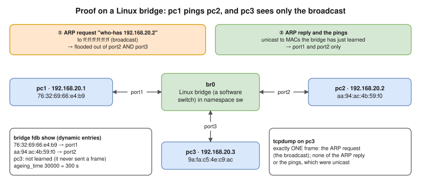

# 3.1 · Ethernet and Switching Basics

> **Level 3 · Core networking protocols** · Lesson 1 of 11 · ⏱️ about 60 minutes (estimate) · 🧪 [Lab 1.2](../13-hands-on-labs/lab-01.2-build-a-tiny-network-with-namespaces.md) (part B)
> ⬅️ [Level 2 · DHCP](../02-ip-addressing-and-subnetting/08-dhcp.md) · ➡️ [3.2 TCP and UDP](02-tcp-and-udp.md)



- Inside one local network, data moves in **frames**: an envelope with a "to" MAC, a "from" MAC and the IP packet inside. A switch reads only the envelope.
- ⭐ A switch **learns** from the **source** MAC and **forwards** on the **destination** MAC. Only broadcasts, multicasts and **unknown** unicasts are flooded.
- Its table (MAC → port) is the **MAC address table**, also called the **forwarding database (FDB)** or **CAM table**.
- Docker's `docker0`, Kubernetes node bridges and many CNI plugins are **software switches** that behave exactly like this.
- "Same VLAN?" and "same broadcast domain?" are the first questions when two machines on the "same network" can't see each other. MACs change at every router ([2.7](../02-ip-addressing-and-subnetting/07-default-gateway-routing-table-and-arp.md)).

## The Ethernet frame



- **MTU** (maximum transmission unit) = the largest **payload** a link carries: normally **1500 bytes** on Ethernet. MTU problems (big transfers hang, small ones work) start here.
- The 98-byte ping frame `tcpdump` showed in [2.7](../02-ip-addressing-and-subnetting/07-default-gateway-routing-table-and-arp.md) = 14 bytes of Ethernet header + 84 bytes of IP packet. The network card strips the FCS.
- When links on one path have different MTUs, big packets can vanish: [Path MTU discovery](07-icmp-ping-and-traceroute.md#mtu-and-path-mtu-discovery).

## Reading a MAC address

- **48 bits**, written as 6 bytes in hex: `3c:22:fb:12:34:56`. The first 3 bytes (`3c:22:fb`) are normally the **OUI**, the vendor ID IEEE assigns to the manufacturer.
- Two bits of the **first byte** have special meanings:

| Bit (of the first byte) | If set | Example |
|---|---|---|
| Lowest bit (I/G) | **Multicast/broadcast** address: the frame is for a group | `ff:ff:ff:ff:ff:ff` (broadcast), `01:00:5e:…` (IPv4 multicast) |
| Second-lowest bit (U/L) | **Locally administered**: made up by software, not burned in by a vendor | `02:42:…` (Docker), random veth MACs like `76:32:…` and `aa:94:…` |

Quick test: second hex digit `2`, `6`, `A` or `E` = locally administered. Checked with Python on addresses from this module's labs:

```text
76:32:69:66:e4:b9  unicast  local
aa:94:ac:4b:59:f0  unicast  local
02:42:ac:11:00:02  unicast  local
01:00:5e:00:00:01  multicast global(OUI)
3c:22:fb:12:34:56  unicast  global(OUI)
```

- Lab veth MACs look random because Linux generates locally administered ones. A MAC doesn't identify a device for ever: phones use **randomised (private) MACs** per Wi-Fi network; VMs and containers get generated ones.

## Proof with a Linux bridge (tested)



[Lab 1.2](../13-hands-on-labs/lab-01.2-build-a-tiny-network-with-namespaces.md), part B: `pc3` runs `tcpdump` while `pc1` pings `pc2`. `pc3` saw exactly **one** frame **(tested in the lab container)**:

```text
76:32:69:66:e4:b9 > ff:ff:ff:ff:ff:ff, ethertype ARP (0x0806), length 42: Request who-has 192.168.20.2 tell 192.168.20.1, length 28
```

The bridge's table afterwards (dynamic entries only), and its ageing time in hundredths of a second (**300 s**) **(tested in the lab container)**:

```console
$ bridge fdb show br br0 | grep -v permanent
76:32:69:66:e4:b9 dev port1 master br0
aa:94:ac:4b:59:f0 dev port2 master br0
$ cat /sys/class/net/br0/bridge/ageing_time
30000
```

## Collision domains and broadcast domains

| | Collision domain | Broadcast domain |
|---|---|---|
| What it is | Devices whose transmissions can collide | Devices that receive each other's broadcasts |
| Hub | All ports: **one** | One |
| Switch | **Each port** is its own (and full duplex removes collisions entirely) | **All ports: one** (per VLAN) |
| Router | Each interface | **Each interface**: routers don't forward broadcasts |

- Collisions are history on modern full-duplex links. **Broadcast domains** still matter: every ARP request, DHCP Discover and some service-discovery traffic reaches every device in the domain, so big flat networks are split into **VLANs** and **subnets**.

## Loops, STP and VLANs (preview)

- Ethernet frames have **no TTL**. Two cables between two switches let a broadcast circle forever and multiply: a **broadcast storm** that can take down the whole LAN in seconds. MAC addresses also appear to "flap" between ports.
- **Spanning Tree Protocol (STP)** blocks redundant links until they're needed. (The lab bridge shows `stp_state 0`, meaning off, which is fine for a loop-free lab.)
- A **VLAN** splits one switch into several separate switches, each its own broadcast domain. Traffic between VLANs must go through a router.
- Both in depth in [Level 4](../04-switching-and-routing/README.md).

## Where you meet it

| Where | What it looks like |
|---|---|
| Docker | `docker0` is a Linux bridge; each container's veth is a port. `bridge fdb show br docker0` shows the containers' MACs ([10.1](../10-container-and-kubernetes-networking/01-docker-bridge-networking-inside-out.md)) |
| Kubernetes | Many CNI plugins put pods on a node-local bridge (e.g. `cni0`) and connect nodes with routing or a VXLAN overlay: Ethernet frames carried inside UDP packets |
| AWS | A VPC is **not** a normal Ethernet LAN: no broadcast or multicast between instances (multicast only via Transit Gateway), and the VPC itself answers ARP. Protocols that depend on broadcast (some old clustering software) need changes |
| Data centres | Layer 2 domains kept small (often one rack), everything else routed (**leaf–spine**, [Level 12](../12-expert-architecture-and-troubleshooting/README.md)) |

## Try it

**On your Mac:**

```bash
ifconfig en0 | grep ether      # your Wi-Fi MAC (may be a private, randomised one)
arp -a                          # IP → MAC entries your Mac has learned
```

**On Linux:**

```bash
ip -br link                     # interfaces and their MACs
bridge link                     # ports attached to Linux bridges (e.g. docker0)
bridge fdb show br docker0      # the bridge's MAC table
ip -d link show docker0         # bridge details, including stp_state
```

## Troubleshooting

| You see | It means | Next step |
|---|---|---|
| Two hosts on the "same network" can't ARP each other | Different VLANs, or a port is down | `ip -br link`, switch port/VLAN config, `tcpdump -e arp` on both ends |
| Small requests work, large transfers hang | MTU mismatch / tunnel overhead | `ping -M do -s 1472 <host>` ([3.7](07-icmp-ping-and-traceroute.md)) |
| Whole LAN suddenly slow, switch lights flashing | Broadcast storm (loop), e.g. two cables between two switches without STP | Look for a recently added cable; check STP status. For redundant links use STP or link aggregation (LACP) |
| Slow link with many errors | Duplex mismatch or a bad cable | `ethtool eth0` (speed/duplex), `ip -s link` (errors, drops) |
| "MAC flapping" warnings on a switch | A loop, or two devices using the same MAC (cloned VMs) | Switch logs; regenerate the VM's MAC |

## Interview angle

- **"What's in an Ethernet frame?"** → Destination MAC, source MAC, optional VLAN tag, EtherType, payload up to 1500 bytes (MTU), FCS.
- ⭐ **"How does a switch learn?"** → From the **source** MAC of incoming frames. It forwards known unicasts to one port, floods unknown unicasts and broadcasts, and ages entries out (300 s typically).
- **"Collision domain vs broadcast domain?"** → Each switch port is its own collision domain; the whole switch (or VLAN) is one broadcast domain; routers separate broadcast domains.
- **"Why are loops bad at Layer 2?"** → No TTL in Ethernet, so broadcasts loop and multiply for ever. STP blocks redundant paths.
- **"Is a VPC a Layer 2 network?"** → No broadcast or multicast; the VPC handles ARP. It behaves like routed Layer 3 even within a subnet.

## Check yourself

1. Which field does a switch **learn** from, and which does it **forward** on?
2. A switch has just been powered on. PC A sends a unicast frame to PC B. Who receives it?
3. Is `0e:11:22:33:44:55` a vendor-assigned or a locally administered address? Unicast or multicast?
4. A host sends a 1500-byte IP packet. How big is the Ethernet frame `tcpdump` shows?
5. You connect 4 switches in a ring with no STP. What happens after the first ARP request?

<details>
<summary><b>Answers</b> (try first)</summary>

1. Learns from the **source** MAC; forwards on the **destination** MAC.
2. **Everyone** except A: B's MAC is unknown, so the frame is flooded. The switch now knows A's port.
3. `0e` = `0000 1110`. Lowest bit 0 → **unicast**; second bit 1 → **locally administered**.
4. **1514 bytes** (14-byte header + 1500); `tcpdump` doesn't show the 4-byte FCS.
5. A **broadcast storm**: the request circles the ring in both directions for ever and multiplies at each switch, until the links and CPUs are saturated.

</details>

➡️ **Next:** [3.2 · TCP and UDP](02-tcp-and-udp.md): the two transport protocols, what each guarantees, and how to choose.
