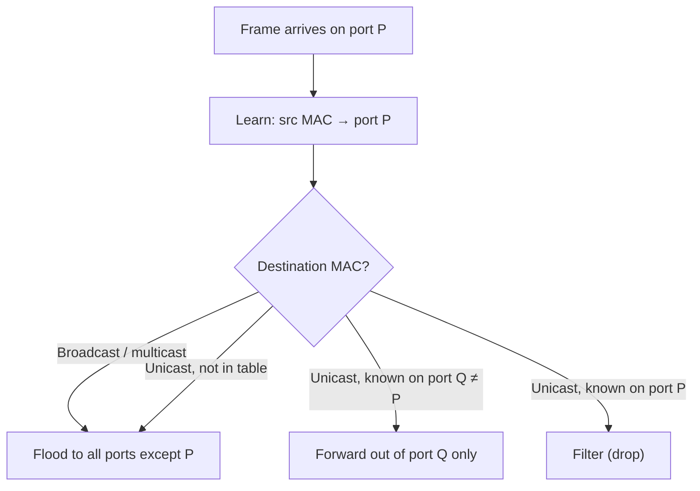

# 3.1 · Ethernet and Switching Basics

> **Level 3 · Core networking protocols** · Lesson 1 of 11 · ⏱️ about 60 minutes (estimate)
> ⬅️ [Level 2 · DHCP](../02-ip-addressing-and-subnetting/08-dhcp.md) · ➡️ [3.2 TCP and UDP](02-tcp-and-udp.md)

## What you'll learn

- What an **Ethernet frame** contains, field by field, and where the **MTU** of 1500 comes from.
- How to read a **MAC address**: the vendor part, and the bits that mean *multicast* and *locally administered*.
- How a switch **learns, forwards, floods and forgets**, proven with a Linux bridge.
- **Collision domains** vs **broadcast domains**, and why broadcasts limit how big a LAN can get.
- Why switching loops are dangerous, and what **STP** and **VLANs** are for (in depth in [Level 4](../04-switching-and-routing/README.md)).
- What's different about "Layer 2" in the cloud.

## Before you start

- [1.2](../01-networking-fundamentals/02-network-devices.md): what a switch does, in one paragraph.
- [2.7](../02-ip-addressing-and-subnetting/07-default-gateway-routing-table-and-arp.md): ARP, and the fact that MACs change at every router.

---

## The idea in plain words

Inside one local network, data moves in **frames**. A frame is an envelope with a **"to" MAC address** and a **"from" MAC address**, and the IP packet inside it.

A **switch** is the mail sorter for one floor. It doesn't read the letter (the IP packet); it only reads the envelope (the MAC addresses). It remembers which desk each sender sits at, and next time delivers straight there. When it doesn't know, it hands a copy to **everyone** on the floor.

## Why it matters

- Every packet you've ever sent on a wired or Docker network was inside an Ethernet frame. **MTU problems** (big transfers hang, small ones work) start here.
- Docker's `docker0`, Kubernetes node bridges and many CNI plugins are **software switches** that behave exactly as described below.
- "Same VLAN?" and "same broadcast domain?" are the first questions when two machines on the "same network" can't see each other.

---

## How it works

### The Ethernet frame

```text
| Dest MAC | Source MAC | (802.1Q tag) | EtherType | Payload (the IP packet)  | FCS     |
| 6 bytes  | 6 bytes    | (4 bytes)    | 2 bytes   | 46 – 1500 bytes          | 4 bytes |
```

| Field | What it's for |
|---|---|
| **Destination MAC** | Who should pick the frame up. It comes **first**, so a switch can start deciding before the rest arrives |
| **Source MAC** | Who sent it. The switch **learns** from this field |
| **802.1Q tag** (optional) | Which **VLAN** the frame belongs to ([Level 4](../04-switching-and-routing/README.md)) |
| **EtherType** | What's inside: `0x0800` IPv4, `0x0806` ARP, `0x86DD` IPv6, `0x8100` means "a VLAN tag follows" |
| **Payload** | The IP packet (or ARP message). At most **1500 bytes**: this is the **MTU** |
| **FCS** | A checksum (CRC-32). A frame with a bad FCS is dropped silently by the receiving card |

On the wire there's also an 8-byte **preamble** before the frame and a gap after it, which tools like `tcpdump` never show. They also don't show the FCS, because the network card strips it. That's why `tcpdump` reported a 98-byte frame for a ping in [2.7](../02-ip-addressing-and-subnetting/07-default-gateway-routing-table-and-arp.md): 14 bytes of Ethernet header + 84 bytes of IP packet.

**MTU** (maximum transmission unit) is the largest **payload** a link carries, normally **1500 bytes** on Ethernet. Data centres often use **jumbo frames** (MTU 9000; AWS supports 9001 inside a VPC). Tunnels (VPNs, VXLAN overlays in Kubernetes) add headers, so the usable MTU inside them is smaller, e.g. 1450. When links on one path have different MTUs, big packets can vanish: that's [Path MTU discovery](07-icmp-ping-and-traceroute.md#mtu-and-path-mtu-discovery).

### Reading a MAC address

A MAC address is **48 bits**, written as 6 bytes in hex: `3c:22:fb:12:34:56`.

- The first 3 bytes (`3c:22:fb`) are normally the **OUI**, the vendor ID that IEEE assigns to the manufacturer.
- Two bits in the **first byte** have special meanings:

| Bit (of the first byte) | If set | Example |
|---|---|---|
| Lowest bit (I/G) | **Multicast/broadcast** address: the frame is for a group | `ff:ff:ff:ff:ff:ff` (broadcast), `01:00:5e:…` (IPv4 multicast) |
| Second-lowest bit (U/L) | **Locally administered**: made up by software, not burned in by a vendor | `02:42:…` (Docker), random veth MACs like `76:32:…` and `aa:94:…` |

Quick test: if the **second hex digit** is `2`, `6`, `A` or `E`, the address is locally administered. Checked with Python on addresses from this module's labs:

```text
76:32:69:66:e4:b9  unicast  local
aa:94:ac:4b:59:f0  unicast  local
02:42:ac:11:00:02  unicast  local
01:00:5e:00:00:01  multicast global(OUI)
3c:22:fb:12:34:56  unicast  global(OUI)
```

That's why the veth MACs in the labs look random: Linux generates locally administered addresses. Phones also use **randomised (private) MACs** per Wi-Fi network for privacy.

### How a switch forwards frames

A switch keeps a **MAC address table** (also called the **forwarding database, FDB**, or **CAM table**): *MAC → port*.

For every frame it receives:

1. **Learn**: record *source MAC → the port it arrived on* (refresh the timer if it's already there).
2. **Forward** by destination MAC:
   - **Known unicast** → out of that **one** port only.
   - **Unknown unicast** (MAC not in the table) → **flood** to all ports except the incoming one.
   - **Broadcast** (`ff:ff:…`) → **flood**.
   - **Multicast** → flood, unless the switch does IGMP snooping.
   - Destination on the **same** port it came in on → **filter** (drop).
3. **Age out**: forget entries not seen for a while (300 seconds by default on Cisco and on the Linux bridge), so moved devices are relearned.



### Proof with a Linux bridge (tested)

[Lab 1.2](../13-hands-on-labs/lab-01.2-build-a-tiny-network-with-namespaces.md), part B: three "PCs" (`pc1`–`pc3`, `192.168.20.1`–`.3`) plugged into one Linux bridge `br0` (a software switch) in a namespace called `sw`. The MACs **(tested in the lab container)**:

```text
pc1 76:32:69:66:e4:b9
pc2 aa:94:ac:4b:59:f0
pc3 9a:fa:c5:4e:c9:ac
```

`pc3` runs `tcpdump` while `pc1` pings `pc2`. `pc3` saw exactly **one** frame **(tested in the lab container)**:

```text
76:32:69:66:e4:b9 > ff:ff:ff:ff:ff:ff, ethertype ARP (0x0806), length 42: Request who-has 192.168.20.2 tell 192.168.20.1, length 28
```

- The ARP **request** is a broadcast, so the switch **flooded** it to `pc3` as well.
- The ARP **reply** and the pings were **unicast** to MACs the switch had just learned, so `pc3` saw **none** of them.

The bridge's table afterwards (dynamic entries only) **(tested in the lab container)**:

```console
$ bridge fdb show br br0 | grep -v permanent
76:32:69:66:e4:b9 dev port1 master br0
aa:94:ac:4b:59:f0 dev port2 master br0
```

`pc3`'s MAC isn't there: it never sent anything, so the switch never learned it. The bridge's ageing time **(tested in the lab container)**:

```console
$ cat /sys/class/net/br0/bridge/ageing_time
30000
```

(In hundredths of a second: **300 seconds**.)

### Collision domains and broadcast domains

| | Collision domain | Broadcast domain |
|---|---|---|
| What it is | Devices whose transmissions can collide | Devices that receive each other's broadcasts |
| Hub | All ports: **one** | One |
| Switch | **Each port** is its own (and full duplex removes collisions entirely) | **All ports: one** (per VLAN) |
| Router | Each interface | **Each interface**: routers don't forward broadcasts |

Collisions are history on modern full-duplex links. **Broadcast domains** still matter: every ARP request, DHCP Discover and some service-discovery traffic reaches every device in the domain. That's one reason big flat networks are split into **VLANs** and **subnets**.

### Loops, STP and VLANs (preview)

- Ethernet frames have **no TTL**. If two switches are connected by two cables, a broadcast circles forever and multiplies: a **broadcast storm** that can take down the whole LAN in seconds. MAC addresses also appear to "flap" between ports.
- The **Spanning Tree Protocol (STP)** prevents this by blocking redundant links until they're needed. (The lab bridge shows `stp_state 0`, meaning off, which is fine for a loop-free lab.)
- A **VLAN** splits one switch into several separate switches, each its own broadcast domain. Traffic between VLANs must go through a router.

Both are covered properly in [Level 4](../04-switching-and-routing/README.md).

---

## Try it

**On your Mac:**

```bash
ifconfig en0 | grep ether      # your Wi-Fi MAC (may be a private, randomised one)
arp -a                          # IP → MAC entries your Mac has learned
```

**On Linux:**

```bash
ip -br link                     # interfaces and their MACs
bridge link                     # ports attached to Linux bridges (e.g. docker0)
bridge fdb show br docker0      # the bridge's MAC table
ip -d link show docker0         # bridge details, including stp_state
```

## In the real world

- **Docker:** `docker0` is a Linux bridge; each container's veth is a port. `bridge fdb show br docker0` on a Docker host shows the containers' MACs ([10.1](../10-container-and-kubernetes-networking/01-docker-bridge-networking-inside-out.md)).
- **Kubernetes:** many CNI plugins put pods on a node-local bridge (e.g. `cni0`) and connect nodes with routing or a VXLAN overlay, which is Ethernet frames carried inside UDP packets.
- **AWS:** a VPC is **not** a normal Ethernet LAN. There's no broadcast or multicast between instances (multicast only via Transit Gateway), and the VPC itself answers ARP. You can't run protocols that depend on broadcast (some old clustering software) without changes.
- **Data centres:** modern designs keep Layer 2 domains small (often one rack) and route everything else (**leaf–spine**, [Level 12](../12-expert-architecture-and-troubleshooting/README.md)).

## Common mistakes

| Mistake | Reality |
|---|---|
| "A switch sends every frame to everyone" | Only broadcasts, multicasts and **unknown** unicasts are flooded |
| "MTU 1500 means 1500-byte frames" | 1500 is the **payload**; the frame is 1518 bytes (1522 with a VLAN tag), plus preamble on the wire |
| Plugging two cables between two switches "for redundancy" without STP | A broadcast storm. Use STP or link aggregation (LACP) |
| Expecting a MAC address to identify a device for ever | Phones randomise MACs; VMs and containers get generated ones |

## Troubleshooting

| Symptom | Likely cause | Check |
|---|---|---|
| Two hosts on the "same network" can't ARP each other | Different VLANs, or a port is down | `ip -br link`, switch port/VLAN config, `tcpdump -e arp` on both ends |
| Small requests work, large transfers hang | MTU mismatch / tunnel overhead | `ping -M do -s 1472 <host>` ([3.7](07-icmp-ping-and-traceroute.md)) |
| Whole LAN suddenly slow, switch lights flashing | Broadcast storm (loop) | Look for a recently added cable; check STP status |
| Slow link with many errors | Duplex mismatch or a bad cable | `ethtool eth0` (speed/duplex), `ip -s link` (errors, drops) |
| "MAC flapping" warnings on a switch | A loop, or two devices using the same MAC (cloned VMs) | Switch logs; regenerate the VM's MAC |

## Hands-on lab

[Lab 1.2 · Build a tiny network with namespaces](../13-hands-on-labs/lab-01.2-build-a-tiny-network-with-namespaces.md), part B: build a three-port switch, watch it flood a broadcast and learn MACs.

## Interview angle

- **"What's in an Ethernet frame?"** → Destination MAC, source MAC, optional VLAN tag, EtherType, payload up to 1500 bytes (MTU), FCS.
- ⭐ **"How does a switch learn?"** → From the **source** MAC of incoming frames. It forwards known unicasts to one port, floods unknown unicasts and broadcasts, and ages entries out (300 s typically).
- **"Collision domain vs broadcast domain?"** → Each switch port is its own collision domain; the whole switch (or VLAN) is one broadcast domain; routers separate broadcast domains.
- **"Why are loops bad at Layer 2?"** → No TTL in Ethernet, so broadcasts loop and multiply for ever. STP blocks redundant paths.
- **"Is a VPC a Layer 2 network?"** → No broadcast or multicast; the VPC handles ARP. It behaves like routed Layer 3 even within a subnet.

## Check yourself

1. Which field does a switch **learn** from, and which does it **forward** on?
2. A switch has just been powered on. PC A sends a unicast frame to PC B. Who receives it?
3. Is `0e:11:22:33:44:55` a vendor-assigned or a locally administered address? Unicast or multicast?
4. A host sends a 1500-byte IP packet. How big is the Ethernet frame `tcpdump` shows?
5. You connect 4 switches in a ring with no STP. What happens after the first ARP request?

<details>
<summary><b>Answers</b> (try first)</summary>

1. Learns from the **source** MAC; forwards on the **destination** MAC.
2. **Everyone** except A: B's MAC is unknown, so the frame is flooded. The switch now knows A's port.
3. `0e` = `0000 1110`. Lowest bit 0 → **unicast**; second bit 1 → **locally administered**.
4. **1514 bytes** (14-byte header + 1500); `tcpdump` doesn't show the 4-byte FCS.
5. A **broadcast storm**: the request circles the ring in both directions for ever and multiplies at each switch, until the links and CPUs are saturated.

</details>

## Summary

- A frame = **dst MAC, src MAC, (VLAN tag), EtherType, payload ≤ 1500 (MTU), FCS**.
- A switch **learns** source MACs, **forwards** known unicasts to one port, **floods** broadcasts and unknown unicasts, and **ages** entries out.
- Switch ports separate **collision** domains; routers (and VLANs) separate **broadcast** domains.
- Layer 2 loops are deadly (no TTL) → **STP**. Big flat networks are split with **VLANs**.
- Cloud networks don't behave like a classic LAN: no broadcast, ARP handled for you.

## Next

➡️ [3.2 · TCP and UDP](02-tcp-and-udp.md): the two transport protocols, what each guarantees, and how to choose.
