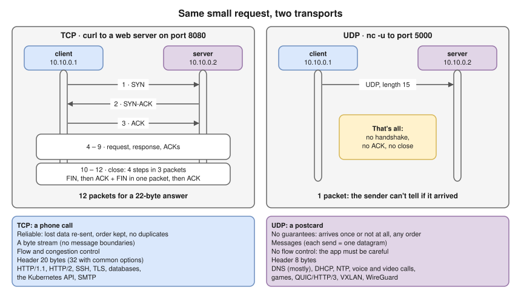
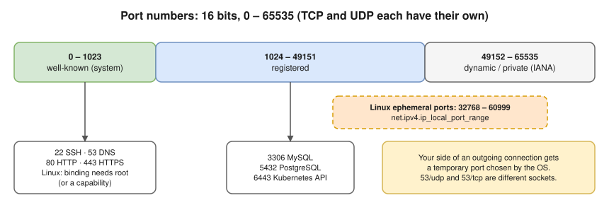
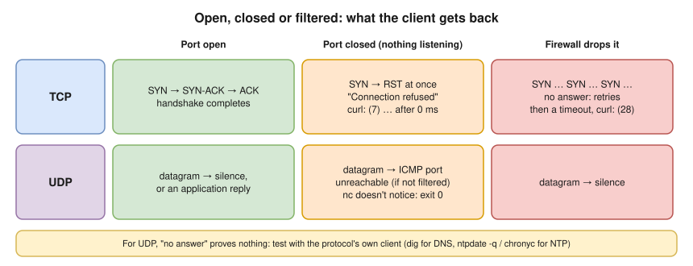

# 3.2 · TCP and UDP: The Two Transport Protocols

> **Level 3 · Core networking protocols** · Lesson 2 of 11 · ⏱️ about 60 minutes (estimate) · 🧪 [Lab 3.1](../13-hands-on-labs/lab-03.1-capture-a-tcp-handshake.md) (parts C and E)
> ⬅️ [3.1 Ethernet and switching basics](01-ethernet-and-switching-basics.md) · ➡️ [3.3 TCP in depth](03-tcp-in-depth.md)



- IP gets a packet to the right **machine** and promises nothing else: packets can be lost, duplicated or arrive out of order. The transport layer adds the **port** (which program) and decides how much care to take.
- ⭐ **TCP**: connection-oriented, reliable, ordered **byte stream**, with a 3-way handshake **SYN → SYN-ACK → ACK**. **UDP**: connectionless **datagrams**, no guarantees, 8-byte header.
- Firewalls, security groups and Kubernetes NetworkPolicies are written **per protocol and port**. "Allow 53" isn't enough: DNS needs **UDP 53 and TCP 53**.
- The **failure signals** differ: a closed TCP port answers at once with a reset; a closed UDP port may just stay silent.
- Background: ports, sockets and the 5-tuple in [1.3](../01-networking-fundamentals/03-addresses-ports-and-protocols.md); the transport layer (L4) in [1.5](../01-networking-fundamentals/05-osi-and-tcp-ip-models.md).

## Ports



- Linux uses **32768–60999** for ephemeral ports by default, not IANA's range **(tested in the lab container: `net.ipv4.ip_local_port_range = 32768 60999`)**.
- A full list of common ports: [references/common-ports.md](../references/common-ports.md).

## UDP and TCP on the wire (tested)

One UDP message between two namespaces (`client` `10.10.0.1` → `server` `10.10.0.2`, with `nc -u -l -p 5000` listening on the server) **(tested in the lab container)**:

```console
$ echo "hello over udp" | nc -u -w 1 10.10.0.2 5000
```

```text
IP 10.10.0.1.50171 > 10.10.0.2.5000: UDP, length 15
```

- That's the **whole conversation**: one packet, no handshake, no acknowledgement. The sender can't tell whether it arrived (it did: the server printed `hello over udp`).
- The same request over TCP (`curl` to port 8080) takes **12 packets** for a 22-byte answer: 3 to open, 6 for data and ACKs, and the close. The close is **4 steps** (FIN, ACK, FIN, ACK), but the capture shows **3 packets** because the server sent its ACK and its FIN together. Dissected line by line in [3.3](03-tcp-in-depth.md#a-complete-connection-packet-by-packet-tested).
- The first packet, the **SYN**, is how a firewall or NAT rule recognises a **new connection**. Only that first packet hits a NAT rule; conntrack handles the rest.
- In [Lab 3.4](../13-hands-on-labs/lab-03.4-nat-and-port-forwarding.md) a port-forwarding rule's counter showed exactly **1 packet, 60 bytes**: one SYN (20-byte IP header + 40-byte TCP header with options).

## When the port is closed (tested)



**TCP, nothing listening on port 9999:** the server's kernel answers the SYN with a **reset** (`R`) immediately **(tested in the lab container)**:

```text
10.10.0.1.51358 > 10.10.0.2.9999: Flags [S], seq 2750311665, win 64240, ...
10.10.0.2.9999 > 10.10.0.1.51358: Flags [R.], seq 0, ack 2750311666, win 0, length 0
```

```console
$ curl http://10.10.0.2:9999/
curl: (7) Failed to connect to 10.10.0.2 port 9999 after 0 ms: Couldn't connect to server
$ nc -zv -w 2 10.10.0.2 9999
nc: connect to 10.10.0.2 port 9999 (tcp) failed: Connection refused
```

**UDP, nothing listening on port 5353:** the server's kernel answers with an **ICMP "port unreachable"** **(tested in the lab container)**:

```text
10.10.0.1.45927 > 10.10.0.2.5353: domain [length 3 < 12] (invalid)
10.10.0.2 > 10.10.0.1: ICMP 10.10.0.2 udp port 5353 unreachable, length 39
```

- `nc` **didn't notice** and exited with status 0: it sent its one datagram and stopped.
- If a firewall drops the ICMP message (very common), the sender gets **nothing at all**.

## Choosing between them

- **TCP** when every byte must arrive, in order, and you'd rather wait than lose data: web pages, APIs, file transfers, databases, SSH. A **byte stream** with no message boundaries, so applications add their own framing (HTTP headers, length prefixes).
- **UDP** when:
  - **late data is useless**: a voice call can't wait for a re-sent packet from 300 ms ago, so retransmission is the wrong trade-off;
  - the exchange is **one small question and one small answer** (DNS, NTP, DHCP): a handshake would triple the time;
  - you need **broadcast or multicast** (DHCP Discover): TCP is always one-to-one;
  - you build your **own reliability** in user space: **QUIC** (under **HTTP/3**) runs over UDP to avoid TCP's head-of-line blocking and to be upgraded without changing operating systems ([3.5](05-http-and-https.md)).
- **DNS uses both:** UDP for normal queries; **TCP** when the answer is too big for one UDP message (the server sets the "truncated" flag and the client retries over TCP), and for zone transfers.

## Where you meet it

| Where | What to know |
|---|---|
| AWS security groups and NACLs | Separate rules per protocol. A NACL is **stateless**, so it must also allow the **return traffic** to the client's **ephemeral ports** (AWS suggests 1024–65535); a security group is stateful and doesn't need this. Forgetting it gives **timeouts** |
| Kubernetes | A Service port has a `protocol` (TCP by default). CoreDNS needs **both** UDP and TCP 53 allowed in NetworkPolicies |
| Load balancers | AWS NLB supports TCP, UDP and TLS listeners; ALB is HTTP/HTTPS only (and therefore TCP only) |
| NAT and firewalls | They track UDP "connections" with a **timeout** (there's no FIN), so long-idle UDP flows (VPNs, VoIP) send keepalives |

## Try it

**On your Mac:**

```bash
lsof -nP -iTCP -sTCP:LISTEN     # TCP listening sockets
lsof -nP -iUDP                  # UDP sockets
nc -zv -G 3 google.com 443      # does a TCP port answer?
dig +tcp google.com             # force DNS over TCP
```

**On Linux:**

```bash
ss -tlnp                        # TCP listening sockets (t=TCP, l=listening, n=numeric, p=process)
ss -ulnp                        # UDP sockets
ss -tan                         # all TCP sockets and their states
sudo tcpdump -i any -nn 'udp port 53'   # watch DNS queries
```

## Troubleshooting

| You see | It means | Next step |
|---|---|---|
| `Connection refused` (instant) | Reached the host; **nothing is listening** on that TCP port (or a firewall sent a reject) | `ss -tlnp` on the server: right port? Listening on `0.0.0.0` or only `127.0.0.1`? |
| `Connection timed out` / curl `(28)` | SYNs got **no answer**: a firewall drop, wrong IP, or routing | Capture on the server: do SYNs arrive? ([3.3](03-tcp-in-depth.md), [3.11](11-troubleshooting-connectivity.md)) |
| UDP app gets no reply | Could be anything: closed port, filtered ICMP, firewall. "No reply" doesn't mean "closed" | Capture on both ends; test with the protocol's own client (`dig`, `chronyc`) |
| DNS works for small names, fails for some big answers | TCP 53 blocked (only UDP 53 opened) | `dig +tcp name @server`; open **UDP and TCP** 53 |

## Interview angle

- ⭐ **"TCP vs UDP?"** → TCP: connection-oriented, reliable, ordered byte stream with flow and congestion control. UDP: connectionless datagrams, no guarantees, 8-byte header, lower latency. Give an example of each and why.
- ⭐ **"Why does DNS use UDP?"** → One small question, one small answer: no handshake needed. Falls back to TCP for large responses and zone transfers, so allow both.
- **"Why is HTTP/3 on UDP?"** → QUIC implements reliability per stream in user space, avoiding TCP head-of-line blocking and allowing faster handshakes combined with TLS 1.3.
- **"How do you know a port is closed vs filtered?"** → TCP closed = RST ("refused"); filtered = timeout. UDP closed = ICMP port unreachable, if not itself filtered.
- **"NACL timeouts but security group looks fine?"** → NACLs are stateless: allow the ephemeral return ports.

## Check yourself

1. Which of these use UDP: DHCP, SSH, NTP, HTTP/3, PostgreSQL, a VXLAN overlay?
2. A client connects to `10.0.0.5:5432` and gets `Connection refused` at once. Is the network path working?
3. Why can't TCP be used for DHCP Discover?
4. A firewall allows TCP 53 only. What breaks?
5. What range does Linux use for ephemeral ports by default, and where do you check it?

<details>
<summary><b>Answers</b> (try first)</summary>

1. **UDP:** DHCP, NTP, HTTP/3 (QUIC), VXLAN. **TCP:** SSH, PostgreSQL.
2. **Yes**: the SYN reached the host and its kernel sent a reset back. The problem is on the host: nothing listens on 5432 there (or it listens on another address), or a local firewall rejects it.
3. The client has no IP address and doesn't know the server, so it must **broadcast**; TCP only works between two known endpoints.
4. Normal DNS queries (UDP) fail, so almost all name resolution breaks.
5. **32768–60999**; `cat /proc/sys/net/ipv4/ip_local_port_range` or `sysctl net.ipv4.ip_local_port_range`.

</details>

➡️ **Next:** [3.3 · TCP in depth](03-tcp-in-depth.md): the handshake, sequence numbers, windows, retransmission and connection states, packet by packet.
