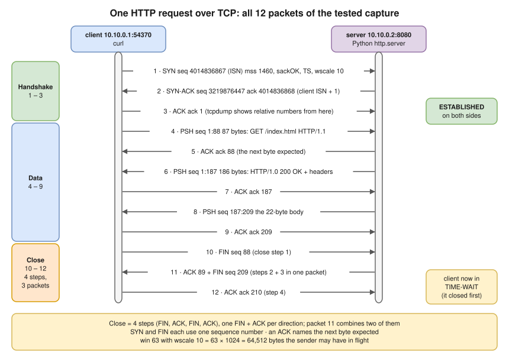
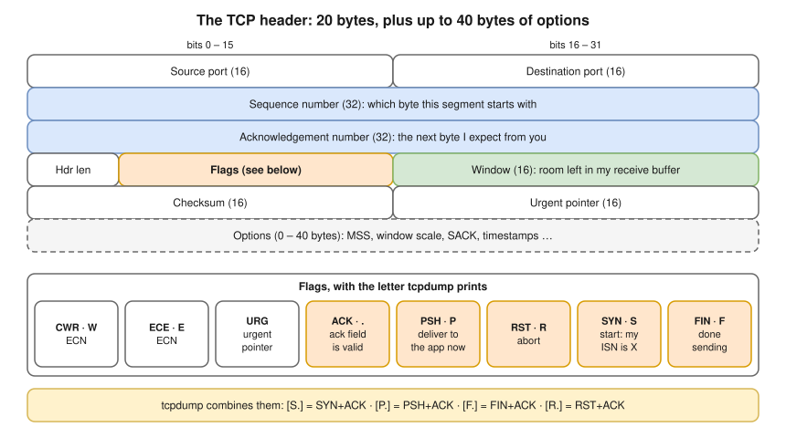
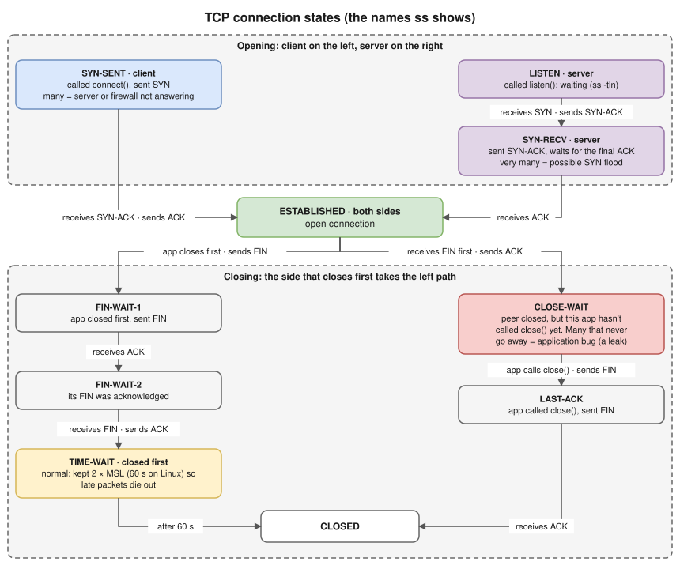

# 3.3 · TCP in Depth: Handshake, Reliability and Connection States

> **Level 3 · Core networking protocols** · Lesson 3 of 11 · ⏱️ about 2 hours (estimate) · 🧪 [Lab 3.1](../13-hands-on-labs/lab-03.1-capture-a-tcp-handshake.md)
> ⬅️ [3.2 TCP and UDP](02-tcp-and-udp.md) · ➡️ [3.4 DNS](04-dns.md)



- TCP turns an unreliable network into a reliable pipe: it **numbers every byte**, **acknowledges** what arrived ("I have everything up to N, send N next"), **re-sends** what isn't confirmed in time, advertises **how much room** it has (the window), and **slows down** when the network looks congested.
- ⭐ Handshake: **SYN** (client's random ISN) → **SYN-ACK** (server's ISN, ack = client ISN + 1) → **ACK**. SYN and FIN each consume one sequence number.
- ⭐ Close: **4 steps**, one FIN and one ACK per direction: **FIN → ACK, FIN → ACK**. The capture below shows only **3 packets** because the server sent its ACK and its own FIN together (packet 11). The side that sends the first FIN ends in **TIME-WAIT**.
- "Connection refused", "connection timed out" and "connection reset by peer" are TCP telling you **exactly** what happened.
- Thousands of **CLOSE_WAIT** sockets mean an application bug; thousands of **TIME_WAIT** sockets usually don't.
- Throughput on long-distance links is limited by **windows and congestion control**, not bandwidth ([1.4](../01-networking-fundamentals/04-network-performance.md)).

## The TCP header



## A complete connection, packet by packet (tested)

`curl http://10.10.0.2:8080/index.html` from a `client` namespace to Python's `http.server`, captured on the client ([Lab 3.1](../13-hands-on-labs/lab-03.1-capture-a-tcp-handshake.md)) **(tested in the lab container)**:

```text
 1  10.10.0.1.54370 > 10.10.0.2.8080: Flags [S], seq 4014836867, win 64240, options [mss 1460,sackOK,TS val 598057074 ecr 0,nop,wscale 10], length 0
 2  10.10.0.2.8080 > 10.10.0.1.54370: Flags [S.], seq 3219876447, ack 4014836868, win 65160, options [mss 1460,sackOK,TS val 3005015560 ecr 598057074,nop,wscale 10], length 0
 3  10.10.0.1.54370 > 10.10.0.2.8080: Flags [.], ack 1, win 63, options [nop,nop,TS val 598057075 ecr 3005015560], length 0
 4  10.10.0.1.54370 > 10.10.0.2.8080: Flags [P.], seq 1:88, ack 1, win 63, options [...], length 87: HTTP: GET /index.html HTTP/1.1
 5  10.10.0.2.8080 > 10.10.0.1.54370: Flags [.], ack 88, win 64, options [...], length 0
 6  10.10.0.2.8080 > 10.10.0.1.54370: Flags [P.], seq 1:187, ack 88, win 64, options [...], length 186: HTTP: HTTP/1.0 200 OK
 7  10.10.0.1.54370 > 10.10.0.2.8080: Flags [.], ack 187, win 63, options [...], length 0
 8  10.10.0.2.8080 > 10.10.0.1.54370: Flags [P.], seq 187:209, ack 88, win 64, options [...], length 22: HTTP
 9  10.10.0.1.54370 > 10.10.0.2.8080: Flags [.], ack 209, win 63, options [...], length 0
10  10.10.0.1.54370 > 10.10.0.2.8080: Flags [F.], seq 88, ack 209, win 63, options [...], length 0
11  10.10.0.2.8080 > 10.10.0.1.54370: Flags [F.], seq 209, ack 89, win 64, options [...], length 0
12  10.10.0.1.54370 > 10.10.0.2.8080: Flags [.], ack 210, win 63, options [...], length 0
```

(Line numbers added; timestamps and repeated timestamp options trimmed.)

| # | What happens | Notes |
|---|---|---|
| 1–3 | **Handshake**: SYN, SYN-ACK, ACK. The client's ISN is random; ephemeral port `54370` | A SYN **consumes one sequence number**, so the SYN-ACK acks ISN + 1. After packet 3 both sides are **ESTABLISHED**, and `tcpdump` shows **relative** numbers (`ack 1` = ISN + 1) |
| 4–5 | Client sends the 87-byte request (`seq 1:88` = byte 1 up to, not including, 88); server acks 88 | An ACK carries the **next byte expected** |
| 6–9 | Server sends 186 bytes of headers, then the 22-byte body `hello from the server\n`; the client acks each | |
| 10–12 | The 4-step close in 3 packets: client **FIN** (step 1); server **ACK** of that FIN (`ack 89`) + its own **FIN** in one packet (steps 2 and 3); client's final **ACK** (step 4). **The client enters TIME_WAIT** | FIN also consumes one sequence number. The side that closes first gets TIME_WAIT |

Afterwards **(tested in the lab container)**:

```console
$ ss -tan          # on the client
State     Recv-Q Send-Q Local Address:Port  Peer Address:Port
TIME-WAIT 0      0          10.10.0.1:54370    10.10.0.2:8080
```

`tshark` on packet 4 **(tested in the lab container)**: frame length **153** bytes = **14** (Ethernet) + **20** (IP header) + **32** (TCP header: 20 + 12 bytes of timestamp options) + **87** (HTTP request). The TTL was 64. That's the [encapsulation](../01-networking-fundamentals/05-osi-and-tcp-ip-models.md) from Level 1, measured.

## The handshake options

| Option | Value here | Meaning |
|---|---|---|
| **MSS** (maximum segment size) | `1460` | The largest TCP payload I can receive in one segment: MTU 1500 − 20 (IP) − 20 (TCP). With timestamps on, the real payload per packet is **1448** (12 bytes of options), which `ss -ti` shows as `mss:1448` |
| **Window scale** | `wscale 10` | Multiply the 16-bit window field by 2¹⁰ = 1024. So `win 63` in packet 3 means 63 × 1024 = **64,512 bytes** |
| **SACK** | `sackOK` | Selective acknowledgement: the receiver can say "I have 1–1000 and 2001–3000", so only the gap is re-sent |
| **Timestamps** | `TS val … ecr …` | Help measure RTT and protect against wrapped sequence numbers |

- **Random ISNs** stop packets from an old connection being mistaken for a new one, and stop an attacker easily guessing numbers to inject data.
- `tcpdump` shows relative `seq 1`; use `-S` to see the absolute sequence numbers.

## Connection states



- ⭐ **TIME-WAIT** is on **the side that closed first**: normal, kept 60 s on Linux so late packets of the old connection die out and the final ACK can be re-sent. It's only a problem with port exhaustion; fix that with connection reuse, not sysctls.
- ⭐ **CLOSE-WAIT** is on the side that **received** the FIN: the peer has closed, **but this application hasn't called `close()` yet**. Many that never go away = an application bug (a leak).
- Who gets TIME_WAIT depends on **who closes first**. In the run above the client did; in another run of the same lab the Python server's FIN went first and the server held it. It's a race when both close at about the same time.

## Reset (RST): the abort button

A RST ends a connection immediately, with no goodbye. You see one when:

- a SYN arrives for a port **nothing listens on** ([3.2](02-tcp-and-udp.md): "Connection refused");
- a packet arrives for a connection the receiver **doesn't know** (it restarted; or a NAT gateway, firewall or load balancer **forgot an idle connection**) → "Connection reset by peer";
- an application aborts (closes with unread data, or uses `SO_LINGER` 0).

## Retransmission: what happens when packets are lost

**The handshake.** A firewall silently **drops** SYNs to port 8080, so the client re-sends the same SYN (same sequence number) **(tested in the lab container, kernel 6.18)**:

```text
 00:00:00.000000 IP 10.10.0.1.51846 > 10.10.0.2.8080: Flags [S], seq 3484792888, ...
 00:00:01.027019 IP 10.10.0.1.51846 > 10.10.0.2.8080: Flags [S], seq 3484792888, ...
 00:00:01.023991 IP 10.10.0.1.51846 > 10.10.0.2.8080: Flags [S], seq 3484792888, ...
 00:00:01.023984 IP 10.10.0.1.51846 > 10.10.0.2.8080: Flags [S], seq 3484792888, ...
```

```console
$ curl --connect-timeout 4 http://10.10.0.2:8080/
curl: (28) Failed to connect to 10.10.0.2 port 8080 after 4002 ms: Timeout was reached
```

- The gaps are **1 second each** because Linux 6.5+ uses linear timeouts for the first few SYN retries (`net.ipv4.tcp_syn_linear_timeouts = 4` here). On older kernels they **double** (1, 2, 4, 8 … s), and with the default `tcp_syn_retries = 6` an unanswered `connect()` gives up after about 2 minutes. That's why a blocked port often "hangs".
- With **REJECT** instead of DROP, the server sends back an ICMP error and curl fails at once (`curl: (7) … Couldn't connect to server`). **DROP = timeout, REJECT = instant failure.**

**Data.** For lost data segments TCP uses:

- a **retransmission timeout (RTO)**, computed from the measured RTT (at least 200 ms on Linux; `ss -ti` shows `rto:204`);
- **fast retransmit**: three duplicate ACKs for the same byte mean "that segment is missing", so it's re-sent without waiting for the timeout;
- **SACK**, so only the missing pieces are re-sent.

## Flow control vs congestion control

| | Flow control | Congestion control |
|---|---|---|
| Protects | The **receiver** (don't overflow its buffer) | The **network** (don't overload the path) |
| Mechanism | The **receive window** (`win` in each packet) | The **congestion window (cwnd)**, kept privately by the sender |
| Sender may have in flight | min(receive window, cwnd) | |

- Window limits **bytes in flight**, not bandwidth: throughput ≈ window / RTT ([1.4](../01-networking-fundamentals/04-network-performance.md)).
- **Slow start**: begin with a small cwnd (10 segments on modern Linux) and double it every RTT until loss or a threshold. **Congestion avoidance**: then grow slowly (about one segment per RTT) and cut back on loss.
- **CUBIC** is the Linux default; **BBR** (developed by Google) models bandwidth and RTT instead of reacting to loss. This lab container happened to use BBR (`net.ipv4.tcp_congestion_control = bbr`).

## Reading `ss -ti`

The server's socket during a 10 MB download over a link shaped to 20 Mbit/s **(tested in the lab container)**:

```console
$ ss -tin state established
Recv-Q Send-Q Local Address:Port Peer Address:Port
0      844184     10.10.0.2:8080    10.10.0.1:33166
	 bbr wscale:10,10 rto:208 rtt:5.204/0.733 ato:40 mss:1448 pmtu:1500 rcvmss:536 advmss:1448 cwnd:12 ssthresh:136 bytes_sent:4764127 bytes_acked:4752543 ... delivery_rate 19280952bps ... busy:1996ms rwnd_limited:24ms(1.2%) unacked:8 ... notsent:832600 minrtt:0.022 snd_wnd:1009664
```

| Field | Meaning here |
|---|---|
| `Send-Q 844184` | Bytes the app has written that the peer hasn't acknowledged yet (mostly not even sent: `notsent:832600`). The link is the bottleneck |
| `rtt:5.204/0.733` | Smoothed RTT 5.2 ms (mean deviation 0.7 ms). The idle RTT (`minrtt`) is 0.022 ms; the extra 5 ms is **queueing** in the shaper ([bufferbloat](../01-networking-fundamentals/04-network-performance.md)) |
| `rto:208` | Retransmission timeout, in ms |
| `mss:1448` | Payload per segment |
| `cwnd:12` | Congestion window: 12 segments may be unacknowledged |
| `delivery_rate 19280952bps` | ~19.3 Mbit/s actually delivered, just under the 20 Mbit/s limit |
| `rwnd_limited:24ms(1.2%)` | Only 1.2% of the time was the **receiver's window** the limit, so flow control wasn't the problem |

The whole download: `downloaded 10000000 bytes in 4.193788 s` = 19.1 Mbit/s **(tested in the lab container)**.

## Other behaviours worth knowing

- **Nagle's algorithm** holds back small writes until earlier data is acknowledged; with **delayed ACKs** it can add ~40 ms to chatty request/response protocols. Interactive apps set `TCP_NODELAY`.
- **Keepalive** probes an idle connection (on Linux, after 2 hours by default) so dead peers are noticed. Apps and load balancers often use shorter timeouts of their own.
- **SYN flood** attacks fill the `SYN-RECV` queue; Linux defends with **SYN cookies** ([Level 6](../06-network-security/README.md)).

## Where you meet it

| Where | What to know |
|---|---|
| AWS load balancers | ALB closes idle connections after **60 s** by default; NLB's TCP idle timeout is **350 s**. A pooled connection kept longer gets a **reset** on its next request. Fix: keepalive shorter than the timeout, or raise the timeout |
| NAT gateways | Also forget idle connections (AWS NAT gateway: 350 s), with the same symptom |
| Port exhaustion | A client making many short connections to **one** destination IP and port can run out of ephemeral ports while old ones sit in TIME_WAIT. Fixes: connection pooling/keepalive, a wider `ip_local_port_range`, more destination IPs. (Don't use the long-removed `tcp_tw_recycle`) |
| Kubernetes | conntrack and kube-proxy track every connection; many short-lived connections show up as conntrack table pressure ([Level 10](../10-container-and-kubernetes-networking/README.md)) |

## Try it

**On Linux:**

```bash
ss -tan                          # all TCP sockets with states
ss -tan state time-wait | wc -l  # how many TIME_WAIT
ss -tan state close-wait         # who has CLOSE_WAIT (with -p: which process)
ss -tin dst <server-ip>          # internals: rtt, cwnd, retransmits
sudo tcpdump -i any -nn 'tcp[tcpflags] & (tcp-syn|tcp-rst) != 0'   # only SYNs and RSTs
nstat -az | grep -i retrans      # retransmission counters
```

**On your Mac:**

```bash
netstat -an -p tcp | head        # sockets and states
sudo tcpdump -i en0 -nn 'tcp port 443 and tcp[tcpflags] & tcp-syn != 0'
```

## Troubleshooting

| You see | It means | Next step |
|---|---|---|
| `connect()` hangs, then `timed out` | SYNs dropped (firewall, security group, wrong route, server down) | `ss -tan state syn-sent` on the client; capture on the server: do SYNs arrive? |
| `Connection reset by peer` mid-session | An idle timeout on a NAT/LB/firewall, or the server process crashed | Correlate with idle time; capture who sends the RST |
| Slow transfers, many retransmissions | Packet loss or an MTU black hole | `ss -ti` (`retrans:`), `nstat`, `ping -M do` ([3.7](07-icmp-ping-and-traceroute.md)) |
| Thousands of `CLOSE-WAIT` | App not closing sockets | `ss -tanp state close-wait` → the process; fix the code |
| Lots of `TIME-WAIT` | Normal on the side that closes first | Act only on port exhaustion: reuse connections |
| Fast LAN, slow long-distance transfer | Window too small for the BDP | `ss -ti` (`rwnd_limited`), socket buffer sizes |

## Interview angle

- ⭐ **"Walk me through the TCP handshake."** → SYN (client ISN), SYN-ACK (server ISN, ack = client ISN + 1), ACK. Options negotiated: MSS, window scale, SACK, timestamps.
- ⭐ **"TIME_WAIT vs CLOSE_WAIT?"** → TIME_WAIT: on the side that closed first, normal, 60 s on Linux. CLOSE_WAIT: peer closed but our app hasn't; a leak if it grows.
- **"How does TCP close a connection?"** → Four steps: FIN, ACK, FIN, ACK (each side closes its own direction). The middle two often travel in one packet, as in the capture (3 packets). The side that closed first waits in TIME_WAIT.
- **"What's the difference between refused, timed out and reset?"** → RST to a SYN (nothing listening) / no answer to SYNs (dropped) / RST on an existing connection (peer or middlebox killed it).
- **"Flow control vs congestion control?"** → Receiver's advertised window vs sender's cwnd; send min of the two.
- **"Why is a 100 Mbit/s link slow to a far-away region?"** → Throughput ≤ window / RTT. Check window scaling and buffers; consider parallel streams or a closer endpoint.
- **"Random 'connection reset by peer' behind an ALB/NAT?"** → Idle timeout shorter than the client's keepalive / pool lifetime.

## Check yourself

1. A SYN has `seq 1000`. What `ack` does the SYN-ACK carry, and why?
2. `win 63` with `wscale 10`: how many bytes may the sender have in flight (if cwnd allows)?
3. A server shows 5,000 sockets in CLOSE_WAIT and the number keeps growing. Whose fault is it?
4. Why does `curl` to a port blocked with DROP take several seconds to fail, but with REJECT fail at once?
5. MSS is 1460 but `ss -ti` shows `mss:1448`. Why?

<details>
<summary><b>Answers</b> (try first)</summary>

1. **`ack 1001`**: the SYN itself consumes one sequence number, and the ACK names the next byte expected.
2. 63 × 1024 = **64,512 bytes**.
3. The **application on that server**: its peers closed their side but the app never called `close()`.
4. DROP sends nothing back, so the client keeps retransmitting the SYN until its timeout. REJECT sends an ICMP error (or a RST), which the client turns into an immediate error.
5. TCP **timestamps** use 12 bytes of options in every segment: 1460 − 12 = **1448** bytes of payload.

</details>

➡️ **Next:** [3.4 · DNS](04-dns.md): how a name becomes an IP address, built from scratch with a root server, a TLD server and an authoritative server.
