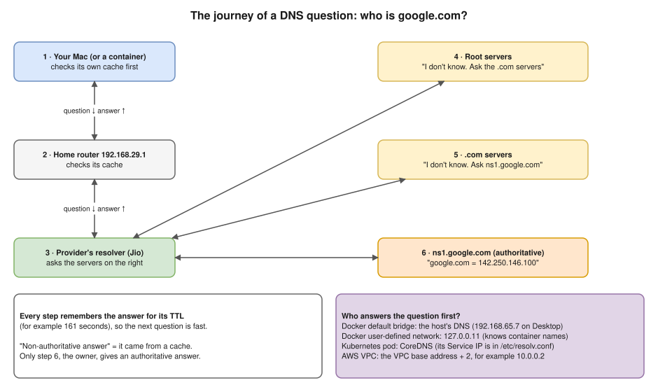
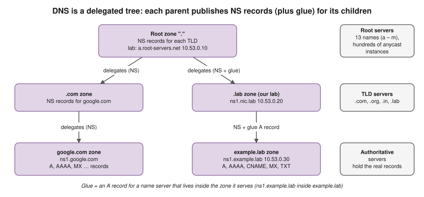
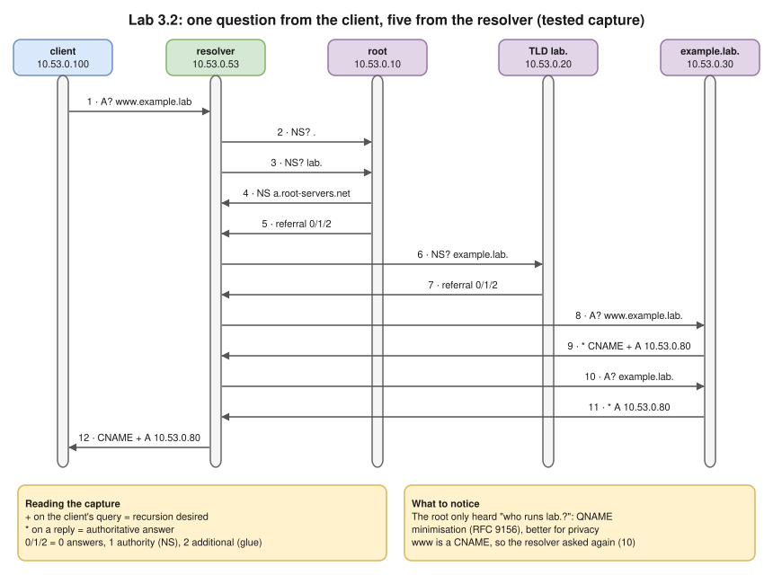
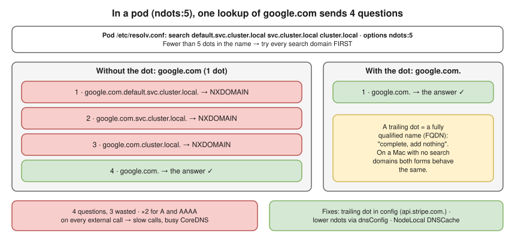

# 3.4 · DNS: How Names Become Addresses ⭐

> **Level 3 · Core networking protocols** · Lesson 4 of 11 · ⏱️ about 2 hours (estimate) · 🧪 [Lab 3.2](../13-hands-on-labs/lab-03.2-trace-dns-resolution.md)
> ⬅️ [3.3 TCP in depth](03-tcp-in-depth.md) · ➡️ [3.5 HTTP and HTTPS](05-http-and-https.md)



- **DNS** turns a name into an IP address. No single server knows every name: it's a **tree**, and a **recursive resolver** walks it for you and **caches** the answers for their **TTL**.
- Your question to the resolver is **recursive** ("get me the final answer"); the resolver's questions to root, TLD and authoritative servers are **iterative** ("tell me what you know, or who to ask next").
- ⭐ When DNS breaks, **everything** looks broken: stale caches, wrong search domains, blocked port 53, missing records. Kubernetes service discovery, AWS private endpoints and Route 53 failover all **are** DNS.
- DNS uses **UDP 53**, and **TCP 53** for big answers and zone transfers ([3.2](02-tcp-and-udp.md)).
- In pods, **`ndots:5`** turns one external lookup into four questions ([below](#the-trailing-dot-and-the-ndots5-trap-)).

## The cast and the tree



| Part | What it does | Examples |
|---|---|---|
| **Stub resolver** | The small client inside your OS. Reads `/etc/hosts` and `/etc/resolv.conf`, sends the question to a resolver, waits | glibc on Linux, `mDNSResponder` on macOS |
| **Recursive resolver** | Does the real work: walks the tree, follows referrals, **caches** answers | Your router / provider, `8.8.8.8`, `1.1.1.1`, the AWS VPC resolver, CoreDNS (as a forwarder) |
| **Root / TLD servers** | Know only who runs each TLD / each domain inside their TLD | `a.root-servers.net` … `m.root-servers.net`; the `.com`, `.org`, `.in` servers |
| **Authoritative server** | Holds the real records for a **zone** and answers with authority | `ns1.google.com`, Route 53 hosted zones |

## Watching a resolver work (tested)



[Lab 3.2](../13-hands-on-labs/lab-03.2-trace-dns-resolution.md): an offline BIND tree in network namespaces, an empty resolver cache, one query for `www.example.lab`. Everything the resolver sent and received **(tested in the lab container)**:

```text
10.53.0.100.45837 > 10.53.0.53.53: 15623+ [1au] A? www.example.lab. (56)                  ← client → resolver
10.53.0.53.44561 > 10.53.0.10.53: 31278 [1au] NS? . (40)                                 ← resolver checks the root
10.53.0.53.49318 > 10.53.0.10.53: 46229% [1au] NS? lab. (44)                             ← "who runs lab.?"
10.53.0.10.53 > 10.53.0.53.44561: 31278*- 1/0/1 NS a.root-servers.net. (87)
10.53.0.10.53 > 10.53.0.53.49318: 46229- 0/1/2 (101)                                     ← referral: 0 answers, 1 NS, 2 extra
10.53.0.53.37337 > 10.53.0.20.53: 14181% [1au] NS? example.lab. (52)                     ← TLD: "who runs example.lab.?"
10.53.0.20.53 > 10.53.0.53.37337: 14181- 0/1/2 (102)                                     ← referral again
10.53.0.53.41680 > 10.53.0.30.53: 4659% [1au] A? www.example.lab. (56)                   ← finally, the owner
10.53.0.30.53 > 10.53.0.53.41680: 4659*- 2/1/2 CNAME example.lab., A 10.53.0.80 (136)    ← * = authoritative answer
10.53.0.53.34804 > 10.53.0.30.53: 45317% [1au] A? example.lab. (68)
10.53.0.30.53 > 10.53.0.53.34804: 45317*- 1/1/2 A 10.53.0.80 (118)
10.53.0.53.53 > 10.53.0.100.45837: 15623 2/0/1 CNAME example.lab., A 10.53.0.80 (102)    ← resolver → client
```

`dig +trace` does the same walk from the client itself **(tested in the lab container)**. On a real machine, `dig +trace google.com` shows the same steps against the real root and `.com` servers **(tested on the Mac, Oct 2026)**.

```console
$ dig +trace www.example.lab
.			86385	IN	NS	a.root-servers.net.
;; Received 87 bytes from 10.53.0.53#53(10.53.0.53) in 4 ms
lab.			86400	IN	NS	ns1.nic.lab.
;; Received 116 bytes from 10.53.0.10#53(a.root-servers.net) in 0 ms
example.lab.		86400	IN	NS	ns1.example.lab.
;; Received 106 bytes from 10.53.0.20#53(ns1.nic.lab) in 0 ms
www.example.lab.	300	IN	CNAME	example.lab.
example.lab.		300	IN	A	10.53.0.80
example.lab.		300	IN	NS	ns1.example.lab.
;; Received 136 bytes from 10.53.0.30#53(ns1.example.lab) in 0 ms
```

## Reading `dig` output (tested)

```console
$ dig www.example.lab
;; ->>HEADER<<- opcode: QUERY, status: NOERROR, id: 15623
;; flags: qr rd ra; QUERY: 1, ANSWER: 2, AUTHORITY: 0, ADDITIONAL: 1

;; QUESTION SECTION:
;www.example.lab.		IN	A

;; ANSWER SECTION:
www.example.lab.	300	IN	CNAME	example.lab.
example.lab.		300	IN	A	10.53.0.80

;; Query time: 4 msec
;; SERVER: 10.53.0.53#53(10.53.0.53) (UDP)
```

**(tested in the lab container; EDNS/cookie lines trimmed)**

| Part | Meaning |
|---|---|
| `status: NOERROR` | The name exists. Others: **`NXDOMAIN`** (no such name), **`SERVFAIL`** (the resolver couldn't get an answer), `REFUSED` (the server won't answer you) |
| `flags: qr` | This is a **response** |
| `rd` / `ra` | **Recursion desired** (the client asked for the full lookup) / **recursion available** (this server is a recursive resolver) |
| `aa` (absent here) | **Authoritative answer**: only set when the zone's own server answers |
| `300` · `IN` | **TTL** in seconds · Internet class (always, in practice) |
| `SERVER: … (UDP)` | Who answered, over which transport |

## Authoritative vs non-authoritative

- **Authoritative** = the **owner** of the name answers (for google.com, `ns1.google.com`). **Non-authoritative** = an answer **from a cache**: normal, and what you almost always get.
- Ask the owner directly and **`aa`** appears; ask the **root** and you get a **referral**: no `aa`, no answer, just "ask `ns1.nic.lab` at `10.53.0.20`" **(tested in the lab container)**:

```console
$ dig @10.53.0.30 www.example.lab +norecurse
;; ->>HEADER<<- opcode: QUERY, status: NOERROR, id: 1277
;; flags: qr aa; QUERY: 1, ANSWER: 2, AUTHORITY: 1, ADDITIONAL: 2
$ dig @10.53.0.10 www.example.lab +norecurse
;; flags: qr; QUERY: 1, ANSWER: 0, AUTHORITY: 1, ADDITIONAL: 2
;; AUTHORITY SECTION:
lab.			86400	IN	NS	ns1.nic.lab.
;; ADDITIONAL SECTION:
ns1.nic.lab.		86400	IN	A	10.53.0.20
```

- On the Mac, ask the owner with `nslookup` and the "Non-authoritative answer" line disappears **(tested on the Mac, Oct 2026)**:

```bash
nslookup google.com ns1.google.com
```

## `nslookup` on the Mac (tested)

`nslookup` = **n**ame **s**erver **lookup** **(tested on the Mac, Oct 2026)**:

```
nslookup google.com
Server:		2405:201:1006:e906::c0a8:1d01
Address:	2405:201:1006:e906::c0a8:1d01#53

Non-authoritative answer:
Name:	google.com
Address: 142.250.146.100
Name:	google.com
Address: 142.250.146.113
...
```

- `Server:` = **who you asked**: the home router. `c0a8:1d01` is hex for `192.168.29.1`, its IPv4 address ([2.1](../02-ip-addressing-and-subnetting/01-binary-decimal-and-hex.md)); the Mac has both set as DNS servers **(tested: `scutil --dns`)**. `#53` = port 53.
- **IPv6 question, IPv4 answer:** the server's address is how your question travelled; the `A` records are what you asked for (the default).
- **Several addresses:** google.com is thousands of servers. The Mac uses the first and tries the next if it fails. Servers shuffle the order between runs (**round robin**) to spread clients.
- **They change over time** (Google picks addresses near you): a minute later the answer was a single `172.217.160.78`; on 7 Oct `142.250.146.x`, on 8 Oct `192.178.193.x`. A reverse lookup of `192.178.193.101` gives `ly-in-f101.1e100.net`, and `1e100.net` is Google's own domain **(tested on the Mac, Oct 2026)**.

## Record types

| Record | Meaning | Example |
|---|---|---|
| **A** | Name → **IPv4** | `google.com → 142.250.146.100` |
| **AAAA** | Name → **IPv6** | `google.com → 2404:6800:4000:100e::65` **(tested on the Mac)** |
| **CNAME** | Name → **another name** (a nickname) | `www.shop.com → shop.com` |
| **MX** | Where to deliver **email** (with a priority; lower first) | `gmail.com → gmail-smtp-in.l.google.com` |
| **NS** | Which servers are **authoritative** for a domain | `google.com → ns1.google.com` |
| **SOA** | Start of authority: the zone's primary server, serial number and timers (including how long to cache "no such name") | Seen in every NXDOMAIN answer |
| **TXT** | Free text: domain verification, SPF for email | `"v=spf1 include:_spf.google.com ~all"` |
| **PTR** | **Reverse:** IP → name | `dig -x 8.8.8.8 +short` → `dns.google.` **(tested on the Mac)** |
| **SRV** | Service location: host **and port** for a service | Used by Kubernetes for named ports, and by LDAP/SIP |
| **CAA** | Which certificate authorities may issue certificates for the domain | `0 issue "letsencrypt.org"` |
| **Alias** (Route 53 only) | Like a CNAME, but allowed at the **zone apex** (`shop.com` itself), pointing at an ALB, CloudFront, etc. | `shop.com → my-alb-123.us-west-1.elb.amazonaws.com` |

- A CNAME **can't** be at the zone apex (it can't coexist with the zone's SOA and NS records): use a Route 53 **Alias** or an A record.
- A reverse lookup turns `10.53.0.80` into `80.0.53.10.in-addr.arpa.` (octets reversed), delegated like any other zone.

The lab zone **(tested in the lab container)**:

```console
$ dig example.lab A +noall +answer     # and the same for AAAA, MX, TXT
example.lab.		285	IN	A	10.53.0.80
example.lab.		300	IN	AAAA	fd00:53::80
example.lab.		300	IN	MX	10 mail.example.lab.
example.lab.		300	IN	TXT	"v=spf1 mx -all"
$ dig api.example.lab +noall +answer   # two A records: simple load spreading
api.example.lab.	300	IN	A	10.53.0.81
api.example.lab.	300	IN	A	10.53.0.82
$ dig -x 10.53.0.80 +noall +answer     # reverse lookup lives under in-addr.arpa
80.0.53.10.in-addr.arpa. 300	IN	PTR	example.lab.
```

## TTL and caching

The number after the name is the **TTL**: on the Mac, `google.com.   161   IN   A   172.217.160.78` may be cached 161 more seconds **(tested on the Mac, Oct 2026)**. Lab zone TTL 300: asked again 8 s later, the resolver returns the **cached** answer, TTL counting down **(tested in the lab container)**:

```text
www.example.lab.	292	IN	CNAME	example.lab.
example.lab.		292	IN	A	10.53.0.80
```

- 🎯 **"I changed a record, but some users still reach the old server."** → Their resolvers cached the old answer until its **TTL** runs out. Before a planned migration, **lower the TTL** (say to 60 s) a day ahead; raise it again afterwards.
- **Negative caching:** "no such name" is cached too, for the time in the zone's **SOA** (its last field, here 60 s). So querying a record **before** creating it can keep clients on NXDOMAIN after you add it. The NXDOMAIN, and the same question 13 s later (TTL 47) **(tested in the lab container)**:

```console
$ dig nope.example.lab
;; ->>HEADER<<- opcode: QUERY, status: NXDOMAIN, id: 39368
;; AUTHORITY SECTION:
example.lab.		60	IN	SOA	ns1.example.lab. admin.example.lab. 2026101401 3600 600 86400 60
$ dig nope.example.lab +noall +authority      # asked again later
example.lab.		47	IN	SOA	ns1.example.lab. admin.example.lab. 2026101401 3600 600 86400 60
```

- **A warm cache hides outages:** with the authoritative server **stopped**, the resolver still answered from its cache (`status: NOERROR`, TTL 271). Only after the cache was emptied did the same question fail with **`SERVFAIL`** **(tested in the lab container)**.

## UDP or TCP

- **UDP 53** for normal questions; **TCP 53** when an answer is too big (the server sets the TC "truncated" flag) and for zone transfers. Resolvers advertise the UDP size they accept with **EDNS** (`udp: 1232` in `dig` output). `dig +tcp` forces TCP **(tested in the lab container)**:

```text
example.lab.		285	IN	A	10.53.0.80
;; SERVER: 10.53.0.53#53(10.53.0.53) (TCP)
```

- **Encrypted DNS:** DNS over TLS (**DoT**, TCP 853) and DNS over HTTPS (**DoH**, 443) hide queries from the network; browsers can use DoH independently of the OS. **DNSSEC** signs answers so they can't be forged ([Level 6](../06-network-security/README.md)).

## `/etc/hosts`, search domains, and why tools disagree

| Tool | Uses `/etc/hosts` and search domains? | Use it to |
|---|---|---|
| `getent hosts db` (Linux) | ✅ Yes, like a real app does | See what **your app** will get |
| `nslookup` / `dig` | ❌ No, they ask a DNS server directly | Test **the DNS server** itself |

The lab client has `search example.lab`: the short name `api` resolves for an application, but `dig` doesn't add the search domain unless told to **(tested in the lab container)**:

```console
$ getent hosts api
10.53.0.82      api.example.lab
10.53.0.81      api.example.lab
$ dig api +noall +comments | grep status
;; ->>HEADER<<- opcode: QUERY, status: NXDOMAIN, id: 63631
$ dig api +search +noall +answer
api.example.lab.	300	IN	A	10.53.0.82
api.example.lab.	300	IN	A	10.53.0.81
```

## DNS inside Docker

| Where the container runs | DNS server in `/etc/resolv.conf` | Finds other containers by name? |
|---|---|---|
| **Default bridge** | `192.168.65.7` on Docker Desktop (the host's DNS servers on Linux) | ❌ No |
| **User-defined network** | **`127.0.0.11`**: Docker's built-in DNS server, which knows container names and forwards everything else | ✅ Yes |

**(tested on the Mac with Docker Desktop, Oct 2026)**. A failed lookup inside a container **(tested on the Mac)**:

```
** server can't find doesnotexist.invalid: NXDOMAIN
```

## DNS inside Kubernetes ⭐

- **CoreDNS** runs in `kube-system` behind a Service called **`kube-dns`**; every pod's `/etc/resolv.conf` points at its ClusterIP (e.g. `nameserver 10.96.0.10`).
- **Service names:** `<service>.<namespace>.svc.cluster.local` → the ClusterIP. In the same namespace just `<service>` works, thanks to the **search domains**.
- **Headless Service** (`clusterIP: None`) returns the **pod IPs**. StatefulSet pods get stable names: `<pod>.<service>.<namespace>.svc.cluster.local`.

### The trailing dot and the `ndots:5` trap ⭐



- `google.com.` (trailing dot) is a **fully qualified domain name (FQDN)**: the dot is the root of the tree, "complete, add nothing". Without it the resolver may try the **search domains** first.
- **On the Mac, no difference:** `nslookup google.com` and `nslookup google.com.` returned the same 6 addresses (order changed); `scutil --dns` shows **no search domains** **(tested on the Mac, Oct 2026)**.
- **In a pod** the diagram's counts come from a container with a pod's `search` and `ndots:5`, recording every question for **one** lookup **(tested on the Mac with Docker Desktop, Oct 2026)**.
- Real apps ask for A **and** AAAA, so the waste doubles on **every external call**: slower external calls, overloaded CoreDNS, and on EKS the VPC resolver's packet limit (below).
- **Fixes:** a **trailing dot** in config (`api.stripe.com.`); a lower `ndots` for the pod with `dnsConfig`; **NodeLocal DNSCache** (a DNS cache on every node, so repeated questions never leave the node).

```yaml
spec:
  dnsConfig:
    options:
      - name: ndots
        value: "2"
```

**Try it yourself:**

```bash
docker run --rm --dns 8.8.8.8 --dns-search default.svc.cluster.local --dns-search svc.cluster.local --dns-search cluster.local --dns-option ndots:5 nicolaka/netshoot sh -c 'timeout 5 tcpdump -i eth0 -nn -l udp port 53 2>/dev/null > /tmp/q.txt & sleep 1; getent hosts google.com; sleep 3; grep -oE " A{1,4}\? [^ ]+" /tmp/q.txt'
```

- It lists the questions sent for `google.com`. Change it to `google.com.` and only `google.com.` is asked. The list may appear twice: `getent` repeats the lookup, so count one round.
- `--dns 8.8.8.8` is needed on a Mac because Docker Desktop's DNS server (`192.168.65.7`) **never answers** `.cluster.local` questions, so the lookup just hangs **(tested on the Mac)**. CoreDNS in a real cluster answers NXDomain straight away.
- **On EKS:** each network interface can send at most **1024 packets per second** to the VPC DNS resolver. Very chatty clusters hit this and see random DNS failures; NodeLocal DNSCache helps here too.

## DNS on AWS

| Piece | What to know |
|---|---|
| **Route 53** | AWS's DNS service and the **authoritative** owner of your domains: a **public hosted zone** answers the internet; a **private hosted zone** answers only inside the VPCs you attach it to |
| **VPC resolver** | At the **VPC base address + 2** (e.g. `10.0.0.2`), also at `169.254.169.253`. Needs `enableDnsSupport`; private hosted zones also need `enableDnsHostnames` |
| **Interface endpoints** | (e.g. for ECR) rely on **private DNS**, so the normal service name resolves to the endpoint's private IP ([scenario deep dives](../../hemant-scenario-deep-dives.md), B10) |
| **Resolver endpoints** | Inbound and outbound: connect VPC DNS with on-premises DNS |
| **Routing policies** | Weighted, latency, failover, geolocation: Route 53 answers differently per client or per health check (DNS as a traffic manager) |

## Try it

**On your Mac:**

```bash
nslookup google.com
nslookup -type=AAAA google.com
nslookup google.com ns1.google.com      # ask the owner: no "Non-authoritative answer"
nslookup google.com                     # run twice: same addresses, different order
nslookup google.com.
dig -x 192.178.193.101 +short           # who owns an address (reverse lookup)
dig google.com +noall +answer           # the TTL
dig +trace google.com                   # walk the tree yourself
scutil --dns | grep nameserver          # which resolvers your Mac uses
docker run --rm alpine cat /etc/resolv.conf
```

**On Linux:**

```bash
cat /etc/resolv.conf
getent hosts example.com                # what an application gets
dig example.com                         # what the DNS server says
dig @1.1.1.1 example.com +short         # ask a specific resolver
resolvectl status                       # on systemd-resolved hosts
```

## Troubleshooting

| You see | It means | Next step |
|---|---|---|
| `Could not resolve host` / `bad address` | The name didn't resolve | `nslookup`, `/etc/resolv.conf` |
| `NXDOMAIN` | The name **doesn't exist** (typo, wrong namespace, record missing, or a cached negative answer) | Spelling, the FQDN, the record in Route 53 |
| `SERVFAIL` | The resolver **failed** to get an answer (authoritative server down or unreachable, DNSSEC failure) | Query the authoritative server directly: `dig @ns1… name` |
| `communications error … connection refused` | The resolver host answered, but **nothing listens** on port 53 | Is the DNS service running on that address? |
| `communications error … timed out` / `no servers could be reached` | DNS packets are dropped | Kubernetes NetworkPolicy blocking egress to kube-dns on **UDP and TCP 53**; a security group or NACL. Never block TCP 53 |
| Old IP returned | Caching | The TTL (lower it a day **before** a migration); flush your Mac's cache: `sudo dscacheutil -flushcache; sudo killall -HUP mDNSResponder` |
| `dig` works but the app fails (or the reverse) | `/etc/hosts` or search domains differ | Compare with `getent hosts` |
| Pods slow on external names | `ndots:5` search list | Trailing dot, or lower `ndots` |

The lab's failure messages **(tested in the lab container)**:

```console
$ dig www.example.lab          # authoritative server stopped, resolver cache empty
;; ->>HEADER<<- opcode: QUERY, status: SERVFAIL, id: 441
$ dig www.example.lab          # resolver process stopped
;; communications error to 10.53.0.53#53: connection refused
;; no servers could be reached
$ dig www.example.lab          # UDP 53 dropped by a firewall: 3 tries × 5 s = 15 s
;; communications error to 10.53.0.53#53: timed out
;; no servers could be reached
$ curl http://www.example.lab/
curl: (6) Could not resolve host: www.example.lab
```

## Interview angle

- ⭐ **"What happens when you type google.com in the browser?"** → The browser/OS cache, then the resolver (router → provider), then root → `.com` → Google's authoritative server. The IP comes back and is cached for the TTL. Then a TCP connection to port 443, TLS, and the HTTP request ([3.10](10-packet-flow-end-to-end.md)).
- **"What does 'non-authoritative' mean?"** → The answer came from a cache, not from the domain's own name server.
- **"Recursive vs iterative queries?"** → The client asks the resolver recursively ("give me the final answer"); the resolver asks root, TLD and authoritative servers iteratively (each gives an answer or a referral).
- ⭐ **"Pods can't resolve anything. How do you debug?"** →
  1. `kubectl exec <pod> -- cat /etc/resolv.conf`
  2. Test from a debug pod: `nslookup kubernetes.default`
  3. Check the CoreDNS pods and logs
  4. Look for a NetworkPolicy that blocks port 53
  - **He'll push: "Only external names fail?"** → CoreDNS can't reach its upstream (the VPC resolver), or the `ndots` search list is slowing things down.
- **"Why can't my containers find each other by name?"** → They're on the **default bridge**, which doesn't use Docker's DNS at `127.0.0.11`. Use a user-defined network (Compose creates one).
- **"CNAME at the zone apex?"** → Not allowed. Use a Route 53 **Alias** record.
- **"NXDOMAIN vs SERVFAIL?"** → NXDOMAIN: the authoritative server says the name doesn't exist. SERVFAIL: the resolver couldn't get any answer.
- ⭐ **"What's the difference between `google.com` and `google.com.`?"** → The trailing dot makes the name fully qualified, so no search domains are added. On a laptop with no search domains they behave the same. In a pod, `ndots:5` turns `google.com` into 3 wrong lookups before the real one: I measured 4 questions instead of 1.
  - **He'll push: "How do you fix it cluster-wide?"** → NodeLocal DNSCache on every node, plus a lower `ndots` (via `dnsConfig`) for chatty workloads.

## Check yourself

1. Name the four kinds of DNS server a lookup for `www.example.com` can touch, in order, starting from a cold cache.
2. In `dig` output you see `flags: qr aa rd`. Who answered?
3. A record has TTL 3600. You change it. What's the longest a client might keep using the old value?
4. `dig api` returns NXDOMAIN, but `curl http://api/` works on the same machine. Why?
5. A pod resolves `my-svc` fine but `api.github.com` is slow. What's the likely cause, and two fixes?
6. Which ports and protocols must a firewall allow for DNS?

<details>
<summary><b>Answers</b> (try first)</summary>

1. Recursive **resolver** → **root** → **TLD** (`.com`) → **authoritative** (`example.com`'s name servers). (Plus the stub resolver on the client.)
2. The **authoritative** server for that zone (`aa`), and recursion was desired (`rd`) but not offered (no `ra`).
3. Up to **3600 seconds** (one hour) after its resolver cached it, plus any extra caching in the app or OS.
4. `curl` uses the system resolver, which applies the **search domains** (or `/etc/hosts`); `dig` sends the bare name.
5. **`ndots:5`**: the search domains are tried first, giving 3 wasted lookups (×2 for A and AAAA). Fixes: a trailing dot (`api.github.com.`), lower `ndots` with `dnsConfig`, NodeLocal DNSCache.
6. **UDP 53 and TCP 53** (plus 853/443 if you use DoT/DoH).

</details>

➡️ **Next:** [3.5 · HTTP and HTTPS](05-http-and-https.md): what actually travels inside the TCP connection once the name is resolved.
