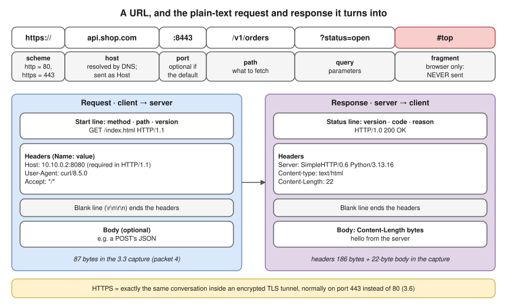
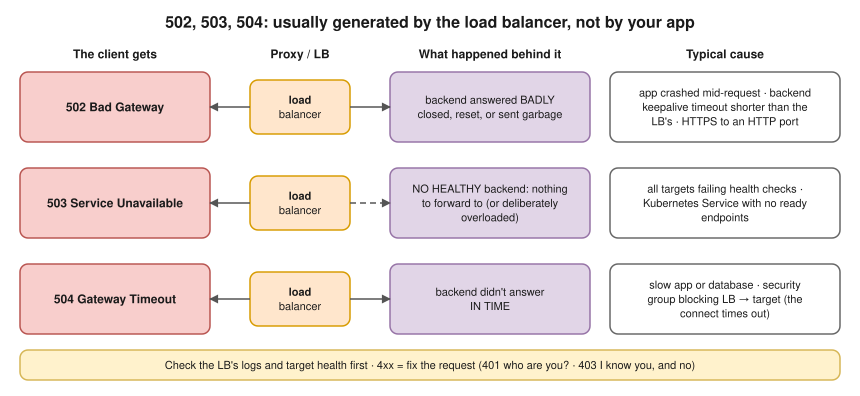
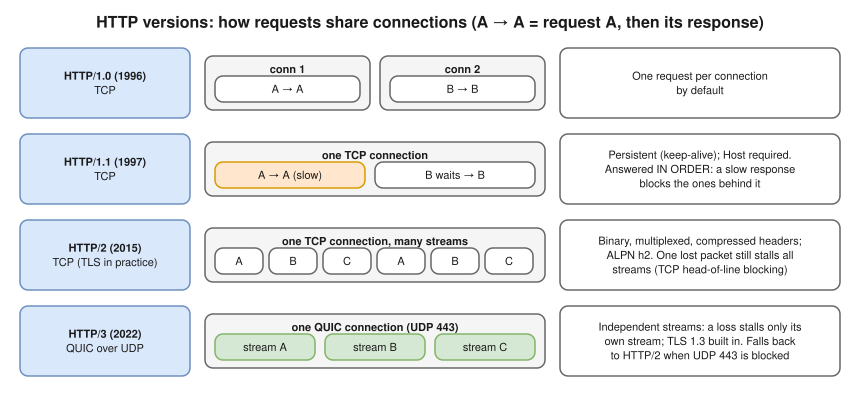

# 3.5 · HTTP and HTTPS

> **Level 3 · Core networking protocols** · Lesson 5 of 11 · ⏱️ about 90 minutes (estimate) · 🧪 [Lab 3.1](../13-hands-on-labs/lab-03.1-capture-a-tcp-handshake.md) (part F; HTTPS in [Lab 3.3](../13-hands-on-labs/lab-03.3-tls-certificates-and-handshake.md))
> ⬅️ [3.4 DNS](04-dns.md) · ➡️ [3.6 TLS and certificates](06-tls-and-certificates.md)



- HTTP is a **conversation in plain text**: a **request** (method, path, headers, body) and a **response** (status, headers, body). Every web page, REST API, Kubernetes API call and container image pull is this conversation.
- **HTTPS** = the same conversation inside a **TLS** tunnel ([3.6](06-tls-and-certificates.md)), normally on port 443 instead of 80. HTTP/1.1 and HTTP/2 run inside a TCP connection ([3.3](03-tcp-in-depth.md)); the host is resolved by DNS first ([3.4](04-dns.md)).
- ⭐ **502 / 503 / 504** are usually generated by the **load balancer or proxy**, not by your app. 4xx = the client's fault; 5xx = the server side.
- Retries are only safe for **idempotent** methods; getting this wrong charges a customer twice.
- Load balancers, ingress controllers, API gateways and CDNs all **speak HTTP** and decide on its headers.

## A request and a response on the wire (tested)

HTTP/1.x is plain text, so you can type it by hand. A request with `nc` to Python's `http.server` in [Lab 3.1](../13-hands-on-labs/lab-03.1-capture-a-tcp-handshake.md)'s namespaces **(tested in the lab container)**:

```console
$ printf 'GET /index.html HTTP/1.1\r\nHost: 10.10.0.2\r\nConnection: close\r\n\r\n' | nc -w 2 10.10.0.2 8080
HTTP/1.0 200 OK
Server: SimpleHTTP/0.6 Python/3.13.16
Date: Wed, 14 Oct 2026 19:45:27 GMT
Content-type: text/html
Content-Length: 22
Last-Modified: Wed, 14 Oct 2026 19:44:34 GMT

hello from the server
```

The same exchange through `curl -v` (`>` = sent, `<` = received) **(tested in the lab container; progress meter trimmed)**:

```text
*   Trying 10.10.0.2:8080...
* Connected to 10.10.0.2 (10.10.0.2) port 8080
> GET /index.html HTTP/1.1
> Host: 10.10.0.2:8080
> User-Agent: curl/8.5.0
> Accept: */*
>
* HTTP 1.0, assume close after body
< HTTP/1.0 200 OK
< Server: SimpleHTTP/0.6 Python/3.13.16
< Date: Wed, 14 Oct 2026 19:45:27 GMT
< Content-type: text/html
< Content-Length: 22
< Last-Modified: Wed, 14 Oct 2026 19:44:34 GMT
<
* Closing connection
hello from the server
```

## Methods

| Method | Purpose | Safe? (no change) | Idempotent? (repeat = same result) |
|---|---|---|---|
| **GET** | Read a resource | ✅ | ✅ |
| **HEAD** | Like GET, headers only | ✅ | ✅ |
| **OPTIONS** | Which methods are allowed (CORS preflight) | ✅ | ✅ |
| **POST** | Create / submit / "do something" | ❌ | ❌ |
| **PUT** | Replace a resource completely | ❌ | ✅ |
| **PATCH** | Change part of a resource | ❌ | Not necessarily |
| **DELETE** | Remove a resource | ❌ | ✅ |

- Proxies, load balancers and client libraries may **retry** after a timeout. Retrying GET or PUT is harmless; retrying a POST can create a second order. APIs use **idempotency keys** to make POST retries safe.

`HEAD` and two error cases against the lab server (`501 Not Implemented`: Python's simple server doesn't support POST at all) **(tested in the lab container)**:

```console
$ curl -sSI http://10.10.0.2:8080/index.html
HTTP/1.0 200 OK
Server: SimpleHTTP/0.6 Python/3.13.16
...
Content-Length: 22
$ curl -s -o /dev/null -w '%{http_code}\n' http://10.10.0.2:8080/nope
404
$ curl -s -X POST -d 'a=1' -o /dev/null -w '%{http_code}\n' http://10.10.0.2:8080/
501
```

## Status codes

| Class | Meaning | Ones to know |
|---|---|---|
| **1xx** | Informational | `101 Switching Protocols` (WebSocket upgrade) |
| **2xx** | Success | `200 OK`, `201 Created`, `204 No Content` |
| **3xx** | Redirect / use cache | `301`/`308` moved permanently, `302`/`307` temporary, `304 Not Modified` (your cached copy is fine) |
| **4xx** | **Client** error: fix the request | `400` bad request, **`401`** not authenticated, **`403`** authenticated but not allowed, `404` not found, `405` method not allowed, `408` request timeout, **`429`** too many requests (rate limited) |
| **5xx** | **Server** error | `500` app crashed, `501` not implemented, **`502`**, **`503`**, **`504`** (below) |



## Headers worth knowing

| Header | Direction | Why it matters |
|---|---|---|
| `Host` | Request | **Required in HTTP/1.1.** Lets one IP host many sites; ingress controllers and ALBs route on it. (HTTP/2 uses `:authority`) |
| `Content-Type` / `Content-Length` | Both | What the body is, and how long. Mismatched length = truncated or hanging responses |
| `Connection: keep-alive` / `close` | Both | Reuse the TCP connection or not (HTTP/1.x) |
| `Cache-Control`, `ETag`, `Last-Modified` | Response | How long caches (browser, CDN) may keep it; `304` revalidation |
| `Location` | Response | Where a `3xx` redirect points |
| `Set-Cookie` / `Cookie` | Response / request | Sessions. HTTP itself is **stateless**; cookies or tokens add state |
| `Authorization` | Request | Credentials (e.g. `Bearer <token>`) |
| `X-Forwarded-For`, `X-Forwarded-Proto` | Request (added by proxies) | The **original client IP** and scheme, because the app only sees the proxy's IP. Trust it only from your own proxies. The standard form is `Forwarded` (RFC 7239) |

## HTTP versions



- HTTP/2 is negotiated with **ALPN** during TLS (`h2`). HTTP/3's built-in TLS 1.3 also makes connection setup faster.

Connection reuse, seen from the client. The lab server speaks HTTP/1.0, so `curl` closes after each request (`HTTP 1.0, assume close after body`, above). A second server configured for HTTP/1.1, asked for two URLs in one `curl` command: one TCP handshake, two requests **(tested in the lab container)**:

```text
* Connected to 10.10.0.2 (10.10.0.2) port 8081
> GET /index.html HTTP/1.1
< HTTP/1.1 200 OK
* Connection #0 to host 10.10.0.2 left intact
* Re-using existing connection with host 10.10.0.2
> GET /index.html HTTP/1.1
< HTTP/1.1 200 OK
* Connection #0 to host 10.10.0.2 left intact
```

## Timing a request phase by phase

`curl -w` prints how long each phase took (cumulative seconds from the start) **(tested in the lab container, two namespaces on one machine, so everything is tiny)**:

```console
$ curl -s -o /dev/null -w 'dns=%{time_namelookup} connect=%{time_connect} ttfb=%{time_starttransfer} total=%{time_total}\n' http://10.10.0.2:8080/index.html
dns=0.000019 connect=0.000162 ttfb=0.001369 total=0.001414
```

| Phase | Large value means |
|---|---|
| `time_namelookup` | Slow DNS |
| `time_connect` − namelookup | Network RTT / SYN retries |
| `time_appconnect` (HTTPS only) | TLS handshake cost |
| `time_starttransfer` (TTFB) − connect | **Server think time**: the app or database is slow |
| `time_total` − starttransfer | Transfer: big body or slow link |

## Where you meet it

| Where | What to know |
|---|---|
| AWS ALB / NLB | ALB is HTTP-aware (L7): routes on host and path, terminates TLS, adds `X-Forwarded-For`, and generates 502/503/504 itself. **NLB** works at L4 and doesn't look at HTTP at all (client IP via the PROXY protocol or client IP preservation) |
| Kubernetes Ingress / Gateway API | An ingress controller (NGINX, ALB controller, Envoy) routes by `Host` and path to Services |
| Health checks | Usually an HTTP GET to a path like `/healthz`; a target is "healthy" only if it returns the expected status code |
| Container registries | HTTP APIs: `docker pull` is a series of GETs with `Authorization` headers |
| Keepalive mismatch | If a backend closes idle connections **sooner** than the LB does, the LB may send a request on a just-closed connection → sporadic **502s**. Keep the backend's keepalive timeout **longer** than the LB's idle timeout |

## Try it

**On your Mac or Linux:**

```bash
curl -v https://example.com/ -o /dev/null          # request and response headers, TLS info
curl -sSI https://example.com/                      # headers only (HEAD)
curl -sS -o /dev/null -w '%{http_code} %{time_total}\n' https://example.com/
curl -sS -L -o /dev/null -w '%{url_effective}\n' http://github.com   # follow redirects
curl -sS --http2 -o /dev/null -w '%{http_version}\n' https://example.com/
curl -H 'Host: other.site' http://<ip>/             # test name-based routing by IP
```

## Troubleshooting

| You see | It means | Next step |
|---|---|---|
| `curl: (6) Could not resolve host` | DNS | [3.4](04-dns.md) |
| `curl: (7) … Couldn't connect` | Nothing listening, or REJECT | `ss -tlnp` on the server ([3.2](02-tcp-and-udp.md)) |
| `curl: (28) … Timeout` | SYNs dropped / slow server | Is it `time_connect` or TTFB that's slow? |
| `curl: (52) Empty reply from server` / `(56) Recv failure` | Connection closed or reset with no response: app crashed, wrong protocol, app listening only on `127.0.0.1` behind a port publish ([1.3](../01-networking-fundamentals/03-addresses-ports-and-protocols.md)) | App logs; `ss -tlnp` |
| 502 / 503 / 504 from the LB | Generated by the proxy (diagram above), not necessarily an app bug | LB access logs and target health first; backend keepalive; HTTP vs HTTPS to the target; readiness probes; security group from LB to target |
| Wrong site or 404 when testing by IP | No `Host` header for a virtual host | `curl -H 'Host: name' http://ip/` or `curl --resolve name:443:ip https://name/` |
| Redirect loop | HTTP→HTTPS redirect behind a TLS-terminating LB that talks HTTP to the app | Make the app trust `X-Forwarded-Proto` |

## Interview angle

- ⭐ **"What happens when you type a URL?"** → DNS → TCP handshake → TLS handshake → HTTP request with `Host` → response → rendering, with caching at every step ([3.10](10-packet-flow-end-to-end.md)).
- ⭐ **"502 vs 503 vs 504?"** → Bad answer from the backend / no healthy backend / backend too slow. Usually generated by the LB, not the app.
- **"401 vs 403?"** → Not authenticated vs not authorised.
- **"What did HTTP/2 and HTTP/3 change?"** → HTTP/2: binary multiplexing over one TCP connection. HTTP/3: the same over QUIC (UDP), removing TCP head-of-line blocking.
- **"How does the app learn the client's real IP behind a load balancer?"** → `X-Forwarded-For` (ALB), or the PROXY protocol / client IP preservation (NLB).
- **"Which methods are idempotent?"** → GET, HEAD, OPTIONS, PUT, DELETE. Not POST (or necessarily PATCH).

## Check yourself

1. Which part of `https://shop.com/cart?id=7#summary` is never sent to the server?
2. Why must an HTTP/1.1 request contain a `Host` header?
3. A Kubernetes Service has no ready pods. What status code does the ingress likely return?
4. TTFB is 2.8 s, `time_connect` is 0.02 s. Where's the problem?
5. Can a client safely retry a timed-out `PUT /users/42`? A `POST /orders`?

<details>
<summary><b>Answers</b> (try first)</summary>

1. The **fragment** `#summary`.
2. Many sites share one IP address; `Host` tells the server (or ingress) which site is wanted.
3. **503 Service Unavailable**.
4. On the **server side** (application or database): the network connected in 20 ms, but the first byte took 2.8 s.
5. `PUT` is idempotent, so **yes**. `POST` is not, so only with an idempotency key or after checking whether the first attempt succeeded.

</details>

➡️ **Next:** [3.6 · TLS and certificates](06-tls-and-certificates.md): how the "S" in HTTPS works, and how to read every certificate error.
