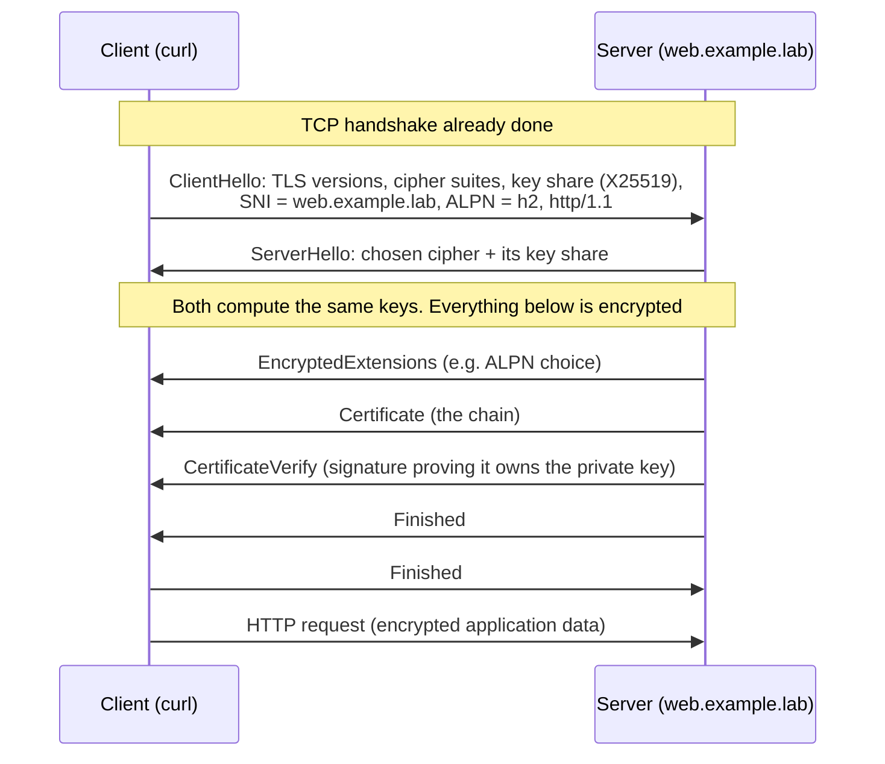
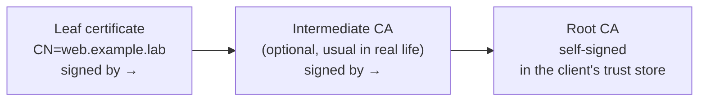

# 3.6 · TLS and Certificates

> **Level 3 · Core networking protocols** · Lesson 6 of 11 · ⏱️ about 2 hours (estimate)
> ⬅️ [3.5 HTTP and HTTPS](05-http-and-https.md) · ➡️ [3.7 ICMP, ping and traceroute](07-icmp-ping-and-traceroute.md)

## What you'll learn

- The three things **TLS** gives you: **encryption**, **integrity** and **authentication**.
- The **TLS 1.3 handshake**, message by message, from a real `curl -v`.
- What's inside a **certificate** (subject, SAN, issuer, validity) and how a **chain of trust** is checked.
- How to make your own CA and server certificate with `openssl`, and reproduce every common certificate **error** (tested).
- **SNI**, **ALPN**, **mTLS**, and where TLS is terminated in real architectures.

## Before you start

- [3.5](05-http-and-https.md): HTTP, and the fact that HTTPS = HTTP inside TLS.
- [3.3](03-tcp-in-depth.md): TLS runs on top of a TCP connection (QUIC builds it in).

---

## The idea in plain words

Imagine sending a letter through many strangers' hands.

- **Encryption**: the letter is in a locked box; strangers can carry it but not read it.
- **Integrity**: if anyone tampers with the box, the receiver notices.
- **Authentication**: before you put anything in the box, you check the receiver's **ID card** (the **certificate**), issued by an authority you trust (a **certificate authority, CA**). Otherwise you might be locking your letter in a box that belongs to an impostor.

TLS (Transport Layer Security; the old name was SSL) does all three. **HTTPS, SMTPS, IMAPS, LDAPS, database connections and the Kubernetes API** all use it.

## Why it matters

- Certificate errors are among the most common production incidents: **expired certificates**, **wrong names**, **missing intermediates**.
- You'll decide where to **terminate** TLS (load balancer, ingress, pod), and whether internal traffic needs **mutual TLS**.
- `openssl s_client` is the tool interviewers expect you to know.

---

## How it works

### Two kinds of cryptography, used together

| | Asymmetric (public key) | Symmetric |
|---|---|---|
| Keys | A **key pair**: public (share freely) + private (never leaves the server) | One shared secret key |
| Speed | Slow | Fast |
| Used in TLS for | **Proving identity** (signatures) and **agreeing on a key** | **Encrypting the actual data** (e.g. AES-GCM, ChaCha20) |

The handshake uses asymmetric crypto to authenticate the server and to agree on fresh symmetric keys with **(EC)DHE** key exchange. Because the keys are ephemeral, recording the traffic and stealing the server's private key **later** still doesn't decrypt it: **forward secrecy**.

### The TLS 1.3 handshake (tested)

`curl -v` to an `openssl s_server` in [Lab 3.3](../13-hands-on-labs/lab-03.3-tls-certificates-and-handshake.md), trusting the lab CA **(tested in the lab container)**:

```text
*   Trying 10.20.0.2:8443...
* ALPN: curl offers h2,http/1.1
* TLSv1.3 (OUT), TLS handshake, Client hello (1):
*  CAfile: ca.crt
* TLSv1.3 (IN), TLS handshake, Server hello (2):
* TLSv1.3 (IN), TLS handshake, Encrypted Extensions (8):
* TLSv1.3 (IN), TLS handshake, Certificate (11):
* TLSv1.3 (IN), TLS handshake, CERT verify (15):
* TLSv1.3 (IN), TLS handshake, Finished (20):
* TLSv1.3 (OUT), TLS change cipher, Change cipher spec (1):
* TLSv1.3 (OUT), TLS handshake, Finished (20):
* SSL connection using TLSv1.3 / TLS_AES_256_GCM_SHA384 / X25519 / RSASSA-PSS
* ALPN: server did not agree on a protocol. Uses default.
* Server certificate:
*  subject: CN=web.example.lab
*  start date: Oct 14 19:45:50 2026 GMT
*  expire date: Oct 21 19:45:50 2026 GMT
*  subjectAltName: host "web.example.lab" matched cert's "web.example.lab"
*  issuer: CN=Lab Root CA
*  SSL certificate verify ok.
```



| Message | Purpose |
|---|---|
| **ClientHello** | "Here's what I support, here's my half of the key exchange, I want `web.example.lab` (**SNI**), I can speak `h2` or `http/1.1` (**ALPN**)" |
| **ServerHello** | "We'll use TLS 1.3 with `TLS_AES_256_GCM_SHA384` and X25519; here's my half" |
| **Certificate** | The server's certificate (and intermediates) |
| **CertificateVerify** | A signature over the handshake with the server's **private key**: proof it really owns the certificate |
| **Finished** (both) | A hash of everything so far, so tampering with any earlier message is detected |

**TLS 1.3 takes one round trip** before data flows (TLS 1.2 took two). The "Change cipher spec" line is a compatibility leftover with no real role in 1.3.

### What an observer can still see (tested)

The capture of that same handshake, decoded with `tshark` **(tested in the lab container)**:

```text
    4   0.003175    10.20.0.1 → 10.20.0.2    TLSv1 583 Client Hello (SNI=web.example.lab)
    6   0.004996    10.20.0.2 → 10.20.0.1    TLSv1.3 1422 Server Hello, Change Cipher Spec, Application Data, Application Data, Application Data, Application Data
    8   0.006426    10.20.0.1 → 10.20.0.2    TLSv1.3 146 Change Cipher Spec, Application Data
```

- The **SNI** (the site name) is visible **in clear text** in the ClientHello. That's how firewalls and proxies filter HTTPS by domain. (**Encrypted Client Hello**, ECH, is the newer extension that hides it.)
- In TLS 1.3 the **certificate is encrypted**: it's inside the "Application Data" records. (In TLS 1.2 it was visible.)
- The IP addresses, ports, timing and sizes are always visible.

### Certificates

A certificate (X.509) binds a **public key** to **names**, signed by an **issuer**. The fields that matter:

| Field | In the lab certificate | Checked how |
|---|---|---|
| **Subject** | `CN=web.example.lab` | Informational today |
| **Subject Alternative Name (SAN)** | `DNS:web.example.lab` | ⭐ The hostname you connect to **must** match a SAN entry (browsers ignore the CN) |
| **Issuer** | `CN=Lab Root CA` | Must lead to a CA in the client's **trust store** |
| **Validity** | `notBefore` / `notAfter` (7 days here) | The client's clock must be inside the window |
| **Public key** | RSA 2048 | Used to verify `CertificateVerify` |
| **Key usage / extended key usage** | (server authentication) | Must allow the use |

### The chain of trust



The client checks each signature up the chain until it reaches a root it already trusts (the OS or browser **trust store**, `/etc/ssl/certs` on Linux, Keychain on macOS). Servers must send the **leaf and the intermediates**; the root isn't sent (the client must already have it). Forgetting the intermediate is a classic bug: browsers sometimes cope (they cache intermediates), `curl` and APIs fail.

Building a mini PKI by hand **(tested in the lab container, OpenSSL 3)**:

```console
$ openssl req -x509 -newkey rsa:2048 -nodes -keyout ca.key -out ca.crt -days 30 -subj "/CN=Lab Root CA"
$ openssl req -newkey rsa:2048 -nodes -keyout server.key -out server.csr -subj "/CN=web.example.lab" -addext "subjectAltName=DNS:web.example.lab"
$ openssl x509 -req -in server.csr -CA ca.crt -CAkey ca.key -CAcreateserial -out server.crt -days 7 -copy_extensions copy
Certificate request self-signature ok
subject=CN = web.example.lab
$ openssl x509 -in server.crt -noout -subject -issuer -ext subjectAltName
subject=CN = web.example.lab
issuer=CN = Lab Root CA
X509v3 Subject Alternative Name:
    DNS:web.example.lab
$ openssl verify -CAfile ca.crt server.crt
server.crt: OK
```

The **CSR** (certificate signing request) carries the public key and requested names; the CA signs it. The private key **never leaves** the server.

### Every common error, reproduced (tested)

All from [Lab 3.3](../13-hands-on-labs/lab-03.3-tls-certificates-and-handshake.md) **(tested in the lab container)**:

| Situation | `curl` says |
|---|---|
| The client doesn't trust the issuing CA (self-signed or private CA) | `curl: (60) SSL certificate problem: unable to get local issuer certificate` |
| Connecting by **IP**, but the certificate only has a DNS name | `curl: (60) SSL: no alternative certificate subject name matches target host name '10.20.0.2'` |
| Connecting with a **different name** | `curl: (60) SSL: no alternative certificate subject name matches target host name 'other.example.lab'` |
| Certificate past its `notAfter` | `curl: (60) SSL certificate problem: certificate has expired` |
| `-k` / `--insecure`: skip all checks | `200`: it "works", and anyone in the middle could be impersonating the server |

`openssl s_client` shows the same verification **(tested in the lab container)**:

```console
$ echo | openssl s_client -connect web.example.lab:8443 -servername web.example.lab -CAfile ca.crt 2>/dev/null | grep -E 'subject=|issuer=|Cipher is|Verify return'
subject=CN = web.example.lab
issuer=CN = Lab Root CA
New, TLSv1.3, Cipher is TLS_AES_256_GCM_SHA384
Verify return code: 0 (ok)
```

### SNI, ALPN and mutual TLS

- **SNI** (Server Name Indication): the client names the site in the ClientHello, so one IP can serve many certificates. A missing or wrong SNI gets the **default** certificate → name mismatch. Always pass `-servername` to `s_client`.
- **ALPN**: the client and server agree on the application protocol (`h2`, `http/1.1`) during the handshake. The lab's `s_server` didn't pick one, so curl used HTTP/1.1.
- **Mutual TLS (mTLS)**: the server **also** asks for a client certificate. Used for service-to-service authentication (service meshes like Istio/Linkerd, the Kubernetes API with client certs, partner APIs).

### Where TLS ends: termination options

| Option | How | Trade-off |
|---|---|---|
| **Terminate at the load balancer** | ALB / ingress has the certificate; plain HTTP to backends | Simple, LB can route on HTTP; traffic inside the VPC is unencrypted |
| **Re-encrypt** | LB terminates, then opens new TLS to the backend | Encrypted end to end; two sets of certificates |
| **Passthrough** | NLB (TCP) forwards the encrypted bytes; the backend terminates | The LB can't see HTTP (no path routing); backend manages certificates |

---

## Try it

```bash
# Who issued a site's certificate, and when does it expire?
echo | openssl s_client -connect example.com:443 -servername example.com 2>/dev/null | openssl x509 -noout -subject -issuer -dates -ext subjectAltName

# The full chain the server sends
openssl s_client -connect example.com:443 -servername example.com -showcerts </dev/null

# Which TLS version and cipher curl negotiated
curl -sv -o /dev/null https://example.com 2>&1 | grep -E 'SSL connection|ALPN'

# Read a certificate file
openssl x509 -in cert.pem -noout -text | less
```

These work the same on macOS (LibreSSL's `openssl`; some options differ slightly) and Linux.

## In the real world

- **AWS Certificate Manager (ACM)** issues and renews public certificates for ALB, NLB (TLS listeners), CloudFront and API Gateway; you never see the private key.
- **Kubernetes:** **cert-manager** requests certificates (e.g. from **Let's Encrypt**, via ACME) and stores them as Secrets for ingresses. The API server, kubelets and etcd use certificates from the cluster CA.
- **Short lifetimes:** Let's Encrypt certificates last 90 days, and the maximum lifetime for public certificates is being reduced in stages (CA/Browser Forum ballot SC-081: 200 days from March 2026, down to 47 days by 2029). **Automate renewal**; never track expiry dates by hand.
- **Corporate proxies** that inspect HTTPS re-sign traffic with their own CA; tools that don't trust that CA fail with `unable to get local issuer certificate`.

## Common mistakes

| Mistake | Fix |
|---|---|
| Putting the name only in the CN | Put every hostname in the **SAN** |
| Serving the leaf without the intermediate | Serve the **full chain** (leaf + intermediates) |
| Using `-k` / `verify=False` "temporarily" | Add the CA to the trust store (`--cacert`, `REQUESTS_CA_BUNDLE`, `update-ca-certificates`) |
| Testing with `s_client` without `-servername` | Without SNI you may get a different (default) certificate |
| Manual renewal reminders | ACM / cert-manager / ACME automation and expiry monitoring |

## Troubleshooting

| Error | Cause | Check |
|---|---|---|
| `unable to get local issuer certificate` | Unknown CA, or a **missing intermediate** | `openssl s_client -showcerts`: is the chain complete? Is the CA in the trust store? |
| `no alternative certificate subject name matches` / `hostname mismatch` | Wrong name (or IP), wrong SNI, default certificate | `openssl x509 -noout -ext subjectAltName`; use the right hostname |
| `certificate has expired` / `not yet valid` | Expired certificate, or the **client's clock** is wrong | `-dates` on the cert; `date` on the client |
| `self-signed certificate` / `self signed certificate in certificate chain` | Self-signed leaf, or a private/proxy root not trusted | Trust the CA properly |
| `wrong version number` / `packet length too long` | Speaking TLS to a **plain HTTP** port (or the reverse) | Check the port and scheme |
| Handshake failure / `no shared cipher` | Client and server have no common TLS version or cipher | `openssl s_client -tls1_2` / `-tls1_3`; server's TLS policy |

## Hands-on lab

[Lab 3.3 · TLS: certificates and the handshake](../13-hands-on-labs/lab-03.3-tls-certificates-and-handshake.md): create a CA, issue a server certificate, serve HTTPS, reproduce every error in the table above, and see the SNI in a capture.

## Interview angle

- ⭐ **"Explain the TLS handshake."** → ClientHello (versions, ciphers, key share, SNI, ALPN) → ServerHello (choice + key share) → encrypted Certificate, CertificateVerify, Finished → client Finished. One RTT in TLS 1.3. ECDHE gives forward secrecy.
- ⭐ **"How does the client know the server is real?"** → It verifies the chain up to a trusted root, checks the hostname against the SAN, the validity dates, and the CertificateVerify signature proves possession of the private key.
- **"What's SNI and why does it matter?"** → The hostname in the ClientHello, so one IP can host many certificates. Visible in clear text (unless ECH).
- **"TLS termination: where and why?"** → At the LB for simplicity and L7 routing; re-encrypt or passthrough when internal traffic must stay encrypted.
- **"What's mTLS?"** → Both sides present certificates; used for service-to-service authentication in meshes.
- **"Certificate works in the browser but curl fails?"** → Missing intermediate (browsers can fill it in; curl can't).

## Check yourself

1. Which part of the TLS 1.3 handshake proves that the server owns the private key for its certificate?
2. A certificate has `CN=api.shop.com` and SAN `DNS:shop.com`. Does `https://api.shop.com` validate?
3. Why can a firewall block `facebook.com` over HTTPS without decrypting anything?
4. Your service suddenly fails with `certificate has expired`, but the certificate is valid until next year. What do you check?
5. Name one advantage and one disadvantage of terminating TLS at the load balancer.

<details>
<summary><b>Answers</b> (try first)</summary>

1. **CertificateVerify**: a signature over the handshake made with the server's private key.
2. **No.** Modern clients match only the **SAN** list, and `api.shop.com` isn't in it.
3. The **SNI** in the ClientHello is in clear text (unless ECH is used).
4. The **client's clock** (and which certificate the server is actually sending, e.g. an old one still loaded, or a different one because of SNI).
5. Advantage: one place to manage certificates; the LB can route on HTTP headers and paths. Disadvantage: traffic from the LB to the backends is unencrypted unless you re-encrypt.

</details>

## Summary

- TLS gives **encryption, integrity and authentication**; asymmetric crypto for identity and key agreement, symmetric for data.
- TLS 1.3: **one round trip**; certificate encrypted; **SNI** still visible.
- A certificate is trusted if its **chain** reaches a trusted root, the **hostname matches a SAN**, and it's **within its dates**.
- Most errors are: unknown CA / missing intermediate, name mismatch, expired (or a wrong clock).
- Never ship `-k`. Automate certificates (ACM, cert-manager).

## Next

➡️ [3.7 · ICMP, ping and traceroute](07-icmp-ping-and-traceroute.md): the network's own error messages, and the tools built on them.
