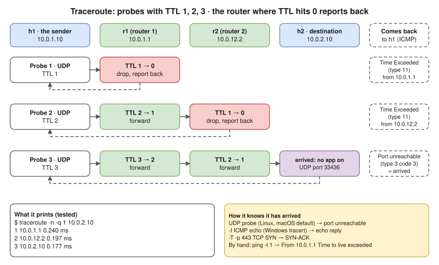
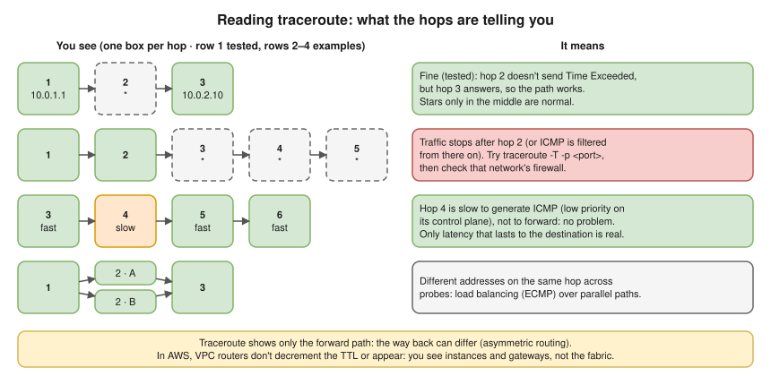
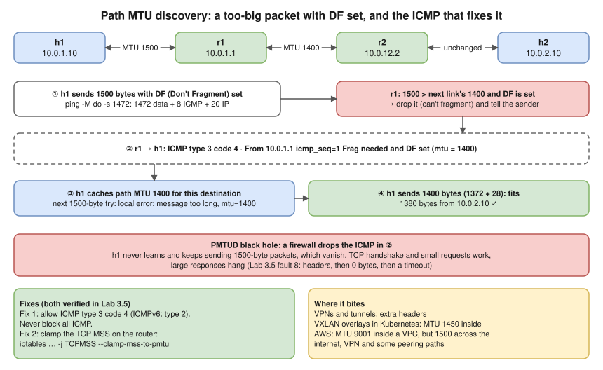

# 3.7 · ICMP, Ping and Traceroute

> **Level 3 · Core networking protocols** · Lesson 7 of 11 · ⏱️ about 75 minutes (estimate) · 🧪 [Lab 2.2](../13-hands-on-labs/lab-02.2-routing-between-two-subnets.md) part C · [Lab 3.5](../13-hands-on-labs/lab-03.5-troubleshooting-challenge.md) fault 8
> ⬅️ [3.6 TLS and certificates](06-tls-and-certificates.md) · ➡️ [3.8 NAT, PAT and port forwarding](08-nat-pat-and-port-forwarding.md)



- **ICMP** is IP's error-report and test channel. It sits **inside IP** (protocol **1**; ICMPv6 is **58**), has **no ports**: each message has a **type** and a **code**.
- Every router decrements the **TTL**; the one that brings it to **0** drops the packet and sends **ICMP Time Exceeded**. ⭐ **Traceroute is that, automated**: TTL 1, 2, 3 … and list who reports back.
- `ping` tests **IP reachability and RTT, not services**: ping failing doesn't mean "host down", ping working doesn't mean "the app works".
- **Path MTU discovery** needs ICMP "fragmentation needed". Block it and connections open but **big transfers hang**.

## ICMP messages

| Type | Code | Name | You see it as |
|---|---|---|---|
| 8 / 0 | 0 | **Echo request / echo reply** | `ping` |
| 3 | 0 | Destination unreachable: **net** | `Destination Net Unreachable` (a router has no route) |
| 3 | 1 | Destination unreachable: **host** | `Destination Host Unreachable` (ARP for the last hop failed) |
| 3 | 3 | Destination unreachable: **port** | A closed **UDP** port ([3.2](02-tcp-and-udp.md)); also how traceroute knows it arrived |
| 3 | 4 | **Fragmentation needed and DF set** | `Frag needed … (mtu = 1400)`: the heart of Path MTU discovery |
| 3 | 13 | Communication administratively prohibited | A firewall rejected it |
| 5 | | Redirect | "Use another gateway" (usually ignored or disabled) |
| 11 | 0 | **Time exceeded** in transit | `Time to live exceeded`: what traceroute relies on |

**IPv6:** ICMPv6 type **2 "Packet Too Big"** replaces "fragmentation needed", and Neighbor Discovery (types 133–137) replaces ARP ([2.6](../02-ip-addressing-and-subnetting/06-ipv6-fundamentals.md)). Blocking ICMPv6 breaks IPv6.

## Ping

`h1` → `h2`, two routers apart **(tested in the lab container)**:

```console
$ ping -c 2 10.0.2.10
PING 10.0.2.10 (10.0.2.10) 56(84) bytes of data.
64 bytes from 10.0.2.10: icmp_seq=1 ttl=62 time=0.039 ms
64 bytes from 10.0.2.10: icmp_seq=2 ttl=62 time=0.056 ms

--- 10.0.2.10 ping statistics ---
2 packets transmitted, 2 received, 0% packet loss, time 1008ms
rtt min/avg/max/mdev = 0.039/0.047/0.056/0.008 ms
```

| Part | Meaning |
|---|---|
| `56(84) bytes` | 56 bytes of data; 84 with the ICMP (8) and IP (20) headers |
| `icmp_seq` | Sequence number. **Gaps** = lost packets; **out of order** = reordering |
| `ttl=62` | The reply's remaining TTL. Linux starts at 64, so the reply crossed **2 routers** (Windows starts at 128, many routers at 255) |
| `time` · `mdev` | Round-trip time · its variation, a rough **jitter** figure ([1.4](../01-networking-fundamentals/04-network-performance.md)) |
| `+2 errors` | ICMP errors came back instead of replies (e.g. unreachable) |

**Ping failing ≠ host down.** With `h2` dropping echo requests, its web server still answers **(tested in the lab container)**. Windows Firewall blocks ping by default; AWS security groups don't allow ICMP unless you add a rule. Test the real port (`nc -zv`, `curl`):

```console
$ ping -c 2 -W 1 10.0.2.10
2 packets transmitted, 0 received, 100% packet loss, time 1014ms
$ curl -s -o /dev/null -w 'HTTP %{http_code}\n' http://10.0.2.10:8080/
HTTP 200
```

## Traceroute and TTL

The diagram above by hand: TTL 1 dies at r1, TTL 2 at r2 **(tested in the lab container)**:

```console
$ ping -c 1 -t 1 10.0.2.10
From 10.0.1.1 icmp_seq=1 Time to live exceeded
$ ping -c 1 -t 2 10.0.2.10
From 10.0.12.2 icmp_seq=1 Time to live exceeded
```

Linux `traceroute` sends **UDP** probes to high ports; a lab capture matched the diagram, ending in `udp port 33436 unreachable` (Linux also sends later probes in parallel). All three probe types gave the same 3 hops **(tested in the lab container)**:

| Tool / option | Probe | Use when |
|---|---|---|
| `traceroute` (Linux, macOS default) | UDP to high ports | Default |
| `traceroute -I` / Windows `tracert` | ICMP echo | UDP is filtered |
| `traceroute -T -p 443` (Linux, needs root) | TCP SYN to a real port | Firewalls only allow the service port; the best match for "can my app's traffic get there?" |
| `mtr` | Repeated traceroute with loss and latency **per hop** | Intermittent loss |



- `*` = no reply for that probe. Stars only in the **middle** are normal; stars from some hop **to the end** mean traffic stops after the last answering hop. The silent hop, with `r2` dropping its own Time Exceeded messages **(tested in the lab container)**:

  ```text
   1  10.0.1.1  0.025 ms
   2  *
   3  10.0.2.10  0.011 ms
  ```
- One slow middle hop is that router answering ICMP slowly, not a problem; only latency that **continues** to the destination is real. Different addresses on one hop = **ECMP** load balancing.
- Traceroute shows only the **forward** path (the return can differ). In **AWS**, VPC routers don't decrement the TTL or appear: you see instances and gateways, not the fabric.

## MTU and Path MTU discovery



Each link has an **MTU** (1500 on Ethernet). Too big for the next link: the router **fragments**, or, if **Don't Fragment (DF)** is set (TCP sets it on Linux and most systems), **drops** it and returns ICMP "fragmentation needed" with the smaller MTU. The sender lowers its size for that destination: **PMTUD**. In the lab, the r1–r2 link was set to MTU 1400 **(tested in the lab container)**:

```console
$ ping -c 1 -M do -s 1472 10.0.2.10        # 1472 data + 8 ICMP + 20 IP = 1500
From 10.0.1.1 icmp_seq=1 Frag needed and DF set (mtu = 1400)
$ ping -c 1 -M do -s 1472 10.0.2.10        # again: the host has now cached the path MTU
ping: local error: message too long, mtu=1400
$ ping -c 1 -M do -s 1372 10.0.2.10        # 1372 + 28 = 1400: fits
1380 bytes from 10.0.2.10: icmp_seq=1 ttl=62 time=0.038 ms
```

`tracepath` finds the path MTU hop by hop **(tested in the lab container)**:

```text
 1?: [LOCALHOST]                      pmtu 1500
 1:  10.0.1.1                                              0.036ms
 2:  10.0.1.1                                              0.005ms pmtu 1400
 2:  10.0.12.2                                             0.013ms
 3:  10.0.2.10                                             0.013ms reached
     Resume: pmtu 1400 hops 3 back 3
```

**The PMTUD black hole:** a firewall drops the "fragmentation needed", the sender keeps sending full-size packets, and they vanish. **The handshake and small requests work, large responses hang** ([Lab 3.5](../13-hands-on-labs/lab-03.5-troubleshooting-challenge.md) fault 8: a 200 KB download returns headers, then 0 bytes, then times out **(tested in the lab container)**). Two fixes, both verified there:

1. **Allow ICMP type 3 code 4** (and ICMPv6 type 2) through firewalls. Never block all ICMP: allow at least frag-needed / packet-too-big and time-exceeded.
2. **Clamp the TCP MSS** on the router so TCP never sends segments too big for the path:

   ```bash
   iptables -t mangle -A FORWARD -p tcp --tcp-flags SYN,RST SYN -j TCPMSS --clamp-mss-to-pmtu
   ```

Where it bites: **VPNs and tunnels** (extra headers), **VXLAN overlays** in Kubernetes (MTU 1450 inside), **AWS** (MTU 9001 inside a VPC, but 1500 across the internet, VPN and some peering paths).

## Where you meet it

| Where | What to know |
|---|---|
| AWS | Security groups block inbound ICMP by default: allow "ICMP – echo request" (or All ICMP) to ping. AWS also recommends allowing **"Destination Unreachable: fragmentation required"** so PMTUD works between 9001-MTU instances and 1500-MTU paths |
| Kubernetes | Pinging a **ClusterIP** usually fails (with kube-proxy in iptables mode, the virtual IP only exists as rules for the Service's TCP/UDP ports). Test Services with `curl`/`nc` |
| Load balancers | They don't answer ping on behalf of backends; an ALB answering doesn't mean targets are healthy |

## Try it

**On your Mac:**

```bash
ping -c 4 8.8.8.8
ping -c 2 -D -s 1472 8.8.8.8       # DF set (-D); does a 1500-byte packet get through?
traceroute -n 8.8.8.8              # UDP probes
traceroute -n -I 8.8.8.8           # ICMP probes
```

**On Linux:**

```bash
ping -c 4 8.8.8.8
ping -c 2 -M do -s 1472 8.8.8.8    # DF set (-M do)
traceroute -n 8.8.8.8
sudo traceroute -n -T -p 443 example.com   # TCP SYN probes to port 443
tracepath -n example.com           # path MTU
mtr -rwc 20 8.8.8.8                # per-hop loss and latency (install mtr)
```

## Troubleshooting

| You see | It means | Next step |
|---|---|---|
| `Destination Host Unreachable` from your own IP | ARP for the next hop failed | [2.7](../02-ip-addressing-and-subnetting/07-default-gateway-routing-table-and-arp.md): gateway/host on the link? |
| `Destination Net Unreachable` from a router | That router has no route | Its routing table |
| `Time to live exceeded` from a router (normal ping) | A **routing loop** | `traceroute`: the same addresses repeating |
| 100% loss, no errors | Dropped silently (firewall, ICMP blocked, return path missing) | Test a TCP port; capture on the far end |
| Small requests work, large downloads hang | **MTU / PMTUD black hole** | `ping -M do -s 1472`, `tracepath`, MSS clamping |
| traceroute stars from hop N to the end | Traffic stops after hop N (or ICMP filtered there) | `traceroute -T -p <port>`; check that network's firewall |
| Testing MTU with plain `ping` shows nothing | Fragmentation hides the problem | Set DF (`-M do` on Linux, `-D` on macOS) and the size |

## Interview angle

- ⭐ **"How does traceroute work?"** → Probes with TTL 1, 2, 3…; each router that drops a probe at TTL 0 sends ICMP time exceeded; the destination answers port unreachable (UDP) or echo reply (ICMP) or SYN-ACK (TCP).
- **"Ping fails but the website loads. How?"** → ICMP is filtered; HTTP isn't. Ping is not a service check.
- ⭐ **"Connections open but large transfers hang."** → MTU mismatch with blocked ICMP (PMTUD black hole). Test with DF pings; fix by allowing ICMP frag-needed or clamping MSS.
- **"What's TTL for?"** → Stops packets looping for ever; each router decrements it; traceroute exploits it. Also hints at the OS (64 Linux/macOS, 128 Windows).
- **"Why `*` in traceroute?"** → That hop doesn't send (or rate-limits, or a firewall drops) time-exceeded messages; not necessarily a problem.

## Check yourself

1. A reply shows `ttl=55`, and the server runs Linux. Roughly how many routers are in the return path?
2. Which ICMP message tells traceroute that a probe reached the destination when using UDP probes?
3. What's the largest `-s` value for which `ping -M do` succeeds on a path with MTU 1500?
4. Traceroute shows hop 4 at 180 ms, and hops 5–9 at 25 ms. Is there a problem at hop 4?
5. Why does an SSH session work over a VPN, but `scp` of a big file stalls immediately?

<details>
<summary><b>Answers</b> (try first)</summary>

1. 64 − 55 = **9 routers** (assuming it started at 64).
2. **Destination unreachable, port unreachable** (type 3 code 3).
3. **1472** (1472 + 8 ICMP + 20 IP = 1500).
4. **No.** Hop 4 is slow to *generate* ICMP; traffic through it is fine, since later hops are fast.
5. A likely **PMTUD black hole**: the VPN lowers the path MTU, the ICMP "fragmentation needed" is blocked, and full-size packets of the big transfer are silently dropped. Fix with MSS clamping or allowing the ICMP.

</details>

➡️ **Next:** [3.8 · NAT, PAT and port forwarding](08-nat-pat-and-port-forwarding.md): how many private addresses share one public address, and how port forwarding works.
